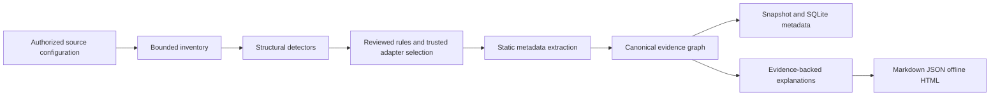

# Product brief, architecture and decisions

Pipeline Handbook helps a new data engineer answer: What technologies appear in
this authorized scope? What feeds this output? Which definition owns the
relationship? Which supplied components, deployment references and connections
explain the existing environment? Where should I inspect next? What is still unknown?

The product is an extensible local discovery and onboarding tool. Its evidence
graph preserves environments, service namespaces and source provenance. It does
not invent purpose, ownership, safe recovery instructions or execution history.
Human business interpretation comes from separately reviewed annotations. Recovered
architecture findings are a projection of the supplied evidence, separate from
recommendations or a prescribed target architecture.

## MVP scope

The first release analyzes local files and offline exports. Five reference
adapters cover Pentaho XML, shell/cron, a conservative PostgreSQL SQL subset,
Airflow Python AST and dbt manifest v12. Detection-only entries widen discovery
without implying analyzer support. Multiple technologies may be detected in one
artifact, and multiple eligible adapters may inspect it.
The additive 2026-10-30 architecture extension adds two reference adapters for
normalized Docker Compose JSON and a versioned environment-map declaration. These
extend local metadata coverage; they do not establish runtime observations or
native proprietary report parsing.

JSON is the implemented configuration/rule format. The conceptual YAML contract
is represented by versioned JSON schemas. Network metadata APIs, runtime run
ingestion, a complete SQL parser and vendor compatibility certification are
outside this MVP. The application works without all vendor runtimes.

## Processing lifecycle

Inventory yields artifacts, content hashes and coverage findings. Detectors use
structural signals, imports, configuration fields or dependency declarations.
Documentation terms yield mention-level evidence. File extensions alone never
establish a technology. Unknown files remain inventoried.

The registry separates detectors, declarative mappings/explanation templates,
and executable adapters. Rules select eligible trusted implementations; scanned
content cannot provide import paths. Configuration supplies trust and override
policy. Priority provides deterministic order, while conflicts remain visible.
An adapter failure is a local coverage finding, not a reason to erase other
analysis results.

## Canonical model and identity

Nodes represent source systems, pipelines, tasks, datasets, columns, schedules,
components, deployment resources, reports/forms and, when supported in future,
runs. Typed edges distinguish data flow, column lineage, control flow, invocation,
containment, schedules, deployment and explicit configured connections.
An edge always points from an upstream source to a downstream target for its
stated semantics; containment and invocation do not silently become data lineage.

Dataset identity includes environment, service namespace and qualified name.
Definition/task identity includes source context and a qualified definition name.
Matching names across DEV/PROD or independent services do not merge. Literal
cross-file references resolve only inside the same authorized source; dynamic
or unresolved references become findings. No basename guessing creates a link.
The additive environment-map binding interface can link extracted endpoints across
authorized sources in the same environment using exact kind/name/namespace/source/
artifact selectors. It retains both endpoint and binding evidence and cannot
bypass filters, create a missing asset or infer a link from name similarity.

Every generated fact carries evidence IDs. Evidence records a sanitized relative
location, original source hash, collector timestamp, adapter/rule versions and
status. Status distinguishes declared, observed, inferred and unknown. Definitions
produce declared evidence; the bundled fixtures contain no observed vendor runs.
Declared client versions remain distinct from unknown server versions.
Inspection time is distinct from a source export's own generation/collection
time. For example, the bundled PostgreSQL version export is dated 2026-01-15;
scanning it later does not make its version a current live observation.
Structured evidence can additionally retain an `object_path` JSON pointer alongside
the source-relative line location, making normalized export facts inspectable.

## Inspection boundaries

Inputs are explicit configured scopes. Inventory refuses symlink escape and
keeps generated output separate. Size, total-byte, file-count and timeout budgets
bound collection. Unsafe XML entity/DOCTYPE input is rejected. JSON parsing is
bounded. Python is parsed as AST, never imported. SQL and shell are treated as
text in restricted static grammars, never executed.

Redaction occurs before persisted metadata, cache/store/report output. Raw source
text is transient and absent from snapshots. Published locations omit absolute
host paths. Sensitive literals and known credential forms are redacted; labeled
fake secret canaries test the implemented patterns. Unknown secret formats remain
a practical limitation, so public examples use synthetic inputs only.

Trusted adapter workers have bounded time/resources and return validated canonical
facts. Application audit guards reject process/socket use, filesystem writes,
target-file reads and dynamic execution; structured in-memory results are the only
output retained. They are reviewed executable project components. These guards are not a complete
OS security sandbox for arbitrary malicious plugins. The application never
automatically installs, downloads or trusts adapters found in scanned content.
There are no live connectors, telemetry or outbound AI calls in this release.

## ADR 001: standard-library local CLI

**Decision:** Python 3.11+, `argparse`, SQLite, JSON, AST and restricted XML/text
parsing. Use `unittest` and synthetic exports.

**Reason:** a newcomer can reproduce the portfolio without account setup,
dependency installation or vendor services. Source-tool support stays separate
from the implementation language.

**Tradeoff:** JSON replaces YAML in the initial implementation. A small strict
schema validator supports the schema features used here, not all JSON Schema.
Conservative SQL parsing intentionally declines complex syntax. A future parser
dependency requires version/license review and expanded labeled fixtures.

## ADR 002: evidence-first model, separate flows

**Decision:** every asset, relationship and explanation refers to provenance;
data flow, control flow, runtime and business interpretation remain distinct.

**Reason:** a transformation hop, job hop and Airflow dependency have different
semantics. A convincing diagram without support boundaries is misleading.

**Tradeoff:** incomplete graphs are expected. Unknown/dynamic constructs and
conflicts are first-class findings that require additional exports or review.

## ADR 003: explicit registry and trust

**Decision:** constrained schema-validated rule packs provide detectors,
normalized-concept mappings and explanation templates. Complex parsing requires
an adapter implementing SDK v1. Executable plugins are explicitly configured and
trusted by exact ID outside scanned scopes.

**Reason:** adding a detector or adapter should not require rewriting the core,
and scanned data must not become an executable instruction.

**Tradeoff:** only signal kinds and mapping concepts already implemented by the
core can be added declaratively. YAML/JSON cannot invent a parser.

## ADR 004: reparse and reproducible semantic snapshots

**Decision:** re-inventory and reparse on every scan; do not reuse an extraction
cache. Store sanitized snapshots and a local SQLite metadata record.

**Reason:** the small MVP favors trustworthy invalidation over premature speed.
Semantic identity incorporates source hashes, effective configuration, rule,
adapter, schema and Python grammar fingerprints. Host paths are excluded from
component identity. Timestamps and elapsed metrics do not create semantic
changes. `diff` reports changes in facts rather than collection time alone.
`status --config <reviewed-config.json>` rechecks inventory hashes and the current
registry/configuration against the latest snapshot without analyzing workflows.
It reports added/changed/removed artifacts and whether coverage was complete.

**Tradeoff:** unchanged inputs are parsed again. Large repositories need a future
content-addressed extraction cache whose key includes all these inputs.

## ADR 005: recover architecture as a derived evidence view

**Decision:** project an architecture view from the existing canonical snapshot.
Two registry-selected static parsers add supplied component/deployment/report
metadata. Exact deferred bindings resolve only after eligible extraction. The
projection itself reads no extra sources and makes no network calls.

**Reason:** onboarding needs a component/technology-role view and a guided path
from outputs to producers and inspection points. These should explain what the
evidence describes, without imposing standard layers or converting data ancestry
into execution order.

**Tradeoff:** the view is bounded by supplied definitions, declarations and tested
parsers. A Compose project group is not a proven security boundary; a configured
connection is not successful communication. Missing deployment/runtime/ownership/
log evidence remains explicit. Recommendations are a separate collection and are
empty in this milestone. See the [recovery guide](architecture-recovery.md).

## Milestone checkpoints

1. Inventory/registry/configuration: validate schemas; prove misleading filenames
   do not identify a tool; preserve documentation-only and unknown artifacts.
2. Reference adapters: compare canonical graphs with manual fixture expectations;
   verify technology-specific hop/dependency direction and declared conditions.
3. Cross-tool evidence: resolve only literal references, preserve environment
   identity and report dynamic or inaccessible definitions.
4. Handbook/change tracking: generate all formats, resolve evidence anchors,
   preserve reviewed annotations and compare semantic snapshots.
5. Verification: secret/no-execution adversarial fixtures, extension tests,
   labeled detection/graph metrics and documented new-joiner questions.
6. Architecture recovery: components/technology roles, declared topology, exact
   bindings, source-object provenance, separate workflow inspection sequences,
   explicit unknowns and backwards-compatible handbook rendering.

The test suite and evaluation output are the evidence for completed checkpoints;
the backlog lists capabilities not established by these tests.
