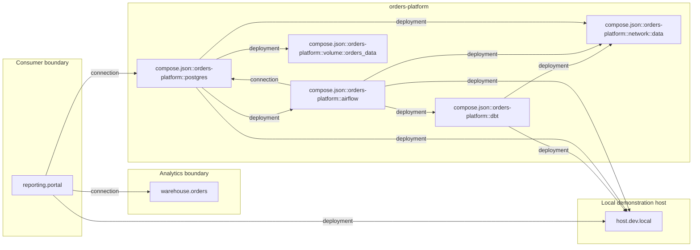
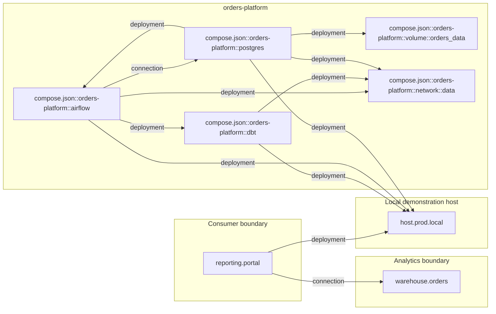
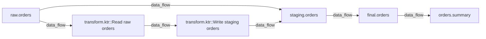
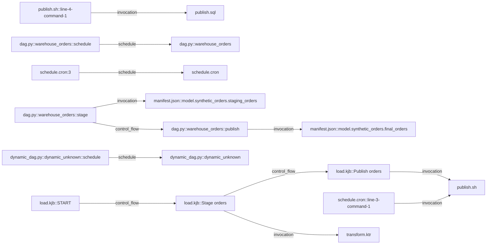

```mermaid
graph LR
  item_e1bf68e9ed9330ed8d["staging.orders"]
  item_1c62383ff4ec6716c5["DEMO.STAGING.ORDERS"]
  item_c073d9d6f676e19df8["raw.orders"]
  item_c6e2a8b57bc64604ff["DEMO.RAW.ORDERS"]
  item_9b0bc07025f4380f81["final.orders"]
  item_7233ee05d402349ef8["DEMO.FINAL.ORDERS"]
  item_98a50e783a2ee7bfd8["manifest.json::model.synthetic_orders.staging_orders"]
  item_5739590a49f3a608dd["manifest.json::model.synthetic_orders.final_orders"]
  item_4479f300ee7ce86a62["orders.review_form"]
  item_02cf79a867e81a38ff["orders.summary"]
  item_fe3e0f6b003027b83d["transform.ktr::Read raw orders"]
  item_5fbae2e2a1a7f149f3["transform.ktr::Write staging orders"]
  item_1c62383ff4ec6716c5 -->|data_flow| item_7233ee05d402349ef8
  item_fe3e0f6b003027b83d -->|data_flow| item_5fbae2e2a1a7f149f3
  item_7233ee05d402349ef8 -->|data_flow| item_02cf79a867e81a38ff
  item_9b0bc07025f4380f81 -->|data_flow| item_4479f300ee7ce86a62
  item_1c62383ff4ec6716c5 -->|data_flow| item_5739590a49f3a608dd
  item_5fbae2e2a1a7f149f3 -->|data_flow| item_e1bf68e9ed9330ed8d
  item_c6e2a8b57bc64604ff -->|data_flow| item_1c62383ff4ec6716c5
  item_c073d9d6f676e19df8 -->|data_flow| item_e1bf68e9ed9330ed8d
  item_c6e2a8b57bc64604ff -->|data_flow| item_98a50e783a2ee7bfd8
  item_e1bf68e9ed9330ed8d -->|data_flow| item_9b0bc07025f4380f81
  item_5739590a49f3a608dd -->|data_flow| item_7233ee05d402349ef8
  item_98a50e783a2ee7bfd8 -->|data_flow| item_1c62383ff4ec6716c5
  item_c073d9d6f676e19df8 -->|data_flow| item_fe3e0f6b003027b83d
```

# Pipeline Handbook · pipeline_handbook_architecture_recovery

## Start Here

Inspected: 2026-10-30T00:59:40+00:00. Snapshot age at generation: 0.0 days. Age alone does not establish source freshness. Regenerate after source changes. File hashes describe this scan; the saved page does not recheck the inputs. Source exports may predate this inspection: their generated/collected timestamps describe the supplied export, not an observed live system. Static definitions do not prove deployment or successful execution.

1. Check technology and environment inventory.
2. Choose an output in the asset dictionary and trace upstream data flow.
3. Open the evidence locations to find the responsible code or job.
4. Read control-flow conditions and coverage findings before drawing operational conclusions.

Static definitions do not prove successful execution. Business meaning, ownership and safe recovery procedures require reviewed evidence.

## Recovered architecture overview

This reconstructs the supplied evidence; it is not a prescribed target architecture. Declared deployment/connection references do not prove running services or successful communication.

### Recovered findings

| Finding | Status | Evidence IDs |
| --- | --- | --- |
| The supplied snapshot contains 34 inventoried artifacts in 6 authorized scopes, 12 supported pipeline definitions and 3 declared report/form consumers. Boundaries are recovered from source identity and explicit metadata; no predefined layers are imposed. | inferred | \["evidence:0353ae32bc79e8c5129d10f3", "evidence:070ef7648797e51051af156c", "evidence:0982b4c2cf0cd7368c9ec122", "evidence:09bf1e79f1ba383ddffb26e7", "evidence:0a3a7b7c0622612c47e2d202", "evidence:0c7ddbc34b2322cb13564205", "evidence:0e02f12ef8adb4efe9232e2d", "evidence:109af7d36e8a8e0757c3c3b1", "evidence:11644456f0f688f5a72b5711", "evidence:11da3e4da9d445c24c66715e", "evidence:1249a256bbe6746bc0b0d781", "evidence:15e1847d66d57edc678f0e1a", "evidence:1823a4c1a410c3687aa9fad6", "evidence:18bd51248e471a92eb80a336", "evidence:19067ebead599fa6890bdaef", "evidence:1d5d5cd0ebb09eddb15ac240", "evidence:1df844ebbde2fc9038eaecab", "evidence:1e7b7035f6325f70cd6354d5", "evidence:20df1c6b2e879ae25cbc3f71", "evidence:2461c8a6d2462a98a20a1453", "evidence:2a3df0d1ae871f02e6035fd7", "evidence:2cbfdd8e92fdfce95d254ed5", "evidence:2d9de3d655a211f4d48dd30b", "evidence:2ea5e9f521e6eb8f4c3815e9", "evidence:3351633f5425ade3c60ac309", "evidence:3dcdc28184491604bd11475b", "evidence:3e2229462c8c857b9060689e", "evidence:3ff0c5c9ead4e25b984782c7", "evidence:40eecd144dec95d5fc175381", "evidence:41211d91cddff01f680039d9", "evidence:41a0940e1667d3ef14276ebe", "evidence:430202c35ef244ef49dd721b", "evidence:45defc36886855b1ab458936", "evidence:477540fa844b831aba991afc", "evidence:4ace6e01b921fd8a1b70d64e", "evidence:4d060ea913df58ae45ebc87a", "evidence:4d733e40169ff8934bef4f8e", "evidence:528ace4379c825dbb3a9b41f", "evidence:586e8fc844ab17164481e7fb", "evidence:58c607abd1d53c12f358ab16", "evidence:5941a300e2fa49cf5a117bb1", "evidence:5945efc8a9772deb66931c8b", "evidence:59f6e96645ebaabede92ee6c", "evidence:5af4af09569d15df45c6b815", "evidence:5c4fba626533fecc653b8ca3", "evidence:5cdb1a821694f2b5a478cb57", "evidence:5df2d03ff5e27a8a5c357314", "evidence:5eedb3c70aa07cd616e8dfae", "evidence:5f99413bf458f8715aa24230", "evidence:60f3e05fdaea5fbbad1143c1", "evidence:64738098dbc70f3a960bceae", "evidence:6892f12a9a73db41ccac869a", "evidence:6bdd8f19f3bc5b5e3d11bc6f", "evidence:6c5be98d16f332f41442268b", "evidence:6c65c3d0dc23c32e9fc9fa0f", "evidence:6f6d4d0302a1c2d4b59510d2", "evidence:7553cecd8ae4977dabb27289", "evidence:78d56061e5dbc0dfc103ec7f", "evidence:80c17a5428bdbb9f3e788cf3", "evidence:8685e91ee0733be4d296d4c4", "evidence:868f530ab28153922d7c1966", "evidence:86cfe125da9682adcaaf6fbc", "evidence:89e51250259e1be94c8efb8f", "evidence:8e69839264a6a97cf7e691f3", "evidence:8f4458749351f6d855f2ae55", "evidence:8ff3dd854f40ec042a659474", "evidence:905894d00228ede4f0379366", "evidence:912152a2f14758cd6268f0e7", "evidence:921bf9b5bf173401594801b3", "evidence:9413c1564edb20a926bbe253", "evidence:941a1ad4843c362d9b3cffb6", "evidence:973c2fb4119fe8347abd2124", "evidence:98811427968c8bfcd20d67ba", "evidence:99ee9c96287e68afcc40382b", "evidence:9bb70a4c9f1cfe99769d0562", "evidence:9d6e510d3b1ea73eef0a3460", "evidence:a017019412e341d4a2b1540a", "evidence:a4bd7ec0078e8b4574c9a665", "evidence:a68b395ab8dbfbc35078d7f3", "evidence:a7defa680fcca98413315d47", "evidence:a8d5ada5a0e510b59ae11eb3", "evidence:a8e0cac44a390c15f9195e79", "evidence:a9d8d80856901656a0b03f60", "evidence:aa24d58f2ec6ba0de5493c82", "evidence:ab92868619dc9da2db0ce76e", "evidence:abad13f2b14fbf651b0a5c64", "evidence:ade06e901714f077e134037f", "evidence:ae934e6325604229600a56d5", "evidence:b0416b460c6570511af40965", "evidence:b1c310ab31e010743396acd2", "evidence:b261a4e82614e38257923249", "evidence:b3bcce12853e44c738490ab7", "evidence:b4208a46bfb4a229b95ec1b8", "evidence:b557cc3c2cfcb2332573d148", "evidence:b7a1686f08437c0cb0603e85", "evidence:b8b288f0a0a6a84836fc676b", "evidence:ba807f4c9db7fab5237c7408", "evidence:bb660d1b8cb3a7c11b76bd84", "evidence:bc399d1ed830236abacdfc52", "evidence:bd928724965a3969984591cd", "evidence:be26a66a5eaf19b86a61aa55", "evidence:be90f3356bfaa9be8d284417", "evidence:bf3cec88ee998903a880198e", "evidence:c49c52fe3f96e58d3f2bfed9", "evidence:c4af29d604c779b5bf03a18b", "evidence:c8dd39e7f400bd062b22c8a1", "evidence:cbeca7797010849c02bad188", "evidence:cc389cbfa96ce5f9e80e48a2", "evidence:d0873ac3e50ae7a117def5eb", "evidence:d1ff5efa51a5aac4dfbe2117", "evidence:d5964c87e91ef285af094cd6", "evidence:d5cae390ac101ce6e5bd79b8", "evidence:d6f9ed68552fa2b186fef0bc", "evidence:d753b743f1d059b8de45eadc", "evidence:df898aca04cb33ff4555d9c0", "evidence:e24851e6898bd059aef2e208", "evidence:e2b7a60682294e500874de3c", "evidence:e496d17b3b29fe91d59b2208", "evidence:e585ed62b791db42a8c63304", "evidence:e5f03133024f4d0db5b74a1f", "evidence:e924925ac4918483ed4766e6", "evidence:e99ab946595612835a4a3fee", "evidence:f0302ffa86f013ce711c5452", "evidence:f1144e103c19ff1eaf553e11", "evidence:f29f3f052b384ab79190a548", "evidence:f2a204b8a4522fd670902be3", "evidence:f88e781d1cd231440adb23e8", "evidence:fd12daffdca7f26ff7633b66"\] |


### Components and found boundaries

| Component / group | Environment | Boundary | Location | Recovered role | Status | Evidence IDs |
| --- | --- | --- | --- | --- | --- | --- |
| compose.json::orders-platform::volume::orders_data | prod | orders-platform | unknown | compose.json::orders-platform::volume::orders_data is a declared deployment_resource in prod. Boundary: orders-platform. Location: unknown. Deployment and runtime state are unverified. | declared | \["evidence:df898aca04cb33ff4555d9c0"\] |
| compose.json::orders-platform::postgres | prod | orders-platform | unknown | compose.json::orders-platform::postgres is a declared component in prod. Boundary: orders-platform. Location: unknown. Deployment and runtime state are unverified. | declared | \["evidence:912152a2f14758cd6268f0e7"\] |
| host.prod.local | prod | Local demonstration host | synthetic://prod/lab-node-01 | host.prod.local is a declared deployment_resource in prod. Boundary: Local demonstration host. Location: synthetic://prod/lab-node-01. Deployment and runtime state are unverified. | declared | \["evidence:3dcdc28184491604bd11475b"\] |
| compose.json::orders-platform::airflow | prod | orders-platform | unknown | compose.json::orders-platform::airflow is a declared component in prod. Boundary: orders-platform. Location: unknown. Deployment and runtime state are unverified. | declared | \["evidence:868f530ab28153922d7c1966"\] |
| compose.json::orders-platform::volume::orders_data | dev | orders-platform | unknown | compose.json::orders-platform::volume::orders_data is a declared deployment_resource in dev. Boundary: orders-platform. Location: unknown. Deployment and runtime state are unverified. | declared | \["evidence:78d56061e5dbc0dfc103ec7f"\] |
| warehouse.orders | dev | Analytics boundary | conflicting declarations; inspect all source evidence | warehouse.orders is a declared component in dev. Boundary: Analytics boundary. Location: conflicting declarations; inspect all source evidence. Deployment and runtime state are unverified. | unknown | \["evidence:6892f12a9a73db41ccac869a", "evidence:ade06e901714f077e134037f"\] |
| reporting.portal | dev | Consumer boundary | synthetic://dev/portal | reporting.portal is a declared component in dev. Boundary: Consumer boundary. Location: synthetic://dev/portal. Deployment and runtime state are unverified. | declared | \["evidence:1df844ebbde2fc9038eaecab"\] |
| orders.review_form | dev | unknown | unknown | orders.review_form is a declared report in dev. Boundary: unknown. Location: unknown. Deployment and runtime state are unverified. | declared | \["evidence:b0416b460c6570511af40965"\] |
| unplaced.worker | dev | Unplaced processing | unknown | unplaced.worker is a declared component in dev. Boundary: Unplaced processing. Location: unknown. Deployment and runtime state are unverified. | declared | \["evidence:e924925ac4918483ed4766e6"\] |
| host.dev.local | dev | Local demonstration host | synthetic://dev/lab-node-01 | host.dev.local is a declared deployment_resource in dev. Boundary: Local demonstration host. Location: synthetic://dev/lab-node-01. Deployment and runtime state are unverified. | declared | \["evidence:bd928724965a3969984591cd"\] |
| warehouse.orders | prod | Analytics boundary | metadata-export://synthetic/prod/warehouse | warehouse.orders is a declared component in prod. Boundary: Analytics boundary. Location: metadata-export://synthetic/prod/warehouse. Deployment and runtime state are unverified. | declared | \["evidence:f88e781d1cd231440adb23e8"\] |
| orders.summary | dev | unknown | unknown | orders.summary is a declared report in dev. Boundary: unknown. Location: unknown. Deployment and runtime state are unverified. | declared | \["evidence:d5964c87e91ef285af094cd6"\] |
| compose.json::orders-platform::network::data | prod | orders-platform | unknown | compose.json::orders-platform::network::data is a declared deployment_resource in prod. Boundary: orders-platform. Location: unknown. Deployment and runtime state are unverified. | declared | \["evidence:b4208a46bfb4a229b95ec1b8"\] |
| orders.summary | prod | unknown | unknown | orders.summary is a declared report in prod. Boundary: unknown. Location: unknown. Deployment and runtime state are unverified. | declared | \["evidence:f2a204b8a4522fd670902be3"\] |
| compose.json::orders-platform::dbt | dev | orders-platform | unknown | compose.json::orders-platform::dbt is a declared component in dev. Boundary: orders-platform. Location: unknown. Deployment and runtime state are unverified. | declared | \["evidence:a4bd7ec0078e8b4574c9a665"\] |
| compose.json::orders-platform::postgres | dev | orders-platform | unknown | compose.json::orders-platform::postgres is a declared component in dev. Boundary: orders-platform. Location: unknown. Deployment and runtime state are unverified. | declared | \["evidence:18bd51248e471a92eb80a336"\] |
| compose.json::orders-platform::dbt | prod | orders-platform | unknown | compose.json::orders-platform::dbt is a declared component in prod. Boundary: orders-platform. Location: unknown. Deployment and runtime state are unverified. | declared | \["evidence:aa24d58f2ec6ba0de5493c82"\] |
| compose.json::orders-platform::airflow | dev | orders-platform | unknown | compose.json::orders-platform::airflow is a declared component in dev. Boundary: orders-platform. Location: unknown. Deployment and runtime state are unverified. | declared | \["evidence:8ff3dd854f40ec042a659474"\] |
| compose.json::orders-platform::network::data | dev | orders-platform | unknown | compose.json::orders-platform::network::data is a declared deployment_resource in dev. Boundary: orders-platform. Location: unknown. Deployment and runtime state are unverified. | declared | \["evidence:d5cae390ac101ce6e5bd79b8"\] |
| reporting.portal | prod | Consumer boundary | synthetic://prod/portal | reporting.portal is a declared component in prod. Boundary: Consumer boundary. Location: synthetic://prod/portal. Deployment and runtime state are unverified. | declared | \["evidence:2d9de3d655a211f4d48dd30b"\] |
| legacy_orders | prod | authorized source legacy_prod | actual deployment unknown | legacy_prod groups 2 supported pipeline definitions under configured service legacy_orders. This source boundary does not establish a deployment or architectural layer. | inferred | \["evidence:5941a300e2fa49cf5a117bb1", "evidence:a7defa680fcca98413315d47"\] |
| analytics_warehouse | dev | authorized source modern_dev | actual deployment unknown | modern_dev groups 5 supported pipeline definitions under configured service analytics_warehouse. This source boundary does not establish a deployment or architectural layer. | inferred | \["evidence:1249a256bbe6746bc0b0d781", "evidence:973c2fb4119fe8347abd2124", "evidence:9bb70a4c9f1cfe99769d0562", "evidence:a8e0cac44a390c15f9195e79", "evidence:e496d17b3b29fe91d59b2208"\] |
| legacy_orders | dev | authorized source legacy_dev | actual deployment unknown | legacy_dev groups 5 supported pipeline definitions under configured service legacy_orders. This source boundary does not establish a deployment or architectural layer. | inferred | \["evidence:11da3e4da9d445c24c66715e", "evidence:60f3e05fdaea5fbbad1143c1", "evidence:89e51250259e1be94c8efb8f", "evidence:a68b395ab8dbfbc35078d7f3", "evidence:e5f03133024f4d0db5b74a1f"\] |


### Technology roles

| Technology | Environment | Category / analysis | Recovered role | Evidence IDs |
| --- | --- | --- | --- | --- |
| pentaho | dev | {"analysis": \["analyzed_subset"\], "category": "recognized"} | pentaho evidence in legacy_dev contributes 4 column definitions, 2 dataset definitions, 2 pipeline definitions, 5 task definitions. Definition examples: load.kjb, transform.ktr. These describe the supported declared role; execution and deployment remain unverified. | \["evidence:0353ae32bc79e8c5129d10f3", "evidence:11da3e4da9d445c24c66715e", "evidence:15e1847d66d57edc678f0e1a", "evidence:3ff0c5c9ead4e25b984782c7", "evidence:477540fa844b831aba991afc", "evidence:4ace6e01b921fd8a1b70d64e", "evidence:60f3e05fdaea5fbbad1143c1", "evidence:8f4458749351f6d855f2ae55", "evidence:a017019412e341d4a2b1540a", "evidence:a8d5ada5a0e510b59ae11eb3", "evidence:ae934e6325604229600a56d5", "evidence:b1c310ab31e010743396acd2", "evidence:b7a1686f08437c0cb0603e85", "evidence:bb660d1b8cb3a7c11b76bd84", "evidence:be90f3356bfaa9be8d284417", "evidence:c4af29d604c779b5bf03a18b", "evidence:d6f9ed68552fa2b186fef0bc", "evidence:e2b7a60682294e500874de3c"\] |
| postgresql | prod | {"analysis": \["analyzed_subset", "detection_only"\], "category": "recognized"} | postgresql evidence in legacy_prod contributes 4 column definitions, 2 dataset definitions, 1 pipeline definitions. Definition examples: publish.sql. These describe the supported declared role; execution and deployment remain unverified. | \["evidence:0982b4c2cf0cd7368c9ec122", "evidence:09bf1e79f1ba383ddffb26e7", "evidence:2cbfdd8e92fdfce95d254ed5", "evidence:2ea5e9f521e6eb8f4c3815e9", "evidence:528ace4379c825dbb3a9b41f", "evidence:586e8fc844ab17164481e7fb", "evidence:5cdb1a821694f2b5a478cb57", "evidence:6c5be98d16f332f41442268b", "evidence:a7defa680fcca98413315d47", "evidence:a9d8d80856901656a0b03f60", "evidence:b557cc3c2cfcb2332573d148", "evidence:cc389cbfa96ce5f9e80e48a2"\] |
| snowflake | dev | {"analysis": \["detection_only"\], "category": "mentioned"} | snowflake is mentioned in documentation in modern_dev; its environment role and deployment are unverified. | \["evidence:fd12daffdca7f26ff7633b66"\] |
| docker | prod | {"analysis": \["analyzed_subset"\], "category": "declared"} | docker evidence in arch_prod contributes 3 component definitions, 2 deployment_resource definitions. Definition examples: compose.json::orders-platform::airflow, compose.json::orders-platform::dbt, compose.json::orders-platform::postgres. These describe the supported declared role; execution and deployment remain unverified. | \["evidence:41a0940e1667d3ef14276ebe", "evidence:868f530ab28153922d7c1966", "evidence:912152a2f14758cd6268f0e7", "evidence:aa24d58f2ec6ba0de5493c82", "evidence:b4208a46bfb4a229b95ec1b8", "evidence:df898aca04cb33ff4555d9c0"\] |
| cron | dev | {"analysis": \["analyzed_subset"\], "category": "recognized"} | cron evidence in legacy_dev contributes 1 pipeline definitions, 1 schedule definitions, 1 task definitions. Definition examples: schedule.cron. These describe the supported declared role; execution and deployment remain unverified. | \["evidence:89e51250259e1be94c8efb8f", "evidence:99ee9c96287e68afcc40382b", "evidence:bc399d1ed830236abacdfc52", "evidence:d0873ac3e50ae7a117def5eb"\] |
| environment-map | dev | {"analysis": \["analyzed_subset"\], "category": "ambiguous"} | environment-map has ambiguous evidence in arch_dev, with no supported graph extraction from those artifacts. Its operational role is unknown; dependency or detection alone is insufficient. | \["evidence:8e69839264a6a97cf7e691f3"\] |
| tableau | dev | {"analysis": \["detection_only"\], "category": "mentioned"} | tableau is mentioned in documentation in legacy_dev; its environment role and deployment are unverified. | \["evidence:3351633f5425ade3c60ac309"\] |
| snowflake | dev | {"analysis": \["detection_only"\], "category": "declared"} | snowflake has declared evidence in modern_dev, with no supported graph extraction from those artifacts. Its operational role is unknown; dependency or detection alone is insufficient. | \["evidence:5af4af09569d15df45c6b815", "evidence:5c4fba626533fecc653b8ca3"\] |
| shell | dev | {"analysis": \["analyzed_subset"\], "category": "recognized"} | shell evidence in legacy_dev contributes 1 pipeline definitions, 1 task definitions. Definition examples: publish.sh. These describe the supported declared role; execution and deployment remain unverified. | \["evidence:1d5d5cd0ebb09eddb15ac240", "evidence:58c607abd1d53c12f358ab16", "evidence:a68b395ab8dbfbc35078d7f3"\] |
| environment-map | prod | {"analysis": \["analyzed_subset"\], "category": "declared"} | environment-map evidence in arch_prod contributes 2 component definitions, 1 deployment_resource definitions, 1 report definitions. Definition examples: orders.summary, reporting.portal, warehouse.orders. These describe the supported declared role; execution and deployment remain unverified. | \["evidence:2d9de3d655a211f4d48dd30b", "evidence:3dcdc28184491604bd11475b", "evidence:ba807f4c9db7fab5237c7408", "evidence:f2a204b8a4522fd670902be3", "evidence:f88e781d1cd231440adb23e8"\] |
| docker | dev | {"analysis": \["detection_only"\], "category": "declared"} | docker has declared evidence in legacy_dev, with no supported graph extraction from those artifacts. Its operational role is unknown; dependency or detection alone is insufficient. | \["evidence:f1144e103c19ff1eaf553e11"\] |
| dbt | dev | {"analysis": \["analyzed_subset"\], "category": "recognized"} | dbt evidence in modern_dev contributes 6 column definitions, 3 dataset definitions, 3 pipeline definitions. Definition examples: manifest.json::model.synthetic_orders.final_orders, manifest.json::model.synthetic_orders.staging_orders, manifest.json::synthetic_orders. These describe the supported declared role; execution and deployment remain unverified. | \["evidence:070ef7648797e51051af156c", "evidence:0c7ddbc34b2322cb13564205", "evidence:11644456f0f688f5a72b5711", "evidence:1249a256bbe6746bc0b0d781", "evidence:2461c8a6d2462a98a20a1453", "evidence:2a3df0d1ae871f02e6035fd7", "evidence:5df2d03ff5e27a8a5c357314", "evidence:5f99413bf458f8715aa24230", "evidence:8685e91ee0733be4d296d4c4", "evidence:9bb70a4c9f1cfe99769d0562", "evidence:a8e0cac44a390c15f9195e79", "evidence:b8b288f0a0a6a84836fc676b", "evidence:c8dd39e7f400bd062b22c8a1"\] |
| dbt | dev | {"analysis": \["detection_only"\], "category": "mentioned"} | dbt is mentioned in documentation in modern_dev; its environment role and deployment are unverified. | \["evidence:d753b743f1d059b8de45eadc"\] |
| python | dev | {"analysis": \["detection_only"\], "category": "mentioned"} | python is mentioned in documentation in modern_dev; its environment role and deployment are unverified. | \["evidence:40eecd144dec95d5fc175381", "evidence:bf3cec88ee998903a880198e"\] |
| kafka | dev | {"analysis": \["detection_only"\], "category": "mentioned"} | kafka is mentioned in documentation in legacy_dev; its environment role and deployment are unverified. | \["evidence:c49c52fe3f96e58d3f2bfed9"\] |
| docker | dev | {"analysis": \["analyzed_subset"\], "category": "declared"} | docker evidence in arch_dev contributes 3 component definitions, 2 deployment_resource definitions. Definition examples: compose.json::orders-platform::airflow, compose.json::orders-platform::dbt, compose.json::orders-platform::postgres. These describe the supported declared role; execution and deployment remain unverified. | \["evidence:18bd51248e471a92eb80a336", "evidence:45defc36886855b1ab458936", "evidence:78d56061e5dbc0dfc103ec7f", "evidence:8ff3dd854f40ec042a659474", "evidence:a4bd7ec0078e8b4574c9a665", "evidence:d5cae390ac101ce6e5bd79b8"\] |
| python | dev | {"analysis": \["detection_only"\], "category": "recognized"} | python has recognized evidence in modern_dev, with no supported graph extraction from those artifacts. Its operational role is unknown; dependency or detection alone is insufficient. | \["evidence:430202c35ef244ef49dd721b", "evidence:941a1ad4843c362d9b3cffb6"\] |
| postgresql | dev | {"analysis": \["detection_only"\], "category": "mentioned"} | postgresql is mentioned in documentation in legacy_dev; its environment role and deployment are unverified. | \["evidence:abad13f2b14fbf651b0a5c64"\] |
| pentaho | prod | {"analysis": \["analyzed_subset"\], "category": "recognized"} | pentaho evidence in legacy_prod contributes 4 column definitions, 2 dataset definitions, 1 pipeline definitions, 2 task definitions. Definition examples: transform.ktr. These describe the supported declared role; execution and deployment remain unverified. | \["evidence:0982b4c2cf0cd7368c9ec122", "evidence:09bf1e79f1ba383ddffb26e7", "evidence:109af7d36e8a8e0757c3c3b1", "evidence:528ace4379c825dbb3a9b41f", "evidence:5941a300e2fa49cf5a117bb1", "evidence:5cdb1a821694f2b5a478cb57", "evidence:64738098dbc70f3a960bceae", "evidence:7553cecd8ae4977dabb27289", "evidence:921bf9b5bf173401594801b3", "evidence:a9d8d80856901656a0b03f60", "evidence:cbeca7797010849c02bad188", "evidence:cc389cbfa96ce5f9e80e48a2", "evidence:f29f3f052b384ab79190a548"\] |
| airflow | dev | {"analysis": \["detection_only"\], "category": "declared"} | airflow has declared evidence in modern_dev, with no supported graph extraction from those artifacts. Its operational role is unknown; dependency or detection alone is insufficient. | \["evidence:b3bcce12853e44c738490ab7"\] |
| dbt | dev | {"analysis": \["detection_only"\], "category": "declared"} | dbt has declared evidence in modern_dev, with no supported graph extraction from those artifacts. Its operational role is unknown; dependency or detection alone is insufficient. | \["evidence:4d060ea913df58ae45ebc87a"\] |
| environment-map | dev | {"analysis": \["analyzed_subset"\], "category": "declared"} | environment-map evidence in arch_dev contributes 3 component definitions, 1 deployment_resource definitions, 2 report definitions. Definition examples: orders.review_form, orders.summary, reporting.portal, unplaced.worker. These describe the supported declared role; execution and deployment remain unverified. | \["evidence:19067ebead599fa6890bdaef", "evidence:1df844ebbde2fc9038eaecab", "evidence:41211d91cddff01f680039d9", "evidence:6892f12a9a73db41ccac869a", "evidence:6bdd8f19f3bc5b5e3d11bc6f", "evidence:86cfe125da9682adcaaf6fbc", "evidence:ade06e901714f077e134037f", "evidence:b0416b460c6570511af40965", "evidence:bd928724965a3969984591cd", "evidence:d5964c87e91ef285af094cd6", "evidence:e924925ac4918483ed4766e6"\] |
| python | test | {"analysis": \["detection_only"\], "category": "recognized"} | python has recognized evidence in adversarial, with no supported graph extraction from those artifacts. Its operational role is unknown; dependency or detection alone is insufficient. | \["evidence:98811427968c8bfcd20d67ba"\] |
| airflow | dev | {"analysis": \["analyzed_subset"\], "category": "recognized"} | airflow evidence in modern_dev contributes 2 pipeline definitions, 2 schedule definitions, 2 task definitions. Definition examples: dag.py::warehouse_orders, dynamic_dag.py::dynamic_unknown. These describe the supported declared role; execution and deployment remain unverified. | \["evidence:0a3a7b7c0622612c47e2d202", "evidence:1823a4c1a410c3687aa9fad6", "evidence:5eedb3c70aa07cd616e8dfae", "evidence:80c17a5428bdbb9f3e788cf3", "evidence:973c2fb4119fe8347abd2124", "evidence:ab92868619dc9da2db0ce76e", "evidence:d1ff5efa51a5aac4dfbe2117", "evidence:e496d17b3b29fe91d59b2208"\] |
| postgresql | dev | {"analysis": \["analyzed_subset", "detection_only"\], "category": "recognized"} | postgresql evidence in legacy_dev contributes 4 column definitions, 2 dataset definitions, 1 pipeline definitions. Definition examples: publish.sql. These describe the supported declared role; execution and deployment remain unverified. | \["evidence:0353ae32bc79e8c5129d10f3", "evidence:20df1c6b2e879ae25cbc3f71", "evidence:3ff0c5c9ead4e25b984782c7", "evidence:4ace6e01b921fd8a1b70d64e", "evidence:5945efc8a9772deb66931c8b", "evidence:6c65c3d0dc23c32e9fc9fa0f", "evidence:9413c1564edb20a926bbe253", "evidence:b261a4e82614e38257923249", "evidence:b7a1686f08437c0cb0603e85", "evidence:be26a66a5eaf19b86a61aa55", "evidence:be90f3356bfaa9be8d284417", "evidence:d6f9ed68552fa2b186fef0bc", "evidence:e5f03133024f4d0db5b74a1f"\] |
| postgresql | dev | {"analysis": \["detection_only"\], "category": "declared"} | postgresql has declared evidence in legacy_dev, with no supported graph extraction from those artifacts. Its operational role is unknown; dependency or detection alone is insufficient. | \["evidence:3e2229462c8c857b9060689e", "evidence:e585ed62b791db42a8c63304"\] |
| shell | dev | {"analysis": \["detection_only"\], "category": "mentioned"} | shell is mentioned in documentation in legacy_dev; its environment role and deployment are unverified. | \["evidence:59f6e96645ebaabede92ee6c"\] |
| airflow | dev | {"analysis": \["detection_only"\], "category": "mentioned"} | airflow is mentioned in documentation in modern_dev; its environment role and deployment are unverified. | \["evidence:905894d00228ede4f0379366"\] |
| pentaho | dev | {"analysis": \["detection_only"\], "category": "mentioned"} | pentaho is mentioned in documentation in legacy_dev; its environment role and deployment are unverified. | \["evidence:0e02f12ef8adb4efe9232e2d"\] |
| dbt | test | {"analysis": \["analyzed_subset"\], "category": "recognized"} | dbt has recognized evidence in adversarial, with no supported graph extraction from those artifacts. Its operational role is unknown; dependency or detection alone is insufficient. | \["evidence:f0302ffa86f013ce711c5452"\] |


## Deployment and connection map

Only found environments and supplied boundary/project labels are grouped. Project labels do not prove physical or security isolation. These relationships are distinct from data flow and control flow. A missing boundary is recorded as unknown, not filled with a preferred architecture.

### dev



| From | To | Kind | Status | Evidence IDs |
| --- | --- | --- | --- | --- |
| compose.json::orders-platform::dbt | compose.json::orders-platform::network::data | deployment | declared | \["evidence:523ec381d1032fe184b8e69c"\] |
| compose.json::orders-platform::airflow | compose.json::orders-platform::network::data | deployment | declared | \["evidence:75608c6cc0cd0465dd2fb3fa"\] |
| reporting.portal | compose.json::orders-platform::postgres | connection | declared | \["evidence:18bd51248e471a92eb80a336", "evidence:1df844ebbde2fc9038eaecab", "evidence:fe94aac7ecfa78e881f7efc1"\] |
| compose.json::orders-platform::dbt | host.dev.local | deployment | declared | \["evidence:743a884fbcf0ac8be07d030e", "evidence:a4bd7ec0078e8b4574c9a665", "evidence:bd928724965a3969984591cd"\] |
| compose.json::orders-platform::airflow | compose.json::orders-platform::postgres | connection | declared | \["evidence:04ecdc8251e4ca907faee7aa", "evidence:18bd51248e471a92eb80a336", "evidence:8ff3dd854f40ec042a659474"\] |
| compose.json::orders-platform::postgres | host.dev.local | deployment | declared | \["evidence:18bd51248e471a92eb80a336", "evidence:76b67a6d67c8a9a031414d71", "evidence:bd928724965a3969984591cd"\] |
| compose.json::orders-platform::postgres | compose.json::orders-platform::airflow | deployment | declared | \["evidence:87e891db164dfc99769c45e7"\] |
| compose.json::orders-platform::postgres | compose.json::orders-platform::volume::orders_data | deployment | declared | \["evidence:b4a8d9ee6c51adde9f743dff"\] |
| compose.json::orders-platform::airflow | host.dev.local | deployment | declared | \["evidence:3d4da00f22cca1f8b5794534", "evidence:8ff3dd854f40ec042a659474", "evidence:bd928724965a3969984591cd"\] |
| compose.json::orders-platform::airflow | compose.json::orders-platform::dbt | deployment | declared | \["evidence:ade0080e9414065a22ed4515"\] |
| compose.json::orders-platform::postgres | compose.json::orders-platform::network::data | deployment | declared | \["evidence:470151c81552bf1643804062"\] |
| reporting.portal | warehouse.orders | connection | declared | \["evidence:1df844ebbde2fc9038eaecab", "evidence:6892f12a9a73db41ccac869a", "evidence:ade06e901714f077e134037f", "evidence:ecefaeeb2b4454bcb9bf14fe"\] |
| reporting.portal | host.dev.local | deployment | declared | \["evidence:1df844ebbde2fc9038eaecab", "evidence:bd928724965a3969984591cd", "evidence:e95e5a075fe9464bca47856f"\] |


### prod



| From | To | Kind | Status | Evidence IDs |
| --- | --- | --- | --- | --- |
| compose.json::orders-platform::dbt | host.prod.local | deployment | declared | \["evidence:3dcdc28184491604bd11475b", "evidence:aa24d58f2ec6ba0de5493c82", "evidence:c5befae3ba732c492e1992fb"\] |
| compose.json::orders-platform::airflow | host.prod.local | deployment | declared | \["evidence:228afa1a0a80695513d9b248", "evidence:3dcdc28184491604bd11475b", "evidence:868f530ab28153922d7c1966"\] |
| compose.json::orders-platform::airflow | compose.json::orders-platform::network::data | deployment | declared | \["evidence:76c94cd0e4272045135e1ca6"\] |
| reporting.portal | host.prod.local | deployment | declared | \["evidence:2d9de3d655a211f4d48dd30b", "evidence:3dcdc28184491604bd11475b", "evidence:41363cc5c7228154fe69febd"\] |
| compose.json::orders-platform::postgres | host.prod.local | deployment | declared | \["evidence:3dcdc28184491604bd11475b", "evidence:912152a2f14758cd6268f0e7", "evidence:a7d241fdff2bedc294dee373"\] |
| compose.json::orders-platform::dbt | compose.json::orders-platform::network::data | deployment | declared | \["evidence:89335ad902281cb7b91e3d19"\] |
| compose.json::orders-platform::airflow | compose.json::orders-platform::postgres | connection | declared | \["evidence:31c04e5bae775d2e580b4c9b", "evidence:868f530ab28153922d7c1966", "evidence:912152a2f14758cd6268f0e7"\] |
| compose.json::orders-platform::airflow | compose.json::orders-platform::dbt | deployment | declared | \["evidence:0fcf49c97792bf34a89a20ba"\] |
| compose.json::orders-platform::postgres | compose.json::orders-platform::network::data | deployment | declared | \["evidence:52815d6f9b0a03cee38a416c"\] |
| reporting.portal | warehouse.orders | connection | declared | \["evidence:2d9de3d655a211f4d48dd30b", "evidence:f3a43d752f9c699759e52791", "evidence:f88e781d1cd231440adb23e8"\] |
| compose.json::orders-platform::postgres | compose.json::orders-platform::airflow | deployment | declared | \["evidence:3d45514dbe826e58db3c099c"\] |
| compose.json::orders-platform::postgres | compose.json::orders-platform::volume::orders_data | deployment | declared | \["evidence:43ce9a47562f4e2482e55666"\] |


## Workflow walkthroughs

Numbered data steps are an inspection sequence through data ancestry, not execution order. Actual declared controls and schedules are separate.

<a id="item-78553572421fb5538c"></a>
### DEMO.FINAL.ORDERS

Trace DEMO.FINAL.ORDERS in dev/analytics_warehouse through supported data ancestry, then inspect separately declared controls and triggers.

Output: [DEMO.FINAL.ORDERS](#item-7233ee05d402349ef8)

Evidence: [Eb0d781](#item-800eb0914ef8326e5c), [Eaa12e4](#item-cca3ab1a875f8366cf), [Efdae5d](#item-f0f05a3d2af12e8612), [Eb32fc2](#item-5549add0871f0f6eb1), [E4548d9](#item-56f4d7944773bd8fef), [E788cf3](#item-ef81ce75bb1fc6c0aa), [E9d0562](#item-3079fd9b087233cf89), [E0ce76e](#item-60d86e14f2748c6d49), [E22c8a1](#item-6b7b4cbd361572fb29), [Eca7e5d](#item-a8d323ea4da3435b86)

#### Data ancestry — inspection sequence

1. DEMO.RAW.ORDERS → manifest.json::model.synthetic_orders.staging_orders: supported data dependency; actual data movement is unverified. [declared]. [DEMO.RAW.ORDERS](#item-c6e2a8b57bc64604ff) · [manifest.json::model.synthetic_orders.staging_orders](#item-98a50e783a2ee7bfd8) [Eca7e5d](#item-a8d323ea4da3435b86)

2. DEMO.RAW.ORDERS → DEMO.STAGING.ORDERS: supported data dependency; actual data movement is unverified. [declared]. [DEMO.RAW.ORDERS](#item-c6e2a8b57bc64604ff) · [DEMO.STAGING.ORDERS](#item-1c62383ff4ec6716c5) [Eca7e5d](#item-a8d323ea4da3435b86)

3. manifest.json::model.synthetic_orders.staging_orders → DEMO.STAGING.ORDERS: supported data dependency; actual data movement is unverified. [declared]. [manifest.json::model.synthetic_orders.staging_orders](#item-98a50e783a2ee7bfd8) · [DEMO.STAGING.ORDERS](#item-1c62383ff4ec6716c5) [Eca7e5d](#item-a8d323ea4da3435b86)

4. DEMO.STAGING.ORDERS → manifest.json::model.synthetic_orders.final_orders: supported data dependency; actual data movement is unverified. [declared]. [DEMO.STAGING.ORDERS](#item-1c62383ff4ec6716c5) · [manifest.json::model.synthetic_orders.final_orders](#item-5739590a49f3a608dd) [Eca7e5d](#item-a8d323ea4da3435b86)

5. DEMO.STAGING.ORDERS → DEMO.FINAL.ORDERS: supported data dependency; actual data movement is unverified. [declared]. [DEMO.STAGING.ORDERS](#item-1c62383ff4ec6716c5) · [DEMO.FINAL.ORDERS](#item-7233ee05d402349ef8) [Eca7e5d](#item-a8d323ea4da3435b86)

6. manifest.json::model.synthetic_orders.final_orders → DEMO.FINAL.ORDERS: supported data dependency; actual data movement is unverified. [declared]. [manifest.json::model.synthetic_orders.final_orders](#item-5739590a49f3a608dd) · [DEMO.FINAL.ORDERS](#item-7233ee05d402349ef8) [Eca7e5d](#item-a8d323ea4da3435b86)

7. Definition on the supported data path: manifest.json::model.synthetic_orders.staging_orders \(pipeline\). Inspect its source evidence; no execution is established. [inferred]. [manifest.json::model.synthetic_orders.staging_orders](#item-98a50e783a2ee7bfd8) [Eb0d781](#item-800eb0914ef8326e5c), [Eca7e5d](#item-a8d323ea4da3435b86)

8. Definition on the supported data path: manifest.json::model.synthetic_orders.final_orders \(pipeline\). Inspect its source evidence; no execution is established. [inferred]. [manifest.json::model.synthetic_orders.final_orders](#item-5739590a49f3a608dd) [E9d0562](#item-3079fd9b087233cf89), [Eca7e5d](#item-a8d323ea4da3435b86)

#### Actual declared control dependencies

- dag.py::warehouse_orders::stage → dag.py::warehouse_orders::publish: declared task dependency; this does not establish data movement or successful execution. [Efdae5d](#item-f0f05a3d2af12e8612)

#### Definition invocation references

- dag.py::warehouse_orders::publish → manifest.json::model.synthetic_orders.final_orders: declared reference to a workflow definition; execution is unverified. Configuration relation: reviewed exact task-to-model binding. [E4548d9](#item-56f4d7944773bd8fef), [E9d0562](#item-3079fd9b087233cf89), [E0ce76e](#item-60d86e14f2748c6d49)
- dag.py::warehouse_orders::stage → manifest.json::model.synthetic_orders.staging_orders: declared reference to a workflow definition; execution is unverified. Configuration relation: reviewed exact task-to-model binding. [Eb0d781](#item-800eb0914ef8326e5c), [Eaa12e4](#item-cca3ab1a875f8366cf), [E788cf3](#item-ef81ce75bb1fc6c0aa)

#### Schedules and conditions

- dag.py::warehouse_orders::schedule → dag.py::warehouse_orders: declared trigger; no run is established. Declared schedule expression: 0 3 * * *. Timezone and actual runs require their own evidence. [Eb32fc2](#item-5549add0871f0f6eb1)

#### Configured deployment and connection context

No configured deployment or connection evidence linked to this output; placement and communication remain unverified.

#### Where to inspect

| Inspection point | Location | Object pointer | Status | Evidence IDs |
| --- | --- | --- | --- | --- |
| Inspect the authorized definition at modern_dev/manifest.json:L1. Verify the recorded source hash and analyzer version. | modern_dev/manifest.json:L1 | not supplied | declared | \["evidence:0c7ddbc34b2322cb13564205"\] |
| Inspect the authorized definition at modern_dev/manifest.json:L1. Verify the recorded source hash and analyzer version. | modern_dev/manifest.json:L1 | not supplied | declared | \["evidence:9bb70a4c9f1cfe99769d0562"\] |
| Inspect the authorized definition at modern_dev/manifest.json:L1. Verify the recorded source hash and analyzer version. | modern_dev/manifest.json:L1 | not supplied | declared | \["evidence:1249a256bbe6746bc0b0d781"\] |
| Inspect the authorized definition at modern_dev/dag.py:L7. Verify the recorded source hash and analyzer version. | modern_dev/dag.py:L7 | not supplied | declared | \["evidence:ab92868619dc9da2db0ce76e"\] |
| Inspect the authorized definition at modern_dev/manifest.json:L1. Verify the recorded source hash and analyzer version. | modern_dev/manifest.json:L1 | not supplied | declared | \["evidence:a8e0cac44a390c15f9195e79"\] |
| Inspect the authorized definition at modern_dev/dag.py:L5. Verify the recorded source hash and analyzer version. | modern_dev/dag.py:L5 | not supplied | declared | \["evidence:5eedb3c70aa07cd616e8dfae"\] |
| Inspect the authorized definition at modern_dev/manifest.json:L1. Verify the recorded source hash and analyzer version. | modern_dev/manifest.json:L1 | not supplied | declared | \["evidence:2a3df0d1ae871f02e6035fd7"\] |
| Inspect the authorized definition at modern_dev/manifest.json:L1. Verify the recorded source hash and analyzer version. | modern_dev/manifest.json:L1 | not supplied | declared | \["evidence:c8dd39e7f400bd062b22c8a1"\] |
| Inspect the authorized definition at modern_dev/dag.py:L6. Verify the recorded source hash and analyzer version. | modern_dev/dag.py:L6 | not supplied | declared | \["evidence:80c17a5428bdbb9f3e788cf3"\] |
| Inspect the authorized definition at modern_dev/dag.py:L5. Verify the recorded source hash and analyzer version. | modern_dev/dag.py:L5 | not supplied | declared | \["evidence:e496d17b3b29fe91d59b2208"\] |


#### Limits

- Data ancestry is presented for inspection, not as an execution sequence.
- Static definitions and exported declarations do not prove deployment, communication or successful execution.
- Business purpose, original design rationale, ownership, SLAs and recovery steps require reviewed human evidence.
- Log and validation inspection locations are unknown for this trace.

<a id="item-ebe240c13fdf3bd56c"></a>
### DEMO.RAW.ORDERS

Trace DEMO.RAW.ORDERS in dev/analytics_warehouse through supported data ancestry, then inspect separately declared controls and triggers.

Output: [DEMO.RAW.ORDERS](#item-c6e2a8b57bc64604ff)

Evidence: [E564205](#item-32b759985f412c4dd0)

#### Data ancestry — inspection sequence

No supported upstream data ancestry recovered.

#### Actual declared control dependencies

No control dependency evidence linked to this output.

#### Definition invocation references

No exact invocation reference linked to this output.

#### Schedules and conditions

No schedule evidence linked to this output.

#### Configured deployment and connection context

No configured deployment or connection evidence linked to this output; placement and communication remain unverified.

#### Where to inspect

| Inspection point | Location | Object pointer | Status | Evidence IDs |
| --- | --- | --- | --- | --- |
| Inspect the authorized definition at modern_dev/manifest.json:L1. Verify the recorded source hash and analyzer version. | modern_dev/manifest.json:L1 | not supplied | declared | \["evidence:0c7ddbc34b2322cb13564205"\] |


#### Limits

- Data ancestry is presented for inspection, not as an execution sequence.
- Static definitions and exported declarations do not prove deployment, communication or successful execution.
- Business purpose, original design rationale, ownership, SLAs and recovery steps require reviewed human evidence.
- No supported incoming data dependency was extracted; source origin is unknown rather than proven external or absent.
- No supported trigger was resolved for this output; schedules may exist outside available evidence.
- Log and validation inspection locations are unknown for this trace.

<a id="item-97e2c567f95b19e3cc"></a>
### DEMO.STAGING.ORDERS

Trace DEMO.STAGING.ORDERS in dev/analytics_warehouse through supported data ancestry, then inspect separately declared controls and triggers.

Output: [DEMO.STAGING.ORDERS](#item-1c62383ff4ec6716c5)

Evidence: [Eb0d781](#item-800eb0914ef8326e5c), [E035fd7](#item-5ae4c2f62fcdda8c84), [Eaa12e4](#item-cca3ab1a875f8366cf), [Efdae5d](#item-f0f05a3d2af12e8612), [Eb32fc2](#item-5549add0871f0f6eb1), [E4548d9](#item-56f4d7944773bd8fef), [E788cf3](#item-ef81ce75bb1fc6c0aa), [E9d0562](#item-3079fd9b087233cf89), [E0ce76e](#item-60d86e14f2748c6d49), [Eca7e5d](#item-a8d323ea4da3435b86)

#### Data ancestry — inspection sequence

1. DEMO.RAW.ORDERS → manifest.json::model.synthetic_orders.staging_orders: supported data dependency; actual data movement is unverified. [declared]. [DEMO.RAW.ORDERS](#item-c6e2a8b57bc64604ff) · [manifest.json::model.synthetic_orders.staging_orders](#item-98a50e783a2ee7bfd8) [Eca7e5d](#item-a8d323ea4da3435b86)

2. DEMO.RAW.ORDERS → DEMO.STAGING.ORDERS: supported data dependency; actual data movement is unverified. [declared]. [DEMO.RAW.ORDERS](#item-c6e2a8b57bc64604ff) · [DEMO.STAGING.ORDERS](#item-1c62383ff4ec6716c5) [Eca7e5d](#item-a8d323ea4da3435b86)

3. manifest.json::model.synthetic_orders.staging_orders → DEMO.STAGING.ORDERS: supported data dependency; actual data movement is unverified. [declared]. [manifest.json::model.synthetic_orders.staging_orders](#item-98a50e783a2ee7bfd8) · [DEMO.STAGING.ORDERS](#item-1c62383ff4ec6716c5) [Eca7e5d](#item-a8d323ea4da3435b86)

4. Definition on the supported data path: manifest.json::model.synthetic_orders.staging_orders \(pipeline\). Inspect its source evidence; no execution is established. [inferred]. [manifest.json::model.synthetic_orders.staging_orders](#item-98a50e783a2ee7bfd8) [Eb0d781](#item-800eb0914ef8326e5c), [Eca7e5d](#item-a8d323ea4da3435b86)

#### Actual declared control dependencies

- dag.py::warehouse_orders::stage → dag.py::warehouse_orders::publish: declared task dependency; this does not establish data movement or successful execution. [Efdae5d](#item-f0f05a3d2af12e8612)

#### Definition invocation references

- dag.py::warehouse_orders::publish → manifest.json::model.synthetic_orders.final_orders: declared reference to a workflow definition; execution is unverified. Configuration relation: reviewed exact task-to-model binding. [E4548d9](#item-56f4d7944773bd8fef), [E9d0562](#item-3079fd9b087233cf89), [E0ce76e](#item-60d86e14f2748c6d49)
- dag.py::warehouse_orders::stage → manifest.json::model.synthetic_orders.staging_orders: declared reference to a workflow definition; execution is unverified. Configuration relation: reviewed exact task-to-model binding. [Eb0d781](#item-800eb0914ef8326e5c), [Eaa12e4](#item-cca3ab1a875f8366cf), [E788cf3](#item-ef81ce75bb1fc6c0aa)

#### Schedules and conditions

- dag.py::warehouse_orders::schedule → dag.py::warehouse_orders: declared trigger; no run is established. Declared schedule expression: 0 3 * * *. Timezone and actual runs require their own evidence. [Eb32fc2](#item-5549add0871f0f6eb1)

#### Configured deployment and connection context

No configured deployment or connection evidence linked to this output; placement and communication remain unverified.

#### Where to inspect

| Inspection point | Location | Object pointer | Status | Evidence IDs |
| --- | --- | --- | --- | --- |
| Inspect the authorized definition at modern_dev/manifest.json:L1. Verify the recorded source hash and analyzer version. | modern_dev/manifest.json:L1 | not supplied | declared | \["evidence:0c7ddbc34b2322cb13564205"\] |
| Inspect the authorized definition at modern_dev/manifest.json:L1. Verify the recorded source hash and analyzer version. | modern_dev/manifest.json:L1 | not supplied | declared | \["evidence:9bb70a4c9f1cfe99769d0562"\] |
| Inspect the authorized definition at modern_dev/manifest.json:L1. Verify the recorded source hash and analyzer version. | modern_dev/manifest.json:L1 | not supplied | declared | \["evidence:1249a256bbe6746bc0b0d781"\] |
| Inspect the authorized definition at modern_dev/dag.py:L7. Verify the recorded source hash and analyzer version. | modern_dev/dag.py:L7 | not supplied | declared | \["evidence:ab92868619dc9da2db0ce76e"\] |
| Inspect the authorized definition at modern_dev/manifest.json:L1. Verify the recorded source hash and analyzer version. | modern_dev/manifest.json:L1 | not supplied | declared | \["evidence:a8e0cac44a390c15f9195e79"\] |
| Inspect the authorized definition at modern_dev/dag.py:L5. Verify the recorded source hash and analyzer version. | modern_dev/dag.py:L5 | not supplied | declared | \["evidence:5eedb3c70aa07cd616e8dfae"\] |
| Inspect the authorized definition at modern_dev/manifest.json:L1. Verify the recorded source hash and analyzer version. | modern_dev/manifest.json:L1 | not supplied | declared | \["evidence:2a3df0d1ae871f02e6035fd7"\] |
| Inspect the authorized definition at modern_dev/dag.py:L6. Verify the recorded source hash and analyzer version. | modern_dev/dag.py:L6 | not supplied | declared | \["evidence:80c17a5428bdbb9f3e788cf3"\] |
| Inspect the authorized definition at modern_dev/dag.py:L5. Verify the recorded source hash and analyzer version. | modern_dev/dag.py:L5 | not supplied | declared | \["evidence:e496d17b3b29fe91d59b2208"\] |


#### Limits

- Data ancestry is presented for inspection, not as an execution sequence.
- Static definitions and exported declarations do not prove deployment, communication or successful execution.
- Business purpose, original design rationale, ownership, SLAs and recovery steps require reviewed human evidence.
- Log and validation inspection locations are unknown for this trace.

<a id="item-6eea2323783f07d16e"></a>
### orders.review_form

Trace orders.review_form in dev/arch_dev through supported data ancestry, then inspect separately declared controls and triggers.

Output: [orders.review_form](#item-4479f300ee7ce86a62)

Evidence: [E66715e](#item-101fb26247b18a082a), [Eea921c](#item-f73f5368f6040bb2e9), [E5e0b3e](#item-1f6fb716df8e12d853), [Ec0c793](#item-ddc963cf97d6a35ff9), [E8c97be](#item-b5fee46bc4eb0a35cd), [E162ac8](#item-cd2a17db964545524f), [E0a56d5](#item-9b206e03d3583a2d5a), [Ef40965](#item-8d158c98af2d582127), [E96acd2](#item-6987a37ee6d3f9ed42), [E61aa55](#item-bfe14cc260bf4dab03), [E066d69](#item-2ce11d6e1aa8e1cb70), [E1e3d50](#item-b64af3a45ac2fc6594), [Eb74a1f](#item-9f4bf018abd25be525), [E56f668](#item-4b5d4150eba261bb09)

#### Data ancestry — inspection sequence

1. raw.orders → transform.ktr::Read raw orders: supported data dependency; actual data movement is unverified. [declared]. [raw.orders](#item-c073d9d6f676e19df8) · [transform.ktr::Read raw orders](#item-fe3e0f6b003027b83d) [E56f668](#item-4b5d4150eba261bb09)

2. transform.ktr::Read raw orders → transform.ktr::Write staging orders: supported data dependency; actual data movement is unverified. [declared]. [transform.ktr::Read raw orders](#item-fe3e0f6b003027b83d) · [transform.ktr::Write staging orders](#item-5fbae2e2a1a7f149f3) [E56f668](#item-4b5d4150eba261bb09)

3. raw.orders → staging.orders: supported data dependency; actual data movement is unverified. [declared]. [raw.orders](#item-c073d9d6f676e19df8) · [staging.orders](#item-e1bf68e9ed9330ed8d) [E56f668](#item-4b5d4150eba261bb09)

4. transform.ktr::Write staging orders → staging.orders: supported data dependency; actual data movement is unverified. [declared]. [transform.ktr::Write staging orders](#item-5fbae2e2a1a7f149f3) · [staging.orders](#item-e1bf68e9ed9330ed8d) [E56f668](#item-4b5d4150eba261bb09)

5. staging.orders → final.orders: supported data dependency; actual data movement is unverified. [declared]. [staging.orders](#item-e1bf68e9ed9330ed8d) · [final.orders](#item-9b0bc07025f4380f81) [E1e3d50](#item-b64af3a45ac2fc6594)

6. final.orders → orders.review_form: supported data dependency; actual data movement is unverified. Configuration relation: declared form dataset consumption. [declared]. [final.orders](#item-9b0bc07025f4380f81) · [orders.review_form](#item-4479f300ee7ce86a62) [E162ac8](#item-cd2a17db964545524f), [Ef40965](#item-8d158c98af2d582127), [E61aa55](#item-bfe14cc260bf4dab03)

7. Definition on the supported data path: publish.sql \(pipeline\). Inspect its source evidence; no execution is established. [inferred]. [publish.sql](#item-4428efc86609ef0edf) [E1e3d50](#item-b64af3a45ac2fc6594), [Eb74a1f](#item-9f4bf018abd25be525)

8. Definition on the supported data path: transform.ktr \(pipeline\). Inspect its source evidence; no execution is established. [inferred]. [transform.ktr](#item-499ebd52bbe0b9d12d) [E66715e](#item-101fb26247b18a082a), [E56f668](#item-4b5d4150eba261bb09)

9. Definition on the supported data path: transform.ktr::Read raw orders \(task\). Inspect its source evidence; no execution is established. [inferred]. [transform.ktr::Read raw orders](#item-fe3e0f6b003027b83d) [E0a56d5](#item-9b206e03d3583a2d5a)

10. Definition on the supported data path: transform.ktr::Write staging orders \(task\). Inspect its source evidence; no execution is established. [inferred]. [transform.ktr::Write staging orders](#item-5fbae2e2a1a7f149f3) [E96acd2](#item-6987a37ee6d3f9ed42)

#### Actual declared control dependencies

- load.kjb::START → load.kjb::Stage orders: declared task dependency; this does not establish data movement or successful execution. Condition: unconditional. [Ec0c793](#item-ddc963cf97d6a35ff9)
- load.kjb::Stage orders → load.kjb::Publish orders: declared task dependency; this does not establish data movement or successful execution. Condition: success. [Ec0c793](#item-ddc963cf97d6a35ff9)

#### Definition invocation references

- load.kjb::Publish orders → publish.sh: declared reference to a workflow definition; execution is unverified. [E8c97be](#item-b5fee46bc4eb0a35cd)
- publish.sh::line-4-command-1 → publish.sql: declared reference to a workflow definition; execution is unverified. [Eea921c](#item-f73f5368f6040bb2e9)
- load.kjb::Stage orders → transform.ktr: declared reference to a workflow definition; execution is unverified. [E8c97be](#item-b5fee46bc4eb0a35cd)
- schedule.cron::line-3-command-1 → publish.sh: declared reference to a workflow definition; execution is unverified. [E5e0b3e](#item-1f6fb716df8e12d853)

#### Schedules and conditions

- schedule.cron:3 → schedule.cron: declared trigger; no run is established. Declared schedule expression: 0 2 * * *. Timezone and actual runs require their own evidence. [E066d69](#item-2ce11d6e1aa8e1cb70)

#### Configured deployment and connection context

No configured deployment or connection evidence linked to this output; placement and communication remain unverified.

#### Where to inspect

| Inspection point | Location | Object pointer | Status | Evidence IDs |
| --- | --- | --- | --- | --- |
| Inspect the authorized definition at legacy_dev/transform.ktr:L1. Verify the recorded source hash and analyzer version. | legacy_dev/transform.ktr:L1 | not supplied | declared | \["evidence:b1c310ab31e010743396acd2"\] |
| Inspect the authorized definition at legacy_dev/transform.ktr:L1. Verify the recorded source hash and analyzer version. | legacy_dev/transform.ktr:L1 | not supplied | declared | \["evidence:3ff0c5c9ead4e25b984782c7"\] |
| Inspect the authorized definition at legacy_dev/schedule.cron:L3. Verify the recorded source hash and analyzer version. | legacy_dev/schedule.cron:L3 | not supplied | declared | \["evidence:d0873ac3e50ae7a117def5eb"\] |
| definition: synthetic://dev/forms/orders-review. This location is declared in supplied metadata; its contents and accessibility were not inspected. | synthetic://dev/forms/orders-review | not supplied | declared | \["evidence:b0416b460c6570511af40965"\] |
| Inspect the authorized definition at legacy_dev/publish.sh:L4. Verify the recorded source hash and analyzer version. | legacy_dev/publish.sh:L4 | not supplied | declared | \["evidence:1d5d5cd0ebb09eddb15ac240"\] |
| Inspect the authorized definition at legacy_dev/publish.sql:L1. Verify the recorded source hash and analyzer version. | legacy_dev/publish.sql:L1 | not supplied | declared | \["evidence:be26a66a5eaf19b86a61aa55"\] |
| Inspect the authorized definition at legacy_dev/transform.ktr:L1. Verify the recorded source hash and analyzer version. | legacy_dev/transform.ktr:L1 | not supplied | declared | \["evidence:15e1847d66d57edc678f0e1a"\] |
| Inspect the authorized definition at legacy_dev/publish.sh:L1. Verify the recorded source hash and analyzer version. | legacy_dev/publish.sh:L1 | not supplied | declared | \["evidence:a68b395ab8dbfbc35078d7f3"\] |
| Inspect the authorized definition at legacy_dev/transform.ktr:L1. Verify the recorded source hash and analyzer version. | legacy_dev/transform.ktr:L1 | not supplied | declared | \["evidence:11da3e4da9d445c24c66715e"\] |
| Inspect the authorized definition at legacy_dev/load.kjb:L1. Verify the recorded source hash and analyzer version. | legacy_dev/load.kjb:L1 | not supplied | declared | \["evidence:60f3e05fdaea5fbbad1143c1"\] |
| Inspect the authorized definition at legacy_dev/publish.sql:L1. Verify the recorded source hash and analyzer version. | legacy_dev/publish.sql:L1 | not supplied | declared | \["evidence:e5f03133024f4d0db5b74a1f"\] |
| Inspect the authorized definition at legacy_dev/load.kjb:L1. Verify the recorded source hash and analyzer version. | legacy_dev/load.kjb:L1 | not supplied | declared | \["evidence:bb660d1b8cb3a7c11b76bd84"\] |
| Inspect the authorized definition at arch_dev/environment-map.json:L1 \(object /reports/1\). Verify the recorded source hash and analyzer version. | arch_dev/environment-map.json:L1 | /reports/1 | declared | \["evidence:b0416b460c6570511af40965"\] |
| Inspect the authorized definition at legacy_dev/transform.ktr:L1. Verify the recorded source hash and analyzer version. | legacy_dev/transform.ktr:L1 | not supplied | declared | \["evidence:ae934e6325604229600a56d5"\] |
| Inspect the authorized definition at legacy_dev/load.kjb:L1. Verify the recorded source hash and analyzer version. | legacy_dev/load.kjb:L1 | not supplied | declared | \["evidence:a017019412e341d4a2b1540a"\] |
| Inspect the authorized definition at legacy_dev/publish.sql:L1. Verify the recorded source hash and analyzer version. | legacy_dev/publish.sql:L1 | not supplied | declared | \["evidence:4ace6e01b921fd8a1b70d64e"\] |
| Inspect the authorized definition at legacy_dev/schedule.cron:L1. Verify the recorded source hash and analyzer version. | legacy_dev/schedule.cron:L1 | not supplied | declared | \["evidence:89e51250259e1be94c8efb8f"\] |
| Inspect the authorized definition at legacy_dev/load.kjb:L1. Verify the recorded source hash and analyzer version. | legacy_dev/load.kjb:L1 | not supplied | declared | \["evidence:8f4458749351f6d855f2ae55"\] |
| Inspect the authorized definition at legacy_dev/schedule.cron:L3. Verify the recorded source hash and analyzer version. | legacy_dev/schedule.cron:L3 | not supplied | declared | \["evidence:bc399d1ed830236abacdfc52"\] |


#### Limits

- Data ancestry is presented for inspection, not as an execution sequence.
- Static definitions and exported declarations do not prove deployment, communication or successful execution.
- Business purpose, original design rationale, ownership, SLAs and recovery steps require reviewed human evidence.
- Log and validation inspection locations are unknown for this trace.

<a id="item-33b71b68fbb09c01f4"></a>
### orders.summary

Trace orders.summary in dev/arch_dev through supported data ancestry, then inspect separately declared controls and triggers.

Output: [orders.summary](#item-02cf79a867e81a38ff)

Evidence: [Eb0d781](#item-800eb0914ef8326e5c), [E5fb7d6](#item-53f2775663ea70fd24), [Eaa12e4](#item-cca3ab1a875f8366cf), [Efdae5d](#item-f0f05a3d2af12e8612), [Eb32fc2](#item-5549add0871f0f6eb1), [E4548d9](#item-56f4d7944773bd8fef), [E788cf3](#item-ef81ce75bb1fc6c0aa), [E9d0562](#item-3079fd9b087233cf89), [E0ce76e](#item-60d86e14f2748c6d49), [E22c8a1](#item-6b7b4cbd361572fb29), [E094cd6](#item-c72b8572af0441eb7c), [Eca7e5d](#item-a8d323ea4da3435b86)

#### Data ancestry — inspection sequence

1. DEMO.RAW.ORDERS → manifest.json::model.synthetic_orders.staging_orders: supported data dependency; actual data movement is unverified. [declared]. [DEMO.RAW.ORDERS](#item-c6e2a8b57bc64604ff) · [manifest.json::model.synthetic_orders.staging_orders](#item-98a50e783a2ee7bfd8) [Eca7e5d](#item-a8d323ea4da3435b86)

2. DEMO.RAW.ORDERS → DEMO.STAGING.ORDERS: supported data dependency; actual data movement is unverified. [declared]. [DEMO.RAW.ORDERS](#item-c6e2a8b57bc64604ff) · [DEMO.STAGING.ORDERS](#item-1c62383ff4ec6716c5) [Eca7e5d](#item-a8d323ea4da3435b86)

3. manifest.json::model.synthetic_orders.staging_orders → DEMO.STAGING.ORDERS: supported data dependency; actual data movement is unverified. [declared]. [manifest.json::model.synthetic_orders.staging_orders](#item-98a50e783a2ee7bfd8) · [DEMO.STAGING.ORDERS](#item-1c62383ff4ec6716c5) [Eca7e5d](#item-a8d323ea4da3435b86)

4. DEMO.STAGING.ORDERS → manifest.json::model.synthetic_orders.final_orders: supported data dependency; actual data movement is unverified. [declared]. [DEMO.STAGING.ORDERS](#item-1c62383ff4ec6716c5) · [manifest.json::model.synthetic_orders.final_orders](#item-5739590a49f3a608dd) [Eca7e5d](#item-a8d323ea4da3435b86)

5. DEMO.STAGING.ORDERS → DEMO.FINAL.ORDERS: supported data dependency; actual data movement is unverified. [declared]. [DEMO.STAGING.ORDERS](#item-1c62383ff4ec6716c5) · [DEMO.FINAL.ORDERS](#item-7233ee05d402349ef8) [Eca7e5d](#item-a8d323ea4da3435b86)

6. manifest.json::model.synthetic_orders.final_orders → DEMO.FINAL.ORDERS: supported data dependency; actual data movement is unverified. [declared]. [manifest.json::model.synthetic_orders.final_orders](#item-5739590a49f3a608dd) · [DEMO.FINAL.ORDERS](#item-7233ee05d402349ef8) [Eca7e5d](#item-a8d323ea4da3435b86)

7. DEMO.FINAL.ORDERS → orders.summary: supported data dependency; actual data movement is unverified. Configuration relation: declared dashboard dataset consumption. [declared]. [DEMO.FINAL.ORDERS](#item-7233ee05d402349ef8) · [orders.summary](#item-02cf79a867e81a38ff) [E5fb7d6](#item-53f2775663ea70fd24), [E22c8a1](#item-6b7b4cbd361572fb29), [E094cd6](#item-c72b8572af0441eb7c)

8. Definition on the supported data path: manifest.json::model.synthetic_orders.staging_orders \(pipeline\). Inspect its source evidence; no execution is established. [inferred]. [manifest.json::model.synthetic_orders.staging_orders](#item-98a50e783a2ee7bfd8) [Eb0d781](#item-800eb0914ef8326e5c), [Eca7e5d](#item-a8d323ea4da3435b86)

9. Definition on the supported data path: manifest.json::model.synthetic_orders.final_orders \(pipeline\). Inspect its source evidence; no execution is established. [inferred]. [manifest.json::model.synthetic_orders.final_orders](#item-5739590a49f3a608dd) [E9d0562](#item-3079fd9b087233cf89), [Eca7e5d](#item-a8d323ea4da3435b86)

#### Actual declared control dependencies

- dag.py::warehouse_orders::stage → dag.py::warehouse_orders::publish: declared task dependency; this does not establish data movement or successful execution. [Efdae5d](#item-f0f05a3d2af12e8612)

#### Definition invocation references

- dag.py::warehouse_orders::publish → manifest.json::model.synthetic_orders.final_orders: declared reference to a workflow definition; execution is unverified. Configuration relation: reviewed exact task-to-model binding. [E4548d9](#item-56f4d7944773bd8fef), [E9d0562](#item-3079fd9b087233cf89), [E0ce76e](#item-60d86e14f2748c6d49)
- dag.py::warehouse_orders::stage → manifest.json::model.synthetic_orders.staging_orders: declared reference to a workflow definition; execution is unverified. Configuration relation: reviewed exact task-to-model binding. [Eb0d781](#item-800eb0914ef8326e5c), [Eaa12e4](#item-cca3ab1a875f8366cf), [E788cf3](#item-ef81ce75bb1fc6c0aa)

#### Schedules and conditions

- dag.py::warehouse_orders::schedule → dag.py::warehouse_orders: declared trigger; no run is established. Declared schedule expression: 0 3 * * *. Timezone and actual runs require their own evidence. [Eb32fc2](#item-5549add0871f0f6eb1)

#### Configured deployment and connection context

No configured deployment or connection evidence linked to this output; placement and communication remain unverified.

#### Where to inspect

| Inspection point | Location | Object pointer | Status | Evidence IDs |
| --- | --- | --- | --- | --- |
| Inspect the authorized definition at modern_dev/manifest.json:L1. Verify the recorded source hash and analyzer version. | modern_dev/manifest.json:L1 | not supplied | declared | \["evidence:0c7ddbc34b2322cb13564205"\] |
| Inspect the authorized definition at modern_dev/manifest.json:L1. Verify the recorded source hash and analyzer version. | modern_dev/manifest.json:L1 | not supplied | declared | \["evidence:9bb70a4c9f1cfe99769d0562"\] |
| Inspect the authorized definition at modern_dev/manifest.json:L1. Verify the recorded source hash and analyzer version. | modern_dev/manifest.json:L1 | not supplied | declared | \["evidence:1249a256bbe6746bc0b0d781"\] |
| Inspect the authorized definition at modern_dev/dag.py:L7. Verify the recorded source hash and analyzer version. | modern_dev/dag.py:L7 | not supplied | declared | \["evidence:ab92868619dc9da2db0ce76e"\] |
| Inspect the authorized definition at modern_dev/manifest.json:L1. Verify the recorded source hash and analyzer version. | modern_dev/manifest.json:L1 | not supplied | declared | \["evidence:a8e0cac44a390c15f9195e79"\] |
| Inspect the authorized definition at modern_dev/dag.py:L5. Verify the recorded source hash and analyzer version. | modern_dev/dag.py:L5 | not supplied | declared | \["evidence:5eedb3c70aa07cd616e8dfae"\] |
| Inspect the authorized definition at modern_dev/manifest.json:L1. Verify the recorded source hash and analyzer version. | modern_dev/manifest.json:L1 | not supplied | declared | \["evidence:2a3df0d1ae871f02e6035fd7"\] |
| definition: synthetic://dev/reports/orders-summary. This location is declared in supplied metadata; its contents and accessibility were not inspected. | synthetic://dev/reports/orders-summary | not supplied | declared | \["evidence:d5964c87e91ef285af094cd6"\] |
| Inspect the authorized definition at arch_dev/environment-map.json:L1 \(object /reports/0\). Verify the recorded source hash and analyzer version. | arch_dev/environment-map.json:L1 | /reports/0 | declared | \["evidence:d5964c87e91ef285af094cd6"\] |
| Inspect the authorized definition at modern_dev/manifest.json:L1. Verify the recorded source hash and analyzer version. | modern_dev/manifest.json:L1 | not supplied | declared | \["evidence:c8dd39e7f400bd062b22c8a1"\] |
| Inspect the authorized definition at modern_dev/dag.py:L6. Verify the recorded source hash and analyzer version. | modern_dev/dag.py:L6 | not supplied | declared | \["evidence:80c17a5428bdbb9f3e788cf3"\] |
| Inspect the authorized definition at modern_dev/dag.py:L5. Verify the recorded source hash and analyzer version. | modern_dev/dag.py:L5 | not supplied | declared | \["evidence:e496d17b3b29fe91d59b2208"\] |


#### Limits

- Data ancestry is presented for inspection, not as an execution sequence.
- Static definitions and exported declarations do not prove deployment, communication or successful execution.
- Business purpose, original design rationale, ownership, SLAs and recovery steps require reviewed human evidence.
- Log and validation inspection locations are unknown for this trace.

<a id="item-39d834d6e1bbb3a278"></a>
### final.orders

Trace final.orders in dev/legacy_orders through supported data ancestry, then inspect separately declared controls and triggers.

Output: [final.orders](#item-9b0bc07025f4380f81)

Evidence: [E66715e](#item-101fb26247b18a082a), [Eea921c](#item-f73f5368f6040bb2e9), [E5e0b3e](#item-1f6fb716df8e12d853), [Ec0c793](#item-ddc963cf97d6a35ff9), [E8c97be](#item-b5fee46bc4eb0a35cd), [E0a56d5](#item-9b206e03d3583a2d5a), [E96acd2](#item-6987a37ee6d3f9ed42), [E61aa55](#item-bfe14cc260bf4dab03), [E066d69](#item-2ce11d6e1aa8e1cb70), [E1e3d50](#item-b64af3a45ac2fc6594), [Eb74a1f](#item-9f4bf018abd25be525), [E56f668](#item-4b5d4150eba261bb09)

#### Data ancestry — inspection sequence

1. raw.orders → transform.ktr::Read raw orders: supported data dependency; actual data movement is unverified. [declared]. [raw.orders](#item-c073d9d6f676e19df8) · [transform.ktr::Read raw orders](#item-fe3e0f6b003027b83d) [E56f668](#item-4b5d4150eba261bb09)

2. transform.ktr::Read raw orders → transform.ktr::Write staging orders: supported data dependency; actual data movement is unverified. [declared]. [transform.ktr::Read raw orders](#item-fe3e0f6b003027b83d) · [transform.ktr::Write staging orders](#item-5fbae2e2a1a7f149f3) [E56f668](#item-4b5d4150eba261bb09)

3. raw.orders → staging.orders: supported data dependency; actual data movement is unverified. [declared]. [raw.orders](#item-c073d9d6f676e19df8) · [staging.orders](#item-e1bf68e9ed9330ed8d) [E56f668](#item-4b5d4150eba261bb09)

4. transform.ktr::Write staging orders → staging.orders: supported data dependency; actual data movement is unverified. [declared]. [transform.ktr::Write staging orders](#item-5fbae2e2a1a7f149f3) · [staging.orders](#item-e1bf68e9ed9330ed8d) [E56f668](#item-4b5d4150eba261bb09)

5. staging.orders → final.orders: supported data dependency; actual data movement is unverified. [declared]. [staging.orders](#item-e1bf68e9ed9330ed8d) · [final.orders](#item-9b0bc07025f4380f81) [E1e3d50](#item-b64af3a45ac2fc6594)

6. Definition on the supported data path: publish.sql \(pipeline\). Inspect its source evidence; no execution is established. [inferred]. [publish.sql](#item-4428efc86609ef0edf) [E1e3d50](#item-b64af3a45ac2fc6594), [Eb74a1f](#item-9f4bf018abd25be525)

7. Definition on the supported data path: transform.ktr \(pipeline\). Inspect its source evidence; no execution is established. [inferred]. [transform.ktr](#item-499ebd52bbe0b9d12d) [E66715e](#item-101fb26247b18a082a), [E56f668](#item-4b5d4150eba261bb09)

8. Definition on the supported data path: transform.ktr::Read raw orders \(task\). Inspect its source evidence; no execution is established. [inferred]. [transform.ktr::Read raw orders](#item-fe3e0f6b003027b83d) [E0a56d5](#item-9b206e03d3583a2d5a)

9. Definition on the supported data path: transform.ktr::Write staging orders \(task\). Inspect its source evidence; no execution is established. [inferred]. [transform.ktr::Write staging orders](#item-5fbae2e2a1a7f149f3) [E96acd2](#item-6987a37ee6d3f9ed42)

#### Actual declared control dependencies

- load.kjb::START → load.kjb::Stage orders: declared task dependency; this does not establish data movement or successful execution. Condition: unconditional. [Ec0c793](#item-ddc963cf97d6a35ff9)
- load.kjb::Stage orders → load.kjb::Publish orders: declared task dependency; this does not establish data movement or successful execution. Condition: success. [Ec0c793](#item-ddc963cf97d6a35ff9)

#### Definition invocation references

- load.kjb::Publish orders → publish.sh: declared reference to a workflow definition; execution is unverified. [E8c97be](#item-b5fee46bc4eb0a35cd)
- publish.sh::line-4-command-1 → publish.sql: declared reference to a workflow definition; execution is unverified. [Eea921c](#item-f73f5368f6040bb2e9)
- load.kjb::Stage orders → transform.ktr: declared reference to a workflow definition; execution is unverified. [E8c97be](#item-b5fee46bc4eb0a35cd)
- schedule.cron::line-3-command-1 → publish.sh: declared reference to a workflow definition; execution is unverified. [E5e0b3e](#item-1f6fb716df8e12d853)

#### Schedules and conditions

- schedule.cron:3 → schedule.cron: declared trigger; no run is established. Declared schedule expression: 0 2 * * *. Timezone and actual runs require their own evidence. [E066d69](#item-2ce11d6e1aa8e1cb70)

#### Configured deployment and connection context

No configured deployment or connection evidence linked to this output; placement and communication remain unverified.

#### Where to inspect

| Inspection point | Location | Object pointer | Status | Evidence IDs |
| --- | --- | --- | --- | --- |
| Inspect the authorized definition at legacy_dev/transform.ktr:L1. Verify the recorded source hash and analyzer version. | legacy_dev/transform.ktr:L1 | not supplied | declared | \["evidence:b1c310ab31e010743396acd2"\] |
| Inspect the authorized definition at legacy_dev/transform.ktr:L1. Verify the recorded source hash and analyzer version. | legacy_dev/transform.ktr:L1 | not supplied | declared | \["evidence:3ff0c5c9ead4e25b984782c7"\] |
| Inspect the authorized definition at legacy_dev/schedule.cron:L3. Verify the recorded source hash and analyzer version. | legacy_dev/schedule.cron:L3 | not supplied | declared | \["evidence:d0873ac3e50ae7a117def5eb"\] |
| Inspect the authorized definition at legacy_dev/publish.sh:L4. Verify the recorded source hash and analyzer version. | legacy_dev/publish.sh:L4 | not supplied | declared | \["evidence:1d5d5cd0ebb09eddb15ac240"\] |
| Inspect the authorized definition at legacy_dev/publish.sql:L1. Verify the recorded source hash and analyzer version. | legacy_dev/publish.sql:L1 | not supplied | declared | \["evidence:be26a66a5eaf19b86a61aa55"\] |
| Inspect the authorized definition at legacy_dev/transform.ktr:L1. Verify the recorded source hash and analyzer version. | legacy_dev/transform.ktr:L1 | not supplied | declared | \["evidence:15e1847d66d57edc678f0e1a"\] |
| Inspect the authorized definition at legacy_dev/publish.sh:L1. Verify the recorded source hash and analyzer version. | legacy_dev/publish.sh:L1 | not supplied | declared | \["evidence:a68b395ab8dbfbc35078d7f3"\] |
| Inspect the authorized definition at legacy_dev/transform.ktr:L1. Verify the recorded source hash and analyzer version. | legacy_dev/transform.ktr:L1 | not supplied | declared | \["evidence:11da3e4da9d445c24c66715e"\] |
| Inspect the authorized definition at legacy_dev/load.kjb:L1. Verify the recorded source hash and analyzer version. | legacy_dev/load.kjb:L1 | not supplied | declared | \["evidence:60f3e05fdaea5fbbad1143c1"\] |
| Inspect the authorized definition at legacy_dev/publish.sql:L1. Verify the recorded source hash and analyzer version. | legacy_dev/publish.sql:L1 | not supplied | declared | \["evidence:e5f03133024f4d0db5b74a1f"\] |
| Inspect the authorized definition at legacy_dev/load.kjb:L1. Verify the recorded source hash and analyzer version. | legacy_dev/load.kjb:L1 | not supplied | declared | \["evidence:bb660d1b8cb3a7c11b76bd84"\] |
| Inspect the authorized definition at legacy_dev/transform.ktr:L1. Verify the recorded source hash and analyzer version. | legacy_dev/transform.ktr:L1 | not supplied | declared | \["evidence:ae934e6325604229600a56d5"\] |
| Inspect the authorized definition at legacy_dev/load.kjb:L1. Verify the recorded source hash and analyzer version. | legacy_dev/load.kjb:L1 | not supplied | declared | \["evidence:a017019412e341d4a2b1540a"\] |
| Inspect the authorized definition at legacy_dev/publish.sql:L1. Verify the recorded source hash and analyzer version. | legacy_dev/publish.sql:L1 | not supplied | declared | \["evidence:4ace6e01b921fd8a1b70d64e"\] |
| Inspect the authorized definition at legacy_dev/schedule.cron:L1. Verify the recorded source hash and analyzer version. | legacy_dev/schedule.cron:L1 | not supplied | declared | \["evidence:89e51250259e1be94c8efb8f"\] |
| Inspect the authorized definition at legacy_dev/load.kjb:L1. Verify the recorded source hash and analyzer version. | legacy_dev/load.kjb:L1 | not supplied | declared | \["evidence:8f4458749351f6d855f2ae55"\] |
| Inspect the authorized definition at legacy_dev/schedule.cron:L3. Verify the recorded source hash and analyzer version. | legacy_dev/schedule.cron:L3 | not supplied | declared | \["evidence:bc399d1ed830236abacdfc52"\] |


#### Limits

- Data ancestry is presented for inspection, not as an execution sequence.
- Static definitions and exported declarations do not prove deployment, communication or successful execution.
- Business purpose, original design rationale, ownership, SLAs and recovery steps require reviewed human evidence.
- Log and validation inspection locations are unknown for this trace.

<a id="item-b23e7f81dd201d38b1"></a>
### raw.orders

Trace raw.orders in dev/legacy_orders through supported data ancestry, then inspect separately declared controls and triggers.

Output: [raw.orders](#item-c073d9d6f676e19df8)

Evidence: [E8f0e1a](#item-d5cf7174a2b02b89db)

#### Data ancestry — inspection sequence

No supported upstream data ancestry recovered.

#### Actual declared control dependencies

No control dependency evidence linked to this output.

#### Definition invocation references

No exact invocation reference linked to this output.

#### Schedules and conditions

No schedule evidence linked to this output.

#### Configured deployment and connection context

No configured deployment or connection evidence linked to this output; placement and communication remain unverified.

#### Where to inspect

| Inspection point | Location | Object pointer | Status | Evidence IDs |
| --- | --- | --- | --- | --- |
| Inspect the authorized definition at legacy_dev/transform.ktr:L1. Verify the recorded source hash and analyzer version. | legacy_dev/transform.ktr:L1 | not supplied | declared | \["evidence:15e1847d66d57edc678f0e1a"\] |


#### Limits

- Data ancestry is presented for inspection, not as an execution sequence.
- Static definitions and exported declarations do not prove deployment, communication or successful execution.
- Business purpose, original design rationale, ownership, SLAs and recovery steps require reviewed human evidence.
- No supported incoming data dependency was extracted; source origin is unknown rather than proven external or absent.
- No supported trigger was resolved for this output; schedules may exist outside available evidence.
- Log and validation inspection locations are unknown for this trace.

<a id="item-e97bc0245cb171dd86"></a>
### staging.orders

Trace staging.orders in dev/legacy_orders through supported data ancestry, then inspect separately declared controls and triggers.

Output: [staging.orders](#item-e1bf68e9ed9330ed8d)

Evidence: [E66715e](#item-101fb26247b18a082a), [E4782c7](#item-3049c1cfd0ec34b1c5), [E70d64e](#item-a01d06a10e75171ee8), [E5e0b3e](#item-1f6fb716df8e12d853), [Ec0c793](#item-ddc963cf97d6a35ff9), [E8c97be](#item-b5fee46bc4eb0a35cd), [E0a56d5](#item-9b206e03d3583a2d5a), [E96acd2](#item-6987a37ee6d3f9ed42), [E066d69](#item-2ce11d6e1aa8e1cb70), [E56f668](#item-4b5d4150eba261bb09)

#### Data ancestry — inspection sequence

1. raw.orders → transform.ktr::Read raw orders: supported data dependency; actual data movement is unverified. [declared]. [raw.orders](#item-c073d9d6f676e19df8) · [transform.ktr::Read raw orders](#item-fe3e0f6b003027b83d) [E56f668](#item-4b5d4150eba261bb09)

2. transform.ktr::Read raw orders → transform.ktr::Write staging orders: supported data dependency; actual data movement is unverified. [declared]. [transform.ktr::Read raw orders](#item-fe3e0f6b003027b83d) · [transform.ktr::Write staging orders](#item-5fbae2e2a1a7f149f3) [E56f668](#item-4b5d4150eba261bb09)

3. raw.orders → staging.orders: supported data dependency; actual data movement is unverified. [declared]. [raw.orders](#item-c073d9d6f676e19df8) · [staging.orders](#item-e1bf68e9ed9330ed8d) [E56f668](#item-4b5d4150eba261bb09)

4. transform.ktr::Write staging orders → staging.orders: supported data dependency; actual data movement is unverified. [declared]. [transform.ktr::Write staging orders](#item-5fbae2e2a1a7f149f3) · [staging.orders](#item-e1bf68e9ed9330ed8d) [E56f668](#item-4b5d4150eba261bb09)

5. Definition on the supported data path: transform.ktr \(pipeline\). Inspect its source evidence; no execution is established. [inferred]. [transform.ktr](#item-499ebd52bbe0b9d12d) [E66715e](#item-101fb26247b18a082a), [E56f668](#item-4b5d4150eba261bb09)

6. Definition on the supported data path: transform.ktr::Read raw orders \(task\). Inspect its source evidence; no execution is established. [inferred]. [transform.ktr::Read raw orders](#item-fe3e0f6b003027b83d) [E0a56d5](#item-9b206e03d3583a2d5a)

7. Definition on the supported data path: transform.ktr::Write staging orders \(task\). Inspect its source evidence; no execution is established. [inferred]. [transform.ktr::Write staging orders](#item-5fbae2e2a1a7f149f3) [E96acd2](#item-6987a37ee6d3f9ed42)

#### Actual declared control dependencies

- load.kjb::START → load.kjb::Stage orders: declared task dependency; this does not establish data movement or successful execution. Condition: unconditional. [Ec0c793](#item-ddc963cf97d6a35ff9)
- load.kjb::Stage orders → load.kjb::Publish orders: declared task dependency; this does not establish data movement or successful execution. Condition: success. [Ec0c793](#item-ddc963cf97d6a35ff9)

#### Definition invocation references

- load.kjb::Publish orders → publish.sh: declared reference to a workflow definition; execution is unverified. [E8c97be](#item-b5fee46bc4eb0a35cd)
- load.kjb::Stage orders → transform.ktr: declared reference to a workflow definition; execution is unverified. [E8c97be](#item-b5fee46bc4eb0a35cd)
- schedule.cron::line-3-command-1 → publish.sh: declared reference to a workflow definition; execution is unverified. [E5e0b3e](#item-1f6fb716df8e12d853)

#### Schedules and conditions

- schedule.cron:3 → schedule.cron: declared trigger; no run is established. Declared schedule expression: 0 2 * * *. Timezone and actual runs require their own evidence. [E066d69](#item-2ce11d6e1aa8e1cb70)

#### Configured deployment and connection context

No configured deployment or connection evidence linked to this output; placement and communication remain unverified.

#### Where to inspect

| Inspection point | Location | Object pointer | Status | Evidence IDs |
| --- | --- | --- | --- | --- |
| Inspect the authorized definition at legacy_dev/transform.ktr:L1. Verify the recorded source hash and analyzer version. | legacy_dev/transform.ktr:L1 | not supplied | declared | \["evidence:b1c310ab31e010743396acd2"\] |
| Inspect the authorized definition at legacy_dev/transform.ktr:L1. Verify the recorded source hash and analyzer version. | legacy_dev/transform.ktr:L1 | not supplied | declared | \["evidence:3ff0c5c9ead4e25b984782c7"\] |
| Inspect the authorized definition at legacy_dev/schedule.cron:L3. Verify the recorded source hash and analyzer version. | legacy_dev/schedule.cron:L3 | not supplied | declared | \["evidence:d0873ac3e50ae7a117def5eb"\] |
| Inspect the authorized definition at legacy_dev/transform.ktr:L1. Verify the recorded source hash and analyzer version. | legacy_dev/transform.ktr:L1 | not supplied | declared | \["evidence:15e1847d66d57edc678f0e1a"\] |
| Inspect the authorized definition at legacy_dev/publish.sh:L1. Verify the recorded source hash and analyzer version. | legacy_dev/publish.sh:L1 | not supplied | declared | \["evidence:a68b395ab8dbfbc35078d7f3"\] |
| Inspect the authorized definition at legacy_dev/transform.ktr:L1. Verify the recorded source hash and analyzer version. | legacy_dev/transform.ktr:L1 | not supplied | declared | \["evidence:11da3e4da9d445c24c66715e"\] |
| Inspect the authorized definition at legacy_dev/load.kjb:L1. Verify the recorded source hash and analyzer version. | legacy_dev/load.kjb:L1 | not supplied | declared | \["evidence:60f3e05fdaea5fbbad1143c1"\] |
| Inspect the authorized definition at legacy_dev/load.kjb:L1. Verify the recorded source hash and analyzer version. | legacy_dev/load.kjb:L1 | not supplied | declared | \["evidence:bb660d1b8cb3a7c11b76bd84"\] |
| Inspect the authorized definition at legacy_dev/transform.ktr:L1. Verify the recorded source hash and analyzer version. | legacy_dev/transform.ktr:L1 | not supplied | declared | \["evidence:ae934e6325604229600a56d5"\] |
| Inspect the authorized definition at legacy_dev/load.kjb:L1. Verify the recorded source hash and analyzer version. | legacy_dev/load.kjb:L1 | not supplied | declared | \["evidence:a017019412e341d4a2b1540a"\] |
| Inspect the authorized definition at legacy_dev/publish.sql:L1. Verify the recorded source hash and analyzer version. | legacy_dev/publish.sql:L1 | not supplied | declared | \["evidence:4ace6e01b921fd8a1b70d64e"\] |
| Inspect the authorized definition at legacy_dev/schedule.cron:L1. Verify the recorded source hash and analyzer version. | legacy_dev/schedule.cron:L1 | not supplied | declared | \["evidence:89e51250259e1be94c8efb8f"\] |
| Inspect the authorized definition at legacy_dev/load.kjb:L1. Verify the recorded source hash and analyzer version. | legacy_dev/load.kjb:L1 | not supplied | declared | \["evidence:8f4458749351f6d855f2ae55"\] |
| Inspect the authorized definition at legacy_dev/schedule.cron:L3. Verify the recorded source hash and analyzer version. | legacy_dev/schedule.cron:L3 | not supplied | declared | \["evidence:bc399d1ed830236abacdfc52"\] |


#### Limits

- Data ancestry is presented for inspection, not as an execution sequence.
- Static definitions and exported declarations do not prove deployment, communication or successful execution.
- Business purpose, original design rationale, ownership, SLAs and recovery steps require reviewed human evidence.
- Log and validation inspection locations are unknown for this trace.

<a id="item-463a0548843ee937f0"></a>
### orders.summary

Trace orders.summary in prod/arch_prod through supported data ancestry, then inspect separately declared controls and triggers.

Output: [orders.summary](#item-68936ab03e35e3f90b)

Evidence: [Ec3c3b1](#item-42760b655273c712eb), [E5b0e20](#item-fc5dbe6110815faa8d), [E0d9942](#item-dd7caddbc155b855a0), [E538682](#item-215f7096cce56becd1), [E117bb1](#item-5205c0bdbdca138059), [E42268b](#item-5caf80520bcd67d67c), [Eb27289](#item-20dc8aee2ac5084bd0), [E315d47](#item-164b7ce4c80f3730e2), [E902be3](#item-43794f82187983c51e)

#### Data ancestry — inspection sequence

1. raw.orders → transform.ktr::Read raw orders: supported data dependency; actual data movement is unverified. [declared]. [raw.orders](#item-953b28bcf94dbcd506) · [transform.ktr::Read raw orders](#item-5a9e764d01de0e0d24) [E538682](#item-215f7096cce56becd1)

2. transform.ktr::Read raw orders → transform.ktr::Write staging orders: supported data dependency; actual data movement is unverified. [declared]. [transform.ktr::Read raw orders](#item-5a9e764d01de0e0d24) · [transform.ktr::Write staging orders](#item-beaec47a28b063b9b3) [E538682](#item-215f7096cce56becd1)

3. raw.orders → staging.orders: supported data dependency; actual data movement is unverified. [declared]. [raw.orders](#item-953b28bcf94dbcd506) · [staging.orders](#item-5cbcbcf3587c31524a) [E538682](#item-215f7096cce56becd1)

4. transform.ktr::Write staging orders → staging.orders: supported data dependency; actual data movement is unverified. [declared]. [transform.ktr::Write staging orders](#item-beaec47a28b063b9b3) · [staging.orders](#item-5cbcbcf3587c31524a) [E538682](#item-215f7096cce56becd1)

5. staging.orders → final.orders: supported data dependency; actual data movement is unverified. [declared]. [staging.orders](#item-5cbcbcf3587c31524a) · [final.orders](#item-46e9d14e465f15c7da) [E0d9942](#item-dd7caddbc155b855a0)

6. final.orders → orders.summary: supported data dependency; actual data movement is unverified. Configuration relation: declared production-labeled dashboard dataset consumption. [declared]. [final.orders](#item-46e9d14e465f15c7da) · [orders.summary](#item-68936ab03e35e3f90b) [E5b0e20](#item-fc5dbe6110815faa8d), [E42268b](#item-5caf80520bcd67d67c), [E902be3](#item-43794f82187983c51e)

7. Definition on the supported data path: publish.sql \(pipeline\). Inspect its source evidence; no execution is established. [inferred]. [publish.sql](#item-caf06ddab5e60cc142) [E0d9942](#item-dd7caddbc155b855a0), [E315d47](#item-164b7ce4c80f3730e2)

8. Definition on the supported data path: transform.ktr \(pipeline\). Inspect its source evidence; no execution is established. [inferred]. [transform.ktr](#item-9f51cd5193f8103b53) [E538682](#item-215f7096cce56becd1), [E117bb1](#item-5205c0bdbdca138059)

9. Definition on the supported data path: transform.ktr::Read raw orders \(task\). Inspect its source evidence; no execution is established. [inferred]. [transform.ktr::Read raw orders](#item-5a9e764d01de0e0d24) [Ec3c3b1](#item-42760b655273c712eb)

10. Definition on the supported data path: transform.ktr::Write staging orders \(task\). Inspect its source evidence; no execution is established. [inferred]. [transform.ktr::Write staging orders](#item-beaec47a28b063b9b3) [Eb27289](#item-20dc8aee2ac5084bd0)

#### Actual declared control dependencies

No control dependency evidence linked to this output.

#### Definition invocation references

No exact invocation reference linked to this output.

#### Schedules and conditions

No schedule evidence linked to this output.

#### Configured deployment and connection context

No configured deployment or connection evidence linked to this output; placement and communication remain unverified.

#### Where to inspect

| Inspection point | Location | Object pointer | Status | Evidence IDs |
| --- | --- | --- | --- | --- |
| Inspect the authorized definition at legacy_prod/publish.sql:L1. Verify the recorded source hash and analyzer version. | legacy_prod/publish.sql:L1 | not supplied | declared | \["evidence:a7defa680fcca98413315d47"\] |
| Inspect the authorized definition at legacy_prod/transform.ktr:L1. Verify the recorded source hash and analyzer version. | legacy_prod/transform.ktr:L1 | not supplied | declared | \["evidence:cbeca7797010849c02bad188"\] |
| Inspect the authorized definition at arch_prod/environment-map.json:L1 \(object /reports/0\). Verify the recorded source hash and analyzer version. | arch_prod/environment-map.json:L1 | /reports/0 | declared | \["evidence:f2a204b8a4522fd670902be3"\] |
| definition: synthetic://prod/reports/orders-summary. This location is declared in supplied metadata; its contents and accessibility were not inspected. | synthetic://prod/reports/orders-summary | not supplied | declared | \["evidence:f2a204b8a4522fd670902be3"\] |
| Inspect the authorized definition at legacy_prod/transform.ktr:L1. Verify the recorded source hash and analyzer version. | legacy_prod/transform.ktr:L1 | not supplied | declared | \["evidence:109af7d36e8a8e0757c3c3b1"\] |
| Inspect the authorized definition at legacy_prod/transform.ktr:L1. Verify the recorded source hash and analyzer version. | legacy_prod/transform.ktr:L1 | not supplied | declared | \["evidence:528ace4379c825dbb3a9b41f"\] |
| Inspect the authorized definition at legacy_prod/publish.sql:L1. Verify the recorded source hash and analyzer version. | legacy_prod/publish.sql:L1 | not supplied | declared | \["evidence:a9d8d80856901656a0b03f60"\] |
| Inspect the authorized definition at legacy_prod/transform.ktr:L1. Verify the recorded source hash and analyzer version. | legacy_prod/transform.ktr:L1 | not supplied | declared | \["evidence:5941a300e2fa49cf5a117bb1"\] |
| Inspect the authorized definition at legacy_prod/transform.ktr:L1. Verify the recorded source hash and analyzer version. | legacy_prod/transform.ktr:L1 | not supplied | declared | \["evidence:7553cecd8ae4977dabb27289"\] |
| Inspect the authorized definition at legacy_prod/publish.sql:L1. Verify the recorded source hash and analyzer version. | legacy_prod/publish.sql:L1 | not supplied | declared | \["evidence:6c5be98d16f332f41442268b"\] |


#### Limits

- Data ancestry is presented for inspection, not as an execution sequence.
- Static definitions and exported declarations do not prove deployment, communication or successful execution.
- Business purpose, original design rationale, ownership, SLAs and recovery steps require reviewed human evidence.
- No supported trigger was resolved for this output; schedules may exist outside available evidence.
- Log and validation inspection locations are unknown for this trace.

<a id="item-f64dd07feb06afe3d8"></a>
### final.orders

Trace final.orders in prod/legacy_orders through supported data ancestry, then inspect separately declared controls and triggers.

Output: [final.orders](#item-46e9d14e465f15c7da)

Evidence: [Ec3c3b1](#item-42760b655273c712eb), [E0d9942](#item-dd7caddbc155b855a0), [E538682](#item-215f7096cce56becd1), [E117bb1](#item-5205c0bdbdca138059), [E42268b](#item-5caf80520bcd67d67c), [Eb27289](#item-20dc8aee2ac5084bd0), [E315d47](#item-164b7ce4c80f3730e2)

#### Data ancestry — inspection sequence

1. raw.orders → transform.ktr::Read raw orders: supported data dependency; actual data movement is unverified. [declared]. [raw.orders](#item-953b28bcf94dbcd506) · [transform.ktr::Read raw orders](#item-5a9e764d01de0e0d24) [E538682](#item-215f7096cce56becd1)

2. transform.ktr::Read raw orders → transform.ktr::Write staging orders: supported data dependency; actual data movement is unverified. [declared]. [transform.ktr::Read raw orders](#item-5a9e764d01de0e0d24) · [transform.ktr::Write staging orders](#item-beaec47a28b063b9b3) [E538682](#item-215f7096cce56becd1)

3. raw.orders → staging.orders: supported data dependency; actual data movement is unverified. [declared]. [raw.orders](#item-953b28bcf94dbcd506) · [staging.orders](#item-5cbcbcf3587c31524a) [E538682](#item-215f7096cce56becd1)

4. transform.ktr::Write staging orders → staging.orders: supported data dependency; actual data movement is unverified. [declared]. [transform.ktr::Write staging orders](#item-beaec47a28b063b9b3) · [staging.orders](#item-5cbcbcf3587c31524a) [E538682](#item-215f7096cce56becd1)

5. staging.orders → final.orders: supported data dependency; actual data movement is unverified. [declared]. [staging.orders](#item-5cbcbcf3587c31524a) · [final.orders](#item-46e9d14e465f15c7da) [E0d9942](#item-dd7caddbc155b855a0)

6. Definition on the supported data path: publish.sql \(pipeline\). Inspect its source evidence; no execution is established. [inferred]. [publish.sql](#item-caf06ddab5e60cc142) [E0d9942](#item-dd7caddbc155b855a0), [E315d47](#item-164b7ce4c80f3730e2)

7. Definition on the supported data path: transform.ktr \(pipeline\). Inspect its source evidence; no execution is established. [inferred]. [transform.ktr](#item-9f51cd5193f8103b53) [E538682](#item-215f7096cce56becd1), [E117bb1](#item-5205c0bdbdca138059)

8. Definition on the supported data path: transform.ktr::Read raw orders \(task\). Inspect its source evidence; no execution is established. [inferred]. [transform.ktr::Read raw orders](#item-5a9e764d01de0e0d24) [Ec3c3b1](#item-42760b655273c712eb)

9. Definition on the supported data path: transform.ktr::Write staging orders \(task\). Inspect its source evidence; no execution is established. [inferred]. [transform.ktr::Write staging orders](#item-beaec47a28b063b9b3) [Eb27289](#item-20dc8aee2ac5084bd0)

#### Actual declared control dependencies

No control dependency evidence linked to this output.

#### Definition invocation references

No exact invocation reference linked to this output.

#### Schedules and conditions

No schedule evidence linked to this output.

#### Configured deployment and connection context

No configured deployment or connection evidence linked to this output; placement and communication remain unverified.

#### Where to inspect

| Inspection point | Location | Object pointer | Status | Evidence IDs |
| --- | --- | --- | --- | --- |
| Inspect the authorized definition at legacy_prod/publish.sql:L1. Verify the recorded source hash and analyzer version. | legacy_prod/publish.sql:L1 | not supplied | declared | \["evidence:a7defa680fcca98413315d47"\] |
| Inspect the authorized definition at legacy_prod/transform.ktr:L1. Verify the recorded source hash and analyzer version. | legacy_prod/transform.ktr:L1 | not supplied | declared | \["evidence:cbeca7797010849c02bad188"\] |
| Inspect the authorized definition at legacy_prod/transform.ktr:L1. Verify the recorded source hash and analyzer version. | legacy_prod/transform.ktr:L1 | not supplied | declared | \["evidence:109af7d36e8a8e0757c3c3b1"\] |
| Inspect the authorized definition at legacy_prod/transform.ktr:L1. Verify the recorded source hash and analyzer version. | legacy_prod/transform.ktr:L1 | not supplied | declared | \["evidence:528ace4379c825dbb3a9b41f"\] |
| Inspect the authorized definition at legacy_prod/publish.sql:L1. Verify the recorded source hash and analyzer version. | legacy_prod/publish.sql:L1 | not supplied | declared | \["evidence:a9d8d80856901656a0b03f60"\] |
| Inspect the authorized definition at legacy_prod/transform.ktr:L1. Verify the recorded source hash and analyzer version. | legacy_prod/transform.ktr:L1 | not supplied | declared | \["evidence:5941a300e2fa49cf5a117bb1"\] |
| Inspect the authorized definition at legacy_prod/transform.ktr:L1. Verify the recorded source hash and analyzer version. | legacy_prod/transform.ktr:L1 | not supplied | declared | \["evidence:7553cecd8ae4977dabb27289"\] |
| Inspect the authorized definition at legacy_prod/publish.sql:L1. Verify the recorded source hash and analyzer version. | legacy_prod/publish.sql:L1 | not supplied | declared | \["evidence:6c5be98d16f332f41442268b"\] |


#### Limits

- Data ancestry is presented for inspection, not as an execution sequence.
- Static definitions and exported declarations do not prove deployment, communication or successful execution.
- Business purpose, original design rationale, ownership, SLAs and recovery steps require reviewed human evidence.
- No supported trigger was resolved for this output; schedules may exist outside available evidence.
- Log and validation inspection locations are unknown for this trace.

<a id="item-775771fda651f9002c"></a>
### raw.orders

Trace raw.orders in prod/legacy_orders through supported data ancestry, then inspect separately declared controls and triggers.

Output: [raw.orders](#item-953b28bcf94dbcd506)

Evidence: [Ebad188](#item-f25b79e437a5a01d61)

#### Data ancestry — inspection sequence

No supported upstream data ancestry recovered.

#### Actual declared control dependencies

No control dependency evidence linked to this output.

#### Definition invocation references

No exact invocation reference linked to this output.

#### Schedules and conditions

No schedule evidence linked to this output.

#### Configured deployment and connection context

No configured deployment or connection evidence linked to this output; placement and communication remain unverified.

#### Where to inspect

| Inspection point | Location | Object pointer | Status | Evidence IDs |
| --- | --- | --- | --- | --- |
| Inspect the authorized definition at legacy_prod/transform.ktr:L1. Verify the recorded source hash and analyzer version. | legacy_prod/transform.ktr:L1 | not supplied | declared | \["evidence:cbeca7797010849c02bad188"\] |


#### Limits

- Data ancestry is presented for inspection, not as an execution sequence.
- Static definitions and exported declarations do not prove deployment, communication or successful execution.
- Business purpose, original design rationale, ownership, SLAs and recovery steps require reviewed human evidence.
- No supported incoming data dependency was extracted; source origin is unknown rather than proven external or absent.
- No supported trigger was resolved for this output; schedules may exist outside available evidence.
- Log and validation inspection locations are unknown for this trace.

<a id="item-f70449f23db2ef92e6"></a>
### staging.orders

Trace staging.orders in prod/legacy_orders through supported data ancestry, then inspect separately declared controls and triggers.

Output: [staging.orders](#item-5cbcbcf3587c31524a)

Evidence: [Ec3c3b1](#item-42760b655273c712eb), [E538682](#item-215f7096cce56becd1), [Ea9b41f](#item-ebe74f6f26b649d481), [E117bb1](#item-5205c0bdbdca138059), [Eb27289](#item-20dc8aee2ac5084bd0), [Eb03f60](#item-1aa86812bb7fb98fd5)

#### Data ancestry — inspection sequence

1. raw.orders → transform.ktr::Read raw orders: supported data dependency; actual data movement is unverified. [declared]. [raw.orders](#item-953b28bcf94dbcd506) · [transform.ktr::Read raw orders](#item-5a9e764d01de0e0d24) [E538682](#item-215f7096cce56becd1)

2. transform.ktr::Read raw orders → transform.ktr::Write staging orders: supported data dependency; actual data movement is unverified. [declared]. [transform.ktr::Read raw orders](#item-5a9e764d01de0e0d24) · [transform.ktr::Write staging orders](#item-beaec47a28b063b9b3) [E538682](#item-215f7096cce56becd1)

3. raw.orders → staging.orders: supported data dependency; actual data movement is unverified. [declared]. [raw.orders](#item-953b28bcf94dbcd506) · [staging.orders](#item-5cbcbcf3587c31524a) [E538682](#item-215f7096cce56becd1)

4. transform.ktr::Write staging orders → staging.orders: supported data dependency; actual data movement is unverified. [declared]. [transform.ktr::Write staging orders](#item-beaec47a28b063b9b3) · [staging.orders](#item-5cbcbcf3587c31524a) [E538682](#item-215f7096cce56becd1)

5. Definition on the supported data path: transform.ktr \(pipeline\). Inspect its source evidence; no execution is established. [inferred]. [transform.ktr](#item-9f51cd5193f8103b53) [E538682](#item-215f7096cce56becd1), [E117bb1](#item-5205c0bdbdca138059)

6. Definition on the supported data path: transform.ktr::Read raw orders \(task\). Inspect its source evidence; no execution is established. [inferred]. [transform.ktr::Read raw orders](#item-5a9e764d01de0e0d24) [Ec3c3b1](#item-42760b655273c712eb)

7. Definition on the supported data path: transform.ktr::Write staging orders \(task\). Inspect its source evidence; no execution is established. [inferred]. [transform.ktr::Write staging orders](#item-beaec47a28b063b9b3) [Eb27289](#item-20dc8aee2ac5084bd0)

#### Actual declared control dependencies

No control dependency evidence linked to this output.

#### Definition invocation references

No exact invocation reference linked to this output.

#### Schedules and conditions

No schedule evidence linked to this output.

#### Configured deployment and connection context

No configured deployment or connection evidence linked to this output; placement and communication remain unverified.

#### Where to inspect

| Inspection point | Location | Object pointer | Status | Evidence IDs |
| --- | --- | --- | --- | --- |
| Inspect the authorized definition at legacy_prod/transform.ktr:L1. Verify the recorded source hash and analyzer version. | legacy_prod/transform.ktr:L1 | not supplied | declared | \["evidence:cbeca7797010849c02bad188"\] |
| Inspect the authorized definition at legacy_prod/transform.ktr:L1. Verify the recorded source hash and analyzer version. | legacy_prod/transform.ktr:L1 | not supplied | declared | \["evidence:109af7d36e8a8e0757c3c3b1"\] |
| Inspect the authorized definition at legacy_prod/transform.ktr:L1. Verify the recorded source hash and analyzer version. | legacy_prod/transform.ktr:L1 | not supplied | declared | \["evidence:528ace4379c825dbb3a9b41f"\] |
| Inspect the authorized definition at legacy_prod/publish.sql:L1. Verify the recorded source hash and analyzer version. | legacy_prod/publish.sql:L1 | not supplied | declared | \["evidence:a9d8d80856901656a0b03f60"\] |
| Inspect the authorized definition at legacy_prod/transform.ktr:L1. Verify the recorded source hash and analyzer version. | legacy_prod/transform.ktr:L1 | not supplied | declared | \["evidence:5941a300e2fa49cf5a117bb1"\] |
| Inspect the authorized definition at legacy_prod/transform.ktr:L1. Verify the recorded source hash and analyzer version. | legacy_prod/transform.ktr:L1 | not supplied | declared | \["evidence:7553cecd8ae4977dabb27289"\] |


#### Limits

- Data ancestry is presented for inspection, not as an execution sequence.
- Static definitions and exported declarations do not prove deployment, communication or successful execution.
- Business purpose, original design rationale, ownership, SLAs and recovery steps require reviewed human evidence.
- No supported trigger was resolved for this output; schedules may exist outside available evidence.
- Log and validation inspection locations are unknown for this trace.

## Environment inspection guide

Locations are declarations or source evidence, not proof that logs/reports exist or contain successful runs.

| Inspection point | Location | Object pointer | Environment | Status | Evidence IDs |
| --- | --- | --- | --- | --- | --- |
| Inspect the authorized definition at legacy_dev/transform.ktr:L1. Verify the recorded source hash and analyzer version. | legacy_dev/transform.ktr:L1 | not supplied | dev | declared | \["evidence:b1c310ab31e010743396acd2"\] |
| Inspect the authorized definition at legacy_dev/transform.ktr:L1. Verify the recorded source hash and analyzer version. | legacy_dev/transform.ktr:L1 | not supplied | dev | declared | \["evidence:3ff0c5c9ead4e25b984782c7"\] |
| Inspect the authorized definition at arch_prod/compose.json:L1 \(object /volumes/orders_data\). Verify the recorded source hash and analyzer version. | arch_prod/compose.json:L1 | /volumes/orders_data | prod | declared | \["evidence:df898aca04cb33ff4555d9c0"\] |
| definition: compose.json#/services/postgres. This location is declared in supplied metadata; its contents and accessibility were not inspected. | compose.json#/services/postgres | not supplied | prod | declared | \["evidence:912152a2f14758cd6268f0e7"\] |
| Inspect the authorized definition at modern_dev/dynamic_dag.py:L5. Verify the recorded source hash and analyzer version. | modern_dev/dynamic_dag.py:L5 | not supplied | dev | declared | \["evidence:d1ff5efa51a5aac4dfbe2117"\] |
| Inspect the authorized definition at modern_dev/manifest.json:L1. Verify the recorded source hash and analyzer version. | modern_dev/manifest.json:L1 | not supplied | dev | declared | \["evidence:0c7ddbc34b2322cb13564205"\] |
| Inspect the authorized definition at modern_dev/manifest.json:L1. Verify the recorded source hash and analyzer version. | modern_dev/manifest.json:L1 | not supplied | dev | declared | \["evidence:9bb70a4c9f1cfe99769d0562"\] |
| Inspect the authorized definition at legacy_prod/publish.sql:L1. Verify the recorded source hash and analyzer version. | legacy_prod/publish.sql:L1 | not supplied | prod | declared | \["evidence:b557cc3c2cfcb2332573d148"\] |
| Inspect the authorized definition at arch_prod/compose.json:L1 \(object /services/airflow\). Verify the recorded source hash and analyzer version. | arch_prod/compose.json:L1 | /services/airflow | prod | declared | \["evidence:868f530ab28153922d7c1966"\] |
| Inspect the authorized definition at legacy_prod/publish.sql:L1. Verify the recorded source hash and analyzer version. | legacy_prod/publish.sql:L1 | not supplied | prod | declared | \["evidence:a7defa680fcca98413315d47"\] |
| Inspect the authorized definition at legacy_dev/schedule.cron:L3. Verify the recorded source hash and analyzer version. | legacy_dev/schedule.cron:L3 | not supplied | dev | declared | \["evidence:d0873ac3e50ae7a117def5eb"\] |
| Inspect the authorized definition at arch_dev/environment-map.json:L1 \(object /components/0\). Verify the recorded source hash and analyzer version. | arch_dev/environment-map.json:L1 | /components/0 | dev | declared | \["evidence:bd928724965a3969984591cd"\] |
| definition: compose.json#/services/airflow. This location is declared in supplied metadata; its contents and accessibility were not inspected. | compose.json#/services/airflow | not supplied | dev | declared | \["evidence:8ff3dd854f40ec042a659474"\] |
| Inspect the authorized definition at legacy_dev/publish.sql:L1. Verify the recorded source hash and analyzer version. | legacy_dev/publish.sql:L1 | not supplied | dev | declared | \["evidence:20df1c6b2e879ae25cbc3f71"\] |
| Inspect the authorized definition at arch_prod/environment-map.json:L1 \(object /components/1\). Verify the recorded source hash and analyzer version. | arch_prod/environment-map.json:L1 | /components/1 | prod | declared | \["evidence:f88e781d1cd231440adb23e8"\] |
| Inspect the authorized definition at arch_dev/compose.json:L1 \(object /services/postgres\). Verify the recorded source hash and analyzer version. | arch_dev/compose.json:L1 | /services/postgres | dev | declared | \["evidence:18bd51248e471a92eb80a336"\] |
| Inspect the authorized definition at legacy_prod/transform.ktr:L1. Verify the recorded source hash and analyzer version. | legacy_prod/transform.ktr:L1 | not supplied | prod | declared | \["evidence:cbeca7797010849c02bad188"\] |
| definition: synthetic://dev/forms/orders-review. This location is declared in supplied metadata; its contents and accessibility were not inspected. | synthetic://dev/forms/orders-review | not supplied | dev | declared | \["evidence:b0416b460c6570511af40965"\] |
| definition: arch_dev/compose.json. This location is declared in supplied metadata; its contents and accessibility were not inspected. | arch_dev/compose.json | not supplied | dev | declared | \["evidence:bd928724965a3969984591cd"\] |
| Inspect the authorized definition at arch_dev/environment-map.json:L1 \(object /components/2\). Verify the recorded source hash and analyzer version. | arch_dev/environment-map.json:L1 | /components/2 | dev | declared | \["evidence:1df844ebbde2fc9038eaecab"\] |
| Inspect the authorized definition at arch_dev/compose.json:L1 \(object /services/airflow\). Verify the recorded source hash and analyzer version. | arch_dev/compose.json:L1 | /services/airflow | dev | declared | \["evidence:8ff3dd854f40ec042a659474"\] |
| Inspect the authorized definition at legacy_dev/transform.ktr:L1. Verify the recorded source hash and analyzer version. | legacy_dev/transform.ktr:L1 | not supplied | dev | declared | \["evidence:c4af29d604c779b5bf03a18b"\] |
| definition: arch_dev/environment-map.json. This location is declared in supplied metadata; its contents and accessibility were not inspected. | arch_dev/environment-map.json | not supplied | dev | declared | \["evidence:1df844ebbde2fc9038eaecab"\] |
| Inspect the authorized definition at legacy_dev/publish.sql:L1. Verify the recorded source hash and analyzer version. | legacy_dev/publish.sql:L1 | not supplied | dev | declared | \["evidence:d6f9ed68552fa2b186fef0bc"\] |
| Inspect the authorized definition at legacy_dev/publish.sql:L1. Verify the recorded source hash and analyzer version. | legacy_dev/publish.sql:L1 | not supplied | dev | declared | \["evidence:9413c1564edb20a926bbe253"\] |
| Inspect the authorized definition at legacy_dev/publish.sh:L4. Verify the recorded source hash and analyzer version. | legacy_dev/publish.sh:L4 | not supplied | dev | declared | \["evidence:1d5d5cd0ebb09eddb15ac240"\] |
| Inspect the authorized definition at legacy_dev/transform.ktr:L1. Verify the recorded source hash and analyzer version. | legacy_dev/transform.ktr:L1 | not supplied | dev | declared | \["evidence:e2b7a60682294e500874de3c"\] |
| Inspect the authorized definition at legacy_prod/publish.sql:L1. Verify the recorded source hash and analyzer version. | legacy_prod/publish.sql:L1 | not supplied | prod | declared | \["evidence:5cdb1a821694f2b5a478cb57"\] |
| Inspect the authorized definition at modern_dev/manifest.json:L1. Verify the recorded source hash and analyzer version. | modern_dev/manifest.json:L1 | not supplied | dev | declared | \["evidence:5df2d03ff5e27a8a5c357314"\] |
| Inspect the authorized definition at arch_prod/environment-map.json:L1 \(object /components/2\). Verify the recorded source hash and analyzer version. | arch_prod/environment-map.json:L1 | /components/2 | prod | declared | \["evidence:2d9de3d655a211f4d48dd30b"\] |
| Inspect the authorized definition at arch_prod/environment-map.json:L1 \(object /reports/0\). Verify the recorded source hash and analyzer version. | arch_prod/environment-map.json:L1 | /reports/0 | prod | declared | \["evidence:f2a204b8a4522fd670902be3"\] |
| Inspect the authorized definition at legacy_dev/publish.sql:L1. Verify the recorded source hash and analyzer version. | legacy_dev/publish.sql:L1 | not supplied | dev | declared | \["evidence:be26a66a5eaf19b86a61aa55"\] |
| Inspect the authorized definition at legacy_dev/transform.ktr:L1. Verify the recorded source hash and analyzer version. | legacy_dev/transform.ktr:L1 | not supplied | dev | declared | \["evidence:15e1847d66d57edc678f0e1a"\] |
| definition: synthetic://prod/reports/orders-summary. This location is declared in supplied metadata; its contents and accessibility were not inspected. | synthetic://prod/reports/orders-summary | not supplied | prod | declared | \["evidence:f2a204b8a4522fd670902be3"\] |
| Inspect the authorized definition at modern_dev/manifest.json:L1. Verify the recorded source hash and analyzer version. | modern_dev/manifest.json:L1 | not supplied | dev | declared | \["evidence:b8b288f0a0a6a84836fc676b"\] |
| definition: compose.json#/services/dbt. This location is declared in supplied metadata; its contents and accessibility were not inspected. | compose.json#/services/dbt | not supplied | prod | declared | \["evidence:aa24d58f2ec6ba0de5493c82"\] |
| Inspect the authorized definition at modern_dev/manifest.json:L1. Verify the recorded source hash and analyzer version. | modern_dev/manifest.json:L1 | not supplied | dev | declared | \["evidence:1249a256bbe6746bc0b0d781"\] |
| Inspect the authorized definition at legacy_dev/publish.sql:L1. Verify the recorded source hash and analyzer version. | legacy_dev/publish.sql:L1 | not supplied | dev | declared | \["evidence:0353ae32bc79e8c5129d10f3"\] |
| Inspect the authorized definition at legacy_prod/transform.ktr:L1. Verify the recorded source hash and analyzer version. | legacy_prod/transform.ktr:L1 | not supplied | prod | declared | \["evidence:109af7d36e8a8e0757c3c3b1"\] |
| Inspect the authorized definition at arch_dev/compose.json:L1 \(object /networks/data\). Verify the recorded source hash and analyzer version. | arch_dev/compose.json:L1 | /networks/data | dev | declared | \["evidence:d5cae390ac101ce6e5bd79b8"\] |
| Inspect the authorized definition at legacy_prod/transform.ktr:L1. Verify the recorded source hash and analyzer version. | legacy_prod/transform.ktr:L1 | not supplied | prod | declared | \["evidence:528ace4379c825dbb3a9b41f"\] |
| Inspect the authorized definition at legacy_dev/publish.sh:L1. Verify the recorded source hash and analyzer version. | legacy_dev/publish.sh:L1 | not supplied | dev | declared | \["evidence:a68b395ab8dbfbc35078d7f3"\] |
| Inspect the authorized definition at legacy_dev/transform.ktr:L1. Verify the recorded source hash and analyzer version. | legacy_dev/transform.ktr:L1 | not supplied | dev | declared | \["evidence:b7a1686f08437c0cb0603e85"\] |
| Inspect the authorized definition at legacy_dev/transform.ktr:L1. Verify the recorded source hash and analyzer version. | legacy_dev/transform.ktr:L1 | not supplied | dev | declared | \["evidence:11da3e4da9d445c24c66715e"\] |
| Inspect the authorized definition at modern_dev/manifest.json:L1. Verify the recorded source hash and analyzer version. | modern_dev/manifest.json:L1 | not supplied | dev | declared | \["evidence:070ef7648797e51051af156c"\] |
| Inspect the authorized definition at modern_dev/dag.py:L7. Verify the recorded source hash and analyzer version. | modern_dev/dag.py:L7 | not supplied | dev | declared | \["evidence:ab92868619dc9da2db0ce76e"\] |
| Inspect the authorized definition at legacy_dev/load.kjb:L1. Verify the recorded source hash and analyzer version. | legacy_dev/load.kjb:L1 | not supplied | dev | declared | \["evidence:60f3e05fdaea5fbbad1143c1"\] |
| definition: arch_prod/compose.json. This location is declared in supplied metadata; its contents and accessibility were not inspected. | arch_prod/compose.json | not supplied | prod | declared | \["evidence:3dcdc28184491604bd11475b"\] |
| Inspect the authorized definition at legacy_dev/publish.sql:L1. Verify the recorded source hash and analyzer version. | legacy_dev/publish.sql:L1 | not supplied | dev | declared | \["evidence:e5f03133024f4d0db5b74a1f"\] |
| Inspect the authorized definition at legacy_dev/load.kjb:L1. Verify the recorded source hash and analyzer version. | legacy_dev/load.kjb:L1 | not supplied | dev | declared | \["evidence:bb660d1b8cb3a7c11b76bd84"\] |
| Inspect the authorized definition at modern_dev/manifest.json:L1. Verify the recorded source hash and analyzer version. | modern_dev/manifest.json:L1 | not supplied | dev | declared | \["evidence:a8e0cac44a390c15f9195e79"\] |
| Inspect the authorized definition at legacy_prod/publish.sql:L1. Verify the recorded source hash and analyzer version. | legacy_prod/publish.sql:L1 | not supplied | prod | declared | \["evidence:a9d8d80856901656a0b03f60"\] |
| definition: compose.json#/services/airflow. This location is declared in supplied metadata; its contents and accessibility were not inspected. | compose.json#/services/airflow | not supplied | prod | declared | \["evidence:868f530ab28153922d7c1966"\] |
| Inspect the authorized definition at arch_dev/environment-map.json:L1 \(object /reports/1\). Verify the recorded source hash and analyzer version. | arch_dev/environment-map.json:L1 | /reports/1 | dev | declared | \["evidence:b0416b460c6570511af40965"\] |
| Inspect the authorized definition at legacy_dev/transform.ktr:L1. Verify the recorded source hash and analyzer version. | legacy_dev/transform.ktr:L1 | not supplied | dev | declared | \["evidence:ae934e6325604229600a56d5"\] |
| Inspect the authorized definition at legacy_prod/transform.ktr:L1. Verify the recorded source hash and analyzer version. | legacy_prod/transform.ktr:L1 | not supplied | prod | declared | \["evidence:64738098dbc70f3a960bceae"\] |
| definition: arch_prod/environment-map.json. This location is declared in supplied metadata; its contents and accessibility were not inspected. | arch_prod/environment-map.json | not supplied | prod | declared | \["evidence:2d9de3d655a211f4d48dd30b"\] |
| Inspect the authorized definition at modern_dev/dag.py:L5. Verify the recorded source hash and analyzer version. | modern_dev/dag.py:L5 | not supplied | dev | declared | \["evidence:5eedb3c70aa07cd616e8dfae"\] |
| Inspect the authorized definition at modern_dev/manifest.json:L1. Verify the recorded source hash and analyzer version. | modern_dev/manifest.json:L1 | not supplied | dev | declared | \["evidence:2a3df0d1ae871f02e6035fd7"\] |
| Inspect the authorized definition at arch_dev/compose.json:L1 \(object /services/dbt\). Verify the recorded source hash and analyzer version. | arch_dev/compose.json:L1 | /services/dbt | dev | declared | \["evidence:a4bd7ec0078e8b4574c9a665"\] |
| Inspect the authorized definition at legacy_prod/publish.sql:L1. Verify the recorded source hash and analyzer version. | legacy_prod/publish.sql:L1 | not supplied | prod | declared | \["evidence:2cbfdd8e92fdfce95d254ed5"\] |
| Inspect the authorized definition at legacy_prod/transform.ktr:L1. Verify the recorded source hash and analyzer version. | legacy_prod/transform.ktr:L1 | not supplied | prod | declared | \["evidence:5941a300e2fa49cf5a117bb1"\] |
| Inspect the authorized definition at arch_dev/environment-conflict.json:L1 \(object /components/0\). Verify the recorded source hash and analyzer version. | arch_dev/environment-conflict.json:L1 | /components/0 | dev | declared | \["evidence:6892f12a9a73db41ccac869a"\] |
| Inspect the authorized definition at arch_prod/compose.json:L1 \(object /services/postgres\). Verify the recorded source hash and analyzer version. | arch_prod/compose.json:L1 | /services/postgres | prod | declared | \["evidence:912152a2f14758cd6268f0e7"\] |
| Inspect the authorized definition at legacy_prod/transform.ktr:L1. Verify the recorded source hash and analyzer version. | legacy_prod/transform.ktr:L1 | not supplied | prod | declared | \["evidence:f29f3f052b384ab79190a548"\] |
| definition: synthetic://dev/reports/orders-summary. This location is declared in supplied metadata; its contents and accessibility were not inspected. | synthetic://dev/reports/orders-summary | not supplied | dev | declared | \["evidence:d5964c87e91ef285af094cd6"\] |
| Inspect the authorized definition at arch_prod/compose.json:L1 \(object /services/dbt\). Verify the recorded source hash and analyzer version. | arch_prod/compose.json:L1 | /services/dbt | prod | declared | \["evidence:aa24d58f2ec6ba0de5493c82"\] |
| Inspect the authorized definition at legacy_dev/load.kjb:L1. Verify the recorded source hash and analyzer version. | legacy_dev/load.kjb:L1 | not supplied | dev | declared | \["evidence:a017019412e341d4a2b1540a"\] |
| Inspect the authorized definition at legacy_prod/transform.ktr:L1. Verify the recorded source hash and analyzer version. | legacy_prod/transform.ktr:L1 | not supplied | prod | declared | \["evidence:7553cecd8ae4977dabb27289"\] |
| Inspect the authorized definition at legacy_prod/transform.ktr:L1. Verify the recorded source hash and analyzer version. | legacy_prod/transform.ktr:L1 | not supplied | prod | declared | \["evidence:09bf1e79f1ba383ddffb26e7"\] |
| Inspect the authorized definition at arch_dev/environment-map.json:L1 \(object /reports/0\). Verify the recorded source hash and analyzer version. | arch_dev/environment-map.json:L1 | /reports/0 | dev | declared | \["evidence:d5964c87e91ef285af094cd6"\] |
| Inspect the authorized definition at legacy_dev/publish.sql:L1. Verify the recorded source hash and analyzer version. | legacy_dev/publish.sql:L1 | not supplied | dev | declared | \["evidence:4ace6e01b921fd8a1b70d64e"\] |
| Inspect the authorized definition at arch_dev/environment-map.json:L1 \(object /components/1\). Verify the recorded source hash and analyzer version. | arch_dev/environment-map.json:L1 | /components/1 | dev | declared | \["evidence:ade06e901714f077e134037f"\] |
| Inspect the authorized definition at modern_dev/dynamic_dag.py:L5. Verify the recorded source hash and analyzer version. | modern_dev/dynamic_dag.py:L5 | not supplied | dev | declared | \["evidence:973c2fb4119fe8347abd2124"\] |
| Inspect the authorized definition at modern_dev/manifest.json:L1. Verify the recorded source hash and analyzer version. | modern_dev/manifest.json:L1 | not supplied | dev | declared | \["evidence:c8dd39e7f400bd062b22c8a1"\] |
| Inspect the authorized definition at arch_dev/compose.json:L1 \(object /volumes/orders_data\). Verify the recorded source hash and analyzer version. | arch_dev/compose.json:L1 | /volumes/orders_data | dev | declared | \["evidence:78d56061e5dbc0dfc103ec7f"\] |
| Inspect the authorized definition at arch_prod/environment-map.json:L1 \(object /components/0\). Verify the recorded source hash and analyzer version. | arch_prod/environment-map.json:L1 | /components/0 | prod | declared | \["evidence:3dcdc28184491604bd11475b"\] |
| Inspect the authorized definition at arch_dev/environment-map.json:L1 \(object /components/3\). Verify the recorded source hash and analyzer version. | arch_dev/environment-map.json:L1 | /components/3 | dev | declared | \["evidence:e924925ac4918483ed4766e6"\] |
| Inspect the authorized definition at legacy_dev/schedule.cron:L1. Verify the recorded source hash and analyzer version. | legacy_dev/schedule.cron:L1 | not supplied | dev | declared | \["evidence:89e51250259e1be94c8efb8f"\] |
| Inspect the authorized definition at modern_dev/manifest.json:L1. Verify the recorded source hash and analyzer version. | modern_dev/manifest.json:L1 | not supplied | dev | declared | \["evidence:2461c8a6d2462a98a20a1453"\] |
| Inspect the authorized definition at legacy_dev/transform.ktr:L1. Verify the recorded source hash and analyzer version. | legacy_dev/transform.ktr:L1 | not supplied | dev | declared | \["evidence:be90f3356bfaa9be8d284417"\] |
| Inspect the authorized definition at modern_dev/dag.py:L6. Verify the recorded source hash and analyzer version. | modern_dev/dag.py:L6 | not supplied | dev | declared | \["evidence:80c17a5428bdbb9f3e788cf3"\] |
| Inspect the authorized definition at legacy_dev/load.kjb:L1. Verify the recorded source hash and analyzer version. | legacy_dev/load.kjb:L1 | not supplied | dev | declared | \["evidence:8f4458749351f6d855f2ae55"\] |
| definition: compose.json#/services/dbt. This location is declared in supplied metadata; its contents and accessibility were not inspected. | compose.json#/services/dbt | not supplied | dev | declared | \["evidence:a4bd7ec0078e8b4574c9a665"\] |
| metadata: modern_dev/manifest.json. This location is declared in supplied metadata; its contents and accessibility were not inspected. | modern_dev/manifest.json | not supplied | dev | declared | \["evidence:6892f12a9a73db41ccac869a", "evidence:ade06e901714f077e134037f"\] |
| Inspect the authorized definition at modern_dev/manifest.json:L1. Verify the recorded source hash and analyzer version. | modern_dev/manifest.json:L1 | not supplied | dev | declared | \["evidence:8685e91ee0733be4d296d4c4"\] |
| Inspect the authorized definition at modern_dev/dag.py:L5. Verify the recorded source hash and analyzer version. | modern_dev/dag.py:L5 | not supplied | dev | declared | \["evidence:e496d17b3b29fe91d59b2208"\] |
| Inspect the authorized definition at legacy_prod/transform.ktr:L1. Verify the recorded source hash and analyzer version. | legacy_prod/transform.ktr:L1 | not supplied | prod | declared | \["evidence:0982b4c2cf0cd7368c9ec122"\] |
| Inspect the authorized definition at legacy_prod/publish.sql:L1. Verify the recorded source hash and analyzer version. | legacy_prod/publish.sql:L1 | not supplied | prod | declared | \["evidence:cc389cbfa96ce5f9e80e48a2"\] |
| Inspect the authorized definition at arch_prod/compose.json:L1 \(object /networks/data\). Verify the recorded source hash and analyzer version. | arch_prod/compose.json:L1 | /networks/data | prod | declared | \["evidence:b4208a46bfb4a229b95ec1b8"\] |
| definition: compose.json#/services/postgres. This location is declared in supplied metadata; its contents and accessibility were not inspected. | compose.json#/services/postgres | not supplied | dev | declared | \["evidence:18bd51248e471a92eb80a336"\] |
| Inspect the authorized definition at legacy_dev/schedule.cron:L3. Verify the recorded source hash and analyzer version. | legacy_dev/schedule.cron:L3 | not supplied | dev | declared | \["evidence:bc399d1ed830236abacdfc52"\] |
| Inspect the authorized definition at legacy_prod/publish.sql:L1. Verify the recorded source hash and analyzer version. | legacy_prod/publish.sql:L1 | not supplied | prod | declared | \["evidence:6c5be98d16f332f41442268b"\] |
| Inspect the authorized definition at modern_dev/manifest.json:L1. Verify the recorded source hash and analyzer version. | modern_dev/manifest.json:L1 | not supplied | dev | declared | \["evidence:11644456f0f688f5a72b5711"\] |


### Unknowns and questions

| Question | Status | Evidence IDs |
| --- | --- | --- |
| What authorized deployment metadata identifies the actual host or service placement for compose.json::orders-platform::volume::orders_data? The configuration does not establish it. | unknown | \["evidence:df898aca04cb33ff4555d9c0"\] |
| What authorized deployment metadata identifies the actual host or service placement for compose.json::orders-platform::postgres? The configuration does not establish it. | unknown | \["evidence:912152a2f14758cd6268f0e7"\] |
| No supported structural signature. Provide format/schema metadata, an export, a reviewed detector/adapter, or human clarification. | unknown | \["evidence:c3e8702c46f2da19ae138f4b"\] |
| Where are the authorized logs and validation records for DEMO.FINAL.ORDERS in dev/analytics_warehouse? No location was resolved for this trace; request metadata or owner-reviewed inspection guidance. | unknown | \["evidence:1249a256bbe6746bc0b0d781", "evidence:3405167c40337b5782aa12e4", "evidence:5410cce35bfe13c7a1fdae5d", "evidence:7cf2dafc565af50840b32fc2", "evidence:7eafc008f214a8d8fb4548d9", "evidence:80c17a5428bdbb9f3e788cf3", "evidence:9bb70a4c9f1cfe99769d0562", "evidence:ab92868619dc9da2db0ce76e", "evidence:c8dd39e7f400bd062b22c8a1", "evidence:e343f22f5a55275384ca7e5d"\] |
| Which reviewed business purposes, owners, original design rationale, SLAs and recovery instructions apply? Preserve supplied annotations; do not infer these from names or diagrams. | unknown | \["evidence:0353ae32bc79e8c5129d10f3", "evidence:070ef7648797e51051af156c", "evidence:0982b4c2cf0cd7368c9ec122", "evidence:09bf1e79f1ba383ddffb26e7", "evidence:0a3a7b7c0622612c47e2d202", "evidence:0c7ddbc34b2322cb13564205", "evidence:0e02f12ef8adb4efe9232e2d", "evidence:109af7d36e8a8e0757c3c3b1", "evidence:11644456f0f688f5a72b5711", "evidence:11da3e4da9d445c24c66715e", "evidence:1249a256bbe6746bc0b0d781", "evidence:15e1847d66d57edc678f0e1a", "evidence:1823a4c1a410c3687aa9fad6", "evidence:18bd51248e471a92eb80a336", "evidence:19067ebead599fa6890bdaef", "evidence:1d5d5cd0ebb09eddb15ac240", "evidence:1df844ebbde2fc9038eaecab", "evidence:1e7b7035f6325f70cd6354d5", "evidence:20df1c6b2e879ae25cbc3f71", "evidence:2461c8a6d2462a98a20a1453", "evidence:2a3df0d1ae871f02e6035fd7", "evidence:2cbfdd8e92fdfce95d254ed5", "evidence:2d9de3d655a211f4d48dd30b", "evidence:2ea5e9f521e6eb8f4c3815e9", "evidence:3351633f5425ade3c60ac309", "evidence:3dcdc28184491604bd11475b", "evidence:3e2229462c8c857b9060689e", "evidence:3ff0c5c9ead4e25b984782c7", "evidence:40eecd144dec95d5fc175381", "evidence:41211d91cddff01f680039d9", "evidence:41a0940e1667d3ef14276ebe", "evidence:430202c35ef244ef49dd721b", "evidence:45defc36886855b1ab458936", "evidence:477540fa844b831aba991afc", "evidence:4ace6e01b921fd8a1b70d64e", "evidence:4d060ea913df58ae45ebc87a", "evidence:4d733e40169ff8934bef4f8e", "evidence:528ace4379c825dbb3a9b41f", "evidence:586e8fc844ab17164481e7fb", "evidence:58c607abd1d53c12f358ab16", "evidence:5941a300e2fa49cf5a117bb1", "evidence:5945efc8a9772deb66931c8b", "evidence:59f6e96645ebaabede92ee6c", "evidence:5af4af09569d15df45c6b815", "evidence:5c4fba626533fecc653b8ca3", "evidence:5cdb1a821694f2b5a478cb57", "evidence:5df2d03ff5e27a8a5c357314", "evidence:5eedb3c70aa07cd616e8dfae", "evidence:5f99413bf458f8715aa24230", "evidence:60f3e05fdaea5fbbad1143c1", "evidence:64738098dbc70f3a960bceae", "evidence:6892f12a9a73db41ccac869a", "evidence:6bdd8f19f3bc5b5e3d11bc6f", "evidence:6c5be98d16f332f41442268b", "evidence:6c65c3d0dc23c32e9fc9fa0f", "evidence:6f6d4d0302a1c2d4b59510d2", "evidence:7553cecd8ae4977dabb27289", "evidence:78d56061e5dbc0dfc103ec7f", "evidence:80c17a5428bdbb9f3e788cf3", "evidence:8685e91ee0733be4d296d4c4", "evidence:868f530ab28153922d7c1966", "evidence:86cfe125da9682adcaaf6fbc", "evidence:89e51250259e1be94c8efb8f", "evidence:8e69839264a6a97cf7e691f3", "evidence:8f4458749351f6d855f2ae55", "evidence:8ff3dd854f40ec042a659474", "evidence:905894d00228ede4f0379366", "evidence:912152a2f14758cd6268f0e7", "evidence:921bf9b5bf173401594801b3", "evidence:9413c1564edb20a926bbe253", "evidence:941a1ad4843c362d9b3cffb6", "evidence:973c2fb4119fe8347abd2124", "evidence:98811427968c8bfcd20d67ba", "evidence:99ee9c96287e68afcc40382b", "evidence:9bb70a4c9f1cfe99769d0562", "evidence:9d6e510d3b1ea73eef0a3460", "evidence:a017019412e341d4a2b1540a", "evidence:a4bd7ec0078e8b4574c9a665", "evidence:a68b395ab8dbfbc35078d7f3", "evidence:a7defa680fcca98413315d47", "evidence:a8d5ada5a0e510b59ae11eb3", "evidence:a8e0cac44a390c15f9195e79", "evidence:a9d8d80856901656a0b03f60", "evidence:aa24d58f2ec6ba0de5493c82", "evidence:ab92868619dc9da2db0ce76e", "evidence:abad13f2b14fbf651b0a5c64", "evidence:ade06e901714f077e134037f", "evidence:ae934e6325604229600a56d5", "evidence:b0416b460c6570511af40965", "evidence:b1c310ab31e010743396acd2", "evidence:b261a4e82614e38257923249", "evidence:b3bcce12853e44c738490ab7", "evidence:b4208a46bfb4a229b95ec1b8", "evidence:b557cc3c2cfcb2332573d148", "evidence:b7a1686f08437c0cb0603e85", "evidence:b8b288f0a0a6a84836fc676b", "evidence:ba807f4c9db7fab5237c7408", "evidence:bb660d1b8cb3a7c11b76bd84", "evidence:bc399d1ed830236abacdfc52", "evidence:bd928724965a3969984591cd", "evidence:be26a66a5eaf19b86a61aa55", "evidence:be90f3356bfaa9be8d284417", "evidence:bf3cec88ee998903a880198e", "evidence:c49c52fe3f96e58d3f2bfed9", "evidence:c4af29d604c779b5bf03a18b", "evidence:c8dd39e7f400bd062b22c8a1", "evidence:cbeca7797010849c02bad188", "evidence:cc389cbfa96ce5f9e80e48a2", "evidence:d0873ac3e50ae7a117def5eb", "evidence:d1ff5efa51a5aac4dfbe2117", "evidence:d5964c87e91ef285af094cd6", "evidence:d5cae390ac101ce6e5bd79b8", "evidence:d6f9ed68552fa2b186fef0bc", "evidence:d753b743f1d059b8de45eadc", "evidence:df898aca04cb33ff4555d9c0", "evidence:e24851e6898bd059aef2e208", "evidence:e2b7a60682294e500874de3c", "evidence:e496d17b3b29fe91d59b2208", "evidence:e585ed62b791db42a8c63304", "evidence:e5f03133024f4d0db5b74a1f", "evidence:e924925ac4918483ed4766e6", "evidence:e99ab946595612835a4a3fee", "evidence:f0302ffa86f013ce711c5452", "evidence:f1144e103c19ff1eaf553e11", "evidence:f29f3f052b384ab79190a548", "evidence:f2a204b8a4522fd670902be3", "evidence:f88e781d1cd231440adb23e8", "evidence:fd12daffdca7f26ff7633b66"\] |
| Component/report contains malformed, unknown, sensitive-reference or unsupported fields; this local declaration was not guessed. | unknown | \["evidence:9e729b772c3e122489ebcf54"\] |
| Where are the authorized logs and validation records for final.orders in prod/legacy_orders? No location was resolved for this trace; request metadata or owner-reviewed inspection guidance. | unknown | \["evidence:109af7d36e8a8e0757c3c3b1", "evidence:33c0064a06094acbfc0d9942", "evidence:3982ec4b248bfd8816538682", "evidence:5941a300e2fa49cf5a117bb1", "evidence:6c5be98d16f332f41442268b", "evidence:7553cecd8ae4977dabb27289", "evidence:a7defa680fcca98413315d47"\] |
| What authorized deployment metadata identifies the actual host or service placement for compose.json::orders-platform::airflow? The configuration does not establish it. | unknown | \["evidence:868f530ab28153922d7c1966"\] |
| What authorized deployment metadata identifies the actual host or service placement for compose.json::orders-platform::volume::orders_data? The configuration does not establish it. | unknown | \["evidence:78d56061e5dbc0dfc103ec7f"\] |
| Where are the authorized logs and validation records for staging.orders in dev/legacy_orders? No location was resolved for this trace; request metadata or owner-reviewed inspection guidance. | unknown | \["evidence:11da3e4da9d445c24c66715e", "evidence:3ff0c5c9ead4e25b984782c7", "evidence:4ace6e01b921fd8a1b70d64e", "evidence:4fa7836735e0d93a7f5e0b3e", "evidence:6520438700086a75dbc0c793", "evidence:7d416de5f3cfe53c588c97be", "evidence:ae934e6325604229600a56d5", "evidence:b1c310ab31e010743396acd2", "evidence:c44fbd6692574a787a066d69", "evidence:e9a2cc0517c71afb7156f668"\] |
| No supported structural signature. Provide format/schema metadata, an export, a reviewed detector/adapter, or human clarification. | unknown | \["evidence:8aa87438f207ff7dd5ac5145"\] |
| Where are the authorized logs and validation records for raw.orders in prod/legacy_orders? No location was resolved for this trace; request metadata or owner-reviewed inspection guidance. | unknown | \["evidence:cbeca7797010849c02bad188"\] |
| No supported structural signature. Provide format/schema metadata, an export, a reviewed detector/adapter, or human clarification. | unknown | \["evidence:bb08efd61c594f400422a0fc"\] |
| Where are the authorized logs and validation records for orders.review_form in dev/arch_dev? No location was resolved for this trace; request metadata or owner-reviewed inspection guidance. | unknown | \["evidence:11da3e4da9d445c24c66715e", "evidence:4cb5db10373bff76b7ea921c", "evidence:4fa7836735e0d93a7f5e0b3e", "evidence:6520438700086a75dbc0c793", "evidence:7d416de5f3cfe53c588c97be", "evidence:94298372e0712a25f9162ac8", "evidence:ae934e6325604229600a56d5", "evidence:b0416b460c6570511af40965", "evidence:b1c310ab31e010743396acd2", "evidence:be26a66a5eaf19b86a61aa55", "evidence:c44fbd6692574a787a066d69", "evidence:d7d08432f6117992c61e3d50", "evidence:e5f03133024f4d0db5b74a1f", "evidence:e9a2cc0517c71afb7156f668"\] |
| What authorized deployment metadata identifies the actual host or service placement for unplaced.worker? The configuration does not establish it. | unknown | \["evidence:e924925ac4918483ed4766e6"\] |
| Where are the authorized logs and validation records for DEMO.STAGING.ORDERS in dev/analytics_warehouse? No location was resolved for this trace; request metadata or owner-reviewed inspection guidance. | unknown | \["evidence:1249a256bbe6746bc0b0d781", "evidence:2a3df0d1ae871f02e6035fd7", "evidence:3405167c40337b5782aa12e4", "evidence:5410cce35bfe13c7a1fdae5d", "evidence:7cf2dafc565af50840b32fc2", "evidence:7eafc008f214a8d8fb4548d9", "evidence:80c17a5428bdbb9f3e788cf3", "evidence:9bb70a4c9f1cfe99769d0562", "evidence:ab92868619dc9da2db0ce76e", "evidence:e343f22f5a55275384ca7e5d"\] |
| No supported structural signature. Provide format/schema metadata, an export, a reviewed detector/adapter, or human clarification. | unknown | \["evidence:6c34b6b13e770538b7d05489"\] |
| No supported observed run records are included. Request authorized time-bound run/metadata exports to assess successful execution or communication; missing visibility does not establish absence. | unknown | \["evidence:0353ae32bc79e8c5129d10f3", "evidence:070ef7648797e51051af156c", "evidence:0982b4c2cf0cd7368c9ec122", "evidence:09bf1e79f1ba383ddffb26e7", "evidence:0a3a7b7c0622612c47e2d202", "evidence:0c7ddbc34b2322cb13564205", "evidence:0e02f12ef8adb4efe9232e2d", "evidence:109af7d36e8a8e0757c3c3b1", "evidence:11644456f0f688f5a72b5711", "evidence:11da3e4da9d445c24c66715e", "evidence:1249a256bbe6746bc0b0d781", "evidence:15e1847d66d57edc678f0e1a", "evidence:1823a4c1a410c3687aa9fad6", "evidence:18bd51248e471a92eb80a336", "evidence:19067ebead599fa6890bdaef", "evidence:1d5d5cd0ebb09eddb15ac240", "evidence:1df844ebbde2fc9038eaecab", "evidence:1e7b7035f6325f70cd6354d5", "evidence:20df1c6b2e879ae25cbc3f71", "evidence:2461c8a6d2462a98a20a1453", "evidence:2a3df0d1ae871f02e6035fd7", "evidence:2cbfdd8e92fdfce95d254ed5", "evidence:2d9de3d655a211f4d48dd30b", "evidence:2ea5e9f521e6eb8f4c3815e9", "evidence:3351633f5425ade3c60ac309", "evidence:3dcdc28184491604bd11475b", "evidence:3e2229462c8c857b9060689e", "evidence:3ff0c5c9ead4e25b984782c7", "evidence:40eecd144dec95d5fc175381", "evidence:41211d91cddff01f680039d9", "evidence:41a0940e1667d3ef14276ebe", "evidence:430202c35ef244ef49dd721b", "evidence:45defc36886855b1ab458936", "evidence:477540fa844b831aba991afc", "evidence:4ace6e01b921fd8a1b70d64e", "evidence:4d060ea913df58ae45ebc87a", "evidence:4d733e40169ff8934bef4f8e", "evidence:528ace4379c825dbb3a9b41f", "evidence:586e8fc844ab17164481e7fb", "evidence:58c607abd1d53c12f358ab16", "evidence:5941a300e2fa49cf5a117bb1", "evidence:5945efc8a9772deb66931c8b", "evidence:59f6e96645ebaabede92ee6c", "evidence:5af4af09569d15df45c6b815", "evidence:5c4fba626533fecc653b8ca3", "evidence:5cdb1a821694f2b5a478cb57", "evidence:5df2d03ff5e27a8a5c357314", "evidence:5eedb3c70aa07cd616e8dfae", "evidence:5f99413bf458f8715aa24230", "evidence:60f3e05fdaea5fbbad1143c1", "evidence:64738098dbc70f3a960bceae", "evidence:6892f12a9a73db41ccac869a", "evidence:6bdd8f19f3bc5b5e3d11bc6f", "evidence:6c5be98d16f332f41442268b", "evidence:6c65c3d0dc23c32e9fc9fa0f", "evidence:6f6d4d0302a1c2d4b59510d2", "evidence:7553cecd8ae4977dabb27289", "evidence:78d56061e5dbc0dfc103ec7f", "evidence:80c17a5428bdbb9f3e788cf3", "evidence:8685e91ee0733be4d296d4c4", "evidence:868f530ab28153922d7c1966", "evidence:86cfe125da9682adcaaf6fbc", "evidence:89e51250259e1be94c8efb8f", "evidence:8e69839264a6a97cf7e691f3", "evidence:8f4458749351f6d855f2ae55", "evidence:8ff3dd854f40ec042a659474", "evidence:905894d00228ede4f0379366", "evidence:912152a2f14758cd6268f0e7", "evidence:921bf9b5bf173401594801b3", "evidence:9413c1564edb20a926bbe253", "evidence:941a1ad4843c362d9b3cffb6", "evidence:973c2fb4119fe8347abd2124", "evidence:98811427968c8bfcd20d67ba", "evidence:99ee9c96287e68afcc40382b", "evidence:9bb70a4c9f1cfe99769d0562", "evidence:9d6e510d3b1ea73eef0a3460", "evidence:a017019412e341d4a2b1540a", "evidence:a4bd7ec0078e8b4574c9a665", "evidence:a68b395ab8dbfbc35078d7f3", "evidence:a7defa680fcca98413315d47", "evidence:a8d5ada5a0e510b59ae11eb3", "evidence:a8e0cac44a390c15f9195e79", "evidence:a9d8d80856901656a0b03f60", "evidence:aa24d58f2ec6ba0de5493c82", "evidence:ab92868619dc9da2db0ce76e", "evidence:abad13f2b14fbf651b0a5c64", "evidence:ade06e901714f077e134037f", "evidence:ae934e6325604229600a56d5", "evidence:b0416b460c6570511af40965", "evidence:b1c310ab31e010743396acd2", "evidence:b261a4e82614e38257923249", "evidence:b3bcce12853e44c738490ab7", "evidence:b4208a46bfb4a229b95ec1b8", "evidence:b557cc3c2cfcb2332573d148", "evidence:b7a1686f08437c0cb0603e85", "evidence:b8b288f0a0a6a84836fc676b", "evidence:ba807f4c9db7fab5237c7408", "evidence:bb660d1b8cb3a7c11b76bd84", "evidence:bc399d1ed830236abacdfc52", "evidence:bd928724965a3969984591cd", "evidence:be26a66a5eaf19b86a61aa55", "evidence:be90f3356bfaa9be8d284417", "evidence:bf3cec88ee998903a880198e", "evidence:c49c52fe3f96e58d3f2bfed9", "evidence:c4af29d604c779b5bf03a18b", "evidence:c8dd39e7f400bd062b22c8a1", "evidence:cbeca7797010849c02bad188", "evidence:cc389cbfa96ce5f9e80e48a2", "evidence:d0873ac3e50ae7a117def5eb", "evidence:d1ff5efa51a5aac4dfbe2117", "evidence:d5964c87e91ef285af094cd6", "evidence:d5cae390ac101ce6e5bd79b8", "evidence:d6f9ed68552fa2b186fef0bc", "evidence:d753b743f1d059b8de45eadc", "evidence:df898aca04cb33ff4555d9c0", "evidence:e24851e6898bd059aef2e208", "evidence:e2b7a60682294e500874de3c", "evidence:e496d17b3b29fe91d59b2208", "evidence:e585ed62b791db42a8c63304", "evidence:e5f03133024f4d0db5b74a1f", "evidence:e924925ac4918483ed4766e6", "evidence:e99ab946595612835a4a3fee", "evidence:f0302ffa86f013ce711c5452", "evidence:f1144e103c19ff1eaf553e11", "evidence:f29f3f052b384ab79190a548", "evidence:f2a204b8a4522fd670902be3", "evidence:f88e781d1cd231440adb23e8", "evidence:fd12daffdca7f26ff7633b66"\] |
| Runtime-generated SQL or unresolved parameters prevent static lineage. | unknown | \["evidence:b383454061986704d88aa56d"\] |
| No supported structural signature. Provide format/schema metadata, an export, a reviewed detector/adapter, or human clarification. | unknown | \["evidence:d59153f11d460d634cac3d58"\] |
| No supported structural signature. Provide format/schema metadata, an export, a reviewed detector/adapter, or human clarification. | unknown | \["evidence:63fc2f7d30e01930962a837d"\] |
| Service has fields outside this subset. Command/environment/literal bodies and unsupported deployment behavior were omitted. | unknown | \["evidence:6e6626afb40e6bdfc83c89dc"\] |
| Conditional, loop, function or class-generated DAG content is not evaluated. | unknown | \["evidence:ab5bd6af9c7834bfea065daf"\] |
| Where are the authorized logs and validation records for orders.summary in dev/arch_dev? No location was resolved for this trace; request metadata or owner-reviewed inspection guidance. | unknown | \["evidence:1249a256bbe6746bc0b0d781", "evidence:289c1d28a0934dccf55fb7d6", "evidence:3405167c40337b5782aa12e4", "evidence:5410cce35bfe13c7a1fdae5d", "evidence:7cf2dafc565af50840b32fc2", "evidence:7eafc008f214a8d8fb4548d9", "evidence:80c17a5428bdbb9f3e788cf3", "evidence:9bb70a4c9f1cfe99769d0562", "evidence:ab92868619dc9da2db0ce76e", "evidence:c8dd39e7f400bd062b22c8a1", "evidence:d5964c87e91ef285af094cd6", "evidence:e343f22f5a55275384ca7e5d"\] |
| No supported structural signature. Provide format/schema metadata, an export, a reviewed detector/adapter, or human clarification. | unknown | \["evidence:924bbc9df7fe0567a7b8cb67"\] |
| What authorized deployment metadata identifies the actual host or service placement for compose.json::orders-platform::network::data? The configuration does not establish it. | unknown | \["evidence:b4208a46bfb4a229b95ec1b8"\] |
| Conflicting server/deployment versions in this environment/service: 15.8, 16.4. Resolve deployment vs export age; runtime version is unknown. | unknown | \["evidence:3e2229462c8c857b9060689e", "evidence:e585ed62b791db42a8c63304"\] |
| Where are the authorized logs and validation records for orders.summary in prod/arch_prod? No location was resolved for this trace; request metadata or owner-reviewed inspection guidance. | unknown | \["evidence:109af7d36e8a8e0757c3c3b1", "evidence:22db3686cfcc8d6d575b0e20", "evidence:33c0064a06094acbfc0d9942", "evidence:3982ec4b248bfd8816538682", "evidence:5941a300e2fa49cf5a117bb1", "evidence:6c5be98d16f332f41442268b", "evidence:7553cecd8ae4977dabb27289", "evidence:a7defa680fcca98413315d47", "evidence:f2a204b8a4522fd670902be3"\] |
| What authorized deployment metadata identifies the actual host or service placement for compose.json::orders-platform::dbt? The configuration does not establish it. | unknown | \["evidence:a4bd7ec0078e8b4574c9a665"\] |
| Manifest column names are metadata, not source-to-target mappings; column lineage was not inferred. | unknown | \["evidence:7e7ecccea044afbf2dfc7733"\] |
| What authorized deployment metadata identifies the actual host or service placement for compose.json::orders-platform::postgres? The configuration does not establish it. | unknown | \["evidence:18bd51248e471a92eb80a336"\] |
| What authorized deployment metadata identifies the actual host or service placement for compose.json::orders-platform::dbt? The configuration does not establish it. | unknown | \["evidence:aa24d58f2ec6ba0de5493c82"\] |
| What authorized deployment metadata identifies the actual host or service placement for compose.json::orders-platform::airflow? The configuration does not establish it. | unknown | \["evidence:8ff3dd854f40ec042a659474"\] |
| What authorized deployment metadata identifies the actual host or service placement for compose.json::orders-platform::network::data? The configuration does not establish it. | unknown | \["evidence:d5cae390ac101ce6e5bd79b8"\] |
| Only dbt manifest schema v12 is supported. Export a matching manifest or add a tested adapter version. | unknown | \["evidence:23cc1ec1e92e4a7fbd9f7c95"\] |
| Where are the authorized logs and validation records for final.orders in dev/legacy_orders? No location was resolved for this trace; request metadata or owner-reviewed inspection guidance. | unknown | \["evidence:11da3e4da9d445c24c66715e", "evidence:4cb5db10373bff76b7ea921c", "evidence:4fa7836735e0d93a7f5e0b3e", "evidence:6520438700086a75dbc0c793", "evidence:7d416de5f3cfe53c588c97be", "evidence:ae934e6325604229600a56d5", "evidence:b1c310ab31e010743396acd2", "evidence:be26a66a5eaf19b86a61aa55", "evidence:c44fbd6692574a787a066d69", "evidence:d7d08432f6117992c61e3d50", "evidence:e5f03133024f4d0db5b74a1f", "evidence:e9a2cc0517c71afb7156f668"\] |
| Cross-environment bindings are unsupported; explicit environment identities differ. | unknown | \["evidence:5a76f3932c77c6e18a0407b7"\] |
| Service has fields outside this subset. Command/environment/literal bodies and unsupported deployment behavior were omitted. | unknown | \["evidence:b83833c7f62b372ed7b72e4c"\] |
| Where are the authorized logs and validation records for DEMO.RAW.ORDERS in dev/analytics_warehouse? No location was resolved for this trace; request metadata or owner-reviewed inspection guidance. | unknown | \["evidence:0c7ddbc34b2322cb13564205"\] |
| Where are the authorized logs and validation records for staging.orders in prod/legacy_orders? No location was resolved for this trace; request metadata or owner-reviewed inspection guidance. | unknown | \["evidence:109af7d36e8a8e0757c3c3b1", "evidence:3982ec4b248bfd8816538682", "evidence:528ace4379c825dbb3a9b41f", "evidence:5941a300e2fa49cf5a117bb1", "evidence:7553cecd8ae4977dabb27289", "evidence:a9d8d80856901656a0b03f60"\] |
| Exact binding endpoint is absent, excluded, inaccessible or unsupported. Supply the matching authorized artifact and analyzer; short names are insufficient. | unknown | \["evidence:556164219bc6f31c7f27180a"\] |
| Link requires exact safe six-field selectors, a supported relationship and constrained factual attributes; no relationship was guessed. | unknown | \["evidence:b3d19e7600ddff7dce0e2ac7"\] |
| Only pipeline-handbook.environment/v1 is supported; other formats/versions remain unparsed declarations. | unknown | \["evidence:e07920980beb3d70283f322e"\] |
| Operator body is declared but not executed or linked to external tools by command-name guessing. | unknown | \["evidence:15b25cffd829b64a065c1032", "evidence:17af205886979719f97efbb3"\] |
| Where are the authorized logs and validation records for raw.orders in dev/legacy_orders? No location was resolved for this trace; request metadata or owner-reviewed inspection guidance. | unknown | \["evidence:15e1847d66d57edc678f0e1a"\] |
| DOCTYPE/entity XML rejected; supply a sanitized export without external entities. | unknown | \["evidence:9a8ac4abbe6eac0444da419c"\] |
| Adapters disagree on location for warehouse.orders; both evidence sets are retained. Provide an export aligned to the same revision or reviewed clarification of the conflicting declarations. | unknown | \["evidence:6892f12a9a73db41ccac869a", "evidence:ade06e901714f077e134037f"\] |
| No supported structural signature. Provide format/schema metadata, an export, a reviewed detector/adapter, or human clarification. | unknown | \["evidence:4903e5a044df9351cba97e31"\] |


## Recommendations

No recommendations generated. Recovered findings and unknowns describe the supplied environment; no preferred design or optimization is inferred.

## Architecture recovery capabilities

Only entries declaring an architecture subset appear here; exact limitations and detection-only entries remain in the complete capability declarations.

| Technology | Role evidence | Components | Deployment | Configured connections | Reports/forms | Exact bindings | Architecture view | Walkthroughs |
| --- | --- | --- | --- | --- | --- | --- | --- | --- |
| airflow | detection-only | unsupported | unsupported | unsupported | unsupported | unsupported | subset | subset |
| cron | detection-only | unsupported | unsupported | unsupported | unsupported | unsupported | subset | subset |
| dbt | detection-only | unsupported | unsupported | unsupported | unsupported | unsupported | subset | subset |
| docker | detection-only | subset | subset | unsupported | unsupported | unsupported | subset | unsupported |
| environment-map | subset | subset | subset | subset | subset | subset | subset | subset |
| pentaho | detection-only | unsupported | unsupported | unsupported | unsupported | unsupported | subset | subset |
| postgresql | detection-only | unsupported | unsupported | unsupported | unsupported | unsupported | subset | subset |
| shell | detection-only | unsupported | unsupported | unsupported | unsupported | unsupported | subset | subset |


## Technology and environment inventory

| Technology | Family | Environment | Category | Confidence | Versions | Client versions | Export declared at | Support | Analysis | Selected | Reasons / conflicts | Evidence IDs |
| --- | --- | --- | --- | --- | --- | --- | --- | --- | --- | --- | --- | --- |
| docker | deployment | dev | declared | high | \["15.8"\] | unknown | unknown | reference | detection_only | True | {"conflicts": \[\], "reasons": \["structural docker_from signature"\]} | \["evidence:f1144e103c19ff1eaf553e11"\] |
| postgresql | database | dev | declared | high | \["15.8"\] | unknown | unknown | reference | detection_only | True | {"conflicts": \["Conflicting server/deployment versions in this environment/service: 15.8, 16.4. Resolve deployment vs export age; runtime version is unknown."\], "reasons": \["structural docker_from signature"\]} | \["evidence:3e2229462c8c857b9060689e"\] |
| kafka | messaging | dev | mentioned | low | unknown | unknown | unknown | detection-only | detection_only | False | {"conflicts": \[\], "reasons": \["documentation mention only"\]} | \["evidence:c49c52fe3f96e58d3f2bfed9"\] |
| pentaho | etl | dev | mentioned | low | unknown | unknown | unknown | reference | detection_only | False | {"conflicts": \[\], "reasons": \["documentation mention only"\]} | \["evidence:0e02f12ef8adb4efe9232e2d"\] |
| postgresql | database | dev | mentioned | low | unknown | unknown | unknown | reference | detection_only | False | {"conflicts": \[\], "reasons": \["documentation mention only"\]} | \["evidence:abad13f2b14fbf651b0a5c64"\] |
| shell | language | dev | mentioned | low | unknown | unknown | unknown | reference | detection_only | False | {"conflicts": \[\], "reasons": \["documentation mention only"\]} | \["evidence:59f6e96645ebaabede92ee6c"\] |
| tableau | bi | dev | mentioned | low | unknown | unknown | unknown | detection-only | detection_only | False | {"conflicts": \[\], "reasons": \["documentation mention only"\]} | \["evidence:3351633f5425ade3c60ac309"\] |
| postgresql | database | dev | recognized | high | unknown | unknown | unknown | reference | analyzed_subset | True | {"conflicts": \[\], "reasons": \["structural contains_all signature"\]} | \["evidence:5945efc8a9772deb66931c8b"\] |
| pentaho | etl | dev | recognized | high | unknown | unknown | unknown | reference | analyzed_subset | True | {"conflicts": \[\], "reasons": \["structural xml_structure signature"\]} | \["evidence:a8d5ada5a0e510b59ae11eb3"\] |
| postgresql | database | dev | declared | high | \["16.4"\] | unknown | 2026-01-15T00:00:00Z | reference | detection_only | True | {"conflicts": \["Conflicting server/deployment versions in this environment/service: 15.8, 16.4. Resolve deployment vs export age; runtime version is unknown."\], "reasons": \["structural json_fields signature"\]} | \["evidence:e585ed62b791db42a8c63304"\] |
| shell | language | dev | recognized | high | unknown | unknown | unknown | reference | analyzed_subset | True | {"conflicts": \[\], "reasons": \["structural shell signature"\]} | \["evidence:58c607abd1d53c12f358ab16"\] |
| postgresql | database | dev | recognized | high | unknown | unknown | unknown | reference | analyzed_subset | True | {"conflicts": \[\], "reasons": \["structural contains_all signature"\]} | \["evidence:6c65c3d0dc23c32e9fc9fa0f"\] |
| cron | scheduler | dev | recognized | high | unknown | unknown | unknown | reference | analyzed_subset | True | {"conflicts": \[\], "reasons": \["structural cron signature"\]} | \["evidence:99ee9c96287e68afcc40382b"\] |
| pentaho | etl | dev | recognized | high | unknown | unknown | unknown | reference | analyzed_subset | True | {"conflicts": \[\], "reasons": \["structural xml_structure signature"\]} | \["evidence:477540fa844b831aba991afc"\] |
| postgresql | database | dev | recognized | high | unknown | unknown | unknown | reference | detection_only | True | {"conflicts": \[\], "reasons": \["structural contains_all signature"\]} | \["evidence:b261a4e82614e38257923249"\] |
| postgresql | database | prod | recognized | high | unknown | unknown | unknown | reference | analyzed_subset | True | {"conflicts": \[\], "reasons": \["structural contains_all signature"\]} | \["evidence:586e8fc844ab17164481e7fb"\] |
| pentaho | etl | prod | recognized | high | unknown | unknown | unknown | reference | analyzed_subset | True | {"conflicts": \[\], "reasons": \["structural xml_structure signature"\]} | \["evidence:921bf9b5bf173401594801b3"\] |
| postgresql | database | prod | recognized | high | unknown | unknown | unknown | reference | detection_only | True | {"conflicts": \[\], "reasons": \["structural contains_all signature"\]} | \["evidence:2ea5e9f521e6eb8f4c3815e9"\] |
| airflow | orchestrator | dev | mentioned | low | unknown | unknown | unknown | reference | detection_only | False | {"conflicts": \[\], "reasons": \["documentation mention only"\]} | \["evidence:905894d00228ede4f0379366"\] |
| dbt | transformation | dev | mentioned | low | unknown | unknown | unknown | reference | detection_only | False | {"conflicts": \[\], "reasons": \["documentation mention only"\]} | \["evidence:d753b743f1d059b8de45eadc"\] |
| python | language | dev | mentioned | low | unknown | unknown | unknown | detection-only | detection_only | False | {"conflicts": \[\], "reasons": \["documentation mention only"\]} | \["evidence:40eecd144dec95d5fc175381"\] |
| snowflake | warehouse | dev | mentioned | low | unknown | unknown | unknown | detection-only | detection_only | False | {"conflicts": \[\], "reasons": \["documentation mention only"\]} | \["evidence:fd12daffdca7f26ff7633b66"\] |
| airflow | orchestrator | dev | recognized | high | unknown | unknown | unknown | reference | analyzed_subset | True | {"conflicts": \[\], "reasons": \["structural python_import signature"\]} | \["evidence:0a3a7b7c0622612c47e2d202"\] |
| python | language | dev | recognized | high | unknown | unknown | unknown | detection-only | detection_only | True | {"conflicts": \[\], "reasons": \["structural python_import signature"\]} | \["evidence:941a1ad4843c362d9b3cffb6"\] |
| airflow | orchestrator | dev | recognized | high | unknown | unknown | unknown | reference | analyzed_subset | True | {"conflicts": \[\], "reasons": \["structural python_import signature"\]} | \["evidence:1823a4c1a410c3687aa9fad6"\] |
| python | language | dev | recognized | high | unknown | unknown | unknown | detection-only | detection_only | True | {"conflicts": \[\], "reasons": \["structural python_import signature"\]} | \["evidence:430202c35ef244ef49dd721b"\] |
| dbt | transformation | dev | recognized | high | \["1.8.8"\] | unknown | 2026-01-15T00:00:00Z | reference | analyzed_subset | True | {"conflicts": \[\], "reasons": \["structural json_fields signature", "dbt manifest metadata and dependency containers; version support validated by adapter"\]} | \["evidence:5f99413bf458f8715aa24230"\] |
| snowflake | warehouse | dev | declared | high | unknown | unknown | 2026-01-15T00:00:00Z | detection-only | detection_only | True | {"conflicts": \[\], "reasons": \["structural json_fields signature"\]} | \["evidence:5af4af09569d15df45c6b815"\] |
| airflow | orchestrator | dev | declared | high | \["2.10.3"\] | unknown | unknown | reference | detection_only | True | {"conflicts": \[\], "reasons": \["structural dependency signature"\]} | \["evidence:b3bcce12853e44c738490ab7"\] |
| dbt | transformation | dev | declared | high | \["1.8.8"\] | unknown | unknown | reference | detection_only | True | {"conflicts": \[\], "reasons": \["structural dependency signature"\]} | \["evidence:4d060ea913df58ae45ebc87a"\] |
| python | language | dev | mentioned | low | unknown | unknown | unknown | detection-only | detection_only | False | {"conflicts": \[\], "reasons": \["documentation mention only"\]} | \["evidence:bf3cec88ee998903a880198e"\] |
| snowflake | warehouse | dev | declared | high | unknown | \["3.12.3"\] | unknown | detection-only | detection_only | True | {"conflicts": \[\], "reasons": \["Snowflake client dependency declaration; warehouse server version remains unknown"\]} | \["evidence:5c4fba626533fecc653b8ca3"\] |
| dbt | transformation | test | recognized | high | unknown | unknown | 2026-01-15T00:00:00Z | reference | analyzed_subset | True | {"conflicts": \[\], "reasons": \["dbt manifest metadata and dependency containers; version support validated by adapter"\]} | \["evidence:f0302ffa86f013ce711c5452"\] |
| python | language | test | recognized | high | unknown | unknown | unknown | detection-only | detection_only | True | {"conflicts": \[\], "reasons": \["structural python_import signature"\]} | \["evidence:98811427968c8bfcd20d67ba"\] |
| docker | deployment | dev | declared | high | unknown | unknown | unknown | reference | analyzed_subset | True | {"conflicts": \[\], "reasons": \["Normalized Compose JSON project, service image/build and resource structures"\]} | \["evidence:45defc36886855b1ab458936"\] |
| environment-map | metadata | dev | declared | high | unknown | unknown | unknown | reference | analyzed_subset | True | {"conflicts": \[\], "reasons": \["Versioned environment metadata export with explicit component declarations and exact bindings", "Environment-map format family candidate; adapter validates version/schema"\]} | \["evidence:6bdd8f19f3bc5b5e3d11bc6f"\] |
| environment-map | metadata | dev | declared | high | unknown | unknown | unknown | reference | analyzed_subset | True | {"conflicts": \[\], "reasons": \["Versioned environment metadata export with explicit component declarations and exact bindings", "Environment-map format family candidate; adapter validates version/schema"\]} | \["evidence:19067ebead599fa6890bdaef"\] |
| environment-map | metadata | dev | declared | high | unknown | unknown | unknown | reference | analyzed_subset | True | {"conflicts": \[\], "reasons": \["Versioned environment metadata export with explicit component declarations and exact bindings", "Environment-map format family candidate; adapter validates version/schema"\]} | \["evidence:41211d91cddff01f680039d9"\] |
| environment-map | metadata | dev | ambiguous | low | unknown | unknown | unknown | reference | analyzed_subset | True | {"conflicts": \[\], "reasons": \["Environment-map format family candidate; adapter validates version/schema"\]} | \["evidence:8e69839264a6a97cf7e691f3"\] |
| environment-map | metadata | dev | declared | high | unknown | unknown | unknown | reference | analyzed_subset | True | {"conflicts": \[\], "reasons": \["Versioned environment metadata export with explicit component declarations and exact bindings", "Environment-map format family candidate; adapter validates version/schema"\]} | \["evidence:86cfe125da9682adcaaf6fbc"\] |
| docker | deployment | prod | declared | high | unknown | unknown | unknown | reference | analyzed_subset | True | {"conflicts": \[\], "reasons": \["Normalized Compose JSON project, service image/build and resource structures"\]} | \["evidence:41a0940e1667d3ef14276ebe"\] |
| environment-map | metadata | prod | declared | high | unknown | unknown | unknown | reference | analyzed_subset | True | {"conflicts": \[\], "reasons": \["Versioned environment metadata export with explicit component declarations and exact bindings", "Environment-map format family candidate; adapter validates version/schema"\]} | \["evidence:ba807f4c9db7fab5237c7408"\] |


## Pipeline catalogue

<a id="item-98a50e783a2ee7bfd8"></a>
### manifest.json::model.synthetic_orders.staging_orders

Kind: pipeline; environment: dev; namespace: modern_dev; status: declared.

manifest.json::model.synthetic_orders.staging_orders is a declared pipeline extracted from dbt evidence; execution is unverified.

{"compiled_sql_available": true, "materialization": "table", "original_file_path": "models/staging_orders.sql", "parameters": \[\], "resource_type": "model", "semantics": "declared dbt model; incremental/snapshot runtime behavior is not analyzed", "unique_id": "model.synthetic_orders.staging_orders"}

Evidence: [Eb0d781](#item-800eb0914ef8326e5c)

<a id="item-4428efc86609ef0edf"></a>
### publish.sql

Kind: pipeline; environment: dev; namespace: legacy_dev; status: declared.

publish.sql is a declared pipeline extracted from postgresql evidence; execution is unverified.

{"definition_only": true, "dialect": "postgres", "entrypoint": true, "operation": "SQL definition; no workload executed"}

Evidence: [Eb74a1f](#item-9f4bf018abd25be525)

<a id="item-39972077afa7ca32b1"></a>
### publish.sh

Kind: pipeline; environment: dev; namespace: legacy_dev; status: declared.

publish.sh is a declared pipeline extracted from shell evidence; execution is unverified.

{"definition_only": true, "entrypoint": true, "technology": "shell/cron"}

Evidence: [E78d7f3](#item-636b89164b4bc1e984)

<a id="item-602963c8df17ec0697"></a>
### dag.py::warehouse_orders

Kind: pipeline; environment: dev; namespace: modern_dev; status: declared.

dag.py::warehouse_orders is a declared pipeline extracted from airflow evidence; execution is unverified.

{"dag_id": "warehouse_orders", "definition_only": true, "entrypoint": true, "technology": "airflow"}

Evidence: [E9b2208](#item-46818af733bf8022a1)

<a id="item-caf06ddab5e60cc142"></a>
### publish.sql

Kind: pipeline; environment: prod; namespace: legacy_prod; status: declared.

publish.sql is a declared pipeline extracted from postgresql evidence; execution is unverified.

{"definition_only": true, "dialect": "postgres", "entrypoint": true, "operation": "SQL definition; no workload executed"}

Evidence: [E315d47](#item-164b7ce4c80f3730e2)

<a id="item-9fdfb68905e2d1af2e"></a>
### manifest.json::synthetic_orders

Kind: pipeline; environment: dev; namespace: modern_dev; status: declared.

manifest.json::synthetic_orders is a declared pipeline extracted from dbt evidence; execution is unverified.

{"dbt_version": "1.8.8", "definition_only": true, "entrypoint": true, "manifest_schema": "v12", "metadata_generated_at": "2026-01-15T00:00:00Z", "metadata_time_status": "declared export metadata; not scanner collection time or runtime observation", "semantics": "dbt declared dependencies; no models executed", "warehouse_product": "snowflake", "warehouse_server_version": "unknown"}

Evidence: [E195e79](#item-5010a693a3c0854acb)

<a id="item-499ebd52bbe0b9d12d"></a>
### transform.ktr

Kind: pipeline; environment: dev; namespace: legacy_dev; status: declared.

transform.ktr is a declared pipeline extracted from pentaho evidence; execution is unverified.

{"definition_only": true, "entrypoint": true, "label": "stage_orders", "semantics": "KTR enabled hops carry row streams; they are not execution-order guarantees", "technology": "pentaho"}

Evidence: [E66715e](#item-101fb26247b18a082a)

<a id="item-3350e726e0001acdbc"></a>
### load.kjb

Kind: pipeline; environment: dev; namespace: legacy_dev; status: declared.

load.kjb is a declared pipeline extracted from pentaho evidence; execution is unverified.

{"definition_only": true, "entrypoint": true, "label": "orders_nightly", "semantics": "KJB hops declare conditional control flow; successful execution is not observed"}

Evidence: [E1143c1](#item-972ab424b8083e1ed1)

<a id="item-9f51cd5193f8103b53"></a>
### transform.ktr

Kind: pipeline; environment: prod; namespace: legacy_prod; status: declared.

transform.ktr is a declared pipeline extracted from pentaho evidence; execution is unverified.

{"definition_only": true, "entrypoint": true, "label": "stage_orders", "semantics": "KTR enabled hops carry row streams; they are not execution-order guarantees", "technology": "pentaho"}

Evidence: [E117bb1](#item-5205c0bdbdca138059)

<a id="item-7ee29781dbca965f96"></a>
### schedule.cron

Kind: pipeline; environment: dev; namespace: legacy_dev; status: declared.

schedule.cron is a declared pipeline extracted from cron evidence; execution is unverified.

{"definition_only": true, "entrypoint": true, "technology": "shell/cron"}

Evidence: [E8efb8f](#item-1591b9eaa48749cb5a)

<a id="item-37c63046266e643da4"></a>
### dynamic_dag.py::dynamic_unknown

Kind: pipeline; environment: dev; namespace: modern_dev; status: declared.

dynamic_dag.py::dynamic_unknown is a declared pipeline extracted from airflow evidence; execution is unverified.

{"dag_id": "dynamic_unknown", "definition_only": true, "entrypoint": true, "technology": "airflow"}

Evidence: [Ebd2124](#item-08b1d8ec4c8541a705)

<a id="item-5739590a49f3a608dd"></a>
### manifest.json::model.synthetic_orders.final_orders

Kind: pipeline; environment: dev; namespace: modern_dev; status: declared.

manifest.json::model.synthetic_orders.final_orders is a declared pipeline extracted from dbt evidence; execution is unverified.

{"compiled_sql_available": true, "materialization": "table", "original_file_path": "models/final_orders.sql", "parameters": \[\], "resource_type": "model", "semantics": "declared dbt model; incremental/snapshot runtime behavior is not analyzed", "unique_id": "model.synthetic_orders.final_orders"}

Evidence: [E9d0562](#item-3079fd9b087233cf89)

<a id="item-952f9758f4cb604488"></a>
### schedule.cron:3

Kind: schedule; environment: dev; namespace: legacy_dev; status: declared.

schedule.cron:3 is a declared schedule extracted from cron evidence; execution is unverified.

{"expression": "0 2 * * *", "runtime_observed": false, "timezone": "unknown"}

Evidence: [Ecdfc52](#item-9a3d40ce9de73f6df9)

<a id="item-b72485911aa1c86a76"></a>
### dynamic_dag.py::dynamic_unknown::schedule

Kind: schedule; environment: dev; namespace: modern_dev; status: declared.

dynamic_dag.py::dynamic_unknown::schedule is a declared schedule extracted from airflow evidence; execution is unverified.

{"expression": null, "runtime_observed": false, "timezone": "unknown"}

Evidence: [Ebe2117](#item-66e382942a404042ab)

<a id="item-d8cd9010d2c2075d6b"></a>
### dag.py::warehouse_orders::schedule

Kind: schedule; environment: dev; namespace: modern_dev; status: declared.

dag.py::warehouse_orders::schedule is a declared schedule extracted from airflow evidence; execution is unverified.

{"expression": "0 3 * * *", "runtime_observed": false, "timezone": "unknown"}

Evidence: [Ee8dfae](#item-153f538bde1d1e1c12)

<a id="item-fe3e0f6b003027b83d"></a>
### transform.ktr::Read raw orders

Kind: task; environment: dev; namespace: legacy_dev; status: declared.

transform.ktr::Read raw orders is a declared task extracted from pentaho evidence; execution is unverified.

{"connection": {"database": "orders_demo", "port": "5432", "server": "localhost", "type": "POSTGRESQL"}, "connection_name": "orders_local", "type": "TableInput"}

Evidence: [E0a56d5](#item-9b206e03d3583a2d5a)

<a id="item-5a9e764d01de0e0d24"></a>
### transform.ktr::Read raw orders

Kind: task; environment: prod; namespace: legacy_prod; status: declared.

transform.ktr::Read raw orders is a declared task extracted from pentaho evidence; execution is unverified.

{"connection": {"database": "orders_demo", "port": "5432", "server": "localhost", "type": "POSTGRESQL"}, "connection_name": "orders_local", "type": "TableInput"}

Evidence: [Ec3c3b1](#item-42760b655273c712eb)

<a id="item-5fbae2e2a1a7f149f3"></a>
### transform.ktr::Write staging orders

Kind: task; environment: dev; namespace: legacy_dev; status: declared.

transform.ktr::Write staging orders is a declared task extracted from pentaho evidence; execution is unverified.

{"connection": {"database": "orders_demo", "port": "5432", "server": "localhost", "type": "POSTGRESQL"}, "connection_name": "orders_local", "type": "TableOutput"}

Evidence: [E96acd2](#item-6987a37ee6d3f9ed42)

<a id="item-eef1d6a25a5a50d459"></a>
### load.kjb::Stage orders

Kind: task; environment: dev; namespace: legacy_dev; status: declared.

load.kjb::Stage orders is a declared task extracted from pentaho evidence; execution is unverified.

{"type": "TRANS"}

Evidence: [Ef2ae55](#item-c4bf395386f6adee37)

<a id="item-f271ad29509207e982"></a>
### schedule.cron::line-3-command-1

Kind: task; environment: dev; namespace: legacy_dev; status: declared.

schedule.cron::line-3-command-1 is a declared task extracted from cron evidence; execution is unverified.

{"arguments": "omitted; source evidence retains location only", "executable": "sh", "working_directory": "source root \(reviewed marker\)"}

Evidence: [Edef5eb](#item-27904789822a6372aa)

<a id="item-61dcba599753c09045"></a>
### load.kjb::Publish orders

Kind: task; environment: dev; namespace: legacy_dev; status: declared.

load.kjb::Publish orders is a declared task extracted from pentaho evidence; execution is unverified.

{"type": "SHELL"}

Evidence: [E76bd84](#item-8b8625ac4783c51657)

<a id="item-beaec47a28b063b9b3"></a>
### transform.ktr::Write staging orders

Kind: task; environment: prod; namespace: legacy_prod; status: declared.

transform.ktr::Write staging orders is a declared task extracted from pentaho evidence; execution is unverified.

{"connection": {"database": "orders_demo", "port": "5432", "server": "localhost", "type": "POSTGRESQL"}, "connection_name": "orders_local", "type": "TableOutput"}

Evidence: [Eb27289](#item-20dc8aee2ac5084bd0)

<a id="item-b281c243fb648e0813"></a>
### load.kjb::START

Kind: task; environment: dev; namespace: legacy_dev; status: declared.

load.kjb::START is a declared task extracted from pentaho evidence; execution is unverified.

{"type": "SPECIAL"}

Evidence: [Eb1540a](#item-ece0c1663fd08e7c50)

<a id="item-7936d309b513efd2f7"></a>
### publish.sh::line-4-command-1

Kind: task; environment: dev; namespace: legacy_dev; status: declared.

publish.sh::line-4-command-1 is a declared task extracted from shell evidence; execution is unverified.

{"arguments": "omitted; source evidence retains location only", "executable": "psql", "working_directory": "source root \(reviewed marker\)"}

Evidence: [E5ac240](#item-0d1615eb958740b9b0)

<a id="item-c86ae8a69133491b4a"></a>
### dag.py::warehouse_orders::publish

Kind: task; environment: dev; namespace: modern_dev; status: declared.

dag.py::warehouse_orders::publish is a declared task extracted from airflow evidence; execution is unverified.

{"definition_only": true, "operator": "airflow.operators.bash.BashOperator", "task_id": "publish"}

Evidence: [E0ce76e](#item-60d86e14f2748c6d49)

<a id="item-1a2e77fd9d38cb7c25"></a>
### dag.py::warehouse_orders::stage

Kind: task; environment: dev; namespace: modern_dev; status: declared.

dag.py::warehouse_orders::stage is a declared task extracted from airflow evidence; execution is unverified.

{"definition_only": true, "operator": "airflow.operators.bash.BashOperator", "task_id": "stage"}

Evidence: [E788cf3](#item-ef81ce75bb1fc6c0aa)

## Data-flow diagram

Arrows point upstream to downstream. Supported data dependencies do not establish execution order.

### dev



| Upstream | Downstream | Kind | Conditions | Evidence IDs |
| --- | --- | --- | --- | --- |
| DEMO.STAGING.ORDERS | DEMO.FINAL.ORDERS | data_flow | {"semantics": "manifest depends_on.nodes; declared model dependency", "via": "pipeline:eb032712f11bfc6d9192c05e"} | evidence:e343f22f5a55275384ca7e5d |
| transform.ktr::Read raw orders | transform.ktr::Write staging orders | data_flow | {"semantics": "declared enabled row-stream hop", "via": "pipeline:a28d3a9edc5f443d2ae9b901"} | evidence:e9a2cc0517c71afb7156f668 |
| DEMO.FINAL.ORDERS | orders.summary | data_flow | {"binding_id": "link:a5609be5d66f796a1c59b8a7", "declaration_format": "pipeline-handbook.environment/v1", "read_only": true, "relation": "declared dashboard dataset consumption", "resolution": "exact environment/namespace/name/source-artifact declaration", "runtime_verified": false, "semantics": "supplied explicit relationship assertion; resolution requires independently extracted endpoints, and no execution or communication is observed"} | evidence:289c1d28a0934dccf55fb7d6, evidence:c8dd39e7f400bd062b22c8a1, evidence:d5964c87e91ef285af094cd6 |
| final.orders | orders.review_form | data_flow | {"binding_id": "link:df2adcec0c1508675ec6f029", "declaration_format": "pipeline-handbook.environment/v1", "read_only": true, "relation": "declared form dataset consumption", "resolution": "exact environment/namespace/name/source-artifact declaration", "runtime_verified": false, "semantics": "supplied explicit relationship assertion; resolution requires independently extracted endpoints, and no execution or communication is observed"} | evidence:94298372e0712a25f9162ac8, evidence:b0416b460c6570511af40965, evidence:be26a66a5eaf19b86a61aa55 |
| DEMO.STAGING.ORDERS | manifest.json::model.synthetic_orders.final_orders | data_flow | {"semantics": "declared model input"} | evidence:e343f22f5a55275384ca7e5d |
| transform.ktr::Write staging orders | staging.orders | data_flow | {"semantics": "TableOutput declares database write", "via": "pipeline:a28d3a9edc5f443d2ae9b901"} | evidence:e9a2cc0517c71afb7156f668 |
| DEMO.RAW.ORDERS | DEMO.STAGING.ORDERS | data_flow | {"semantics": "manifest depends_on.nodes; declared model dependency", "via": "pipeline:3a8d0df35ad81cef3372f84b"} | evidence:e343f22f5a55275384ca7e5d |
| raw.orders | staging.orders | data_flow | {"condition": null, "semantics": "direct supported TableInput-to-TableOutput row mapping", "via": "pipeline:a28d3a9edc5f443d2ae9b901"} | evidence:e9a2cc0517c71afb7156f668 |
| DEMO.RAW.ORDERS | manifest.json::model.synthetic_orders.staging_orders | data_flow | {"semantics": "declared model input"} | evidence:e343f22f5a55275384ca7e5d |
| staging.orders | final.orders | data_flow | {"condition": null, "operation": "create_table_as", "via": "pipeline:643199447d14bc5d485bbb0b"} | evidence:d7d08432f6117992c61e3d50 |
| manifest.json::model.synthetic_orders.final_orders | DEMO.FINAL.ORDERS | data_flow | {"semantics": "declared model output"} | evidence:e343f22f5a55275384ca7e5d |
| manifest.json::model.synthetic_orders.staging_orders | DEMO.STAGING.ORDERS | data_flow | {"semantics": "declared model output"} | evidence:e343f22f5a55275384ca7e5d |
| raw.orders | transform.ktr::Read raw orders | data_flow | {"semantics": "TableInput declares database read", "via": "pipeline:a28d3a9edc5f443d2ae9b901"} | evidence:e9a2cc0517c71afb7156f668 |

### prod



| Upstream | Downstream | Kind | Conditions | Evidence IDs |
| --- | --- | --- | --- | --- |
| final.orders | orders.summary | data_flow | {"binding_id": "link:5dcaad905949a97c807c3419", "declaration_format": "pipeline-handbook.environment/v1", "read_only": true, "relation": "declared production-labeled dashboard dataset consumption", "resolution": "exact environment/namespace/name/source-artifact declaration", "runtime_verified": false, "semantics": "supplied explicit relationship assertion; resolution requires independently extracted endpoints, and no execution or communication is observed"} | evidence:22db3686cfcc8d6d575b0e20, evidence:6c5be98d16f332f41442268b, evidence:f2a204b8a4522fd670902be3 |
| staging.orders | final.orders | data_flow | {"condition": null, "operation": "create_table_as", "via": "pipeline:931a306fa49cf642049b3773"} | evidence:33c0064a06094acbfc0d9942 |
| transform.ktr::Read raw orders | transform.ktr::Write staging orders | data_flow | {"semantics": "declared enabled row-stream hop", "via": "pipeline:be45a0b1229e89af5d9ed2f6"} | evidence:3982ec4b248bfd8816538682 |
| raw.orders | transform.ktr::Read raw orders | data_flow | {"semantics": "TableInput declares database read", "via": "pipeline:be45a0b1229e89af5d9ed2f6"} | evidence:3982ec4b248bfd8816538682 |
| raw.orders | staging.orders | data_flow | {"condition": null, "semantics": "direct supported TableInput-to-TableOutput row mapping", "via": "pipeline:be45a0b1229e89af5d9ed2f6"} | evidence:3982ec4b248bfd8816538682 |
| transform.ktr::Write staging orders | staging.orders | data_flow | {"semantics": "TableOutput declares database write", "via": "pipeline:be45a0b1229e89af5d9ed2f6"} | evidence:3982ec4b248bfd8816538682 |


## Control-flow diagram

Task dependencies, invocation and schedule are separate from data movement. Conditions appear in the relationship tables.

### dev



| Upstream | Downstream | Kind | Conditions | Evidence IDs |
| --- | --- | --- | --- | --- |
| dag.py::warehouse_orders::schedule | dag.py::warehouse_orders | schedule | {} | evidence:7cf2dafc565af50840b32fc2 |
| dag.py::warehouse_orders::publish | manifest.json::model.synthetic_orders.final_orders | invocation | {"binding_id": "link:4e4b95af431c9995ce59c553", "declaration_format": "pipeline-handbook.environment/v1", "relation": "reviewed exact task-to-model binding", "resolution": "exact environment/namespace/name/source-artifact declaration", "runtime_verified": false, "semantics": "supplied explicit relationship assertion; resolution requires independently extracted endpoints, and no execution or communication is observed"} | evidence:7eafc008f214a8d8fb4548d9, evidence:9bb70a4c9f1cfe99769d0562, evidence:ab92868619dc9da2db0ce76e |
| load.kjb::Publish orders | publish.sh | invocation | {"declared_reference": "${Internal.Entry.Current.Directory}/publish.sh", "path_basis": "Pentaho Internal.Entry.Current.Directory", "resolution": "exact same-source relative artifact path"} | evidence:7d416de5f3cfe53c588c97be |
| dag.py::warehouse_orders::stage | manifest.json::model.synthetic_orders.staging_orders | invocation | {"binding_id": "link:6cfb204a61aceea856940fa3", "declaration_format": "pipeline-handbook.environment/v1", "relation": "reviewed exact task-to-model binding", "resolution": "exact environment/namespace/name/source-artifact declaration", "runtime_verified": false, "semantics": "supplied explicit relationship assertion; resolution requires independently extracted endpoints, and no execution or communication is observed"} | evidence:1249a256bbe6746bc0b0d781, evidence:3405167c40337b5782aa12e4, evidence:80c17a5428bdbb9f3e788cf3 |
| publish.sh::line-4-command-1 | publish.sql | invocation | {"path_basis": "reviewed source-directory marker", "resolution": "exact same-source relative artifact path"} | evidence:4cb5db10373bff76b7ea921c |
| load.kjb::START | load.kjb::Stage orders | control_flow | {"condition": "unconditional", "execution_observed": false, "semantics": "KJB declared transition"} | evidence:6520438700086a75dbc0c793 |
| load.kjb::Stage orders | load.kjb::Publish orders | control_flow | {"condition": "success", "execution_observed": false, "semantics": "KJB declared transition"} | evidence:6520438700086a75dbc0c793 |
| dag.py::warehouse_orders::stage | dag.py::warehouse_orders::publish | control_flow | {"semantics": "declared Airflow dependency; trigger rules govern eligibility, not execution order guarantees"} | evidence:5410cce35bfe13c7a1fdae5d |
| load.kjb::Stage orders | transform.ktr | invocation | {"declared_reference": "${Internal.Entry.Current.Directory}/transform.ktr", "path_basis": "Pentaho Internal.Entry.Current.Directory", "resolution": "exact same-source relative artifact path"} | evidence:7d416de5f3cfe53c588c97be |
| dynamic_dag.py::dynamic_unknown::schedule | dynamic_dag.py::dynamic_unknown | schedule | {} | evidence:2ebc745bd594bbed041de80d |
| schedule.cron:3 | schedule.cron | schedule | {} | evidence:c44fbd6692574a787a066d69 |
| schedule.cron::line-3-command-1 | publish.sh | invocation | {"path_basis": "reviewed source-directory marker", "resolution": "exact same-source relative artifact path"} | evidence:4fa7836735e0d93a7f5e0b3e |


## Asset dictionary and column mappings

<a id="item-e2cb721209080905f1"></a>
### DEMO.STAGING.ORDERS.AMOUNT

Kind: column; environment: dev; namespace: analytics_warehouse; status: declared.

{"dataset": "dataset:7beee4c42da252ace79498fb"}

Evidence: [E357314](#item-3a9ab97db8a23d0209)

<a id="item-8afb812d27dd543038"></a>
### raw.orders.amount

Kind: column; environment: prod; namespace: legacy_orders; status: declared.

{"dataset": "dataset:68189a6ebf9968794925811c"}

Evidence: [E90a548](#item-ff66f6306eec3c7d20)

<a id="item-eb3f0dd4a125e009b5"></a>
### staging.orders.order_id

Kind: column; environment: prod; namespace: legacy_orders; status: declared.

{"dataset": "dataset:8816b3b5b202dc1232c994d5"}

Evidence: [E9ec122](#item-999dd8ebbebfea0a3c), [E78cb57](#item-fcabfb9fcf69074efb)

<a id="item-39d0397c12134e2222"></a>
### DEMO.FINAL.ORDERS.AMOUNT

Kind: column; environment: dev; namespace: analytics_warehouse; status: declared.

{"dataset": "dataset:e7e1bbe84914d9f688b683e7"}

Evidence: [E96d4c4](#item-ea547a767d4644fa55)

<a id="item-7a1d86978dd33ea67f"></a>
### staging.orders.order_id

Kind: column; environment: dev; namespace: legacy_orders; status: declared.

{"dataset": "dataset:3592ee0a0093b91ee68aec2c"}

Evidence: [E284417](#item-843e9eec7964a538da), [Efef0bc](#item-7fb35d7c4d0078e3ec)

<a id="item-7fd6864c7d7abccdeb"></a>
### raw.orders.order_id

Kind: column; environment: prod; namespace: legacy_orders; status: declared.

{"dataset": "dataset:68189a6ebf9968794925811c"}

Evidence: [E0bceae](#item-015134033441b30458)

<a id="item-a0f0b524d3ca6b34ea"></a>
### raw.orders.order_id

Kind: column; environment: dev; namespace: legacy_orders; status: declared.

{"dataset": "dataset:9453b8a6955b4b4ea9386429"}

Evidence: [E03a18b](#item-b1d197ae0d8e4d5d09)

<a id="item-4596053fd101b18249"></a>
### staging.orders.amount

Kind: column; environment: dev; namespace: legacy_orders; status: declared.

{"dataset": "dataset:3592ee0a0093b91ee68aec2c"}

Evidence: [E9d10f3](#item-5c0eeb2c38cb58ee20), [E603e85](#item-a6eb66d8b2f43833cf)

<a id="item-ea1c5816e6ae3654c7"></a>
### DEMO.STAGING.ORDERS.ORDER_ID

Kind: column; environment: dev; namespace: analytics_warehouse; status: declared.

{"dataset": "dataset:7beee4c42da252ace79498fb"}

Evidence: [Efc676b](#item-0de62af1e0a366c70b)

<a id="item-b5085417bfc4358b08"></a>
### final.orders.order_id

Kind: column; environment: dev; namespace: legacy_orders; status: declared.

{"dataset": "dataset:9868158e4bc828b08f48824f"}

Evidence: [Ebbe253](#item-e5edc469588fe9d51a)

<a id="item-1cd4e83492c42253f2"></a>
### DEMO.RAW.ORDERS.AMOUNT

Kind: column; environment: dev; namespace: analytics_warehouse; status: declared.

{"dataset": "dataset:95e73660e79dda70e372c741"}

Evidence: [E2b5711](#item-1b59067bb1ed952f6d)

<a id="item-9bddca6143aa6f10f2"></a>
### final.orders.amount

Kind: column; environment: prod; namespace: legacy_orders; status: declared.

{"dataset": "dataset:b0dd42309b651b0abacfa140"}

Evidence: [E73d148](#item-7f4c02bf936c509cfe)

<a id="item-70e68552d015bc78c0"></a>
### final.orders.amount

Kind: column; environment: dev; namespace: legacy_orders; status: declared.

{"dataset": "dataset:9868158e4bc828b08f48824f"}

Evidence: [Ebc3f71](#item-45a63a94a11d67d386)

<a id="item-9ac1f5e047c482dc59"></a>
### staging.orders.amount

Kind: column; environment: prod; namespace: legacy_orders; status: declared.

{"dataset": "dataset:8816b3b5b202dc1232c994d5"}

Evidence: [Efb26e7](#item-0f541a18722761f25b), [E0e48a2](#item-3ae61690048c2598e9)

<a id="item-a68437f5a54d76c0b9"></a>
### DEMO.FINAL.ORDERS.ORDER_ID

Kind: column; environment: dev; namespace: analytics_warehouse; status: declared.

{"dataset": "dataset:e7e1bbe84914d9f688b683e7"}

Evidence: [E0a1453](#item-dc146151fd0d6c9465)

<a id="item-abebd6c943c899c3eb"></a>
### final.orders.order_id

Kind: column; environment: prod; namespace: legacy_orders; status: declared.

{"dataset": "dataset:b0dd42309b651b0abacfa140"}

Evidence: [E254ed5](#item-ad9b2ca62f5e9c583e)

<a id="item-e124f114c09ef0f15d"></a>
### raw.orders.amount

Kind: column; environment: dev; namespace: legacy_orders; status: declared.

{"dataset": "dataset:9453b8a6955b4b4ea9386429"}

Evidence: [E74de3c](#item-9442c5b3d9c7dc3625)

<a id="item-d817ffb1bea65d0d44"></a>
### DEMO.RAW.ORDERS.ORDER_ID

Kind: column; environment: dev; namespace: analytics_warehouse; status: declared.

{"dataset": "dataset:95e73660e79dda70e372c741"}

Evidence: [Eaf156c](#item-c3d949184eb12c7f06)

<a id="item-e89ad800c543ecce98"></a>
### warehouse.orders

Kind: component; environment: dev; namespace: arch_dev; status: declared.

{"boundary": "Analytics boundary", "declaration_format": "pipeline-handbook.environment/v1", "definition_only": true, "inspection_points": \[{"kind": "metadata", "location": "modern_dev/manifest.json"}\], "location": "synthetic://dev/contradictory-warehouse", "resource_type": "component", "role": "Declared analytical dataset service", "runtime_state": "unknown", "semantics": "supplied metadata declaration; not independently observed", "technology": "snowflake"}

Evidence: [Eac869a](#item-9409983efd3cc4451c), [E34037f](#item-8bd64a0baddb1eab06)

<a id="item-2a0b17e7f9f075a8f8"></a>
### compose.json::orders-platform::airflow

Kind: component; environment: prod; namespace: arch_prod; status: declared.

{"boundary": "orders-platform", "compose_project": "orders-platform", "definition_only": true, "deployment_host": "unknown", "image": "apache/airflow:2.10.3", "image_status": "declared reference; image tag is not an observed server version", "inspection_points": \[{"kind": "definition", "location": "compose.json#/services/airflow"}\], "location": "unknown", "resource_type": "compose_service", "runtime_state": "unknown", "semantics": "declared Compose service; deployment and execution are unverified", "service_name": "airflow"}

Evidence: [E7c1966](#item-5e738f51bacc35a3d9)

<a id="item-4fd40e1d28f1798d97"></a>
### compose.json::orders-platform::dbt

Kind: component; environment: prod; namespace: arch_prod; status: declared.

{"boundary": "orders-platform", "compose_project": "orders-platform", "definition_only": true, "deployment_host": "unknown", "image": "ghcr.io/dbt-labs/dbt-snowflake:1.8.4", "image_status": "declared reference; image tag is not an observed server version", "inspection_points": \[{"kind": "definition", "location": "compose.json#/services/dbt"}\], "location": "unknown", "resource_type": "compose_service", "runtime_state": "unknown", "semantics": "declared Compose service; deployment and execution are unverified", "service_name": "dbt"}

Evidence: [E493c82](#item-45539c5e6f5c69c115)

<a id="item-2b4f758e535143d5bf"></a>
### compose.json::orders-platform::postgres

Kind: component; environment: prod; namespace: arch_prod; status: declared.

{"boundary": "orders-platform", "compose_project": "orders-platform", "definition_only": true, "deployment_host": "unknown", "image": "postgres:16.4", "image_status": "declared reference; image tag is not an observed server version", "inspection_points": \[{"kind": "definition", "location": "compose.json#/services/postgres"}\], "location": "unknown", "resource_type": "compose_service", "runtime_state": "unknown", "semantics": "declared Compose service; deployment and execution are unverified", "service_name": "postgres"}

Evidence: [E68f0e7](#item-85d5a9e77a6af91e9a)

<a id="item-3e04382cb69720bfcc"></a>
### compose.json::orders-platform::airflow

Kind: component; environment: dev; namespace: arch_dev; status: declared.

{"boundary": "orders-platform", "compose_project": "orders-platform", "definition_only": true, "deployment_host": "unknown", "image": "apache/airflow:2.10.3", "image_status": "declared reference; image tag is not an observed server version", "inspection_points": \[{"kind": "definition", "location": "compose.json#/services/airflow"}\], "location": "unknown", "resource_type": "compose_service", "runtime_state": "unknown", "semantics": "declared Compose service; deployment and execution are unverified", "service_name": "airflow"}

Evidence: [E659474](#item-f17dc93093613f91ba)

<a id="item-ca05889ebf54be3066"></a>
### reporting.portal

Kind: component; environment: prod; namespace: arch_prod; status: declared.

{"boundary": "Consumer boundary", "declaration_format": "pipeline-handbook.environment/v1", "definition_only": true, "inspection_points": \[{"kind": "definition", "location": "arch_prod/environment-map.json"}\], "location": "synthetic://prod/portal", "resource_type": "component", "role": "Declared report and form consumer", "runtime_state": "unknown", "semantics": "supplied metadata declaration; not independently observed", "technology": "synthetic-application"}

Evidence: [E8dd30b](#item-7071ab82ee3278e593)

<a id="item-6f89b750d3ad0e5108"></a>
### compose.json::orders-platform::postgres

Kind: component; environment: dev; namespace: arch_dev; status: declared.

{"boundary": "orders-platform", "compose_project": "orders-platform", "definition_only": true, "deployment_host": "unknown", "image": "postgres:16.4", "image_status": "declared reference; image tag is not an observed server version", "inspection_points": \[{"kind": "definition", "location": "compose.json#/services/postgres"}\], "location": "unknown", "resource_type": "compose_service", "runtime_state": "unknown", "semantics": "declared Compose service; deployment and execution are unverified", "service_name": "postgres"}

Evidence: [E80a336](#item-34086463e588a0950f)

<a id="item-abc096175490a73ec0"></a>
### reporting.portal

Kind: component; environment: dev; namespace: arch_dev; status: declared.

{"boundary": "Consumer boundary", "declaration_format": "pipeline-handbook.environment/v1", "definition_only": true, "inspection_points": \[{"kind": "definition", "location": "arch_dev/environment-map.json"}\], "location": "synthetic://dev/portal", "resource_type": "component", "role": "Declared report and form consumer", "runtime_state": "unknown", "semantics": "supplied metadata declaration; not independently observed", "technology": "synthetic-application"}

Evidence: [Eeaecab](#item-7323d8d579e9379ff9)

<a id="item-a94258811c81fdfee7"></a>
### unplaced.worker

Kind: component; environment: dev; namespace: arch_dev; status: declared.

{"boundary": "Unplaced processing", "declaration_format": "pipeline-handbook.environment/v1", "definition_only": true, "resource_type": "component", "role": "Declared worker with missing deployment metadata", "runtime_state": "unknown", "semantics": "supplied metadata declaration; not independently observed"}

Evidence: [E4766e6](#item-b4a6b7d58acd464aca)

<a id="item-16be130070ebe42025"></a>
### compose.json::orders-platform::dbt

Kind: component; environment: dev; namespace: arch_dev; status: declared.

{"boundary": "orders-platform", "compose_project": "orders-platform", "definition_only": true, "deployment_host": "unknown", "image": "ghcr.io/dbt-labs/dbt-snowflake:1.8.4", "image_status": "declared reference; image tag is not an observed server version", "inspection_points": \[{"kind": "definition", "location": "compose.json#/services/dbt"}\], "location": "unknown", "resource_type": "compose_service", "runtime_state": "unknown", "semantics": "declared Compose service; deployment and execution are unverified", "service_name": "dbt"}

Evidence: [Ec9a665](#item-71e6ef39a5662fc6c2)

<a id="item-edafeac1e4ff0a5aca"></a>
### warehouse.orders

Kind: component; environment: prod; namespace: arch_prod; status: declared.

{"boundary": "Analytics boundary", "declaration_format": "pipeline-handbook.environment/v1", "definition_only": true, "location": "metadata-export://synthetic/prod/warehouse", "resource_type": "component", "role": "Declared analytical dataset service", "runtime_state": "unknown", "semantics": "supplied metadata declaration; not independently observed", "technology": "snowflake"}

Evidence: [Edb23e8](#item-f57ef183e97ddf1459)

<a id="item-e1bf68e9ed9330ed8d"></a>
### staging.orders

Kind: dataset; environment: dev; namespace: legacy_orders; status: declared.

{"columns": \["amount", "order_id"\]}

Evidence: [E4782c7](#item-3049c1cfd0ec34b1c5), [E70d64e](#item-a01d06a10e75171ee8)

<a id="item-953b28bcf94dbcd506"></a>
### raw.orders

Kind: dataset; environment: prod; namespace: legacy_orders; status: declared.

{"columns": \["amount", "order_id"\]}

Evidence: [Ebad188](#item-f25b79e437a5a01d61)

<a id="item-1c62383ff4ec6716c5"></a>
### DEMO.STAGING.ORDERS

Kind: dataset; environment: dev; namespace: analytics_warehouse; status: declared.

{"columns": \["ORDER_ID", "AMOUNT"\]}

Evidence: [E035fd7](#item-5ae4c2f62fcdda8c84)

<a id="item-5cbcbcf3587c31524a"></a>
### staging.orders

Kind: dataset; environment: prod; namespace: legacy_orders; status: declared.

{"columns": \["amount", "order_id"\]}

Evidence: [Ea9b41f](#item-ebe74f6f26b649d481), [Eb03f60](#item-1aa86812bb7fb98fd5)

<a id="item-c073d9d6f676e19df8"></a>
### raw.orders

Kind: dataset; environment: dev; namespace: legacy_orders; status: declared.

{"columns": \["amount", "order_id"\]}

Evidence: [E8f0e1a](#item-d5cf7174a2b02b89db)

<a id="item-c6e2a8b57bc64604ff"></a>
### DEMO.RAW.ORDERS

Kind: dataset; environment: dev; namespace: analytics_warehouse; status: declared.

{"columns": \["ORDER_ID", "AMOUNT"\]}

Evidence: [E564205](#item-32b759985f412c4dd0)

<a id="item-9b0bc07025f4380f81"></a>
### final.orders

Kind: dataset; environment: dev; namespace: legacy_orders; status: declared.

{"columns": \["order_id", "amount"\]}

Evidence: [E61aa55](#item-bfe14cc260bf4dab03)

<a id="item-46e9d14e465f15c7da"></a>
### final.orders

Kind: dataset; environment: prod; namespace: legacy_orders; status: declared.

{"columns": \["order_id", "amount"\]}

Evidence: [E42268b](#item-5caf80520bcd67d67c)

<a id="item-7233ee05d402349ef8"></a>
### DEMO.FINAL.ORDERS

Kind: dataset; environment: dev; namespace: analytics_warehouse; status: declared.

{"columns": \["ORDER_ID", "AMOUNT"\]}

Evidence: [E22c8a1](#item-6b7b4cbd361572fb29)

<a id="item-4817979181b6ee11a1"></a>
### compose.json::orders-platform::volume::orders_data

Kind: deployment_resource; environment: dev; namespace: arch_dev; status: declared.

{"boundary": "orders-platform", "compose_project": "orders-platform", "definition_only": true, "location": "unknown", "resource_name": "orders_data", "resource_type": "compose_volume", "runtime_state": "unknown", "semantics": "declared Compose resource; actual creation and host location are unverified"}

Evidence: [E03ec7f](#item-34d9e43e4b53e3073f)

<a id="item-36dfbeeff6abd04e3c"></a>
### host.prod.local

Kind: deployment_resource; environment: prod; namespace: arch_prod; status: declared.

{"boundary": "Local demonstration host", "declaration_format": "pipeline-handbook.environment/v1", "definition_only": true, "inspection_points": \[{"kind": "definition", "location": "arch_prod/compose.json"}\], "location": "synthetic://prod/lab-node-01", "resource_type": "deployment_resource", "role": "Declared synthetic deployment location", "runtime_state": "unknown", "semantics": "supplied metadata declaration; not independently observed"}

Evidence: [E11475b](#item-630b0a80138dc92094)

<a id="item-662a69df11fc123df9"></a>
### compose.json::orders-platform::volume::orders_data

Kind: deployment_resource; environment: prod; namespace: arch_prod; status: declared.

{"boundary": "orders-platform", "compose_project": "orders-platform", "definition_only": true, "location": "unknown", "resource_name": "orders_data", "resource_type": "compose_volume", "runtime_state": "unknown", "semantics": "declared Compose resource; actual creation and host location are unverified"}

Evidence: [E55d9c0](#item-1b63812d6c19c618ee)

<a id="item-bae23286e090bd3d30"></a>
### host.dev.local

Kind: deployment_resource; environment: dev; namespace: arch_dev; status: declared.

{"boundary": "Local demonstration host", "declaration_format": "pipeline-handbook.environment/v1", "definition_only": true, "inspection_points": \[{"kind": "definition", "location": "arch_dev/compose.json"}\], "location": "synthetic://dev/lab-node-01", "resource_type": "deployment_resource", "role": "Declared synthetic deployment location", "runtime_state": "unknown", "semantics": "supplied metadata declaration; not independently observed"}

Evidence: [E4591cd](#item-9a45fbbaf197d34ea9)

<a id="item-24617bd68d587819d8"></a>
### compose.json::orders-platform::network::data

Kind: deployment_resource; environment: dev; namespace: arch_dev; status: declared.

{"boundary": "orders-platform", "compose_project": "orders-platform", "definition_only": true, "location": "unknown", "resource_name": "data", "resource_type": "compose_network", "runtime_state": "unknown", "semantics": "declared Compose resource; actual creation and host location are unverified"}

Evidence: [Ebd79b8](#item-0611f69355ced63b8f)

<a id="item-485438908c165c4356"></a>
### compose.json::orders-platform::network::data

Kind: deployment_resource; environment: prod; namespace: arch_prod; status: declared.

{"boundary": "orders-platform", "compose_project": "orders-platform", "definition_only": true, "location": "unknown", "resource_name": "data", "resource_type": "compose_network", "runtime_state": "unknown", "semantics": "declared Compose resource; actual creation and host location are unverified"}

Evidence: [E5ec1b8](#item-9a6d95c31d048366af)

<a id="item-4479f300ee7ce86a62"></a>
### orders.review_form

Kind: report; environment: dev; namespace: arch_dev; status: declared.

{"declaration_format": "pipeline-handbook.environment/v1", "definition_only": true, "inspection_points": \[{"kind": "definition", "location": "synthetic://dev/forms/orders-review"}\], "report_type": "form", "runtime_state": "unknown", "semantics": "supplied metadata declaration; not independently observed", "technology": "synthetic-form"}

Evidence: [Ef40965](#item-8d158c98af2d582127)

<a id="item-02cf79a867e81a38ff"></a>
### orders.summary

Kind: report; environment: dev; namespace: arch_dev; status: declared.

{"declaration_format": "pipeline-handbook.environment/v1", "definition_only": true, "inspection_points": \[{"kind": "definition", "location": "synthetic://dev/reports/orders-summary"}\], "report_type": "dashboard", "runtime_state": "unknown", "semantics": "supplied metadata declaration; not independently observed", "technology": "synthetic-dashboard"}

Evidence: [E094cd6](#item-c72b8572af0441eb7c)

<a id="item-68936ab03e35e3f90b"></a>
### orders.summary

Kind: report; environment: prod; namespace: arch_prod; status: declared.

{"declaration_format": "pipeline-handbook.environment/v1", "definition_only": true, "inspection_points": \[{"kind": "definition", "location": "synthetic://prod/reports/orders-summary"}\], "report_type": "dashboard", "runtime_state": "unknown", "semantics": "supplied metadata declaration; not independently observed", "technology": "synthetic-dashboard"}

Evidence: [E902be3](#item-43794f82187983c51e)

<a id="item-d50373789ed2bca864"></a>
### untrusted_fixture

Kind: source_system; environment: test; namespace: adversarial; status: declared.

{"kind": "authorized_local_directory", "runtime_observation": false, "scope_id": "adversarial"}

Evidence: [E4a3fee](#item-e94dfde5b411b2b498)

<a id="item-f8be108135fdf38c9a"></a>
### legacy_orders

Kind: source_system; environment: dev; namespace: legacy_dev; status: declared.

{"kind": "authorized_local_directory", "runtime_observation": false, "scope_id": "legacy_dev"}

Evidence: [Ef2e208](#item-1f9c4f1b063f75fe38)

<a id="item-62967805a0087638fe"></a>
### architecture_prod

Kind: source_system; environment: prod; namespace: arch_prod; status: declared.

{"kind": "authorized_local_directory", "runtime_observation": false, "scope_id": "arch_prod"}

Evidence: [E9510d2](#item-637ae31365abf573c4)

<a id="item-76c355deab06579f6a"></a>
### analytics_warehouse

Kind: source_system; environment: dev; namespace: modern_dev; status: declared.

{"kind": "authorized_local_directory", "runtime_observation": false, "scope_id": "modern_dev"}

Evidence: [Eef4f8e](#item-5771a487e6e60a185d)

<a id="item-86877c77f0fc2dcdb4"></a>
### architecture_dev

Kind: source_system; environment: dev; namespace: arch_dev; status: declared.

{"kind": "authorized_local_directory", "runtime_observation": false, "scope_id": "arch_dev"}

Evidence: [E6354d5](#item-c9e76a289bbd3aee6c)

<a id="item-0d2676ab3fe84c82fa"></a>
### legacy_orders

Kind: source_system; environment: prod; namespace: legacy_prod; status: declared.

{"kind": "authorized_local_directory", "runtime_observation": false, "scope_id": "legacy_prod"}

Evidence: [E0a3460](#item-b23b2468cf4e3075a0)

| Source column | Target column | Mapping | Evidence IDs |
| --- | --- | --- | --- |
| raw.orders.order_id | staging.orders.order_id | {"condition": null, "semantics": "direct supported TableInput-to-TableOutput row mapping", "via": "pipeline:a28d3a9edc5f443d2ae9b901"} | \["evidence:4147814e6c2d3efffe46b2bb"\] |
| staging.orders.order_id | final.orders.order_id | {"condition": null, "operation": "create_table_as", "via": "pipeline:931a306fa49cf642049b3773"} | \["evidence:fa5162da8bd9472059a11159"\] |
| raw.orders.amount | staging.orders.amount | {"condition": null, "semantics": "direct supported TableInput-to-TableOutput row mapping", "via": "pipeline:a28d3a9edc5f443d2ae9b901"} | \["evidence:4147814e6c2d3efffe46b2bb"\] |
| raw.orders.order_id | staging.orders.order_id | {"condition": null, "semantics": "direct supported TableInput-to-TableOutput row mapping", "via": "pipeline:be45a0b1229e89af5d9ed2f6"} | \["evidence:027f642ee7acbf2c476b0199"\] |
| staging.orders.order_id | final.orders.order_id | {"condition": null, "operation": "create_table_as", "via": "pipeline:643199447d14bc5d485bbb0b"} | \["evidence:857ffc11a2d74cb0b1c95f15"\] |
| staging.orders.amount | final.orders.amount | {"condition": null, "operation": "create_table_as", "via": "pipeline:643199447d14bc5d485bbb0b"} | \["evidence:857ffc11a2d74cb0b1c95f15"\] |
| staging.orders.amount | final.orders.amount | {"condition": null, "operation": "create_table_as", "via": "pipeline:931a306fa49cf642049b3773"} | \["evidence:fa5162da8bd9472059a11159"\] |
| raw.orders.amount | staging.orders.amount | {"condition": null, "semantics": "direct supported TableInput-to-TableOutput row mapping", "via": "pipeline:be45a0b1229e89af5d9ed2f6"} | \["evidence:027f642ee7acbf2c476b0199"\] |


## Where to check

Open each relative source location in an editor and compare its SHA-256 hash with this snapshot. Dataset names identify declared resources; no business rows were sampled. Logs, validation outputs and actual run success are unknown unless explicitly provided as authorized evidence.

| Source | Environment | Path | Size | SHA-256 |
| --- | --- | --- | --- | --- |
| legacy_dev | dev | Dockerfile | 94 | 68466988f9b2c71d4c0864f099ab641da2a460b2e200f66261c3796ed4d763e5 |
| legacy_dev | dev | README.md | 1425 | 3fab6936856a9fb9baf580b527e665a8436ae10264370e5dcd00c743e4c069d8 |
| legacy_dev | dev | dynamic.sql | 100 | 27f92ccc6adfb3899a0f6c4f2b1af196e9e8a25acb98a76e1ce6adf8588a34d4 |
| legacy_dev | dev | load.kjb | 866 | 4e488797154e685644e008a2b879ca8c3ccb4623c4372f8a1706f5cc0c471d2e |
| legacy_dev | dev | postgres-metadata.json | 287 | 4b576bf0613843c334f6f67dfd674e87d04eeefe8720e7d2fd05e628f6b32bca |
| legacy_dev | dev | publish.sh | 130 | e17cd036075fe2c717e0426ebfa06c13a406613a8ea92db41bc09e3ba111cfa6 |
| legacy_dev | dev | publish.sql | 175 | d80113c92f0f2b62c440c008d2df7a575185a94216e352bf6518e5a38942ed2f |
| legacy_dev | dev | schedule.cron | 123 | eed87b3025afe87d594928ce84ff09aa5a6c2d1eda4c3323caaa6effd52b0b18 |
| legacy_dev | dev | transform.ktr | 1151 | 55959ca630079a6c4caf0d9f9bef4a2dfba4c6fce3618f756177198e51d717b8 |
| legacy_prod | prod | README.md | 185 | c50ddd48a7986f3293eab1f39d2982302c38f71345164abc57be25a593e7f36f |
| legacy_prod | prod | publish.sql | 175 | d80113c92f0f2b62c440c008d2df7a575185a94216e352bf6518e5a38942ed2f |
| legacy_prod | prod | transform.ktr | 1151 | 55959ca630079a6c4caf0d9f9bef4a2dfba4c6fce3618f756177198e51d717b8 |
| modern_dev | dev | README.md | 657 | 2458388259b04c3c2a8fc57b9fa7b0b278c75ab47b503805b46bc76058df82a1 |
| modern_dev | dev | dag.py | 441 | fe5f816b86c8e46364c02a448c1fc325bdd2ecae0feb8780ad2c29f8b06fec65 |
| modern_dev | dev | dynamic_dag.py | 312 | 3c48f1535773dee8f7eee2b3a2e4b0a443489844893f5a93988561a9f2e23ad6 |
| modern_dev | dev | manifest.json | 2732 | f7eb0b3ece365e964577ba4eef4e9786f43e4d4856d35ce04d2ffbc9f43d714a |
| modern_dev | dev | requirements.txt | 95 | b903f65a2c87f2693d81154d32304ece7d1b3c029dc21cb17b1868ec506b320d |
| adversarial | test | PROMPT.md | 196 | 142f9ea22bade245be553119b917a34f5b71acce6c4052aa64e7191d088c2383 |
| adversarial | test | airflow.py | 112 | 9106327776fe26954e88aad7da0b7070249d6e622868d7efea90d2db2b028519 |
| adversarial | test | ambiguous.sql | 106 | df81d7b2738bcb775dd99077714bc31c5f55f1edfedb4cc0e479ddaceefabb9d |
| adversarial | test | dbt-v11.json | 256 | e0c11acf5e11e9fe33186d2b08882eced029a06fe4a6286cf91f83839dbabb38 |
| adversarial | test | hostile.py | 225 | de2fdf2c1e1a9d6cc731c32c0f8be66dc15c0873bbc5fbb2efbe3bde6a73dd76 |
| adversarial | test | secrets.json | 317 | fe56b9af5ee5229e9634497f8fad5c9bcfc88c2c09e1620525255ae1888567d3 |
| adversarial | test | unknown.workflow | 120 | 4e72f0c924e21c3bdfab9f912249d6a615c4dc3cce625cf8b6683b63282fe848 |
| adversarial | test | unsafe.ktr | 169 | 9c523c3ec4dd9458c3b2a39640d676a549a138b45a2946417a55111208ae26d8 |
| arch_dev | dev | compose-misleading.json | 120 | ec964b0d8d021bfd30a761b07b8281050ce22c9c64e6dc075e7eff6dc264f215 |
| arch_dev | dev | compose.json | 980 | 699fb2f4cb6b24b16a27ceb2c7548fb528b41003d97a0ecdf343711572a23eca |
| arch_dev | dev | dynamic-map.json | 694 | 65703bc88f059c3c28ef6569763bd6a7c5c9d30cd83858b2a784e88dbfda594f |
| arch_dev | dev | environment-conflict.json | 321 | 9f00a27d4526c3be42d791c594934168ade9fa6c5b5cbe8247df833bda3dda15 |
| arch_dev | dev | environment-map.json | 9555 | 23b6986935f8656dc7221c3670e461b0685ce54c92aba7e016022f4a2389a662 |
| arch_dev | dev | future-map.json | 146 | 7f7094bdf509fc12f279e3b65ed3df8aa3fd9cd5139a3fa9e282efe303722a07 |
| arch_dev | dev | malformed-map.json | 196 | 5a025670e9d693294f581011aba9afb5e8474fe274fad2475333aeda906c4f1e |
| arch_prod | prod | compose.json | 980 | 699fb2f4cb6b24b16a27ceb2c7548fb528b41003d97a0ecdf343711572a23eca |
| arch_prod | prod | environment-map.json | 6491 | 5efd827d8fe151c945ba5ad4549bdd54431c170b34542ca0e8cbc6a5f74f293f |


### Initial read-only troubleshooting

1. Confirm the environment, service and collection time.
2. Locate and inspect the definition at its evidence location.
3. Review unresolved parameters, dynamic references and permission gaps.
4. Request an authorized metadata/run export to answer runtime questions.
5. Obtain owner-reviewed recovery instructions before changing a workflow.

## Impact, snapshot changes and freshness

Semantic snapshot: `ad517b6dbe554bcefacb271b`. Registry fingerprint: `27ef4cf3e398a25e676b7236bd68d396bf98caa06ce2353025eed5314cb795f2`.

Use `impact` to traverse supported relationships and `diff` to compare stored snapshots. A saved handbook cannot poll source files. Run `status --config <config.json>` to check for stale definitions; `document` rescans before generation. Missing graph visibility limits impact results.

## Coverage gaps, conflicts and human questions

| Code | Severity | Explanation / next input | Evidence IDs |
| --- | --- | --- | --- |
| adapter_conflict | warning | Adapters disagree on location for warehouse.orders; both evidence sets are retained. | \["evidence:6892f12a9a73db41ccac869a", "evidence:ade06e901714f077e134037f"\] |
| compose_service_fields_unsupported | warning | Service has fields outside this subset. Command/environment/literal bodies and unsupported deployment behavior were omitted. | \["evidence:6e6626afb40e6bdfc83c89dc"\] |
| airflow_dynamic_graph | warning | Conditional, loop, function or class-generated DAG content is not evaluated. | \["evidence:ab5bd6af9c7834bfea065daf"\] |
| compose_service_fields_unsupported | warning | Service has fields outside this subset. Command/environment/literal bodies and unsupported deployment behavior were omitted. | \["evidence:b83833c7f62b372ed7b72e4c"\] |
| unresolved_architecture_link | warning | Exact binding endpoint is absent, excluded, inaccessible or unsupported. Supply the matching authorized artifact and analyzer; short names are insufficient. | \["evidence:556164219bc6f31c7f27180a"\] |
| dbt_column_lineage_unsupported | info | Manifest column names are metadata, not source-to-target mappings; column lineage was not inferred. | \["evidence:7e7ecccea044afbf2dfc7733"\] |
| dbt_column_lineage_unsupported | info | Manifest column names are metadata, not source-to-target mappings; column lineage was not inferred. | \["evidence:7e7ecccea044afbf2dfc7733"\] |
| dbt_column_lineage_unsupported | info | Manifest column names are metadata, not source-to-target mappings; column lineage was not inferred. | \["evidence:7e7ecccea044afbf2dfc7733"\] |
| unknown_artifact | warning | No supported structural signature. Provide format/schema metadata, an export, a reviewed detector/adapter, or human clarification. | \["evidence:924bbc9df7fe0567a7b8cb67"\] |
| environment_map_record_invalid | warning | Component/report contains malformed, unknown, sensitive-reference or unsupported fields; this local declaration was not guessed. | \["evidence:9e729b772c3e122489ebcf54"\] |
| dbt_manifest_schema_unsupported | warning | Only dbt manifest schema v12 is supported. Export a matching manifest or add a tested adapter version. | \["evidence:23cc1ec1e92e4a7fbd9f7c95"\] |
| unknown_artifact | warning | No supported structural signature. Provide format/schema metadata, an export, a reviewed detector/adapter, or human clarification. | \["evidence:8aa87438f207ff7dd5ac5145"\] |
| unknown_artifact | warning | No supported structural signature. Provide format/schema metadata, an export, a reviewed detector/adapter, or human clarification. | \["evidence:c3e8702c46f2da19ae138f4b"\] |
| cross_environment_link | warning | Cross-environment bindings are unsupported; explicit environment identities differ. | \["evidence:5a76f3932c77c6e18a0407b7"\] |
| unknown_artifact | warning | No supported structural signature. Provide format/schema metadata, an export, a reviewed detector/adapter, or human clarification. | \["evidence:d59153f11d460d634cac3d58"\] |
| environment_map_link_invalid | warning | Link requires exact safe six-field selectors, a supported relationship and constrained factual attributes; no relationship was guessed. | \["evidence:b3d19e7600ddff7dce0e2ac7"\] |
| unknown_artifact | warning | No supported structural signature. Provide format/schema metadata, an export, a reviewed detector/adapter, or human clarification. | \["evidence:6c34b6b13e770538b7d05489"\] |
| airflow_operator_body_unparsed | info | Operator body is declared but not executed or linked to external tools by command-name guessing. | \["evidence:17af205886979719f97efbb3"\] |
| airflow_operator_body_unparsed | info | Operator body is declared but not executed or linked to external tools by command-name guessing. | \["evidence:15b25cffd829b64a065c1032"\] |
| dynamic_sql | warning | Runtime-generated SQL or unresolved parameters prevent static lineage. | \["evidence:b383454061986704d88aa56d"\] |
| unknown_artifact | warning | No supported structural signature. Provide format/schema metadata, an export, a reviewed detector/adapter, or human clarification. | \["evidence:63fc2f7d30e01930962a837d"\] |
| unknown_artifact | warning | No supported structural signature. Provide format/schema metadata, an export, a reviewed detector/adapter, or human clarification. | \["evidence:4903e5a044df9351cba97e31"\] |
| unsafe_xml | warning | DOCTYPE/entity XML rejected; supply a sanitized export without external entities. | \["evidence:9a8ac4abbe6eac0444da419c"\] |
| unknown_artifact | warning | No supported structural signature. Provide format/schema metadata, an export, a reviewed detector/adapter, or human clarification. | \["evidence:bb08efd61c594f400422a0fc"\] |
| version_conflict | warning | Conflicting server/deployment versions in this environment/service: 15.8, 16.4. Resolve deployment vs export age; runtime version is unknown. | \["evidence:3e2229462c8c857b9060689e", "evidence:e585ed62b791db42a8c63304"\] |
| environment_map_version_unsupported | warning | Only pipeline-handbook.environment/v1 is supported; other formats/versions remain unparsed declarations. | \["evidence:e07920980beb3d70283f322e"\] |


Questions: Who owns each pipeline? Which reviewed business purpose and SLA apply? Which environment/service does each unresolved connection target? Where are time-bound logs, validation reports and run exports?

## Capability declarations

These declarations are limited to the stated adapters and tested fixtures. Detection alone does not imply parsing, lineage, deployment or execution.

```json
[
  {
    "technology": "airflow",
    "family": "orchestrator",
    "version": "1.0.0",
    "applicable_versions": [
      "Airflow 2.10 fixture subset"
    ],
    "features": {
      "detection": "subset",
      "version_identification": "subset",
      "metadata_extraction": "subset",
      "table_lineage": "unsupported",
      "column_lineage": "unsupported",
      "control_flow": "subset",
      "schedules": "subset",
      "runtime_evidence": "unsupported",
      "documentation": "subset"
    },
    "limitations": [
      "AST literal DAG/tasks and >>/<< dependencies only; no imports or DAG execution; dynamic factories unsupported.",
      "No live connection, runtime inference, or claim about successful execution.",
      "Detection is limited to the listed signatures and synthetic fixtures."
    ],
    "maturity": "reference",
    "tests": [
      "tests/test_acceptance.py",
      "tests/test_core.py"
    ],
    "fixtures": [
      "fixtures/legacy",
      "fixtures/modern",
      "fixtures/adversarial"
    ],
    "official_references": [
      "https://airflow.apache.org/docs/apache-airflow/2.10.4/core-concepts/tasks.html"
    ],
    "adapters": [
      "builtin:airflow"
    ],
    "architecture_features": {
      "technology_role_evidence": "detection-only",
      "component_inventory": "unsupported",
      "deployment_configuration": "unsupported",
      "configured_connections": "unsupported",
      "report_consumers": "unsupported",
      "exact_bindings": "unsupported",
      "architecture_views": "subset",
      "workflow_walkthroughs": "subset"
    }
  },
  {
    "technology": "bigquery",
    "family": "warehouse",
    "version": "1.0.0",
    "applicable_versions": [
      "*"
    ],
    "features": {
      "detection": "subset",
      "version_identification": "unsupported",
      "metadata_extraction": "unsupported",
      "table_lineage": "unsupported",
      "column_lineage": "unsupported",
      "control_flow": "unsupported",
      "schedules": "unsupported",
      "runtime_evidence": "unsupported",
      "documentation": "subset"
    },
    "limitations": [
      "SDK/manifest declaration only; client version is not warehouse version.",
      "No live connection, runtime inference, or claim about successful execution.",
      "Detection is limited to the listed signatures and synthetic fixtures.",
      "Signature implemented but not measured against labeled positive fixtures in this MVP."
    ],
    "maturity": "detection-only",
    "tests": [],
    "fixtures": [],
    "official_references": [
      "https://cloud.google.com/bigquery/docs"
    ],
    "adapters": [],
    "architecture_features": {
      "technology_role_evidence": "detection-only",
      "component_inventory": "unsupported",
      "deployment_configuration": "unsupported",
      "configured_connections": "unsupported",
      "report_consumers": "unsupported",
      "exact_bindings": "unsupported",
      "architecture_views": "unsupported",
      "workflow_walkthroughs": "unsupported"
    }
  },
  {
    "technology": "cron",
    "family": "scheduler",
    "version": "1.0.0",
    "applicable_versions": [
      "*"
    ],
    "features": {
      "detection": "subset",
      "version_identification": "unsupported",
      "metadata_extraction": "subset",
      "table_lineage": "unsupported",
      "column_lineage": "unsupported",
      "control_flow": "unsupported",
      "schedules": "subset",
      "runtime_evidence": "unsupported",
      "documentation": "subset"
    },
    "limitations": [
      "Five-field cron subset, timezone/context not inferred; commands are declarations.",
      "No live connection, runtime inference, or claim about successful execution.",
      "Detection is limited to the listed signatures and synthetic fixtures."
    ],
    "maturity": "reference",
    "tests": [
      "tests/test_acceptance.py",
      "tests/test_core.py"
    ],
    "fixtures": [
      "fixtures/legacy",
      "fixtures/modern",
      "fixtures/adversarial"
    ],
    "official_references": [
      "https://man7.org/linux/man-pages/man5/crontab.5.html"
    ],
    "adapters": [
      "builtin:shell"
    ],
    "architecture_features": {
      "technology_role_evidence": "detection-only",
      "component_inventory": "unsupported",
      "deployment_configuration": "unsupported",
      "configured_connections": "unsupported",
      "report_consumers": "unsupported",
      "exact_bindings": "unsupported",
      "architecture_views": "subset",
      "workflow_walkthroughs": "subset"
    }
  },
  {
    "technology": "dagster",
    "family": "orchestrator",
    "version": "1.0.0",
    "applicable_versions": [
      "*"
    ],
    "features": {
      "detection": "subset",
      "version_identification": "unsupported",
      "metadata_extraction": "unsupported",
      "table_lineage": "unsupported",
      "column_lineage": "unsupported",
      "control_flow": "unsupported",
      "schedules": "unsupported",
      "runtime_evidence": "unsupported",
      "documentation": "subset"
    },
    "limitations": [
      "No Dagster graph adapter.",
      "No live connection, runtime inference, or claim about successful execution.",
      "Detection is limited to the listed signatures and synthetic fixtures.",
      "Signature implemented but not measured against labeled positive fixtures in this MVP."
    ],
    "maturity": "detection-only",
    "tests": [],
    "fixtures": [],
    "official_references": [
      "https://docs.dagster.io/"
    ],
    "adapters": [],
    "architecture_features": {
      "technology_role_evidence": "detection-only",
      "component_inventory": "unsupported",
      "deployment_configuration": "unsupported",
      "configured_connections": "unsupported",
      "report_consumers": "unsupported",
      "exact_bindings": "unsupported",
      "architecture_views": "unsupported",
      "workflow_walkthroughs": "unsupported"
    }
  },
  {
    "technology": "databricks",
    "family": "compute",
    "version": "1.0.0",
    "applicable_versions": [
      "*"
    ],
    "features": {
      "detection": "subset",
      "version_identification": "unsupported",
      "metadata_extraction": "unsupported",
      "table_lineage": "unsupported",
      "column_lineage": "unsupported",
      "control_flow": "unsupported",
      "schedules": "unsupported",
      "runtime_evidence": "unsupported",
      "documentation": "subset"
    },
    "limitations": [
      "SDK import or bundle signature only.",
      "No live connection, runtime inference, or claim about successful execution.",
      "Detection is limited to the listed signatures and synthetic fixtures.",
      "Signature implemented but not measured against labeled positive fixtures in this MVP."
    ],
    "maturity": "detection-only",
    "tests": [],
    "fixtures": [],
    "official_references": [
      "https://docs.databricks.com/dev-tools/bundles/"
    ],
    "adapters": [],
    "architecture_features": {
      "technology_role_evidence": "detection-only",
      "component_inventory": "unsupported",
      "deployment_configuration": "unsupported",
      "configured_connections": "unsupported",
      "report_consumers": "unsupported",
      "exact_bindings": "unsupported",
      "architecture_views": "unsupported",
      "workflow_walkthroughs": "unsupported"
    }
  },
  {
    "technology": "dbt",
    "family": "transformation",
    "version": "1.0.0",
    "applicable_versions": [
      "manifest v12 / dbt 1.8 fixtures"
    ],
    "features": {
      "detection": "subset",
      "version_identification": "subset",
      "metadata_extraction": "subset",
      "table_lineage": "subset",
      "column_lineage": "unsupported",
      "control_flow": "unsupported",
      "schedules": "unsupported",
      "runtime_evidence": "unsupported",
      "documentation": "subset"
    },
    "limitations": [
      "Manifest v12 dependency edges and columns metadata; no compiled SQL column analysis or execution; other manifest schemas reported as unsupported.",
      "No live connection, runtime inference, or claim about successful execution.",
      "Detection is limited to the listed signatures and synthetic fixtures.",
      "Unrecognized manifest schema versions remain detected with unsupported extraction reported."
    ],
    "maturity": "reference",
    "tests": [
      "tests/test_acceptance.py",
      "tests/test_core.py"
    ],
    "fixtures": [
      "fixtures/legacy",
      "fixtures/modern",
      "fixtures/adversarial"
    ],
    "official_references": [
      "https://docs.getdbt.com/reference/artifacts/manifest-json"
    ],
    "adapters": [
      "builtin:dbt"
    ],
    "architecture_features": {
      "technology_role_evidence": "detection-only",
      "component_inventory": "unsupported",
      "deployment_configuration": "unsupported",
      "configured_connections": "unsupported",
      "report_consumers": "unsupported",
      "exact_bindings": "unsupported",
      "architecture_views": "subset",
      "workflow_walkthroughs": "subset"
    }
  },
  {
    "technology": "docker",
    "family": "deployment",
    "version": "1.1.0",
    "applicable_versions": [
      "Dockerfile FROM declarations",
      "Compose normalized JSON with name/services/resources"
    ],
    "features": {
      "detection": "subset",
      "version_identification": "subset",
      "metadata_extraction": "subset",
      "table_lineage": "unsupported",
      "column_lineage": "unsupported",
      "control_flow": "unsupported",
      "schedules": "unsupported",
      "runtime_evidence": "unsupported",
      "documentation": "subset"
    },
    "limitations": [
      "Dockerfile is detection-only; Compose JSON parser extracts static service/image/network/volume/startup declarations.",
      "Shared networks do not prove communication. Startup conditions do not prove readiness or execution.",
      "Actual deployment host and running state are unknown. No YAML parsing or Docker calls."
    ],
    "maturity": "reference",
    "tests": [
      "tests/test_architecture_adapters.py",
      "tests/test_architecture_acceptance.py"
    ],
    "fixtures": [
      "fixtures/architecture"
    ],
    "official_references": [
      "https://docs.docker.com/reference/cli/docker/compose/config/",
      "https://docs.docker.com/reference/compose-file/services/"
    ],
    "adapters": [
      "builtin:compose"
    ],
    "architecture_features": {
      "technology_role_evidence": "detection-only",
      "component_inventory": "subset",
      "deployment_configuration": "subset",
      "configured_connections": "unsupported",
      "report_consumers": "unsupported",
      "exact_bindings": "unsupported",
      "architecture_views": "subset",
      "workflow_walkthroughs": "unsupported"
    }
  },
  {
    "technology": "environment-map",
    "family": "metadata",
    "version": "1.0.0",
    "applicable_versions": [
      "pipeline-handbook.environment/v1"
    ],
    "features": {
      "detection": "subset",
      "version_identification": "unsupported",
      "metadata_extraction": "subset",
      "table_lineage": "unsupported",
      "column_lineage": "unsupported",
      "control_flow": "unsupported",
      "schedules": "unsupported",
      "runtime_evidence": "unsupported",
      "documentation": "subset"
    },
    "limitations": [
      "Supplied declarations only, never independent deployment/communication/runtime proof.",
      "Exact same-environment selectors required; missing/inaccessible/excluded endpoints stay unresolved.",
      "Generic report/form metadata only; no proprietary BI/form parser."
    ],
    "maturity": "reference",
    "tests": [
      "tests/test_architecture_adapters.py",
      "tests/test_architecture_acceptance.py"
    ],
    "fixtures": [
      "fixtures/architecture"
    ],
    "official_references": [],
    "adapters": [
      "builtin:environment_map"
    ],
    "architecture_features": {
      "technology_role_evidence": "subset",
      "component_inventory": "subset",
      "deployment_configuration": "subset",
      "configured_connections": "subset",
      "report_consumers": "subset",
      "exact_bindings": "subset",
      "architecture_views": "subset",
      "workflow_walkthroughs": "subset"
    }
  },
  {
    "technology": "kafka",
    "family": "messaging",
    "version": "1.0.0",
    "applicable_versions": [
      "*"
    ],
    "features": {
      "detection": "subset",
      "version_identification": "unsupported",
      "metadata_extraction": "unsupported",
      "table_lineage": "unsupported",
      "column_lineage": "unsupported",
      "control_flow": "unsupported",
      "schedules": "unsupported",
      "runtime_evidence": "unsupported",
      "documentation": "subset"
    },
    "limitations": [
      "Client import/dependency only. No broker metadata or topic lineage.",
      "No live connection, runtime inference, or claim about successful execution.",
      "Detection is limited to the listed signatures and synthetic fixtures."
    ],
    "maturity": "detection-only",
    "tests": [
      "tests/test_acceptance.py",
      "tests/test_core.py"
    ],
    "fixtures": [
      "fixtures/legacy",
      "fixtures/modern",
      "fixtures/adversarial"
    ],
    "official_references": [
      "https://kafka.apache.org/documentation/"
    ],
    "adapters": [],
    "architecture_features": {
      "technology_role_evidence": "detection-only",
      "component_inventory": "unsupported",
      "deployment_configuration": "unsupported",
      "configured_connections": "unsupported",
      "report_consumers": "unsupported",
      "exact_bindings": "unsupported",
      "architecture_views": "unsupported",
      "workflow_walkthroughs": "unsupported"
    }
  },
  {
    "technology": "kubernetes",
    "family": "deployment",
    "version": "1.0.0",
    "applicable_versions": [
      "*"
    ],
    "features": {
      "detection": "subset",
      "version_identification": "unsupported",
      "metadata_extraction": "unsupported",
      "table_lineage": "unsupported",
      "column_lineage": "unsupported",
      "control_flow": "unsupported",
      "schedules": "unsupported",
      "runtime_evidence": "unsupported",
      "documentation": "subset"
    },
    "limitations": [
      "Detection-only. No YAML parser, deployment semantics or running cluster metadata.",
      "No live connection, runtime inference, or claim about successful execution.",
      "Detection is limited to the listed signatures and synthetic fixtures.",
      "Signature implemented but not measured against labeled positive fixtures in this MVP."
    ],
    "maturity": "detection-only",
    "tests": [],
    "fixtures": [],
    "official_references": [
      "https://kubernetes.io/docs/concepts/workloads/controllers/deployment/"
    ],
    "adapters": [],
    "architecture_features": {
      "technology_role_evidence": "detection-only",
      "component_inventory": "unsupported",
      "deployment_configuration": "unsupported",
      "configured_connections": "unsupported",
      "report_consumers": "unsupported",
      "exact_bindings": "unsupported",
      "architecture_views": "unsupported",
      "workflow_walkthroughs": "unsupported"
    }
  },
  {
    "technology": "object-storage",
    "family": "storage",
    "version": "1.0.0",
    "applicable_versions": [
      "*"
    ],
    "features": {
      "detection": "subset",
      "version_identification": "unsupported",
      "metadata_extraction": "unsupported",
      "table_lineage": "unsupported",
      "column_lineage": "unsupported",
      "control_flow": "unsupported",
      "schedules": "unsupported",
      "runtime_evidence": "unsupported",
      "documentation": "subset"
    },
    "limitations": [
      "AWS SDK candidate does not establish an S3 connection; further configuration is needed.",
      "No live connection, runtime inference, or claim about successful execution.",
      "Detection is limited to the listed signatures and synthetic fixtures.",
      "Signature implemented but not measured against labeled positive fixtures in this MVP."
    ],
    "maturity": "detection-only",
    "tests": [],
    "fixtures": [],
    "official_references": [
      "https://docs.aws.amazon.com/AmazonS3/latest/userguide/Welcome.html"
    ],
    "adapters": [],
    "architecture_features": {
      "technology_role_evidence": "detection-only",
      "component_inventory": "unsupported",
      "deployment_configuration": "unsupported",
      "configured_connections": "unsupported",
      "report_consumers": "unsupported",
      "exact_bindings": "unsupported",
      "architecture_views": "unsupported",
      "workflow_walkthroughs": "unsupported"
    }
  },
  {
    "technology": "pentaho",
    "family": "etl",
    "version": "1.0.0",
    "applicable_versions": [
      "PDI 9.4 fixture subset"
    ],
    "features": {
      "detection": "subset",
      "version_identification": "unsupported",
      "metadata_extraction": "subset",
      "table_lineage": "subset",
      "column_lineage": "subset",
      "control_flow": "subset",
      "schedules": "unsupported",
      "runtime_evidence": "unsupported",
      "documentation": "subset"
    },
    "limitations": [
      "KTR TableInput/TableOutput and enabled stream hops only; job literal TRANS/SHELL references and conditional hops. No proprietary plugins or general step semantics.",
      "No live connection, runtime inference, or claim about successful execution.",
      "Detection is limited to the listed signatures and synthetic fixtures."
    ],
    "maturity": "reference",
    "tests": [
      "tests/test_acceptance.py",
      "tests/test_core.py"
    ],
    "fixtures": [
      "fixtures/legacy",
      "fixtures/modern",
      "fixtures/adversarial"
    ],
    "official_references": [
      "https://docs.pentaho.com/pdia-data-integration"
    ],
    "adapters": [
      "builtin:pentaho"
    ],
    "architecture_features": {
      "technology_role_evidence": "detection-only",
      "component_inventory": "unsupported",
      "deployment_configuration": "unsupported",
      "configured_connections": "unsupported",
      "report_consumers": "unsupported",
      "exact_bindings": "unsupported",
      "architecture_views": "subset",
      "workflow_walkthroughs": "subset"
    }
  },
  {
    "technology": "postgresql",
    "family": "database",
    "version": "1.0.0",
    "applicable_versions": [
      "PostgreSQL 16 SQL fixture subset",
      "15/16 image declarations"
    ],
    "features": {
      "detection": "subset",
      "version_identification": "subset",
      "metadata_extraction": "subset",
      "table_lineage": "subset",
      "column_lineage": "subset",
      "control_flow": "unsupported",
      "schedules": "unsupported",
      "runtime_evidence": "unsupported",
      "documentation": "subset"
    },
    "limitations": [
      "SQL subset requires explicit postgres dialect; single-source direct projections only for column lineage. XML connection alone is detection, not SQL extraction.",
      "No live connection, runtime inference, or claim about successful execution.",
      "Detection is limited to the listed signatures and synthetic fixtures."
    ],
    "maturity": "reference",
    "tests": [
      "tests/test_acceptance.py",
      "tests/test_core.py"
    ],
    "fixtures": [
      "fixtures/legacy",
      "fixtures/modern",
      "fixtures/adversarial"
    ],
    "official_references": [
      "https://www.postgresql.org/docs/16/sql-createtableas.html"
    ],
    "adapters": [
      "builtin:sql"
    ],
    "architecture_features": {
      "technology_role_evidence": "detection-only",
      "component_inventory": "unsupported",
      "deployment_configuration": "unsupported",
      "configured_connections": "unsupported",
      "report_consumers": "unsupported",
      "exact_bindings": "unsupported",
      "architecture_views": "subset",
      "workflow_walkthroughs": "subset"
    }
  },
  {
    "technology": "powerbi",
    "family": "bi",
    "version": "1.0.0",
    "applicable_versions": [
      "*"
    ],
    "features": {
      "detection": "subset",
      "version_identification": "unsupported",
      "metadata_extraction": "unsupported",
      "table_lineage": "unsupported",
      "column_lineage": "unsupported",
      "control_flow": "unsupported",
      "schedules": "unsupported",
      "runtime_evidence": "unsupported",
      "documentation": "subset"
    },
    "limitations": [
      "Tabular model structural candidate only; Power BI vs Analysis Services unresolved without more metadata.",
      "No live connection, runtime inference, or claim about successful execution.",
      "Detection is limited to the listed signatures and synthetic fixtures.",
      "Signature implemented but not measured against labeled positive fixtures in this MVP."
    ],
    "maturity": "detection-only",
    "tests": [],
    "fixtures": [],
    "official_references": [
      "https://learn.microsoft.com/power-bi/developer/projects/projects-overview"
    ],
    "adapters": [],
    "architecture_features": {
      "technology_role_evidence": "detection-only",
      "component_inventory": "unsupported",
      "deployment_configuration": "unsupported",
      "configured_connections": "unsupported",
      "report_consumers": "unsupported",
      "exact_bindings": "unsupported",
      "architecture_views": "unsupported",
      "workflow_walkthroughs": "unsupported"
    }
  },
  {
    "technology": "python",
    "family": "language",
    "version": "1.0.0",
    "applicable_versions": [
      "*"
    ],
    "features": {
      "detection": "subset",
      "version_identification": "unsupported",
      "metadata_extraction": "unsupported",
      "table_lineage": "unsupported",
      "column_lineage": "unsupported",
      "control_flow": "unsupported",
      "schedules": "unsupported",
      "runtime_evidence": "unsupported",
      "documentation": "subset"
    },
    "limitations": [
      "Only structural Python import signatures; not every Python program has these imports.",
      "No live connection, runtime inference, or claim about successful execution.",
      "Detection is limited to the listed signatures and synthetic fixtures."
    ],
    "maturity": "detection-only",
    "tests": [
      "tests/test_acceptance.py",
      "tests/test_core.py"
    ],
    "fixtures": [
      "fixtures/legacy",
      "fixtures/modern",
      "fixtures/adversarial"
    ],
    "official_references": [
      "https://docs.python.org/3/library/ast.html"
    ],
    "adapters": [],
    "architecture_features": {
      "technology_role_evidence": "detection-only",
      "component_inventory": "unsupported",
      "deployment_configuration": "unsupported",
      "configured_connections": "unsupported",
      "report_consumers": "unsupported",
      "exact_bindings": "unsupported",
      "architecture_views": "unsupported",
      "workflow_walkthroughs": "unsupported"
    }
  },
  {
    "technology": "shell",
    "family": "language",
    "version": "1.0.0",
    "applicable_versions": [
      "*"
    ],
    "features": {
      "detection": "subset",
      "version_identification": "unsupported",
      "metadata_extraction": "subset",
      "table_lineage": "unsupported",
      "column_lineage": "unsupported",
      "control_flow": "subset",
      "schedules": "unsupported",
      "runtime_evidence": "unsupported",
      "documentation": "subset"
    },
    "limitations": [
      "Static literal command references only; unknown cwd, expansion, loops and pipelines remain gaps.",
      "No live connection, runtime inference, or claim about successful execution.",
      "Detection is limited to the listed signatures and synthetic fixtures."
    ],
    "maturity": "reference",
    "tests": [
      "tests/test_acceptance.py",
      "tests/test_core.py"
    ],
    "fixtures": [
      "fixtures/legacy",
      "fixtures/modern",
      "fixtures/adversarial"
    ],
    "official_references": [
      "https://pubs.opengroup.org/onlinepubs/9799919799/utilities/V3_chap02.html"
    ],
    "adapters": [
      "builtin:shell"
    ],
    "architecture_features": {
      "technology_role_evidence": "detection-only",
      "component_inventory": "unsupported",
      "deployment_configuration": "unsupported",
      "configured_connections": "unsupported",
      "report_consumers": "unsupported",
      "exact_bindings": "unsupported",
      "architecture_views": "subset",
      "workflow_walkthroughs": "subset"
    }
  },
  {
    "technology": "snowflake",
    "family": "warehouse",
    "version": "1.0.0",
    "applicable_versions": [
      "*"
    ],
    "features": {
      "detection": "subset",
      "version_identification": "unsupported",
      "metadata_extraction": "unsupported",
      "table_lineage": "unsupported",
      "column_lineage": "unsupported",
      "control_flow": "unsupported",
      "schedules": "unsupported",
      "runtime_evidence": "unsupported",
      "documentation": "subset"
    },
    "limitations": [
      "Snowflake target declaration only. dbt adapter supplies manifest graph; no direct Snowflake SQL analyzer. Client versions are never reported as server versions.",
      "No live connection, runtime inference, or claim about successful execution.",
      "Detection is limited to the listed signatures and synthetic fixtures.",
      "Client versions are recorded separately from server/tool versions; no warehouse server version identification."
    ],
    "maturity": "detection-only",
    "tests": [
      "tests/test_acceptance.py",
      "tests/test_core.py"
    ],
    "fixtures": [
      "fixtures/legacy",
      "fixtures/modern",
      "fixtures/adversarial"
    ],
    "official_references": [
      "https://docs.snowflake.com/en/user-guide/python-connector"
    ],
    "adapters": [],
    "architecture_features": {
      "technology_role_evidence": "detection-only",
      "component_inventory": "unsupported",
      "deployment_configuration": "unsupported",
      "configured_connections": "unsupported",
      "report_consumers": "unsupported",
      "exact_bindings": "unsupported",
      "architecture_views": "unsupported",
      "workflow_walkthroughs": "unsupported"
    }
  },
  {
    "technology": "spark",
    "family": "compute",
    "version": "1.0.0",
    "applicable_versions": [
      "*"
    ],
    "features": {
      "detection": "subset",
      "version_identification": "unsupported",
      "metadata_extraction": "unsupported",
      "table_lineage": "unsupported",
      "column_lineage": "unsupported",
      "control_flow": "unsupported",
      "schedules": "unsupported",
      "runtime_evidence": "unsupported",
      "documentation": "subset"
    },
    "limitations": [
      "No compute graph or SQL adapter.",
      "No live connection, runtime inference, or claim about successful execution.",
      "Detection is limited to the listed signatures and synthetic fixtures.",
      "Signature implemented but not measured against labeled positive fixtures in this MVP."
    ],
    "maturity": "detection-only",
    "tests": [],
    "fixtures": [],
    "official_references": [
      "https://spark.apache.org/docs/latest/"
    ],
    "adapters": [],
    "architecture_features": {
      "technology_role_evidence": "detection-only",
      "component_inventory": "unsupported",
      "deployment_configuration": "unsupported",
      "configured_connections": "unsupported",
      "report_consumers": "unsupported",
      "exact_bindings": "unsupported",
      "architecture_views": "unsupported",
      "workflow_walkthroughs": "unsupported"
    }
  },
  {
    "technology": "sqlserver",
    "family": "database",
    "version": "1.0.0",
    "applicable_versions": [
      "*"
    ],
    "features": {
      "detection": "subset",
      "version_identification": "unsupported",
      "metadata_extraction": "unsupported",
      "table_lineage": "unsupported",
      "column_lineage": "unsupported",
      "control_flow": "unsupported",
      "schedules": "unsupported",
      "runtime_evidence": "unsupported",
      "documentation": "subset"
    },
    "limitations": [
      "T-SQL structural candidate only; no SQL Server analyzer.",
      "No live connection, runtime inference, or claim about successful execution.",
      "Detection is limited to the listed signatures and synthetic fixtures.",
      "Signature implemented but not measured against labeled positive fixtures in this MVP."
    ],
    "maturity": "detection-only",
    "tests": [],
    "fixtures": [],
    "official_references": [
      "https://learn.microsoft.com/sql/t-sql/statements/create-procedure-transact-sql"
    ],
    "adapters": [],
    "architecture_features": {
      "technology_role_evidence": "detection-only",
      "component_inventory": "unsupported",
      "deployment_configuration": "unsupported",
      "configured_connections": "unsupported",
      "report_consumers": "unsupported",
      "exact_bindings": "unsupported",
      "architecture_views": "unsupported",
      "workflow_walkthroughs": "unsupported"
    }
  },
  {
    "technology": "tableau",
    "family": "bi",
    "version": "1.0.0",
    "applicable_versions": [
      "*"
    ],
    "features": {
      "detection": "subset",
      "version_identification": "unsupported",
      "metadata_extraction": "unsupported",
      "table_lineage": "unsupported",
      "column_lineage": "unsupported",
      "control_flow": "unsupported",
      "schedules": "unsupported",
      "runtime_evidence": "unsupported",
      "documentation": "subset"
    },
    "limitations": [
      "Workbook signature only. No Tableau datasource lineage adapter.",
      "No live connection, runtime inference, or claim about successful execution.",
      "Detection is limited to the listed signatures and synthetic fixtures."
    ],
    "maturity": "detection-only",
    "tests": [
      "tests/test_acceptance.py",
      "tests/test_core.py"
    ],
    "fixtures": [
      "fixtures/legacy",
      "fixtures/modern",
      "fixtures/adversarial"
    ],
    "official_references": [
      "https://help.tableau.com/current/api/metadata_api/en-us/"
    ],
    "adapters": [],
    "architecture_features": {
      "technology_role_evidence": "detection-only",
      "component_inventory": "unsupported",
      "deployment_configuration": "unsupported",
      "configured_connections": "unsupported",
      "report_consumers": "unsupported",
      "exact_bindings": "unsupported",
      "architecture_views": "unsupported",
      "workflow_walkthroughs": "unsupported"
    }
  }
]
```

## Reviewed annotations

No entries within the documented scan coverage.


## Glossary

- **Declared:** present in a static definition; execution is unproven.
- **Observed:** captured through authorized time-bound evidence.
- **Inferred:** derived through a supported rule.
- **Unknown:** missing evidence or unsupported analysis.
- **Data flow:** supported upstream-to-downstream data dependency.
- **Control flow:** technology-specific task order/conditions.
- **Evidence:** sanitized source location, hash and parser/rule provenance.

## Evidence index

<a id="item-93d4e9ba72c48bd0e7"></a>
### E6b0199 · legacy_prod/transform.ktr:L1

```json
{
  "id": "evidence:027f642ee7acbf2c476b0199",
  "artifact_id": "artifact:9fe3e932b2d0114aea436ef7",
  "location": "legacy_prod/transform.ktr:L1",
  "source_hash": "55959ca630079a6c4caf0d9f9bef4a2dfba4c6fce3618f756177198e51d717b8",
  "adapter": "builtin:pentaho",
  "adapter_version": "1.0.0",
  "rule_id": "builtin.pentaho",
  "rule_version": "1.0.0",
  "reason": "column_lineage relationship",
  "status": "declared",
  "collected_at": "2026-10-30T00:59:40+00:00"
}
```

<a id="item-5c0eeb2c38cb58ee20"></a>
### E9d10f3 · legacy_dev/publish.sql:L1

```json
{
  "id": "evidence:0353ae32bc79e8c5129d10f3",
  "artifact_id": "artifact:59892a897910f3cdd8e4b40f",
  "location": "legacy_dev/publish.sql:L1",
  "source_hash": "d80113c92f0f2b62c440c008d2df7a575185a94216e352bf6518e5a38942ed2f",
  "adapter": "builtin:sql",
  "adapter_version": "1.0.0",
  "rule_id": "builtin.postgresql",
  "rule_version": "1.0.0",
  "reason": "column definition: staging.orders.amount",
  "status": "declared",
  "collected_at": "2026-10-30T00:59:40+00:00"
}
```

<a id="item-150cf5d2cab2bd3fd3"></a>
### Eaee7aa · arch_dev/environment-map.json:L1 · /links/4

```json
{
  "id": "evidence:04ecdc8251e4ca907faee7aa",
  "artifact_id": "artifact:2b1e33b59db737cd6c3a9e36",
  "location": "arch_dev/environment-map.json:L1",
  "source_hash": "23b6986935f8656dc7221c3670e461b0685ce54c92aba7e016022f4a2389a662",
  "adapter": "builtin:environment_map",
  "adapter_version": "1.0.0",
  "rule_id": "builtin.environment-map",
  "rule_version": "1.0.0",
  "reason": "explicit semantic binding declaration",
  "status": "declared",
  "object_path": "/links/4",
  "collected_at": "2026-10-30T00:59:40+00:00"
}
```

<a id="item-c3d949184eb12c7f06"></a>
### Eaf156c · modern_dev/manifest.json:L1

```json
{
  "id": "evidence:070ef7648797e51051af156c",
  "artifact_id": "artifact:38e69d7ff5cb76d56437a26f",
  "location": "modern_dev/manifest.json:L1",
  "source_hash": "f7eb0b3ece365e964577ba4eef4e9786f43e4d4856d35ce04d2ffbc9f43d714a",
  "adapter": "builtin:dbt",
  "adapter_version": "1.0.0",
  "rule_id": "builtin.dbt",
  "rule_version": "1.0.0",
  "reason": "column definition: DEMO.RAW.ORDERS.ORDER_ID",
  "status": "declared",
  "collected_at": "2026-10-30T00:59:40+00:00"
}
```

<a id="item-f0801fd4f955e7e5fc"></a>
### E24bc3a · legacy_dev/schedule.cron:L3

```json
{
  "id": "evidence:0715e800b8c081b31f24bc3a",
  "artifact_id": "artifact:7b5d4be5557d5dd2f5e01ef9",
  "location": "legacy_dev/schedule.cron:L3",
  "source_hash": "eed87b3025afe87d594928ce84ff09aa5a6c2d1eda4c3323caaa6effd52b0b18",
  "adapter": "builtin:shell",
  "adapter_version": "1.0.0",
  "rule_id": "builtin.cron",
  "rule_version": "1.0.0",
  "reason": "contains relationship",
  "status": "declared",
  "collected_at": "2026-10-30T00:59:40+00:00"
}
```

<a id="item-999dd8ebbebfea0a3c"></a>
### E9ec122 · legacy_prod/transform.ktr:L1

```json
{
  "id": "evidence:0982b4c2cf0cd7368c9ec122",
  "artifact_id": "artifact:9fe3e932b2d0114aea436ef7",
  "location": "legacy_prod/transform.ktr:L1",
  "source_hash": "55959ca630079a6c4caf0d9f9bef4a2dfba4c6fce3618f756177198e51d717b8",
  "adapter": "builtin:pentaho",
  "adapter_version": "1.0.0",
  "rule_id": "builtin.pentaho",
  "rule_version": "1.0.0",
  "reason": "column definition: staging.orders.order_id",
  "status": "declared",
  "collected_at": "2026-10-30T00:59:40+00:00"
}
```

<a id="item-0f541a18722761f25b"></a>
### Efb26e7 · legacy_prod/transform.ktr:L1

```json
{
  "id": "evidence:09bf1e79f1ba383ddffb26e7",
  "artifact_id": "artifact:9fe3e932b2d0114aea436ef7",
  "location": "legacy_prod/transform.ktr:L1",
  "source_hash": "55959ca630079a6c4caf0d9f9bef4a2dfba4c6fce3618f756177198e51d717b8",
  "adapter": "builtin:pentaho",
  "adapter_version": "1.0.0",
  "rule_id": "builtin.pentaho",
  "rule_version": "1.0.0",
  "reason": "column definition: staging.orders.amount",
  "status": "declared",
  "collected_at": "2026-10-30T00:59:40+00:00"
}
```

<a id="item-357f7b83b1e7f721ac"></a>
### Ee2d202 · modern_dev/dag.py:L2

```json
{
  "id": "evidence:0a3a7b7c0622612c47e2d202",
  "artifact_id": "artifact:9a568b178dd0c59aff979e28",
  "location": "modern_dev/dag.py:L2",
  "source_hash": "fe5f816b86c8e46364c02a448c1fc325bdd2ecae0feb8780ad2c29f8b06fec65",
  "adapter": "builtin:detector",
  "adapter_version": "1.0.0",
  "rule_id": "builtin.airflow",
  "rule_version": "1.0.0",
  "reason": "structural python_import signature",
  "status": "declared",
  "collected_at": "2026-10-30T00:59:40+00:00"
}
```

<a id="item-32b759985f412c4dd0"></a>
### E564205 · modern_dev/manifest.json:L1

```json
{
  "id": "evidence:0c7ddbc34b2322cb13564205",
  "artifact_id": "artifact:38e69d7ff5cb76d56437a26f",
  "location": "modern_dev/manifest.json:L1",
  "source_hash": "f7eb0b3ece365e964577ba4eef4e9786f43e4d4856d35ce04d2ffbc9f43d714a",
  "adapter": "builtin:dbt",
  "adapter_version": "1.0.0",
  "rule_id": "builtin.dbt",
  "rule_version": "1.0.0",
  "reason": "dataset definition: DEMO.RAW.ORDERS",
  "status": "declared",
  "collected_at": "2026-10-30T00:59:40+00:00"
}
```

<a id="item-01bd3cd92aff6fa81d"></a>
### E232e2d · legacy_dev/README.md:L1

```json
{
  "id": "evidence:0e02f12ef8adb4efe9232e2d",
  "artifact_id": "artifact:38d6298ed7c9b42cca863027",
  "location": "legacy_dev/README.md:L1",
  "source_hash": "3fab6936856a9fb9baf580b527e665a8436ae10264370e5dcd00c743e4c069d8",
  "adapter": "builtin:detector",
  "adapter_version": "1.0.0",
  "rule_id": "builtin.pentaho",
  "rule_version": "1.0.0",
  "reason": "documentation mention only",
  "status": "declared",
  "collected_at": "2026-10-30T00:59:40+00:00"
}
```

<a id="item-cab54f48126796c1e6"></a>
### E9a20ba · arch_prod/compose.json:L1 · /services/dbt/depends_on/airflow

```json
{
  "id": "evidence:0fcf49c97792bf34a89a20ba",
  "artifact_id": "artifact:23378db00ec45e1c10e05fde",
  "location": "arch_prod/compose.json:L1",
  "source_hash": "699fb2f4cb6b24b16a27ceb2c7548fb528b41003d97a0ecdf343711572a23eca",
  "adapter": "builtin:compose",
  "adapter_version": "1.0.0",
  "rule_id": "builtin.docker",
  "rule_version": "1.1.0",
  "reason": "deployment relationship",
  "status": "declared",
  "object_path": "/services/dbt/depends_on/airflow",
  "collected_at": "2026-10-30T00:59:40+00:00"
}
```

<a id="item-42760b655273c712eb"></a>
### Ec3c3b1 · legacy_prod/transform.ktr:L1

```json
{
  "id": "evidence:109af7d36e8a8e0757c3c3b1",
  "artifact_id": "artifact:9fe3e932b2d0114aea436ef7",
  "location": "legacy_prod/transform.ktr:L1",
  "source_hash": "55959ca630079a6c4caf0d9f9bef4a2dfba4c6fce3618f756177198e51d717b8",
  "adapter": "builtin:pentaho",
  "adapter_version": "1.0.0",
  "rule_id": "builtin.pentaho",
  "rule_version": "1.0.0",
  "reason": "task definition: transform.ktr::Read raw orders",
  "status": "declared",
  "collected_at": "2026-10-30T00:59:40+00:00"
}
```

<a id="item-1b59067bb1ed952f6d"></a>
### E2b5711 · modern_dev/manifest.json:L1

```json
{
  "id": "evidence:11644456f0f688f5a72b5711",
  "artifact_id": "artifact:38e69d7ff5cb76d56437a26f",
  "location": "modern_dev/manifest.json:L1",
  "source_hash": "f7eb0b3ece365e964577ba4eef4e9786f43e4d4856d35ce04d2ffbc9f43d714a",
  "adapter": "builtin:dbt",
  "adapter_version": "1.0.0",
  "rule_id": "builtin.dbt",
  "rule_version": "1.0.0",
  "reason": "column definition: DEMO.RAW.ORDERS.AMOUNT",
  "status": "declared",
  "collected_at": "2026-10-30T00:59:40+00:00"
}
```

<a id="item-101fb26247b18a082a"></a>
### E66715e · legacy_dev/transform.ktr:L1

```json
{
  "id": "evidence:11da3e4da9d445c24c66715e",
  "artifact_id": "artifact:20ae0a0abb76f7f50ac04db6",
  "location": "legacy_dev/transform.ktr:L1",
  "source_hash": "55959ca630079a6c4caf0d9f9bef4a2dfba4c6fce3618f756177198e51d717b8",
  "adapter": "builtin:pentaho",
  "adapter_version": "1.0.0",
  "rule_id": "builtin.pentaho",
  "rule_version": "1.0.0",
  "reason": "pipeline definition: transform.ktr",
  "status": "declared",
  "collected_at": "2026-10-30T00:59:40+00:00"
}
```

<a id="item-800eb0914ef8326e5c"></a>
### Eb0d781 · modern_dev/manifest.json:L1

```json
{
  "id": "evidence:1249a256bbe6746bc0b0d781",
  "artifact_id": "artifact:38e69d7ff5cb76d56437a26f",
  "location": "modern_dev/manifest.json:L1",
  "source_hash": "f7eb0b3ece365e964577ba4eef4e9786f43e4d4856d35ce04d2ffbc9f43d714a",
  "adapter": "builtin:dbt",
  "adapter_version": "1.0.0",
  "rule_id": "builtin.dbt",
  "rule_version": "1.0.0",
  "reason": "pipeline definition: manifest.json::model.synthetic_orders.staging_orders",
  "status": "declared",
  "collected_at": "2026-10-30T00:59:40+00:00"
}
```

<a id="item-290bea38c06246e4b6"></a>
### E5c1032 · modern_dev/dag.py:L7

```json
{
  "id": "evidence:15b25cffd829b64a065c1032",
  "artifact_id": "artifact:9a568b178dd0c59aff979e28",
  "location": "modern_dev/dag.py:L7",
  "source_hash": "fe5f816b86c8e46364c02a448c1fc325bdd2ecae0feb8780ad2c29f8b06fec65",
  "adapter": "builtin:airflow",
  "adapter_version": "1.0.0",
  "rule_id": "builtin.airflow",
  "rule_version": "1.0.0",
  "reason": "coverage limit",
  "status": "unknown",
  "collected_at": "2026-10-30T00:59:40+00:00"
}
```

<a id="item-d5cf7174a2b02b89db"></a>
### E8f0e1a · legacy_dev/transform.ktr:L1

```json
{
  "id": "evidence:15e1847d66d57edc678f0e1a",
  "artifact_id": "artifact:20ae0a0abb76f7f50ac04db6",
  "location": "legacy_dev/transform.ktr:L1",
  "source_hash": "55959ca630079a6c4caf0d9f9bef4a2dfba4c6fce3618f756177198e51d717b8",
  "adapter": "builtin:pentaho",
  "adapter_version": "1.0.0",
  "rule_id": "builtin.pentaho",
  "rule_version": "1.0.0",
  "reason": "dataset definition: raw.orders",
  "status": "declared",
  "collected_at": "2026-10-30T00:59:40+00:00"
}
```

<a id="item-b97e2eef1be8017a51"></a>
### E7efbb3 · modern_dev/dag.py:L6

```json
{
  "id": "evidence:17af205886979719f97efbb3",
  "artifact_id": "artifact:9a568b178dd0c59aff979e28",
  "location": "modern_dev/dag.py:L6",
  "source_hash": "fe5f816b86c8e46364c02a448c1fc325bdd2ecae0feb8780ad2c29f8b06fec65",
  "adapter": "builtin:airflow",
  "adapter_version": "1.0.0",
  "rule_id": "builtin.airflow",
  "rule_version": "1.0.0",
  "reason": "coverage limit",
  "status": "unknown",
  "collected_at": "2026-10-30T00:59:40+00:00"
}
```

<a id="item-4d6e684b31466ca7c0"></a>
### Ea9fad6 · modern_dev/dynamic_dag.py:L2

```json
{
  "id": "evidence:1823a4c1a410c3687aa9fad6",
  "artifact_id": "artifact:1938fc27c4cb3c109691f078",
  "location": "modern_dev/dynamic_dag.py:L2",
  "source_hash": "3c48f1535773dee8f7eee2b3a2e4b0a443489844893f5a93988561a9f2e23ad6",
  "adapter": "builtin:detector",
  "adapter_version": "1.0.0",
  "rule_id": "builtin.airflow",
  "rule_version": "1.0.0",
  "reason": "structural python_import signature",
  "status": "declared",
  "collected_at": "2026-10-30T00:59:40+00:00"
}
```

<a id="item-34086463e588a0950f"></a>
### E80a336 · arch_dev/compose.json:L1 · /services/postgres

```json
{
  "id": "evidence:18bd51248e471a92eb80a336",
  "artifact_id": "artifact:06112cc528a37b2b69b33d94",
  "location": "arch_dev/compose.json:L1",
  "source_hash": "699fb2f4cb6b24b16a27ceb2c7548fb528b41003d97a0ecdf343711572a23eca",
  "adapter": "builtin:compose",
  "adapter_version": "1.0.0",
  "rule_id": "builtin.docker",
  "rule_version": "1.1.0",
  "reason": "component definition: compose.json::orders-platform::postgres",
  "status": "declared",
  "object_path": "/services/postgres",
  "collected_at": "2026-10-30T00:59:40+00:00"
}
```

<a id="item-3544ffa90a741d26f7"></a>
### E0bdaef · arch_dev/environment-conflict.json:L1

```json
{
  "id": "evidence:19067ebead599fa6890bdaef",
  "artifact_id": "artifact:3f5109c74890a26085d07112",
  "location": "arch_dev/environment-conflict.json:L1",
  "source_hash": "9f00a27d4526c3be42d791c594934168ade9fa6c5b5cbe8247df833bda3dda15",
  "adapter": "builtin:detector",
  "adapter_version": "1.0.0",
  "rule_id": "builtin.environment-map",
  "rule_version": "1.0.0",
  "reason": "Versioned environment metadata export with explicit component declarations and exact bindings; Environment-map format family candidate; adapter validates version/schema",
  "status": "declared",
  "collected_at": "2026-10-30T00:59:40+00:00"
}
```

<a id="item-491c203d4218d638e3"></a>
### E8b01b3 · legacy_prod/transform.ktr:L1

```json
{
  "id": "evidence:192d230773c71136fc8b01b3",
  "artifact_id": "artifact:9fe3e932b2d0114aea436ef7",
  "location": "legacy_prod/transform.ktr:L1",
  "source_hash": "55959ca630079a6c4caf0d9f9bef4a2dfba4c6fce3618f756177198e51d717b8",
  "adapter": "builtin:pentaho",
  "adapter_version": "1.0.0",
  "rule_id": "builtin.pentaho",
  "rule_version": "1.0.0",
  "reason": "contains relationship",
  "status": "declared",
  "collected_at": "2026-10-30T00:59:40+00:00"
}
```

<a id="item-0d1615eb958740b9b0"></a>
### E5ac240 · legacy_dev/publish.sh:L4

```json
{
  "id": "evidence:1d5d5cd0ebb09eddb15ac240",
  "artifact_id": "artifact:2238155e1e0f5ef4d019bb3f",
  "location": "legacy_dev/publish.sh:L4",
  "source_hash": "e17cd036075fe2c717e0426ebfa06c13a406613a8ea92db41bc09e3ba111cfa6",
  "adapter": "builtin:shell",
  "adapter_version": "1.0.0",
  "rule_id": "builtin.shell",
  "rule_version": "1.0.0",
  "reason": "task definition: publish.sh::line-4-command-1",
  "status": "declared",
  "collected_at": "2026-10-30T00:59:40+00:00"
}
```

<a id="item-7323d8d579e9379ff9"></a>
### Eeaecab · arch_dev/environment-map.json:L1 · /components/2

```json
{
  "id": "evidence:1df844ebbde2fc9038eaecab",
  "artifact_id": "artifact:2b1e33b59db737cd6c3a9e36",
  "location": "arch_dev/environment-map.json:L1",
  "source_hash": "23b6986935f8656dc7221c3670e461b0685ce54c92aba7e016022f4a2389a662",
  "adapter": "builtin:environment_map",
  "adapter_version": "1.0.0",
  "rule_id": "builtin.environment-map",
  "rule_version": "1.0.0",
  "reason": "component definition: reporting.portal",
  "status": "declared",
  "object_path": "/components/2",
  "collected_at": "2026-10-30T00:59:40+00:00"
}
```

<a id="item-c9e76a289bbd3aee6c"></a>
### E6354d5 · arch_dev/\[configured-scope\]:L1

```json
{
  "id": "evidence:1e7b7035f6325f70cd6354d5",
  "artifact_id": "source:c07f2741e9be30736084b10f",
  "location": "arch_dev/[configured-scope]:L1",
  "source_hash": "8647daa1872d65945461d0b18f8872a8418ab680c24012d4f94077194b6c91f1",
  "adapter": "builtin:inventory",
  "adapter_version": "1.0.0",
  "rule_id": "inventory",
  "rule_version": "1.0.0",
  "reason": "source_system definition: architecture_dev",
  "status": "declared",
  "collected_at": "2026-10-30T00:59:40+00:00"
}
```

<a id="item-45a63a94a11d67d386"></a>
### Ebc3f71 · legacy_dev/publish.sql:L1

```json
{
  "id": "evidence:20df1c6b2e879ae25cbc3f71",
  "artifact_id": "artifact:59892a897910f3cdd8e4b40f",
  "location": "legacy_dev/publish.sql:L1",
  "source_hash": "d80113c92f0f2b62c440c008d2df7a575185a94216e352bf6518e5a38942ed2f",
  "adapter": "builtin:sql",
  "adapter_version": "1.0.0",
  "rule_id": "builtin.postgresql",
  "rule_version": "1.0.0",
  "reason": "column definition: final.orders.amount",
  "status": "declared",
  "collected_at": "2026-10-30T00:59:40+00:00"
}
```

<a id="item-d95d94402cc0785c31"></a>
### Ed9b248 · arch_prod/environment-map.json:L1 · /links/1

```json
{
  "id": "evidence:228afa1a0a80695513d9b248",
  "artifact_id": "artifact:6882c2fc19d08ce45e17bdde",
  "location": "arch_prod/environment-map.json:L1",
  "source_hash": "5efd827d8fe151c945ba5ad4549bdd54431c170b34542ca0e8cbc6a5f74f293f",
  "adapter": "builtin:environment_map",
  "adapter_version": "1.0.0",
  "rule_id": "builtin.environment-map",
  "rule_version": "1.0.0",
  "reason": "explicit semantic binding declaration",
  "status": "declared",
  "object_path": "/links/1",
  "collected_at": "2026-10-30T00:59:40+00:00"
}
```

<a id="item-fc5dbe6110815faa8d"></a>
### E5b0e20 · arch_prod/environment-map.json:L1 · /links/6

```json
{
  "id": "evidence:22db3686cfcc8d6d575b0e20",
  "artifact_id": "artifact:6882c2fc19d08ce45e17bdde",
  "location": "arch_prod/environment-map.json:L1",
  "source_hash": "5efd827d8fe151c945ba5ad4549bdd54431c170b34542ca0e8cbc6a5f74f293f",
  "adapter": "builtin:environment_map",
  "adapter_version": "1.0.0",
  "rule_id": "builtin.environment-map",
  "rule_version": "1.0.0",
  "reason": "explicit semantic binding declaration",
  "status": "declared",
  "object_path": "/links/6",
  "collected_at": "2026-10-30T00:59:40+00:00"
}
```

<a id="item-eca7d1e25f364ec935"></a>
### E9f7c95 · adversarial/dbt-v11.json:L1

```json
{
  "id": "evidence:23cc1ec1e92e4a7fbd9f7c95",
  "artifact_id": "artifact:487a792b603e24746259aea8",
  "location": "adversarial/dbt-v11.json:L1",
  "source_hash": "e0c11acf5e11e9fe33186d2b08882eced029a06fe4a6286cf91f83839dbabb38",
  "adapter": "builtin:dbt",
  "adapter_version": "1.0.0",
  "rule_id": "builtin.dbt",
  "rule_version": "1.0.0",
  "reason": "coverage limit",
  "status": "unknown",
  "collected_at": "2026-10-30T00:59:40+00:00"
}
```

<a id="item-dc146151fd0d6c9465"></a>
### E0a1453 · modern_dev/manifest.json:L1

```json
{
  "id": "evidence:2461c8a6d2462a98a20a1453",
  "artifact_id": "artifact:38e69d7ff5cb76d56437a26f",
  "location": "modern_dev/manifest.json:L1",
  "source_hash": "f7eb0b3ece365e964577ba4eef4e9786f43e4d4856d35ce04d2ffbc9f43d714a",
  "adapter": "builtin:dbt",
  "adapter_version": "1.0.0",
  "rule_id": "builtin.dbt",
  "rule_version": "1.0.0",
  "reason": "column definition: DEMO.FINAL.ORDERS.ORDER_ID",
  "status": "declared",
  "collected_at": "2026-10-30T00:59:40+00:00"
}
```

<a id="item-53f2775663ea70fd24"></a>
### E5fb7d6 · arch_dev/environment-map.json:L1 · /links/7

```json
{
  "id": "evidence:289c1d28a0934dccf55fb7d6",
  "artifact_id": "artifact:2b1e33b59db737cd6c3a9e36",
  "location": "arch_dev/environment-map.json:L1",
  "source_hash": "23b6986935f8656dc7221c3670e461b0685ce54c92aba7e016022f4a2389a662",
  "adapter": "builtin:environment_map",
  "adapter_version": "1.0.0",
  "rule_id": "builtin.environment-map",
  "rule_version": "1.0.0",
  "reason": "explicit semantic binding declaration",
  "status": "declared",
  "object_path": "/links/7",
  "collected_at": "2026-10-30T00:59:40+00:00"
}
```

<a id="item-5ae4c2f62fcdda8c84"></a>
### E035fd7 · modern_dev/manifest.json:L1

```json
{
  "id": "evidence:2a3df0d1ae871f02e6035fd7",
  "artifact_id": "artifact:38e69d7ff5cb76d56437a26f",
  "location": "modern_dev/manifest.json:L1",
  "source_hash": "f7eb0b3ece365e964577ba4eef4e9786f43e4d4856d35ce04d2ffbc9f43d714a",
  "adapter": "builtin:dbt",
  "adapter_version": "1.0.0",
  "rule_id": "builtin.dbt",
  "rule_version": "1.0.0",
  "reason": "dataset definition: DEMO.STAGING.ORDERS",
  "status": "declared",
  "collected_at": "2026-10-30T00:59:40+00:00"
}
```

<a id="item-ad9b2ca62f5e9c583e"></a>
### E254ed5 · legacy_prod/publish.sql:L1

```json
{
  "id": "evidence:2cbfdd8e92fdfce95d254ed5",
  "artifact_id": "artifact:bbcdbd7f3be1b0fdc3fea105",
  "location": "legacy_prod/publish.sql:L1",
  "source_hash": "d80113c92f0f2b62c440c008d2df7a575185a94216e352bf6518e5a38942ed2f",
  "adapter": "builtin:sql",
  "adapter_version": "1.0.0",
  "rule_id": "builtin.postgresql",
  "rule_version": "1.0.0",
  "reason": "column definition: final.orders.order_id",
  "status": "declared",
  "collected_at": "2026-10-30T00:59:40+00:00"
}
```

<a id="item-7071ab82ee3278e593"></a>
### E8dd30b · arch_prod/environment-map.json:L1 · /components/2

```json
{
  "id": "evidence:2d9de3d655a211f4d48dd30b",
  "artifact_id": "artifact:6882c2fc19d08ce45e17bdde",
  "location": "arch_prod/environment-map.json:L1",
  "source_hash": "5efd827d8fe151c945ba5ad4549bdd54431c170b34542ca0e8cbc6a5f74f293f",
  "adapter": "builtin:environment_map",
  "adapter_version": "1.0.0",
  "rule_id": "builtin.environment-map",
  "rule_version": "1.0.0",
  "reason": "component definition: reporting.portal",
  "status": "declared",
  "object_path": "/components/2",
  "collected_at": "2026-10-30T00:59:40+00:00"
}
```

<a id="item-630050cee4a1807936"></a>
### E3815e9 · legacy_prod/transform.ktr:L5

```json
{
  "id": "evidence:2ea5e9f521e6eb8f4c3815e9",
  "artifact_id": "artifact:9fe3e932b2d0114aea436ef7",
  "location": "legacy_prod/transform.ktr:L5",
  "source_hash": "55959ca630079a6c4caf0d9f9bef4a2dfba4c6fce3618f756177198e51d717b8",
  "adapter": "builtin:detector",
  "adapter_version": "1.0.0",
  "rule_id": "builtin.postgresql",
  "rule_version": "1.0.0",
  "reason": "structural contains_all signature",
  "status": "declared",
  "collected_at": "2026-10-30T00:59:40+00:00"
}
```

<a id="item-ab2533cf0417014ebd"></a>
### E1de80d · modern_dev/dynamic_dag.py:L5

```json
{
  "id": "evidence:2ebc745bd594bbed041de80d",
  "artifact_id": "artifact:1938fc27c4cb3c109691f078",
  "location": "modern_dev/dynamic_dag.py:L5",
  "source_hash": "3c48f1535773dee8f7eee2b3a2e4b0a443489844893f5a93988561a9f2e23ad6",
  "adapter": "builtin:airflow",
  "adapter_version": "1.0.0",
  "rule_id": "builtin.airflow",
  "rule_version": "1.0.0",
  "reason": "schedule relationship",
  "status": "declared",
  "collected_at": "2026-10-30T00:59:40+00:00"
}
```

<a id="item-2237677c027605ad20"></a>
### E0b4c9b · arch_prod/environment-map.json:L1 · /links/4

```json
{
  "id": "evidence:31c04e5bae775d2e580b4c9b",
  "artifact_id": "artifact:6882c2fc19d08ce45e17bdde",
  "location": "arch_prod/environment-map.json:L1",
  "source_hash": "5efd827d8fe151c945ba5ad4549bdd54431c170b34542ca0e8cbc6a5f74f293f",
  "adapter": "builtin:environment_map",
  "adapter_version": "1.0.0",
  "rule_id": "builtin.environment-map",
  "rule_version": "1.0.0",
  "reason": "explicit semantic binding declaration",
  "status": "declared",
  "object_path": "/links/4",
  "collected_at": "2026-10-30T00:59:40+00:00"
}
```

<a id="item-e114243c42bb883cd1"></a>
### E0ac309 · legacy_dev/README.md:L1

```json
{
  "id": "evidence:3351633f5425ade3c60ac309",
  "artifact_id": "artifact:38d6298ed7c9b42cca863027",
  "location": "legacy_dev/README.md:L1",
  "source_hash": "3fab6936856a9fb9baf580b527e665a8436ae10264370e5dcd00c743e4c069d8",
  "adapter": "builtin:detector",
  "adapter_version": "1.0.0",
  "rule_id": "builtin.tableau",
  "rule_version": "1.0.0",
  "reason": "documentation mention only",
  "status": "declared",
  "collected_at": "2026-10-30T00:59:40+00:00"
}
```

<a id="item-dd7caddbc155b855a0"></a>
### E0d9942 · legacy_prod/publish.sql:L1

```json
{
  "id": "evidence:33c0064a06094acbfc0d9942",
  "artifact_id": "artifact:bbcdbd7f3be1b0fdc3fea105",
  "location": "legacy_prod/publish.sql:L1",
  "source_hash": "d80113c92f0f2b62c440c008d2df7a575185a94216e352bf6518e5a38942ed2f",
  "adapter": "builtin:sql",
  "adapter_version": "1.0.0",
  "rule_id": "builtin.postgresql",
  "rule_version": "1.0.0",
  "reason": "data_flow relationship",
  "status": "declared",
  "collected_at": "2026-10-30T00:59:40+00:00"
}
```

<a id="item-cca3ab1a875f8366cf"></a>
### Eaa12e4 · arch_dev/environment-map.json:L1 · /links/9

```json
{
  "id": "evidence:3405167c40337b5782aa12e4",
  "artifact_id": "artifact:2b1e33b59db737cd6c3a9e36",
  "location": "arch_dev/environment-map.json:L1",
  "source_hash": "23b6986935f8656dc7221c3670e461b0685ce54c92aba7e016022f4a2389a662",
  "adapter": "builtin:environment_map",
  "adapter_version": "1.0.0",
  "rule_id": "builtin.environment-map",
  "rule_version": "1.0.0",
  "reason": "explicit semantic binding declaration",
  "status": "declared",
  "object_path": "/links/9",
  "collected_at": "2026-10-30T00:59:40+00:00"
}
```

<a id="item-215f7096cce56becd1"></a>
### E538682 · legacy_prod/transform.ktr:L1

```json
{
  "id": "evidence:3982ec4b248bfd8816538682",
  "artifact_id": "artifact:9fe3e932b2d0114aea436ef7",
  "location": "legacy_prod/transform.ktr:L1",
  "source_hash": "55959ca630079a6c4caf0d9f9bef4a2dfba4c6fce3618f756177198e51d717b8",
  "adapter": "builtin:pentaho",
  "adapter_version": "1.0.0",
  "rule_id": "builtin.pentaho",
  "rule_version": "1.0.0",
  "reason": "data_flow relationship",
  "status": "declared",
  "collected_at": "2026-10-30T00:59:40+00:00"
}
```

<a id="item-4ef2922ec5721b96bc"></a>
### E3c099c · arch_prod/compose.json:L1 · /services/airflow/depends_on/postgres

```json
{
  "id": "evidence:3d45514dbe826e58db3c099c",
  "artifact_id": "artifact:23378db00ec45e1c10e05fde",
  "location": "arch_prod/compose.json:L1",
  "source_hash": "699fb2f4cb6b24b16a27ceb2c7548fb528b41003d97a0ecdf343711572a23eca",
  "adapter": "builtin:compose",
  "adapter_version": "1.0.0",
  "rule_id": "builtin.docker",
  "rule_version": "1.1.0",
  "reason": "deployment relationship",
  "status": "declared",
  "object_path": "/services/airflow/depends_on/postgres",
  "collected_at": "2026-10-30T00:59:40+00:00"
}
```

<a id="item-35812632f77fee238c"></a>
### E794534 · arch_dev/environment-map.json:L1 · /links/1

```json
{
  "id": "evidence:3d4da00f22cca1f8b5794534",
  "artifact_id": "artifact:2b1e33b59db737cd6c3a9e36",
  "location": "arch_dev/environment-map.json:L1",
  "source_hash": "23b6986935f8656dc7221c3670e461b0685ce54c92aba7e016022f4a2389a662",
  "adapter": "builtin:environment_map",
  "adapter_version": "1.0.0",
  "rule_id": "builtin.environment-map",
  "rule_version": "1.0.0",
  "reason": "explicit semantic binding declaration",
  "status": "declared",
  "object_path": "/links/1",
  "collected_at": "2026-10-30T00:59:40+00:00"
}
```

<a id="item-630b0a80138dc92094"></a>
### E11475b · arch_prod/environment-map.json:L1 · /components/0

```json
{
  "id": "evidence:3dcdc28184491604bd11475b",
  "artifact_id": "artifact:6882c2fc19d08ce45e17bdde",
  "location": "arch_prod/environment-map.json:L1",
  "source_hash": "5efd827d8fe151c945ba5ad4549bdd54431c170b34542ca0e8cbc6a5f74f293f",
  "adapter": "builtin:environment_map",
  "adapter_version": "1.0.0",
  "rule_id": "builtin.environment-map",
  "rule_version": "1.0.0",
  "reason": "deployment_resource definition: host.prod.local",
  "status": "declared",
  "object_path": "/components/0",
  "collected_at": "2026-10-30T00:59:40+00:00"
}
```

<a id="item-5514ec3e8b06163f0c"></a>
### E60689e · legacy_dev/Dockerfile:L1

```json
{
  "id": "evidence:3e2229462c8c857b9060689e",
  "artifact_id": "artifact:ed5ab0de7efbe10f833a31d6",
  "location": "legacy_dev/Dockerfile:L1",
  "source_hash": "68466988f9b2c71d4c0864f099ab641da2a460b2e200f66261c3796ed4d763e5",
  "adapter": "builtin:detector",
  "adapter_version": "1.0.0",
  "rule_id": "builtin.postgresql",
  "rule_version": "1.0.0",
  "reason": "structural docker_from signature",
  "status": "declared",
  "collected_at": "2026-10-30T00:59:40+00:00"
}
```

<a id="item-3049c1cfd0ec34b1c5"></a>
### E4782c7 · legacy_dev/transform.ktr:L1

```json
{
  "id": "evidence:3ff0c5c9ead4e25b984782c7",
  "artifact_id": "artifact:20ae0a0abb76f7f50ac04db6",
  "location": "legacy_dev/transform.ktr:L1",
  "source_hash": "55959ca630079a6c4caf0d9f9bef4a2dfba4c6fce3618f756177198e51d717b8",
  "adapter": "builtin:pentaho",
  "adapter_version": "1.0.0",
  "rule_id": "builtin.pentaho",
  "rule_version": "1.0.0",
  "reason": "dataset definition: staging.orders",
  "status": "declared",
  "collected_at": "2026-10-30T00:59:40+00:00"
}
```

<a id="item-543f363798791b696e"></a>
### E175381 · modern_dev/README.md:L1

```json
{
  "id": "evidence:40eecd144dec95d5fc175381",
  "artifact_id": "artifact:341e02d3c6e9afe915f68a4d",
  "location": "modern_dev/README.md:L1",
  "source_hash": "2458388259b04c3c2a8fc57b9fa7b0b278c75ab47b503805b46bc76058df82a1",
  "adapter": "builtin:detector",
  "adapter_version": "1.0.0",
  "rule_id": "builtin.python",
  "rule_version": "1.0.0",
  "reason": "documentation mention only",
  "status": "declared",
  "collected_at": "2026-10-30T00:59:40+00:00"
}
```

<a id="item-47da6c5b6c8b059bf8"></a>
### E0039d9 · arch_dev/environment-map.json:L1

```json
{
  "id": "evidence:41211d91cddff01f680039d9",
  "artifact_id": "artifact:2b1e33b59db737cd6c3a9e36",
  "location": "arch_dev/environment-map.json:L1",
  "source_hash": "23b6986935f8656dc7221c3670e461b0685ce54c92aba7e016022f4a2389a662",
  "adapter": "builtin:detector",
  "adapter_version": "1.0.0",
  "rule_id": "builtin.environment-map",
  "rule_version": "1.0.0",
  "reason": "Versioned environment metadata export with explicit component declarations and exact bindings; Environment-map format family candidate; adapter validates version/schema",
  "status": "declared",
  "collected_at": "2026-10-30T00:59:40+00:00"
}
```

<a id="item-b642ee5eac89cc7c6d"></a>
### E69febd · arch_prod/environment-map.json:L1 · /links/3

```json
{
  "id": "evidence:41363cc5c7228154fe69febd",
  "artifact_id": "artifact:6882c2fc19d08ce45e17bdde",
  "location": "arch_prod/environment-map.json:L1",
  "source_hash": "5efd827d8fe151c945ba5ad4549bdd54431c170b34542ca0e8cbc6a5f74f293f",
  "adapter": "builtin:environment_map",
  "adapter_version": "1.0.0",
  "rule_id": "builtin.environment-map",
  "rule_version": "1.0.0",
  "reason": "explicit semantic binding declaration",
  "status": "declared",
  "object_path": "/links/3",
  "collected_at": "2026-10-30T00:59:40+00:00"
}
```

<a id="item-81a7222032b4aeda02"></a>
### E46b2bb · legacy_dev/transform.ktr:L1

```json
{
  "id": "evidence:4147814e6c2d3efffe46b2bb",
  "artifact_id": "artifact:20ae0a0abb76f7f50ac04db6",
  "location": "legacy_dev/transform.ktr:L1",
  "source_hash": "55959ca630079a6c4caf0d9f9bef4a2dfba4c6fce3618f756177198e51d717b8",
  "adapter": "builtin:pentaho",
  "adapter_version": "1.0.0",
  "rule_id": "builtin.pentaho",
  "rule_version": "1.0.0",
  "reason": "column_lineage relationship",
  "status": "declared",
  "collected_at": "2026-10-30T00:59:40+00:00"
}
```

<a id="item-8c503d249e51772498"></a>
### E276ebe · arch_prod/compose.json:L1

```json
{
  "id": "evidence:41a0940e1667d3ef14276ebe",
  "artifact_id": "artifact:23378db00ec45e1c10e05fde",
  "location": "arch_prod/compose.json:L1",
  "source_hash": "699fb2f4cb6b24b16a27ceb2c7548fb528b41003d97a0ecdf343711572a23eca",
  "adapter": "builtin:detector",
  "adapter_version": "1.0.0",
  "rule_id": "builtin.docker",
  "rule_version": "1.1.0",
  "reason": "Normalized Compose JSON project, service image/build and resource structures",
  "status": "declared",
  "collected_at": "2026-10-30T00:59:40+00:00"
}
```

<a id="item-afb646677ba610e2fd"></a>
### Edd721b · modern_dev/dynamic_dag.py:L2

```json
{
  "id": "evidence:430202c35ef244ef49dd721b",
  "artifact_id": "artifact:1938fc27c4cb3c109691f078",
  "location": "modern_dev/dynamic_dag.py:L2",
  "source_hash": "3c48f1535773dee8f7eee2b3a2e4b0a443489844893f5a93988561a9f2e23ad6",
  "adapter": "builtin:detector",
  "adapter_version": "1.0.0",
  "rule_id": "builtin.python",
  "rule_version": "1.0.0",
  "reason": "structural python_import signature",
  "status": "declared",
  "collected_at": "2026-10-30T00:59:40+00:00"
}
```

<a id="item-3d2b6edec6e45485a6"></a>
### Ee55666 · arch_prod/compose.json:L1 · /services/postgres/volumes/0

```json
{
  "id": "evidence:43ce9a47562f4e2482e55666",
  "artifact_id": "artifact:23378db00ec45e1c10e05fde",
  "location": "arch_prod/compose.json:L1",
  "source_hash": "699fb2f4cb6b24b16a27ceb2c7548fb528b41003d97a0ecdf343711572a23eca",
  "adapter": "builtin:compose",
  "adapter_version": "1.0.0",
  "rule_id": "builtin.docker",
  "rule_version": "1.1.0",
  "reason": "deployment relationship",
  "status": "declared",
  "object_path": "/services/postgres/volumes/0",
  "collected_at": "2026-10-30T00:59:40+00:00"
}
```

<a id="item-eca4fe770c80114cbe"></a>
### E458936 · arch_dev/compose.json:L1

```json
{
  "id": "evidence:45defc36886855b1ab458936",
  "artifact_id": "artifact:06112cc528a37b2b69b33d94",
  "location": "arch_dev/compose.json:L1",
  "source_hash": "699fb2f4cb6b24b16a27ceb2c7548fb528b41003d97a0ecdf343711572a23eca",
  "adapter": "builtin:detector",
  "adapter_version": "1.0.0",
  "rule_id": "builtin.docker",
  "rule_version": "1.1.0",
  "reason": "Normalized Compose JSON project, service image/build and resource structures",
  "status": "declared",
  "collected_at": "2026-10-30T00:59:40+00:00"
}
```

<a id="item-7d148123a1e7c0d190"></a>
### E804062 · arch_dev/compose.json:L1 · /services/postgres/networks/data

```json
{
  "id": "evidence:470151c81552bf1643804062",
  "artifact_id": "artifact:06112cc528a37b2b69b33d94",
  "location": "arch_dev/compose.json:L1",
  "source_hash": "699fb2f4cb6b24b16a27ceb2c7548fb528b41003d97a0ecdf343711572a23eca",
  "adapter": "builtin:compose",
  "adapter_version": "1.0.0",
  "rule_id": "builtin.docker",
  "rule_version": "1.1.0",
  "reason": "deployment relationship",
  "status": "declared",
  "object_path": "/services/postgres/networks/data",
  "collected_at": "2026-10-30T00:59:40+00:00"
}
```

<a id="item-5a27342f0e158b0641"></a>
### E991afc · legacy_dev/transform.ktr:L1

```json
{
  "id": "evidence:477540fa844b831aba991afc",
  "artifact_id": "artifact:20ae0a0abb76f7f50ac04db6",
  "location": "legacy_dev/transform.ktr:L1",
  "source_hash": "55959ca630079a6c4caf0d9f9bef4a2dfba4c6fce3618f756177198e51d717b8",
  "adapter": "builtin:detector",
  "adapter_version": "1.0.0",
  "rule_id": "builtin.pentaho",
  "rule_version": "1.0.0",
  "reason": "structural xml_structure signature",
  "status": "declared",
  "collected_at": "2026-10-30T00:59:40+00:00"
}
```

<a id="item-d1dff1667a5453a507"></a>
### Ea97e31 · adversarial/unsafe.ktr:L1

```json
{
  "id": "evidence:4903e5a044df9351cba97e31",
  "artifact_id": "artifact:d78457191d0eecfe5789874d",
  "location": "adversarial/unsafe.ktr:L1",
  "source_hash": "9c523c3ec4dd9458c3b2a39640d676a549a138b45a2946417a55111208ae26d8",
  "adapter": "builtin:inventory",
  "adapter_version": "1.0.0",
  "rule_id": "inventory",
  "rule_version": "1.0.0",
  "reason": "unknown_artifact",
  "status": "unknown",
  "collected_at": "2026-10-30T00:59:40+00:00"
}
```

<a id="item-a01d06a10e75171ee8"></a>
### E70d64e · legacy_dev/publish.sql:L1

```json
{
  "id": "evidence:4ace6e01b921fd8a1b70d64e",
  "artifact_id": "artifact:59892a897910f3cdd8e4b40f",
  "location": "legacy_dev/publish.sql:L1",
  "source_hash": "d80113c92f0f2b62c440c008d2df7a575185a94216e352bf6518e5a38942ed2f",
  "adapter": "builtin:sql",
  "adapter_version": "1.0.0",
  "rule_id": "builtin.postgresql",
  "rule_version": "1.0.0",
  "reason": "dataset definition: staging.orders",
  "status": "declared",
  "collected_at": "2026-10-30T00:59:40+00:00"
}
```

<a id="item-f73f5368f6040bb2e9"></a>
### Eea921c · legacy_dev/publish.sh:L4

```json
{
  "id": "evidence:4cb5db10373bff76b7ea921c",
  "artifact_id": "artifact:2238155e1e0f5ef4d019bb3f",
  "location": "legacy_dev/publish.sh:L4",
  "source_hash": "e17cd036075fe2c717e0426ebfa06c13a406613a8ea92db41bc09e3ba111cfa6",
  "adapter": "builtin:shell",
  "adapter_version": "1.0.0",
  "rule_id": "builtin.shell",
  "rule_version": "1.0.0",
  "reason": "static artifact reference",
  "status": "declared",
  "collected_at": "2026-10-30T00:59:40+00:00"
}
```

<a id="item-5168ab7fd9c9b896b3"></a>
### Eebc87a · modern_dev/requirements.txt:L2

```json
{
  "id": "evidence:4d060ea913df58ae45ebc87a",
  "artifact_id": "artifact:67f9cee49eb655d102580271",
  "location": "modern_dev/requirements.txt:L2",
  "source_hash": "b903f65a2c87f2693d81154d32304ece7d1b3c029dc21cb17b1868ec506b320d",
  "adapter": "builtin:detector",
  "adapter_version": "1.0.0",
  "rule_id": "builtin.dbt",
  "rule_version": "1.0.0",
  "reason": "structural dependency signature",
  "status": "declared",
  "collected_at": "2026-10-30T00:59:40+00:00"
}
```

<a id="item-07a869c8922f0fcb80"></a>
### E50ca7a · legacy_prod/publish.sql:L1

```json
{
  "id": "evidence:4d6637cdcc0e0f596b50ca7a",
  "artifact_id": "artifact:bbcdbd7f3be1b0fdc3fea105",
  "location": "legacy_prod/publish.sql:L1",
  "source_hash": "d80113c92f0f2b62c440c008d2df7a575185a94216e352bf6518e5a38942ed2f",
  "adapter": "builtin:sql",
  "adapter_version": "1.0.0",
  "rule_id": "builtin.postgresql",
  "rule_version": "1.0.0",
  "reason": "contains relationship",
  "status": "declared",
  "collected_at": "2026-10-30T00:59:40+00:00"
}
```

<a id="item-5771a487e6e60a185d"></a>
### Eef4f8e · modern_dev/\[configured-scope\]:L1

```json
{
  "id": "evidence:4d733e40169ff8934bef4f8e",
  "artifact_id": "source:aac87c600ae38b239ca5e103",
  "location": "modern_dev/[configured-scope]:L1",
  "source_hash": "8647daa1872d65945461d0b18f8872a8418ab680c24012d4f94077194b6c91f1",
  "adapter": "builtin:inventory",
  "adapter_version": "1.0.0",
  "rule_id": "inventory",
  "rule_version": "1.0.0",
  "reason": "source_system definition: analytics_warehouse",
  "status": "declared",
  "collected_at": "2026-10-30T00:59:40+00:00"
}
```

<a id="item-1f6fb716df8e12d853"></a>
### E5e0b3e · legacy_dev/schedule.cron:L3

```json
{
  "id": "evidence:4fa7836735e0d93a7f5e0b3e",
  "artifact_id": "artifact:7b5d4be5557d5dd2f5e01ef9",
  "location": "legacy_dev/schedule.cron:L3",
  "source_hash": "eed87b3025afe87d594928ce84ff09aa5a6c2d1eda4c3323caaa6effd52b0b18",
  "adapter": "builtin:shell",
  "adapter_version": "1.0.0",
  "rule_id": "builtin.cron",
  "rule_version": "1.0.0",
  "reason": "static artifact reference",
  "status": "declared",
  "collected_at": "2026-10-30T00:59:40+00:00"
}
```

<a id="item-f88a3eb613125b2003"></a>
### Eb8e69c · arch_dev/compose.json:L1 · /services/dbt/networks/data

```json
{
  "id": "evidence:523ec381d1032fe184b8e69c",
  "artifact_id": "artifact:06112cc528a37b2b69b33d94",
  "location": "arch_dev/compose.json:L1",
  "source_hash": "699fb2f4cb6b24b16a27ceb2c7548fb528b41003d97a0ecdf343711572a23eca",
  "adapter": "builtin:compose",
  "adapter_version": "1.0.0",
  "rule_id": "builtin.docker",
  "rule_version": "1.1.0",
  "reason": "deployment relationship",
  "status": "declared",
  "object_path": "/services/dbt/networks/data",
  "collected_at": "2026-10-30T00:59:40+00:00"
}
```

<a id="item-975e11bdd19fca00bb"></a>
### E8a416c · arch_prod/compose.json:L1 · /services/postgres/networks/data

```json
{
  "id": "evidence:52815d6f9b0a03cee38a416c",
  "artifact_id": "artifact:23378db00ec45e1c10e05fde",
  "location": "arch_prod/compose.json:L1",
  "source_hash": "699fb2f4cb6b24b16a27ceb2c7548fb528b41003d97a0ecdf343711572a23eca",
  "adapter": "builtin:compose",
  "adapter_version": "1.0.0",
  "rule_id": "builtin.docker",
  "rule_version": "1.1.0",
  "reason": "deployment relationship",
  "status": "declared",
  "object_path": "/services/postgres/networks/data",
  "collected_at": "2026-10-30T00:59:40+00:00"
}
```

<a id="item-ebe74f6f26b649d481"></a>
### Ea9b41f · legacy_prod/transform.ktr:L1

```json
{
  "id": "evidence:528ace4379c825dbb3a9b41f",
  "artifact_id": "artifact:9fe3e932b2d0114aea436ef7",
  "location": "legacy_prod/transform.ktr:L1",
  "source_hash": "55959ca630079a6c4caf0d9f9bef4a2dfba4c6fce3618f756177198e51d717b8",
  "adapter": "builtin:pentaho",
  "adapter_version": "1.0.0",
  "rule_id": "builtin.pentaho",
  "rule_version": "1.0.0",
  "reason": "dataset definition: staging.orders",
  "status": "declared",
  "collected_at": "2026-10-30T00:59:40+00:00"
}
```

<a id="item-f0f05a3d2af12e8612"></a>
### Efdae5d · modern_dev/dag.py:L8

```json
{
  "id": "evidence:5410cce35bfe13c7a1fdae5d",
  "artifact_id": "artifact:9a568b178dd0c59aff979e28",
  "location": "modern_dev/dag.py:L8",
  "source_hash": "fe5f816b86c8e46364c02a448c1fc325bdd2ecae0feb8780ad2c29f8b06fec65",
  "adapter": "builtin:airflow",
  "adapter_version": "1.0.0",
  "rule_id": "builtin.airflow",
  "rule_version": "1.0.0",
  "reason": "control_flow relationship",
  "status": "declared",
  "collected_at": "2026-10-30T00:59:40+00:00"
}
```

<a id="item-5abe1a123ba1371cf5"></a>
### E27180a · arch_dev/environment-map.json:L1 · /links/11

```json
{
  "id": "evidence:556164219bc6f31c7f27180a",
  "artifact_id": "artifact:2b1e33b59db737cd6c3a9e36",
  "location": "arch_dev/environment-map.json:L1",
  "source_hash": "23b6986935f8656dc7221c3670e461b0685ce54c92aba7e016022f4a2389a662",
  "adapter": "builtin:environment_map",
  "adapter_version": "1.0.0",
  "rule_id": "builtin.environment-map",
  "rule_version": "1.0.0",
  "reason": "explicit semantic binding declaration",
  "status": "declared",
  "object_path": "/links/11",
  "collected_at": "2026-10-30T00:59:40+00:00"
}
```

<a id="item-b6d7af7fd677a99a50"></a>
### E81e7fb · legacy_prod/publish.sql:L1

```json
{
  "id": "evidence:586e8fc844ab17164481e7fb",
  "artifact_id": "artifact:bbcdbd7f3be1b0fdc3fea105",
  "location": "legacy_prod/publish.sql:L1",
  "source_hash": "d80113c92f0f2b62c440c008d2df7a575185a94216e352bf6518e5a38942ed2f",
  "adapter": "builtin:detector",
  "adapter_version": "1.0.0",
  "rule_id": "builtin.postgresql",
  "rule_version": "1.0.0",
  "reason": "structural contains_all signature",
  "status": "declared",
  "collected_at": "2026-10-30T00:59:40+00:00"
}
```

<a id="item-89801c4b62e8565646"></a>
### E8249bb · legacy_dev/publish.sh:L4

```json
{
  "id": "evidence:58b6426f355e9aa3098249bb",
  "artifact_id": "artifact:2238155e1e0f5ef4d019bb3f",
  "location": "legacy_dev/publish.sh:L4",
  "source_hash": "e17cd036075fe2c717e0426ebfa06c13a406613a8ea92db41bc09e3ba111cfa6",
  "adapter": "builtin:shell",
  "adapter_version": "1.0.0",
  "rule_id": "builtin.shell",
  "rule_version": "1.0.0",
  "reason": "contains relationship",
  "status": "declared",
  "collected_at": "2026-10-30T00:59:40+00:00"
}
```

<a id="item-cb8dc9cacb53c7980e"></a>
### E58ab16 · legacy_dev/publish.sh:L1

```json
{
  "id": "evidence:58c607abd1d53c12f358ab16",
  "artifact_id": "artifact:2238155e1e0f5ef4d019bb3f",
  "location": "legacy_dev/publish.sh:L1",
  "source_hash": "e17cd036075fe2c717e0426ebfa06c13a406613a8ea92db41bc09e3ba111cfa6",
  "adapter": "builtin:detector",
  "adapter_version": "1.0.0",
  "rule_id": "builtin.shell",
  "rule_version": "1.0.0",
  "reason": "structural shell signature",
  "status": "declared",
  "collected_at": "2026-10-30T00:59:40+00:00"
}
```

<a id="item-5205c0bdbdca138059"></a>
### E117bb1 · legacy_prod/transform.ktr:L1

```json
{
  "id": "evidence:5941a300e2fa49cf5a117bb1",
  "artifact_id": "artifact:9fe3e932b2d0114aea436ef7",
  "location": "legacy_prod/transform.ktr:L1",
  "source_hash": "55959ca630079a6c4caf0d9f9bef4a2dfba4c6fce3618f756177198e51d717b8",
  "adapter": "builtin:pentaho",
  "adapter_version": "1.0.0",
  "rule_id": "builtin.pentaho",
  "rule_version": "1.0.0",
  "reason": "pipeline definition: transform.ktr",
  "status": "declared",
  "collected_at": "2026-10-30T00:59:40+00:00"
}
```

<a id="item-c61c2674fc40cd907c"></a>
### E931c8b · legacy_dev/dynamic.sql:L1

```json
{
  "id": "evidence:5945efc8a9772deb66931c8b",
  "artifact_id": "artifact:a15ba90f743d1408abe73c42",
  "location": "legacy_dev/dynamic.sql:L1",
  "source_hash": "27f92ccc6adfb3899a0f6c4f2b1af196e9e8a25acb98a76e1ce6adf8588a34d4",
  "adapter": "builtin:detector",
  "adapter_version": "1.0.0",
  "rule_id": "builtin.postgresql",
  "rule_version": "1.0.0",
  "reason": "structural contains_all signature",
  "status": "declared",
  "collected_at": "2026-10-30T00:59:40+00:00"
}
```

<a id="item-dd2f81ec1575148847"></a>
### E92ee6c · legacy_dev/README.md:L1

```json
{
  "id": "evidence:59f6e96645ebaabede92ee6c",
  "artifact_id": "artifact:38d6298ed7c9b42cca863027",
  "location": "legacy_dev/README.md:L1",
  "source_hash": "3fab6936856a9fb9baf580b527e665a8436ae10264370e5dcd00c743e4c069d8",
  "adapter": "builtin:detector",
  "adapter_version": "1.0.0",
  "rule_id": "builtin.shell",
  "rule_version": "1.0.0",
  "reason": "documentation mention only",
  "status": "declared",
  "collected_at": "2026-10-30T00:59:40+00:00"
}
```

<a id="item-fc5d8c721681d2b4c9"></a>
### E0407b7 · arch_prod/environment-map.json:L1 · /links/7

```json
{
  "id": "evidence:5a76f3932c77c6e18a0407b7",
  "artifact_id": "artifact:6882c2fc19d08ce45e17bdde",
  "location": "arch_prod/environment-map.json:L1",
  "source_hash": "5efd827d8fe151c945ba5ad4549bdd54431c170b34542ca0e8cbc6a5f74f293f",
  "adapter": "builtin:environment_map",
  "adapter_version": "1.0.0",
  "rule_id": "builtin.environment-map",
  "rule_version": "1.0.0",
  "reason": "explicit semantic binding declaration",
  "status": "declared",
  "object_path": "/links/7",
  "collected_at": "2026-10-30T00:59:40+00:00"
}
```

<a id="item-a83252b2cf54651621"></a>
### Ec6b815 · modern_dev/manifest.json:L1

```json
{
  "id": "evidence:5af4af09569d15df45c6b815",
  "artifact_id": "artifact:38e69d7ff5cb76d56437a26f",
  "location": "modern_dev/manifest.json:L1",
  "source_hash": "f7eb0b3ece365e964577ba4eef4e9786f43e4d4856d35ce04d2ffbc9f43d714a",
  "adapter": "builtin:detector",
  "adapter_version": "1.0.0",
  "rule_id": "builtin.snowflake",
  "rule_version": "1.0.0",
  "reason": "structural json_fields signature",
  "status": "declared",
  "collected_at": "2026-10-30T00:59:40+00:00"
}
```

<a id="item-544969492f2f86c603"></a>
### Ee1952f · modern_dev/manifest.json:L1

```json
{
  "id": "evidence:5b169810e2972a4627e1952f",
  "artifact_id": "artifact:38e69d7ff5cb76d56437a26f",
  "location": "modern_dev/manifest.json:L1",
  "source_hash": "f7eb0b3ece365e964577ba4eef4e9786f43e4d4856d35ce04d2ffbc9f43d714a",
  "adapter": "builtin:dbt",
  "adapter_version": "1.0.0",
  "rule_id": "builtin.dbt",
  "rule_version": "1.0.0",
  "reason": "contains relationship",
  "status": "declared",
  "collected_at": "2026-10-30T00:59:40+00:00"
}
```

<a id="item-7c280037c5145d87ce"></a>
### E3b8ca3 · modern_dev/requirements.txt:L4

```json
{
  "id": "evidence:5c4fba626533fecc653b8ca3",
  "artifact_id": "artifact:67f9cee49eb655d102580271",
  "location": "modern_dev/requirements.txt:L4",
  "source_hash": "b903f65a2c87f2693d81154d32304ece7d1b3c029dc21cb17b1868ec506b320d",
  "adapter": "builtin:detector",
  "adapter_version": "1.0.0",
  "rule_id": "builtin.snowflake",
  "rule_version": "1.0.0",
  "reason": "Snowflake client dependency declaration; warehouse server version remains unknown",
  "status": "declared",
  "collected_at": "2026-10-30T00:59:40+00:00"
}
```

<a id="item-fcabfb9fcf69074efb"></a>
### E78cb57 · legacy_prod/publish.sql:L1

```json
{
  "id": "evidence:5cdb1a821694f2b5a478cb57",
  "artifact_id": "artifact:bbcdbd7f3be1b0fdc3fea105",
  "location": "legacy_prod/publish.sql:L1",
  "source_hash": "d80113c92f0f2b62c440c008d2df7a575185a94216e352bf6518e5a38942ed2f",
  "adapter": "builtin:sql",
  "adapter_version": "1.0.0",
  "rule_id": "builtin.postgresql",
  "rule_version": "1.0.0",
  "reason": "column definition: staging.orders.order_id",
  "status": "declared",
  "collected_at": "2026-10-30T00:59:40+00:00"
}
```

<a id="item-3a9ab97db8a23d0209"></a>
### E357314 · modern_dev/manifest.json:L1

```json
{
  "id": "evidence:5df2d03ff5e27a8a5c357314",
  "artifact_id": "artifact:38e69d7ff5cb76d56437a26f",
  "location": "modern_dev/manifest.json:L1",
  "source_hash": "f7eb0b3ece365e964577ba4eef4e9786f43e4d4856d35ce04d2ffbc9f43d714a",
  "adapter": "builtin:dbt",
  "adapter_version": "1.0.0",
  "rule_id": "builtin.dbt",
  "rule_version": "1.0.0",
  "reason": "column definition: DEMO.STAGING.ORDERS.AMOUNT",
  "status": "declared",
  "collected_at": "2026-10-30T00:59:40+00:00"
}
```

<a id="item-153f538bde1d1e1c12"></a>
### Ee8dfae · modern_dev/dag.py:L5

```json
{
  "id": "evidence:5eedb3c70aa07cd616e8dfae",
  "artifact_id": "artifact:9a568b178dd0c59aff979e28",
  "location": "modern_dev/dag.py:L5",
  "source_hash": "fe5f816b86c8e46364c02a448c1fc325bdd2ecae0feb8780ad2c29f8b06fec65",
  "adapter": "builtin:airflow",
  "adapter_version": "1.0.0",
  "rule_id": "builtin.airflow",
  "rule_version": "1.0.0",
  "reason": "schedule definition: dag.py::warehouse_orders::schedule",
  "status": "declared",
  "collected_at": "2026-10-30T00:59:40+00:00"
}
```

<a id="item-2a9ef65197ea22a5bc"></a>
### Ea24230 · modern_dev/manifest.json:L1

```json
{
  "id": "evidence:5f99413bf458f8715aa24230",
  "artifact_id": "artifact:38e69d7ff5cb76d56437a26f",
  "location": "modern_dev/manifest.json:L1",
  "source_hash": "f7eb0b3ece365e964577ba4eef4e9786f43e4d4856d35ce04d2ffbc9f43d714a",
  "adapter": "builtin:detector",
  "adapter_version": "1.0.0",
  "rule_id": "builtin.dbt",
  "rule_version": "1.0.0",
  "reason": "structural json_fields signature; dbt manifest metadata and dependency containers; version support validated by adapter",
  "status": "declared",
  "collected_at": "2026-10-30T00:59:40+00:00"
}
```

<a id="item-972ab424b8083e1ed1"></a>
### E1143c1 · legacy_dev/load.kjb:L1

```json
{
  "id": "evidence:60f3e05fdaea5fbbad1143c1",
  "artifact_id": "artifact:70ce12b23f23cb306ab75237",
  "location": "legacy_dev/load.kjb:L1",
  "source_hash": "4e488797154e685644e008a2b879ca8c3ccb4623c4372f8a1706f5cc0c471d2e",
  "adapter": "builtin:pentaho",
  "adapter_version": "1.0.0",
  "rule_id": "builtin.pentaho",
  "rule_version": "1.0.0",
  "reason": "pipeline definition: load.kjb",
  "status": "declared",
  "collected_at": "2026-10-30T00:59:40+00:00"
}
```

<a id="item-96a1c92a7a09f1298d"></a>
### E2a837d · adversarial/airflow.py:L1

```json
{
  "id": "evidence:63fc2f7d30e01930962a837d",
  "artifact_id": "artifact:c0defa47c831d397ca0095d7",
  "location": "adversarial/airflow.py:L1",
  "source_hash": "9106327776fe26954e88aad7da0b7070249d6e622868d7efea90d2db2b028519",
  "adapter": "builtin:inventory",
  "adapter_version": "1.0.0",
  "rule_id": "inventory",
  "rule_version": "1.0.0",
  "reason": "unknown_artifact",
  "status": "unknown",
  "collected_at": "2026-10-30T00:59:40+00:00"
}
```

<a id="item-015134033441b30458"></a>
### E0bceae · legacy_prod/transform.ktr:L1

```json
{
  "id": "evidence:64738098dbc70f3a960bceae",
  "artifact_id": "artifact:9fe3e932b2d0114aea436ef7",
  "location": "legacy_prod/transform.ktr:L1",
  "source_hash": "55959ca630079a6c4caf0d9f9bef4a2dfba4c6fce3618f756177198e51d717b8",
  "adapter": "builtin:pentaho",
  "adapter_version": "1.0.0",
  "rule_id": "builtin.pentaho",
  "rule_version": "1.0.0",
  "reason": "column definition: raw.orders.order_id",
  "status": "declared",
  "collected_at": "2026-10-30T00:59:40+00:00"
}
```

<a id="item-ddc963cf97d6a35ff9"></a>
### Ec0c793 · legacy_dev/load.kjb:L1

```json
{
  "id": "evidence:6520438700086a75dbc0c793",
  "artifact_id": "artifact:70ce12b23f23cb306ab75237",
  "location": "legacy_dev/load.kjb:L1",
  "source_hash": "4e488797154e685644e008a2b879ca8c3ccb4623c4372f8a1706f5cc0c471d2e",
  "adapter": "builtin:pentaho",
  "adapter_version": "1.0.0",
  "rule_id": "builtin.pentaho",
  "rule_version": "1.0.0",
  "reason": "control_flow relationship",
  "status": "declared",
  "collected_at": "2026-10-30T00:59:40+00:00"
}
```

<a id="item-019140f19a4e53a73d"></a>
### E46c549 · legacy_dev/transform.ktr:L1

```json
{
  "id": "evidence:66d53abff270bd03c746c549",
  "artifact_id": "artifact:20ae0a0abb76f7f50ac04db6",
  "location": "legacy_dev/transform.ktr:L1",
  "source_hash": "55959ca630079a6c4caf0d9f9bef4a2dfba4c6fce3618f756177198e51d717b8",
  "adapter": "builtin:pentaho",
  "adapter_version": "1.0.0",
  "rule_id": "builtin.pentaho",
  "rule_version": "1.0.0",
  "reason": "contains relationship",
  "status": "declared",
  "collected_at": "2026-10-30T00:59:40+00:00"
}
```

<a id="item-9409983efd3cc4451c"></a>
### Eac869a · arch_dev/environment-conflict.json:L1 · /components/0

```json
{
  "id": "evidence:6892f12a9a73db41ccac869a",
  "artifact_id": "artifact:3f5109c74890a26085d07112",
  "location": "arch_dev/environment-conflict.json:L1",
  "source_hash": "9f00a27d4526c3be42d791c594934168ade9fa6c5b5cbe8247df833bda3dda15",
  "adapter": "builtin:environment_map",
  "adapter_version": "1.0.0",
  "rule_id": "builtin.environment-map",
  "rule_version": "1.0.0",
  "reason": "component definition: warehouse.orders",
  "status": "declared",
  "object_path": "/components/0",
  "collected_at": "2026-10-30T00:59:40+00:00"
}
```

<a id="item-7d46c8ecbcf3735b65"></a>
### E11bc6f · arch_dev/dynamic-map.json:L1

```json
{
  "id": "evidence:6bdd8f19f3bc5b5e3d11bc6f",
  "artifact_id": "artifact:8d0ababaf247f37ff967f4a8",
  "location": "arch_dev/dynamic-map.json:L1",
  "source_hash": "65703bc88f059c3c28ef6569763bd6a7c5c9d30cd83858b2a784e88dbfda594f",
  "adapter": "builtin:detector",
  "adapter_version": "1.0.0",
  "rule_id": "builtin.environment-map",
  "rule_version": "1.0.0",
  "reason": "Versioned environment metadata export with explicit component declarations and exact bindings; Environment-map format family candidate; adapter validates version/schema",
  "status": "declared",
  "collected_at": "2026-10-30T00:59:40+00:00"
}
```

<a id="item-f45cc77fea921d0f07"></a>
### Ed05489 · adversarial/secrets.json:L1

```json
{
  "id": "evidence:6c34b6b13e770538b7d05489",
  "artifact_id": "artifact:956d356457d98057ac27025a",
  "location": "adversarial/secrets.json:L1",
  "source_hash": "fe56b9af5ee5229e9634497f8fad5c9bcfc88c2c09e1620525255ae1888567d3",
  "adapter": "builtin:inventory",
  "adapter_version": "1.0.0",
  "rule_id": "inventory",
  "rule_version": "1.0.0",
  "reason": "unknown_artifact",
  "status": "unknown",
  "collected_at": "2026-10-30T00:59:40+00:00"
}
```

<a id="item-5caf80520bcd67d67c"></a>
### E42268b · legacy_prod/publish.sql:L1

```json
{
  "id": "evidence:6c5be98d16f332f41442268b",
  "artifact_id": "artifact:bbcdbd7f3be1b0fdc3fea105",
  "location": "legacy_prod/publish.sql:L1",
  "source_hash": "d80113c92f0f2b62c440c008d2df7a575185a94216e352bf6518e5a38942ed2f",
  "adapter": "builtin:sql",
  "adapter_version": "1.0.0",
  "rule_id": "builtin.postgresql",
  "rule_version": "1.0.0",
  "reason": "dataset definition: final.orders",
  "status": "declared",
  "collected_at": "2026-10-30T00:59:40+00:00"
}
```

<a id="item-78c2e2cf676d36cb7a"></a>
### Ec9fa0f · legacy_dev/publish.sql:L1

```json
{
  "id": "evidence:6c65c3d0dc23c32e9fc9fa0f",
  "artifact_id": "artifact:59892a897910f3cdd8e4b40f",
  "location": "legacy_dev/publish.sql:L1",
  "source_hash": "d80113c92f0f2b62c440c008d2df7a575185a94216e352bf6518e5a38942ed2f",
  "adapter": "builtin:detector",
  "adapter_version": "1.0.0",
  "rule_id": "builtin.postgresql",
  "rule_version": "1.0.0",
  "reason": "structural contains_all signature",
  "status": "declared",
  "collected_at": "2026-10-30T00:59:40+00:00"
}
```

<a id="item-a1698e2f022c1b3c5d"></a>
### E3c89dc · arch_dev/compose.json:L1 · /services/postgres

```json
{
  "id": "evidence:6e6626afb40e6bdfc83c89dc",
  "artifact_id": "artifact:06112cc528a37b2b69b33d94",
  "location": "arch_dev/compose.json:L1",
  "source_hash": "699fb2f4cb6b24b16a27ceb2c7548fb528b41003d97a0ecdf343711572a23eca",
  "adapter": "builtin:compose",
  "adapter_version": "1.0.0",
  "rule_id": "builtin.docker",
  "rule_version": "1.1.0",
  "reason": "coverage limit",
  "status": "unknown",
  "object_path": "/services/postgres",
  "collected_at": "2026-10-30T00:59:40+00:00"
}
```

<a id="item-637ae31365abf573c4"></a>
### E9510d2 · arch_prod/\[configured-scope\]:L1

```json
{
  "id": "evidence:6f6d4d0302a1c2d4b59510d2",
  "artifact_id": "source:86eeb082421ef09a72cdc981",
  "location": "arch_prod/[configured-scope]:L1",
  "source_hash": "8647daa1872d65945461d0b18f8872a8418ab680c24012d4f94077194b6c91f1",
  "adapter": "builtin:inventory",
  "adapter_version": "1.0.0",
  "rule_id": "inventory",
  "rule_version": "1.0.0",
  "reason": "source_system definition: architecture_prod",
  "status": "declared",
  "collected_at": "2026-10-30T00:59:40+00:00"
}
```

<a id="item-d0c2001392938128a8"></a>
### E7d030e · arch_dev/environment-map.json:L1 · /links/2

```json
{
  "id": "evidence:743a884fbcf0ac8be07d030e",
  "artifact_id": "artifact:2b1e33b59db737cd6c3a9e36",
  "location": "arch_dev/environment-map.json:L1",
  "source_hash": "23b6986935f8656dc7221c3670e461b0685ce54c92aba7e016022f4a2389a662",
  "adapter": "builtin:environment_map",
  "adapter_version": "1.0.0",
  "rule_id": "builtin.environment-map",
  "rule_version": "1.0.0",
  "reason": "explicit semantic binding declaration",
  "status": "declared",
  "object_path": "/links/2",
  "collected_at": "2026-10-30T00:59:40+00:00"
}
```

<a id="item-20dc8aee2ac5084bd0"></a>
### Eb27289 · legacy_prod/transform.ktr:L1

```json
{
  "id": "evidence:7553cecd8ae4977dabb27289",
  "artifact_id": "artifact:9fe3e932b2d0114aea436ef7",
  "location": "legacy_prod/transform.ktr:L1",
  "source_hash": "55959ca630079a6c4caf0d9f9bef4a2dfba4c6fce3618f756177198e51d717b8",
  "adapter": "builtin:pentaho",
  "adapter_version": "1.0.0",
  "rule_id": "builtin.pentaho",
  "rule_version": "1.0.0",
  "reason": "task definition: transform.ktr::Write staging orders",
  "status": "declared",
  "collected_at": "2026-10-30T00:59:40+00:00"
}
```

<a id="item-26d1569a77473fd481"></a>
### E2fb3fa · arch_dev/compose.json:L1 · /services/airflow/networks/data

```json
{
  "id": "evidence:75608c6cc0cd0465dd2fb3fa",
  "artifact_id": "artifact:06112cc528a37b2b69b33d94",
  "location": "arch_dev/compose.json:L1",
  "source_hash": "699fb2f4cb6b24b16a27ceb2c7548fb528b41003d97a0ecdf343711572a23eca",
  "adapter": "builtin:compose",
  "adapter_version": "1.0.0",
  "rule_id": "builtin.docker",
  "rule_version": "1.1.0",
  "reason": "deployment relationship",
  "status": "declared",
  "object_path": "/services/airflow/networks/data",
  "collected_at": "2026-10-30T00:59:40+00:00"
}
```

<a id="item-9bc86bf6de63133f98"></a>
### E414d71 · arch_dev/environment-map.json:L1 · /links/0

```json
{
  "id": "evidence:76b67a6d67c8a9a031414d71",
  "artifact_id": "artifact:2b1e33b59db737cd6c3a9e36",
  "location": "arch_dev/environment-map.json:L1",
  "source_hash": "23b6986935f8656dc7221c3670e461b0685ce54c92aba7e016022f4a2389a662",
  "adapter": "builtin:environment_map",
  "adapter_version": "1.0.0",
  "rule_id": "builtin.environment-map",
  "rule_version": "1.0.0",
  "reason": "explicit semantic binding declaration",
  "status": "declared",
  "object_path": "/links/0",
  "collected_at": "2026-10-30T00:59:40+00:00"
}
```

<a id="item-dd67f0b9b19fc921b7"></a>
### E5e1ca6 · arch_prod/compose.json:L1 · /services/airflow/networks/data

```json
{
  "id": "evidence:76c94cd0e4272045135e1ca6",
  "artifact_id": "artifact:23378db00ec45e1c10e05fde",
  "location": "arch_prod/compose.json:L1",
  "source_hash": "699fb2f4cb6b24b16a27ceb2c7548fb528b41003d97a0ecdf343711572a23eca",
  "adapter": "builtin:compose",
  "adapter_version": "1.0.0",
  "rule_id": "builtin.docker",
  "rule_version": "1.1.0",
  "reason": "deployment relationship",
  "status": "declared",
  "object_path": "/services/airflow/networks/data",
  "collected_at": "2026-10-30T00:59:40+00:00"
}
```

<a id="item-34d9e43e4b53e3073f"></a>
### E03ec7f · arch_dev/compose.json:L1 · /volumes/orders_data

```json
{
  "id": "evidence:78d56061e5dbc0dfc103ec7f",
  "artifact_id": "artifact:06112cc528a37b2b69b33d94",
  "location": "arch_dev/compose.json:L1",
  "source_hash": "699fb2f4cb6b24b16a27ceb2c7548fb528b41003d97a0ecdf343711572a23eca",
  "adapter": "builtin:compose",
  "adapter_version": "1.0.0",
  "rule_id": "builtin.docker",
  "rule_version": "1.1.0",
  "reason": "deployment_resource definition: compose.json::orders-platform::volume::orders_data",
  "status": "declared",
  "object_path": "/volumes/orders_data",
  "collected_at": "2026-10-30T00:59:40+00:00"
}
```

<a id="item-5549add0871f0f6eb1"></a>
### Eb32fc2 · modern_dev/dag.py:L5

```json
{
  "id": "evidence:7cf2dafc565af50840b32fc2",
  "artifact_id": "artifact:9a568b178dd0c59aff979e28",
  "location": "modern_dev/dag.py:L5",
  "source_hash": "fe5f816b86c8e46364c02a448c1fc325bdd2ecae0feb8780ad2c29f8b06fec65",
  "adapter": "builtin:airflow",
  "adapter_version": "1.0.0",
  "rule_id": "builtin.airflow",
  "rule_version": "1.0.0",
  "reason": "schedule relationship",
  "status": "declared",
  "collected_at": "2026-10-30T00:59:40+00:00"
}
```

<a id="item-b5fee46bc4eb0a35cd"></a>
### E8c97be · legacy_dev/load.kjb:L1

```json
{
  "id": "evidence:7d416de5f3cfe53c588c97be",
  "artifact_id": "artifact:70ce12b23f23cb306ab75237",
  "location": "legacy_dev/load.kjb:L1",
  "source_hash": "4e488797154e685644e008a2b879ca8c3ccb4623c4372f8a1706f5cc0c471d2e",
  "adapter": "builtin:pentaho",
  "adapter_version": "1.0.0",
  "rule_id": "builtin.pentaho",
  "rule_version": "1.0.0",
  "reason": "static artifact reference",
  "status": "declared",
  "collected_at": "2026-10-30T00:59:40+00:00"
}
```

<a id="item-fdce776ad09f21d857"></a>
### Efc7733 · modern_dev/manifest.json:L1

```json
{
  "id": "evidence:7e7ecccea044afbf2dfc7733",
  "artifact_id": "artifact:38e69d7ff5cb76d56437a26f",
  "location": "modern_dev/manifest.json:L1",
  "source_hash": "f7eb0b3ece365e964577ba4eef4e9786f43e4d4856d35ce04d2ffbc9f43d714a",
  "adapter": "builtin:dbt",
  "adapter_version": "1.0.0",
  "rule_id": "builtin.dbt",
  "rule_version": "1.0.0",
  "reason": "coverage limit",
  "status": "unknown",
  "collected_at": "2026-10-30T00:59:40+00:00"
}
```

<a id="item-56f4d7944773bd8fef"></a>
### E4548d9 · arch_dev/environment-map.json:L1 · /links/10

```json
{
  "id": "evidence:7eafc008f214a8d8fb4548d9",
  "artifact_id": "artifact:2b1e33b59db737cd6c3a9e36",
  "location": "arch_dev/environment-map.json:L1",
  "source_hash": "23b6986935f8656dc7221c3670e461b0685ce54c92aba7e016022f4a2389a662",
  "adapter": "builtin:environment_map",
  "adapter_version": "1.0.0",
  "rule_id": "builtin.environment-map",
  "rule_version": "1.0.0",
  "reason": "explicit semantic binding declaration",
  "status": "declared",
  "object_path": "/links/10",
  "collected_at": "2026-10-30T00:59:40+00:00"
}
```

<a id="item-ef81ce75bb1fc6c0aa"></a>
### E788cf3 · modern_dev/dag.py:L6

```json
{
  "id": "evidence:80c17a5428bdbb9f3e788cf3",
  "artifact_id": "artifact:9a568b178dd0c59aff979e28",
  "location": "modern_dev/dag.py:L6",
  "source_hash": "fe5f816b86c8e46364c02a448c1fc325bdd2ecae0feb8780ad2c29f8b06fec65",
  "adapter": "builtin:airflow",
  "adapter_version": "1.0.0",
  "rule_id": "builtin.airflow",
  "rule_version": "1.0.0",
  "reason": "task definition: dag.py::warehouse_orders::stage",
  "status": "declared",
  "collected_at": "2026-10-30T00:59:40+00:00"
}
```

<a id="item-5f182f0164897687c9"></a>
### Ec95f15 · legacy_dev/publish.sql:L1

```json
{
  "id": "evidence:857ffc11a2d74cb0b1c95f15",
  "artifact_id": "artifact:59892a897910f3cdd8e4b40f",
  "location": "legacy_dev/publish.sql:L1",
  "source_hash": "d80113c92f0f2b62c440c008d2df7a575185a94216e352bf6518e5a38942ed2f",
  "adapter": "builtin:sql",
  "adapter_version": "1.0.0",
  "rule_id": "builtin.postgresql",
  "rule_version": "1.0.0",
  "reason": "column_lineage relationship",
  "status": "declared",
  "collected_at": "2026-10-30T00:59:40+00:00"
}
```

<a id="item-ea547a767d4644fa55"></a>
### E96d4c4 · modern_dev/manifest.json:L1

```json
{
  "id": "evidence:8685e91ee0733be4d296d4c4",
  "artifact_id": "artifact:38e69d7ff5cb76d56437a26f",
  "location": "modern_dev/manifest.json:L1",
  "source_hash": "f7eb0b3ece365e964577ba4eef4e9786f43e4d4856d35ce04d2ffbc9f43d714a",
  "adapter": "builtin:dbt",
  "adapter_version": "1.0.0",
  "rule_id": "builtin.dbt",
  "rule_version": "1.0.0",
  "reason": "column definition: DEMO.FINAL.ORDERS.AMOUNT",
  "status": "declared",
  "collected_at": "2026-10-30T00:59:40+00:00"
}
```

<a id="item-5e738f51bacc35a3d9"></a>
### E7c1966 · arch_prod/compose.json:L1 · /services/airflow

```json
{
  "id": "evidence:868f530ab28153922d7c1966",
  "artifact_id": "artifact:23378db00ec45e1c10e05fde",
  "location": "arch_prod/compose.json:L1",
  "source_hash": "699fb2f4cb6b24b16a27ceb2c7548fb528b41003d97a0ecdf343711572a23eca",
  "adapter": "builtin:compose",
  "adapter_version": "1.0.0",
  "rule_id": "builtin.docker",
  "rule_version": "1.1.0",
  "reason": "component definition: compose.json::orders-platform::airflow",
  "status": "declared",
  "object_path": "/services/airflow",
  "collected_at": "2026-10-30T00:59:40+00:00"
}
```

<a id="item-e92a8095a139c9f84f"></a>
### Eaf6fbc · arch_dev/malformed-map.json:L1

```json
{
  "id": "evidence:86cfe125da9682adcaaf6fbc",
  "artifact_id": "artifact:4712a77e5cb128eaac0ced14",
  "location": "arch_dev/malformed-map.json:L1",
  "source_hash": "5a025670e9d693294f581011aba9afb5e8474fe274fad2475333aeda906c4f1e",
  "adapter": "builtin:detector",
  "adapter_version": "1.0.0",
  "rule_id": "builtin.environment-map",
  "rule_version": "1.0.0",
  "reason": "Versioned environment metadata export with explicit component declarations and exact bindings; Environment-map format family candidate; adapter validates version/schema",
  "status": "declared",
  "collected_at": "2026-10-30T00:59:40+00:00"
}
```

<a id="item-fa2ca5d3be52592e95"></a>
### E1dd145 · modern_dev/dag.py:L6

```json
{
  "id": "evidence:873dbb24873965ae231dd145",
  "artifact_id": "artifact:9a568b178dd0c59aff979e28",
  "location": "modern_dev/dag.py:L6",
  "source_hash": "fe5f816b86c8e46364c02a448c1fc325bdd2ecae0feb8780ad2c29f8b06fec65",
  "adapter": "builtin:airflow",
  "adapter_version": "1.0.0",
  "rule_id": "builtin.airflow",
  "rule_version": "1.0.0",
  "reason": "contains relationship",
  "status": "declared",
  "collected_at": "2026-10-30T00:59:40+00:00"
}
```

<a id="item-d127bd489abd0981c8"></a>
### E9c45e7 · arch_dev/compose.json:L1 · /services/airflow/depends_on/postgres

```json
{
  "id": "evidence:87e891db164dfc99769c45e7",
  "artifact_id": "artifact:06112cc528a37b2b69b33d94",
  "location": "arch_dev/compose.json:L1",
  "source_hash": "699fb2f4cb6b24b16a27ceb2c7548fb528b41003d97a0ecdf343711572a23eca",
  "adapter": "builtin:compose",
  "adapter_version": "1.0.0",
  "rule_id": "builtin.docker",
  "rule_version": "1.1.0",
  "reason": "deployment relationship",
  "status": "declared",
  "object_path": "/services/airflow/depends_on/postgres",
  "collected_at": "2026-10-30T00:59:40+00:00"
}
```

<a id="item-23740292d51a852b34"></a>
### E1e3d19 · arch_prod/compose.json:L1 · /services/dbt/networks/data

```json
{
  "id": "evidence:89335ad902281cb7b91e3d19",
  "artifact_id": "artifact:23378db00ec45e1c10e05fde",
  "location": "arch_prod/compose.json:L1",
  "source_hash": "699fb2f4cb6b24b16a27ceb2c7548fb528b41003d97a0ecdf343711572a23eca",
  "adapter": "builtin:compose",
  "adapter_version": "1.0.0",
  "rule_id": "builtin.docker",
  "rule_version": "1.1.0",
  "reason": "deployment relationship",
  "status": "declared",
  "object_path": "/services/dbt/networks/data",
  "collected_at": "2026-10-30T00:59:40+00:00"
}
```

<a id="item-1591b9eaa48749cb5a"></a>
### E8efb8f · legacy_dev/schedule.cron:L1

```json
{
  "id": "evidence:89e51250259e1be94c8efb8f",
  "artifact_id": "artifact:7b5d4be5557d5dd2f5e01ef9",
  "location": "legacy_dev/schedule.cron:L1",
  "source_hash": "eed87b3025afe87d594928ce84ff09aa5a6c2d1eda4c3323caaa6effd52b0b18",
  "adapter": "builtin:shell",
  "adapter_version": "1.0.0",
  "rule_id": "builtin.cron",
  "rule_version": "1.0.0",
  "reason": "pipeline definition: schedule.cron",
  "status": "declared",
  "collected_at": "2026-10-30T00:59:40+00:00"
}
```

<a id="item-11452ddf07a2027778"></a>
### Eac5145 · adversarial/ambiguous.sql:L1

```json
{
  "id": "evidence:8aa87438f207ff7dd5ac5145",
  "artifact_id": "artifact:4a656c4ef2b84ea668f6df6c",
  "location": "adversarial/ambiguous.sql:L1",
  "source_hash": "df81d7b2738bcb775dd99077714bc31c5f55f1edfedb4cc0e479ddaceefabb9d",
  "adapter": "builtin:inventory",
  "adapter_version": "1.0.0",
  "rule_id": "inventory",
  "rule_version": "1.0.0",
  "reason": "unknown_artifact",
  "status": "unknown",
  "collected_at": "2026-10-30T00:59:40+00:00"
}
```

<a id="item-543a84cc6b14ab4dac"></a>
### Ee691f3 · arch_dev/future-map.json:L2

```json
{
  "id": "evidence:8e69839264a6a97cf7e691f3",
  "artifact_id": "artifact:f6a1b919a76e736db6a5474d",
  "location": "arch_dev/future-map.json:L2",
  "source_hash": "7f7094bdf509fc12f279e3b65ed3df8aa3fd9cd5139a3fa9e282efe303722a07",
  "adapter": "builtin:detector",
  "adapter_version": "1.0.0",
  "rule_id": "builtin.environment-map",
  "rule_version": "1.0.0",
  "reason": "Environment-map format family candidate; adapter validates version/schema",
  "status": "unknown",
  "collected_at": "2026-10-30T00:59:40+00:00"
}
```

<a id="item-c4bf395386f6adee37"></a>
### Ef2ae55 · legacy_dev/load.kjb:L1

```json
{
  "id": "evidence:8f4458749351f6d855f2ae55",
  "artifact_id": "artifact:70ce12b23f23cb306ab75237",
  "location": "legacy_dev/load.kjb:L1",
  "source_hash": "4e488797154e685644e008a2b879ca8c3ccb4623c4372f8a1706f5cc0c471d2e",
  "adapter": "builtin:pentaho",
  "adapter_version": "1.0.0",
  "rule_id": "builtin.pentaho",
  "rule_version": "1.0.0",
  "reason": "task definition: load.kjb::Stage orders",
  "status": "declared",
  "collected_at": "2026-10-30T00:59:40+00:00"
}
```

<a id="item-f17dc93093613f91ba"></a>
### E659474 · arch_dev/compose.json:L1 · /services/airflow

```json
{
  "id": "evidence:8ff3dd854f40ec042a659474",
  "artifact_id": "artifact:06112cc528a37b2b69b33d94",
  "location": "arch_dev/compose.json:L1",
  "source_hash": "699fb2f4cb6b24b16a27ceb2c7548fb528b41003d97a0ecdf343711572a23eca",
  "adapter": "builtin:compose",
  "adapter_version": "1.0.0",
  "rule_id": "builtin.docker",
  "rule_version": "1.1.0",
  "reason": "component definition: compose.json::orders-platform::airflow",
  "status": "declared",
  "object_path": "/services/airflow",
  "collected_at": "2026-10-30T00:59:40+00:00"
}
```

<a id="item-e34ef4e92ab3d5c4e8"></a>
### E379366 · modern_dev/README.md:L1

```json
{
  "id": "evidence:905894d00228ede4f0379366",
  "artifact_id": "artifact:341e02d3c6e9afe915f68a4d",
  "location": "modern_dev/README.md:L1",
  "source_hash": "2458388259b04c3c2a8fc57b9fa7b0b278c75ab47b503805b46bc76058df82a1",
  "adapter": "builtin:detector",
  "adapter_version": "1.0.0",
  "rule_id": "builtin.airflow",
  "rule_version": "1.0.0",
  "reason": "documentation mention only",
  "status": "declared",
  "collected_at": "2026-10-30T00:59:40+00:00"
}
```

<a id="item-85d5a9e77a6af91e9a"></a>
### E68f0e7 · arch_prod/compose.json:L1 · /services/postgres

```json
{
  "id": "evidence:912152a2f14758cd6268f0e7",
  "artifact_id": "artifact:23378db00ec45e1c10e05fde",
  "location": "arch_prod/compose.json:L1",
  "source_hash": "699fb2f4cb6b24b16a27ceb2c7548fb528b41003d97a0ecdf343711572a23eca",
  "adapter": "builtin:compose",
  "adapter_version": "1.0.0",
  "rule_id": "builtin.docker",
  "rule_version": "1.1.0",
  "reason": "component definition: compose.json::orders-platform::postgres",
  "status": "declared",
  "object_path": "/services/postgres",
  "collected_at": "2026-10-30T00:59:40+00:00"
}
```

<a id="item-5677c1fad757ab5ee5"></a>
### E4801b3 · legacy_prod/transform.ktr:L1

```json
{
  "id": "evidence:921bf9b5bf173401594801b3",
  "artifact_id": "artifact:9fe3e932b2d0114aea436ef7",
  "location": "legacy_prod/transform.ktr:L1",
  "source_hash": "55959ca630079a6c4caf0d9f9bef4a2dfba4c6fce3618f756177198e51d717b8",
  "adapter": "builtin:detector",
  "adapter_version": "1.0.0",
  "rule_id": "builtin.pentaho",
  "rule_version": "1.0.0",
  "reason": "structural xml_structure signature",
  "status": "declared",
  "collected_at": "2026-10-30T00:59:40+00:00"
}
```

<a id="item-99348a07da32ed8b94"></a>
### Eb8cb67 · adversarial/unknown.workflow:L1

```json
{
  "id": "evidence:924bbc9df7fe0567a7b8cb67",
  "artifact_id": "artifact:3a1351a658863df2f8668e93",
  "location": "adversarial/unknown.workflow:L1",
  "source_hash": "4e72f0c924e21c3bdfab9f912249d6a615c4dc3cce625cf8b6683b63282fe848",
  "adapter": "builtin:inventory",
  "adapter_version": "1.0.0",
  "rule_id": "inventory",
  "rule_version": "1.0.0",
  "reason": "unknown_artifact",
  "status": "unknown",
  "collected_at": "2026-10-30T00:59:40+00:00"
}
```

<a id="item-e5edc469588fe9d51a"></a>
### Ebbe253 · legacy_dev/publish.sql:L1

```json
{
  "id": "evidence:9413c1564edb20a926bbe253",
  "artifact_id": "artifact:59892a897910f3cdd8e4b40f",
  "location": "legacy_dev/publish.sql:L1",
  "source_hash": "d80113c92f0f2b62c440c008d2df7a575185a94216e352bf6518e5a38942ed2f",
  "adapter": "builtin:sql",
  "adapter_version": "1.0.0",
  "rule_id": "builtin.postgresql",
  "rule_version": "1.0.0",
  "reason": "column definition: final.orders.order_id",
  "status": "declared",
  "collected_at": "2026-10-30T00:59:40+00:00"
}
```

<a id="item-2c8fea2ec0d61ab469"></a>
### E3cffb6 · modern_dev/dag.py:L2

```json
{
  "id": "evidence:941a1ad4843c362d9b3cffb6",
  "artifact_id": "artifact:9a568b178dd0c59aff979e28",
  "location": "modern_dev/dag.py:L2",
  "source_hash": "fe5f816b86c8e46364c02a448c1fc325bdd2ecae0feb8780ad2c29f8b06fec65",
  "adapter": "builtin:detector",
  "adapter_version": "1.0.0",
  "rule_id": "builtin.python",
  "rule_version": "1.0.0",
  "reason": "structural python_import signature",
  "status": "declared",
  "collected_at": "2026-10-30T00:59:40+00:00"
}
```

<a id="item-cd2a17db964545524f"></a>
### E162ac8 · arch_dev/environment-map.json:L1 · /links/8

```json
{
  "id": "evidence:94298372e0712a25f9162ac8",
  "artifact_id": "artifact:2b1e33b59db737cd6c3a9e36",
  "location": "arch_dev/environment-map.json:L1",
  "source_hash": "23b6986935f8656dc7221c3670e461b0685ce54c92aba7e016022f4a2389a662",
  "adapter": "builtin:environment_map",
  "adapter_version": "1.0.0",
  "rule_id": "builtin.environment-map",
  "rule_version": "1.0.0",
  "reason": "explicit semantic binding declaration",
  "status": "declared",
  "object_path": "/links/8",
  "collected_at": "2026-10-30T00:59:40+00:00"
}
```

<a id="item-08b1d8ec4c8541a705"></a>
### Ebd2124 · modern_dev/dynamic_dag.py:L5

```json
{
  "id": "evidence:973c2fb4119fe8347abd2124",
  "artifact_id": "artifact:1938fc27c4cb3c109691f078",
  "location": "modern_dev/dynamic_dag.py:L5",
  "source_hash": "3c48f1535773dee8f7eee2b3a2e4b0a443489844893f5a93988561a9f2e23ad6",
  "adapter": "builtin:airflow",
  "adapter_version": "1.0.0",
  "rule_id": "builtin.airflow",
  "rule_version": "1.0.0",
  "reason": "pipeline definition: dynamic_dag.py::dynamic_unknown",
  "status": "declared",
  "collected_at": "2026-10-30T00:59:40+00:00"
}
```

<a id="item-1d1e9acb60f9568972"></a>
### E0d67ba · adversarial/hostile.py:L2

```json
{
  "id": "evidence:98811427968c8bfcd20d67ba",
  "artifact_id": "artifact:9f62ae9fe30855289d9b51c0",
  "location": "adversarial/hostile.py:L2",
  "source_hash": "de2fdf2c1e1a9d6cc731c32c0f8be66dc15c0873bbc5fbb2efbe3bde6a73dd76",
  "adapter": "builtin:detector",
  "adapter_version": "1.0.0",
  "rule_id": "builtin.python",
  "rule_version": "1.0.0",
  "reason": "structural python_import signature",
  "status": "declared",
  "collected_at": "2026-10-30T00:59:40+00:00"
}
```

<a id="item-674daddedf41aa2b26"></a>
### E40382b · legacy_dev/schedule.cron:L3

```json
{
  "id": "evidence:99ee9c96287e68afcc40382b",
  "artifact_id": "artifact:7b5d4be5557d5dd2f5e01ef9",
  "location": "legacy_dev/schedule.cron:L3",
  "source_hash": "eed87b3025afe87d594928ce84ff09aa5a6c2d1eda4c3323caaa6effd52b0b18",
  "adapter": "builtin:detector",
  "adapter_version": "1.0.0",
  "rule_id": "builtin.cron",
  "rule_version": "1.0.0",
  "reason": "structural cron signature",
  "status": "declared",
  "collected_at": "2026-10-30T00:59:40+00:00"
}
```

<a id="item-bb5e4073e4d78ad7c3"></a>
### Eda419c · adversarial/unsafe.ktr:L1

```json
{
  "id": "evidence:9a8ac4abbe6eac0444da419c",
  "artifact_id": "artifact:d78457191d0eecfe5789874d",
  "location": "adversarial/unsafe.ktr:L1",
  "source_hash": "9c523c3ec4dd9458c3b2a39640d676a549a138b45a2946417a55111208ae26d8",
  "adapter": "builtin:inventory",
  "adapter_version": "1.0.0",
  "rule_id": "inventory",
  "rule_version": "1.0.0",
  "reason": "unsafe_xml",
  "status": "unknown",
  "collected_at": "2026-10-30T00:59:40+00:00"
}
```

<a id="item-3079fd9b087233cf89"></a>
### E9d0562 · modern_dev/manifest.json:L1

```json
{
  "id": "evidence:9bb70a4c9f1cfe99769d0562",
  "artifact_id": "artifact:38e69d7ff5cb76d56437a26f",
  "location": "modern_dev/manifest.json:L1",
  "source_hash": "f7eb0b3ece365e964577ba4eef4e9786f43e4d4856d35ce04d2ffbc9f43d714a",
  "adapter": "builtin:dbt",
  "adapter_version": "1.0.0",
  "rule_id": "builtin.dbt",
  "rule_version": "1.0.0",
  "reason": "pipeline definition: manifest.json::model.synthetic_orders.final_orders",
  "status": "declared",
  "collected_at": "2026-10-30T00:59:40+00:00"
}
```

<a id="item-b23b2468cf4e3075a0"></a>
### E0a3460 · legacy_prod/\[configured-scope\]:L1

```json
{
  "id": "evidence:9d6e510d3b1ea73eef0a3460",
  "artifact_id": "source:057b234a1e587b8ac2e6cb3d",
  "location": "legacy_prod/[configured-scope]:L1",
  "source_hash": "8647daa1872d65945461d0b18f8872a8418ab680c24012d4f94077194b6c91f1",
  "adapter": "builtin:inventory",
  "adapter_version": "1.0.0",
  "rule_id": "inventory",
  "rule_version": "1.0.0",
  "reason": "source_system definition: legacy_orders",
  "status": "declared",
  "collected_at": "2026-10-30T00:59:40+00:00"
}
```

<a id="item-d8013ac5b7f2237f28"></a>
### Eebcf54 · arch_dev/malformed-map.json:L1 · /components/0

```json
{
  "id": "evidence:9e729b772c3e122489ebcf54",
  "artifact_id": "artifact:4712a77e5cb128eaac0ced14",
  "location": "arch_dev/malformed-map.json:L1",
  "source_hash": "5a025670e9d693294f581011aba9afb5e8474fe274fad2475333aeda906c4f1e",
  "adapter": "builtin:environment_map",
  "adapter_version": "1.0.0",
  "rule_id": "builtin.environment-map",
  "rule_version": "1.0.0",
  "reason": "coverage limit",
  "status": "unknown",
  "object_path": "/components/0",
  "collected_at": "2026-10-30T00:59:40+00:00"
}
```

<a id="item-ece0c1663fd08e7c50"></a>
### Eb1540a · legacy_dev/load.kjb:L1

```json
{
  "id": "evidence:a017019412e341d4a2b1540a",
  "artifact_id": "artifact:70ce12b23f23cb306ab75237",
  "location": "legacy_dev/load.kjb:L1",
  "source_hash": "4e488797154e685644e008a2b879ca8c3ccb4623c4372f8a1706f5cc0c471d2e",
  "adapter": "builtin:pentaho",
  "adapter_version": "1.0.0",
  "rule_id": "builtin.pentaho",
  "rule_version": "1.0.0",
  "reason": "task definition: load.kjb::START",
  "status": "declared",
  "collected_at": "2026-10-30T00:59:40+00:00"
}
```

<a id="item-71e6ef39a5662fc6c2"></a>
### Ec9a665 · arch_dev/compose.json:L1 · /services/dbt

```json
{
  "id": "evidence:a4bd7ec0078e8b4574c9a665",
  "artifact_id": "artifact:06112cc528a37b2b69b33d94",
  "location": "arch_dev/compose.json:L1",
  "source_hash": "699fb2f4cb6b24b16a27ceb2c7548fb528b41003d97a0ecdf343711572a23eca",
  "adapter": "builtin:compose",
  "adapter_version": "1.0.0",
  "rule_id": "builtin.docker",
  "rule_version": "1.1.0",
  "reason": "component definition: compose.json::orders-platform::dbt",
  "status": "declared",
  "object_path": "/services/dbt",
  "collected_at": "2026-10-30T00:59:40+00:00"
}
```

<a id="item-636b89164b4bc1e984"></a>
### E78d7f3 · legacy_dev/publish.sh:L1

```json
{
  "id": "evidence:a68b395ab8dbfbc35078d7f3",
  "artifact_id": "artifact:2238155e1e0f5ef4d019bb3f",
  "location": "legacy_dev/publish.sh:L1",
  "source_hash": "e17cd036075fe2c717e0426ebfa06c13a406613a8ea92db41bc09e3ba111cfa6",
  "adapter": "builtin:shell",
  "adapter_version": "1.0.0",
  "rule_id": "builtin.shell",
  "rule_version": "1.0.0",
  "reason": "pipeline definition: publish.sh",
  "status": "declared",
  "collected_at": "2026-10-30T00:59:40+00:00"
}
```

<a id="item-72e52700da216905dd"></a>
### Edee373 · arch_prod/environment-map.json:L1 · /links/0

```json
{
  "id": "evidence:a7d241fdff2bedc294dee373",
  "artifact_id": "artifact:6882c2fc19d08ce45e17bdde",
  "location": "arch_prod/environment-map.json:L1",
  "source_hash": "5efd827d8fe151c945ba5ad4549bdd54431c170b34542ca0e8cbc6a5f74f293f",
  "adapter": "builtin:environment_map",
  "adapter_version": "1.0.0",
  "rule_id": "builtin.environment-map",
  "rule_version": "1.0.0",
  "reason": "explicit semantic binding declaration",
  "status": "declared",
  "object_path": "/links/0",
  "collected_at": "2026-10-30T00:59:40+00:00"
}
```

<a id="item-164b7ce4c80f3730e2"></a>
### E315d47 · legacy_prod/publish.sql:L1

```json
{
  "id": "evidence:a7defa680fcca98413315d47",
  "artifact_id": "artifact:bbcdbd7f3be1b0fdc3fea105",
  "location": "legacy_prod/publish.sql:L1",
  "source_hash": "d80113c92f0f2b62c440c008d2df7a575185a94216e352bf6518e5a38942ed2f",
  "adapter": "builtin:sql",
  "adapter_version": "1.0.0",
  "rule_id": "builtin.postgresql",
  "rule_version": "1.0.0",
  "reason": "pipeline definition: publish.sql",
  "status": "declared",
  "collected_at": "2026-10-30T00:59:40+00:00"
}
```

<a id="item-758f30fede4ed73eb9"></a>
### Ee11eb3 · legacy_dev/load.kjb:L1

```json
{
  "id": "evidence:a8d5ada5a0e510b59ae11eb3",
  "artifact_id": "artifact:70ce12b23f23cb306ab75237",
  "location": "legacy_dev/load.kjb:L1",
  "source_hash": "4e488797154e685644e008a2b879ca8c3ccb4623c4372f8a1706f5cc0c471d2e",
  "adapter": "builtin:detector",
  "adapter_version": "1.0.0",
  "rule_id": "builtin.pentaho",
  "rule_version": "1.0.0",
  "reason": "structural xml_structure signature",
  "status": "declared",
  "collected_at": "2026-10-30T00:59:40+00:00"
}
```

<a id="item-5010a693a3c0854acb"></a>
### E195e79 · modern_dev/manifest.json:L1

```json
{
  "id": "evidence:a8e0cac44a390c15f9195e79",
  "artifact_id": "artifact:38e69d7ff5cb76d56437a26f",
  "location": "modern_dev/manifest.json:L1",
  "source_hash": "f7eb0b3ece365e964577ba4eef4e9786f43e4d4856d35ce04d2ffbc9f43d714a",
  "adapter": "builtin:dbt",
  "adapter_version": "1.0.0",
  "rule_id": "builtin.dbt",
  "rule_version": "1.0.0",
  "reason": "pipeline definition: manifest.json::synthetic_orders",
  "status": "declared",
  "collected_at": "2026-10-30T00:59:40+00:00"
}
```

<a id="item-1aa86812bb7fb98fd5"></a>
### Eb03f60 · legacy_prod/publish.sql:L1

```json
{
  "id": "evidence:a9d8d80856901656a0b03f60",
  "artifact_id": "artifact:bbcdbd7f3be1b0fdc3fea105",
  "location": "legacy_prod/publish.sql:L1",
  "source_hash": "d80113c92f0f2b62c440c008d2df7a575185a94216e352bf6518e5a38942ed2f",
  "adapter": "builtin:sql",
  "adapter_version": "1.0.0",
  "rule_id": "builtin.postgresql",
  "rule_version": "1.0.0",
  "reason": "dataset definition: staging.orders",
  "status": "declared",
  "collected_at": "2026-10-30T00:59:40+00:00"
}
```

<a id="item-45539c5e6f5c69c115"></a>
### E493c82 · arch_prod/compose.json:L1 · /services/dbt

```json
{
  "id": "evidence:aa24d58f2ec6ba0de5493c82",
  "artifact_id": "artifact:23378db00ec45e1c10e05fde",
  "location": "arch_prod/compose.json:L1",
  "source_hash": "699fb2f4cb6b24b16a27ceb2c7548fb528b41003d97a0ecdf343711572a23eca",
  "adapter": "builtin:compose",
  "adapter_version": "1.0.0",
  "rule_id": "builtin.docker",
  "rule_version": "1.1.0",
  "reason": "component definition: compose.json::orders-platform::dbt",
  "status": "declared",
  "object_path": "/services/dbt",
  "collected_at": "2026-10-30T00:59:40+00:00"
}
```

<a id="item-3741581114c50cee95"></a>
### E065daf · modern_dev/dynamic_dag.py:L6

```json
{
  "id": "evidence:ab5bd6af9c7834bfea065daf",
  "artifact_id": "artifact:1938fc27c4cb3c109691f078",
  "location": "modern_dev/dynamic_dag.py:L6",
  "source_hash": "3c48f1535773dee8f7eee2b3a2e4b0a443489844893f5a93988561a9f2e23ad6",
  "adapter": "builtin:airflow",
  "adapter_version": "1.0.0",
  "rule_id": "builtin.airflow",
  "rule_version": "1.0.0",
  "reason": "coverage limit",
  "status": "unknown",
  "collected_at": "2026-10-30T00:59:40+00:00"
}
```

<a id="item-60d86e14f2748c6d49"></a>
### E0ce76e · modern_dev/dag.py:L7

```json
{
  "id": "evidence:ab92868619dc9da2db0ce76e",
  "artifact_id": "artifact:9a568b178dd0c59aff979e28",
  "location": "modern_dev/dag.py:L7",
  "source_hash": "fe5f816b86c8e46364c02a448c1fc325bdd2ecae0feb8780ad2c29f8b06fec65",
  "adapter": "builtin:airflow",
  "adapter_version": "1.0.0",
  "rule_id": "builtin.airflow",
  "rule_version": "1.0.0",
  "reason": "task definition: dag.py::warehouse_orders::publish",
  "status": "declared",
  "collected_at": "2026-10-30T00:59:40+00:00"
}
```

<a id="item-e8337f6d7016d11991"></a>
### E0a5c64 · legacy_dev/README.md:L1

```json
{
  "id": "evidence:abad13f2b14fbf651b0a5c64",
  "artifact_id": "artifact:38d6298ed7c9b42cca863027",
  "location": "legacy_dev/README.md:L1",
  "source_hash": "3fab6936856a9fb9baf580b527e665a8436ae10264370e5dcd00c743e4c069d8",
  "adapter": "builtin:detector",
  "adapter_version": "1.0.0",
  "rule_id": "builtin.postgresql",
  "rule_version": "1.0.0",
  "reason": "documentation mention only",
  "status": "declared",
  "collected_at": "2026-10-30T00:59:40+00:00"
}
```

<a id="item-b1f9d2fdf610f490e5"></a>
### Eed4515 · arch_dev/compose.json:L1 · /services/dbt/depends_on/airflow

```json
{
  "id": "evidence:ade0080e9414065a22ed4515",
  "artifact_id": "artifact:06112cc528a37b2b69b33d94",
  "location": "arch_dev/compose.json:L1",
  "source_hash": "699fb2f4cb6b24b16a27ceb2c7548fb528b41003d97a0ecdf343711572a23eca",
  "adapter": "builtin:compose",
  "adapter_version": "1.0.0",
  "rule_id": "builtin.docker",
  "rule_version": "1.1.0",
  "reason": "deployment relationship",
  "status": "declared",
  "object_path": "/services/dbt/depends_on/airflow",
  "collected_at": "2026-10-30T00:59:40+00:00"
}
```

<a id="item-8bd64a0baddb1eab06"></a>
### E34037f · arch_dev/environment-map.json:L1 · /components/1

```json
{
  "id": "evidence:ade06e901714f077e134037f",
  "artifact_id": "artifact:2b1e33b59db737cd6c3a9e36",
  "location": "arch_dev/environment-map.json:L1",
  "source_hash": "23b6986935f8656dc7221c3670e461b0685ce54c92aba7e016022f4a2389a662",
  "adapter": "builtin:environment_map",
  "adapter_version": "1.0.0",
  "rule_id": "builtin.environment-map",
  "rule_version": "1.0.0",
  "reason": "component definition: warehouse.orders",
  "status": "declared",
  "object_path": "/components/1",
  "collected_at": "2026-10-30T00:59:40+00:00"
}
```

<a id="item-9b206e03d3583a2d5a"></a>
### E0a56d5 · legacy_dev/transform.ktr:L1

```json
{
  "id": "evidence:ae934e6325604229600a56d5",
  "artifact_id": "artifact:20ae0a0abb76f7f50ac04db6",
  "location": "legacy_dev/transform.ktr:L1",
  "source_hash": "55959ca630079a6c4caf0d9f9bef4a2dfba4c6fce3618f756177198e51d717b8",
  "adapter": "builtin:pentaho",
  "adapter_version": "1.0.0",
  "rule_id": "builtin.pentaho",
  "rule_version": "1.0.0",
  "reason": "task definition: transform.ktr::Read raw orders",
  "status": "declared",
  "collected_at": "2026-10-30T00:59:40+00:00"
}
```

<a id="item-8d158c98af2d582127"></a>
### Ef40965 · arch_dev/environment-map.json:L1 · /reports/1

```json
{
  "id": "evidence:b0416b460c6570511af40965",
  "artifact_id": "artifact:2b1e33b59db737cd6c3a9e36",
  "location": "arch_dev/environment-map.json:L1",
  "source_hash": "23b6986935f8656dc7221c3670e461b0685ce54c92aba7e016022f4a2389a662",
  "adapter": "builtin:environment_map",
  "adapter_version": "1.0.0",
  "rule_id": "builtin.environment-map",
  "rule_version": "1.0.0",
  "reason": "report definition: orders.review_form",
  "status": "declared",
  "object_path": "/reports/1",
  "collected_at": "2026-10-30T00:59:40+00:00"
}
```

<a id="item-6987a37ee6d3f9ed42"></a>
### E96acd2 · legacy_dev/transform.ktr:L1

```json
{
  "id": "evidence:b1c310ab31e010743396acd2",
  "artifact_id": "artifact:20ae0a0abb76f7f50ac04db6",
  "location": "legacy_dev/transform.ktr:L1",
  "source_hash": "55959ca630079a6c4caf0d9f9bef4a2dfba4c6fce3618f756177198e51d717b8",
  "adapter": "builtin:pentaho",
  "adapter_version": "1.0.0",
  "rule_id": "builtin.pentaho",
  "rule_version": "1.0.0",
  "reason": "task definition: transform.ktr::Write staging orders",
  "status": "declared",
  "collected_at": "2026-10-30T00:59:40+00:00"
}
```

<a id="item-1c0ff512765b6f7132"></a>
### E923249 · legacy_dev/transform.ktr:L5

```json
{
  "id": "evidence:b261a4e82614e38257923249",
  "artifact_id": "artifact:20ae0a0abb76f7f50ac04db6",
  "location": "legacy_dev/transform.ktr:L5",
  "source_hash": "55959ca630079a6c4caf0d9f9bef4a2dfba4c6fce3618f756177198e51d717b8",
  "adapter": "builtin:detector",
  "adapter_version": "1.0.0",
  "rule_id": "builtin.postgresql",
  "rule_version": "1.0.0",
  "reason": "structural contains_all signature",
  "status": "declared",
  "collected_at": "2026-10-30T00:59:40+00:00"
}
```

<a id="item-6406e2288be53af889"></a>
### E8aa56d · legacy_dev/dynamic.sql:L1

```json
{
  "id": "evidence:b383454061986704d88aa56d",
  "artifact_id": "artifact:a15ba90f743d1408abe73c42",
  "location": "legacy_dev/dynamic.sql:L1",
  "source_hash": "27f92ccc6adfb3899a0f6c4f2b1af196e9e8a25acb98a76e1ce6adf8588a34d4",
  "adapter": "builtin:sql",
  "adapter_version": "1.0.0",
  "rule_id": "builtin.postgresql",
  "rule_version": "1.0.0",
  "reason": "coverage limit",
  "status": "unknown",
  "collected_at": "2026-10-30T00:59:40+00:00"
}
```

<a id="item-cff23f07da095f903a"></a>
### E490ab7 · modern_dev/requirements.txt:L1

```json
{
  "id": "evidence:b3bcce12853e44c738490ab7",
  "artifact_id": "artifact:67f9cee49eb655d102580271",
  "location": "modern_dev/requirements.txt:L1",
  "source_hash": "b903f65a2c87f2693d81154d32304ece7d1b3c029dc21cb17b1868ec506b320d",
  "adapter": "builtin:detector",
  "adapter_version": "1.0.0",
  "rule_id": "builtin.airflow",
  "rule_version": "1.0.0",
  "reason": "structural dependency signature",
  "status": "declared",
  "collected_at": "2026-10-30T00:59:40+00:00"
}
```

<a id="item-b24a81a2dc924fa918"></a>
### E0e2ac7 · arch_dev/dynamic-map.json:L1 · /links/0

```json
{
  "id": "evidence:b3d19e7600ddff7dce0e2ac7",
  "artifact_id": "artifact:8d0ababaf247f37ff967f4a8",
  "location": "arch_dev/dynamic-map.json:L1",
  "source_hash": "65703bc88f059c3c28ef6569763bd6a7c5c9d30cd83858b2a784e88dbfda594f",
  "adapter": "builtin:environment_map",
  "adapter_version": "1.0.0",
  "rule_id": "builtin.environment-map",
  "rule_version": "1.0.0",
  "reason": "coverage limit",
  "status": "unknown",
  "object_path": "/links/0",
  "collected_at": "2026-10-30T00:59:40+00:00"
}
```

<a id="item-9a6d95c31d048366af"></a>
### E5ec1b8 · arch_prod/compose.json:L1 · /networks/data

```json
{
  "id": "evidence:b4208a46bfb4a229b95ec1b8",
  "artifact_id": "artifact:23378db00ec45e1c10e05fde",
  "location": "arch_prod/compose.json:L1",
  "source_hash": "699fb2f4cb6b24b16a27ceb2c7548fb528b41003d97a0ecdf343711572a23eca",
  "adapter": "builtin:compose",
  "adapter_version": "1.0.0",
  "rule_id": "builtin.docker",
  "rule_version": "1.1.0",
  "reason": "deployment_resource definition: compose.json::orders-platform::network::data",
  "status": "declared",
  "object_path": "/networks/data",
  "collected_at": "2026-10-30T00:59:40+00:00"
}
```

<a id="item-2ff8c31a2357bb1def"></a>
### E743dff · arch_dev/compose.json:L1 · /services/postgres/volumes/0

```json
{
  "id": "evidence:b4a8d9ee6c51adde9f743dff",
  "artifact_id": "artifact:06112cc528a37b2b69b33d94",
  "location": "arch_dev/compose.json:L1",
  "source_hash": "699fb2f4cb6b24b16a27ceb2c7548fb528b41003d97a0ecdf343711572a23eca",
  "adapter": "builtin:compose",
  "adapter_version": "1.0.0",
  "rule_id": "builtin.docker",
  "rule_version": "1.1.0",
  "reason": "deployment relationship",
  "status": "declared",
  "object_path": "/services/postgres/volumes/0",
  "collected_at": "2026-10-30T00:59:40+00:00"
}
```

<a id="item-7f4c02bf936c509cfe"></a>
### E73d148 · legacy_prod/publish.sql:L1

```json
{
  "id": "evidence:b557cc3c2cfcb2332573d148",
  "artifact_id": "artifact:bbcdbd7f3be1b0fdc3fea105",
  "location": "legacy_prod/publish.sql:L1",
  "source_hash": "d80113c92f0f2b62c440c008d2df7a575185a94216e352bf6518e5a38942ed2f",
  "adapter": "builtin:sql",
  "adapter_version": "1.0.0",
  "rule_id": "builtin.postgresql",
  "rule_version": "1.0.0",
  "reason": "column definition: final.orders.amount",
  "status": "declared",
  "collected_at": "2026-10-30T00:59:40+00:00"
}
```

<a id="item-a6eb66d8b2f43833cf"></a>
### E603e85 · legacy_dev/transform.ktr:L1

```json
{
  "id": "evidence:b7a1686f08437c0cb0603e85",
  "artifact_id": "artifact:20ae0a0abb76f7f50ac04db6",
  "location": "legacy_dev/transform.ktr:L1",
  "source_hash": "55959ca630079a6c4caf0d9f9bef4a2dfba4c6fce3618f756177198e51d717b8",
  "adapter": "builtin:pentaho",
  "adapter_version": "1.0.0",
  "rule_id": "builtin.pentaho",
  "rule_version": "1.0.0",
  "reason": "column definition: staging.orders.amount",
  "status": "declared",
  "collected_at": "2026-10-30T00:59:40+00:00"
}
```

<a id="item-d78604fe561bca8d33"></a>
### Eb72e4c · arch_prod/compose.json:L1 · /services/postgres

```json
{
  "id": "evidence:b83833c7f62b372ed7b72e4c",
  "artifact_id": "artifact:23378db00ec45e1c10e05fde",
  "location": "arch_prod/compose.json:L1",
  "source_hash": "699fb2f4cb6b24b16a27ceb2c7548fb528b41003d97a0ecdf343711572a23eca",
  "adapter": "builtin:compose",
  "adapter_version": "1.0.0",
  "rule_id": "builtin.docker",
  "rule_version": "1.1.0",
  "reason": "coverage limit",
  "status": "unknown",
  "object_path": "/services/postgres",
  "collected_at": "2026-10-30T00:59:40+00:00"
}
```

<a id="item-0de62af1e0a366c70b"></a>
### Efc676b · modern_dev/manifest.json:L1

```json
{
  "id": "evidence:b8b288f0a0a6a84836fc676b",
  "artifact_id": "artifact:38e69d7ff5cb76d56437a26f",
  "location": "modern_dev/manifest.json:L1",
  "source_hash": "f7eb0b3ece365e964577ba4eef4e9786f43e4d4856d35ce04d2ffbc9f43d714a",
  "adapter": "builtin:dbt",
  "adapter_version": "1.0.0",
  "rule_id": "builtin.dbt",
  "rule_version": "1.0.0",
  "reason": "column definition: DEMO.STAGING.ORDERS.ORDER_ID",
  "status": "declared",
  "collected_at": "2026-10-30T00:59:40+00:00"
}
```

<a id="item-d904c7d7daee696bc4"></a>
### E7c7408 · arch_prod/environment-map.json:L1

```json
{
  "id": "evidence:ba807f4c9db7fab5237c7408",
  "artifact_id": "artifact:6882c2fc19d08ce45e17bdde",
  "location": "arch_prod/environment-map.json:L1",
  "source_hash": "5efd827d8fe151c945ba5ad4549bdd54431c170b34542ca0e8cbc6a5f74f293f",
  "adapter": "builtin:detector",
  "adapter_version": "1.0.0",
  "rule_id": "builtin.environment-map",
  "rule_version": "1.0.0",
  "reason": "Versioned environment metadata export with explicit component declarations and exact bindings; Environment-map format family candidate; adapter validates version/schema",
  "status": "declared",
  "collected_at": "2026-10-30T00:59:40+00:00"
}
```

<a id="item-31170f7ce74754b308"></a>
### E22a0fc · arch_dev/compose-misleading.json:L1

```json
{
  "id": "evidence:bb08efd61c594f400422a0fc",
  "artifact_id": "artifact:d87653a3417f89e9ea9a8a6e",
  "location": "arch_dev/compose-misleading.json:L1",
  "source_hash": "ec964b0d8d021bfd30a761b07b8281050ce22c9c64e6dc075e7eff6dc264f215",
  "adapter": "builtin:inventory",
  "adapter_version": "1.0.0",
  "rule_id": "inventory",
  "rule_version": "1.0.0",
  "reason": "unknown_artifact",
  "status": "unknown",
  "collected_at": "2026-10-30T00:59:40+00:00"
}
```

<a id="item-8b8625ac4783c51657"></a>
### E76bd84 · legacy_dev/load.kjb:L1

```json
{
  "id": "evidence:bb660d1b8cb3a7c11b76bd84",
  "artifact_id": "artifact:70ce12b23f23cb306ab75237",
  "location": "legacy_dev/load.kjb:L1",
  "source_hash": "4e488797154e685644e008a2b879ca8c3ccb4623c4372f8a1706f5cc0c471d2e",
  "adapter": "builtin:pentaho",
  "adapter_version": "1.0.0",
  "rule_id": "builtin.pentaho",
  "rule_version": "1.0.0",
  "reason": "task definition: load.kjb::Publish orders",
  "status": "declared",
  "collected_at": "2026-10-30T00:59:40+00:00"
}
```

<a id="item-9a3d40ce9de73f6df9"></a>
### Ecdfc52 · legacy_dev/schedule.cron:L3

```json
{
  "id": "evidence:bc399d1ed830236abacdfc52",
  "artifact_id": "artifact:7b5d4be5557d5dd2f5e01ef9",
  "location": "legacy_dev/schedule.cron:L3",
  "source_hash": "eed87b3025afe87d594928ce84ff09aa5a6c2d1eda4c3323caaa6effd52b0b18",
  "adapter": "builtin:shell",
  "adapter_version": "1.0.0",
  "rule_id": "builtin.cron",
  "rule_version": "1.0.0",
  "reason": "schedule definition: schedule.cron:3",
  "status": "declared",
  "collected_at": "2026-10-30T00:59:40+00:00"
}
```

<a id="item-9a45fbbaf197d34ea9"></a>
### E4591cd · arch_dev/environment-map.json:L1 · /components/0

```json
{
  "id": "evidence:bd928724965a3969984591cd",
  "artifact_id": "artifact:2b1e33b59db737cd6c3a9e36",
  "location": "arch_dev/environment-map.json:L1",
  "source_hash": "23b6986935f8656dc7221c3670e461b0685ce54c92aba7e016022f4a2389a662",
  "adapter": "builtin:environment_map",
  "adapter_version": "1.0.0",
  "rule_id": "builtin.environment-map",
  "rule_version": "1.0.0",
  "reason": "deployment_resource definition: host.dev.local",
  "status": "declared",
  "object_path": "/components/0",
  "collected_at": "2026-10-30T00:59:40+00:00"
}
```

<a id="item-bfe14cc260bf4dab03"></a>
### E61aa55 · legacy_dev/publish.sql:L1

```json
{
  "id": "evidence:be26a66a5eaf19b86a61aa55",
  "artifact_id": "artifact:59892a897910f3cdd8e4b40f",
  "location": "legacy_dev/publish.sql:L1",
  "source_hash": "d80113c92f0f2b62c440c008d2df7a575185a94216e352bf6518e5a38942ed2f",
  "adapter": "builtin:sql",
  "adapter_version": "1.0.0",
  "rule_id": "builtin.postgresql",
  "rule_version": "1.0.0",
  "reason": "dataset definition: final.orders",
  "status": "declared",
  "collected_at": "2026-10-30T00:59:40+00:00"
}
```

<a id="item-843e9eec7964a538da"></a>
### E284417 · legacy_dev/transform.ktr:L1

```json
{
  "id": "evidence:be90f3356bfaa9be8d284417",
  "artifact_id": "artifact:20ae0a0abb76f7f50ac04db6",
  "location": "legacy_dev/transform.ktr:L1",
  "source_hash": "55959ca630079a6c4caf0d9f9bef4a2dfba4c6fce3618f756177198e51d717b8",
  "adapter": "builtin:pentaho",
  "adapter_version": "1.0.0",
  "rule_id": "builtin.pentaho",
  "rule_version": "1.0.0",
  "reason": "column definition: staging.orders.order_id",
  "status": "declared",
  "collected_at": "2026-10-30T00:59:40+00:00"
}
```

<a id="item-272ffe970fce3b964f"></a>
### E80198e · modern_dev/requirements.txt:L1

```json
{
  "id": "evidence:bf3cec88ee998903a880198e",
  "artifact_id": "artifact:67f9cee49eb655d102580271",
  "location": "modern_dev/requirements.txt:L1",
  "source_hash": "b903f65a2c87f2693d81154d32304ece7d1b3c029dc21cb17b1868ec506b320d",
  "adapter": "builtin:detector",
  "adapter_version": "1.0.0",
  "rule_id": "builtin.python",
  "rule_version": "1.0.0",
  "reason": "documentation mention only",
  "status": "declared",
  "collected_at": "2026-10-30T00:59:40+00:00"
}
```

<a id="item-f3202a407945c9fc5a"></a>
### E138f4b · legacy_prod/README.md:L1

```json
{
  "id": "evidence:c3e8702c46f2da19ae138f4b",
  "artifact_id": "artifact:51b27154cc4f5659020a3d3e",
  "location": "legacy_prod/README.md:L1",
  "source_hash": "c50ddd48a7986f3293eab1f39d2982302c38f71345164abc57be25a593e7f36f",
  "adapter": "builtin:inventory",
  "adapter_version": "1.0.0",
  "rule_id": "inventory",
  "rule_version": "1.0.0",
  "reason": "unknown_artifact",
  "status": "unknown",
  "collected_at": "2026-10-30T00:59:40+00:00"
}
```

<a id="item-2ce11d6e1aa8e1cb70"></a>
### E066d69 · legacy_dev/schedule.cron:L3

```json
{
  "id": "evidence:c44fbd6692574a787a066d69",
  "artifact_id": "artifact:7b5d4be5557d5dd2f5e01ef9",
  "location": "legacy_dev/schedule.cron:L3",
  "source_hash": "eed87b3025afe87d594928ce84ff09aa5a6c2d1eda4c3323caaa6effd52b0b18",
  "adapter": "builtin:shell",
  "adapter_version": "1.0.0",
  "rule_id": "builtin.cron",
  "rule_version": "1.0.0",
  "reason": "schedule relationship",
  "status": "declared",
  "collected_at": "2026-10-30T00:59:40+00:00"
}
```

<a id="item-b41bd49ed4f8079188"></a>
### E2bfed9 · legacy_dev/README.md:L1

```json
{
  "id": "evidence:c49c52fe3f96e58d3f2bfed9",
  "artifact_id": "artifact:38d6298ed7c9b42cca863027",
  "location": "legacy_dev/README.md:L1",
  "source_hash": "3fab6936856a9fb9baf580b527e665a8436ae10264370e5dcd00c743e4c069d8",
  "adapter": "builtin:detector",
  "adapter_version": "1.0.0",
  "rule_id": "builtin.kafka",
  "rule_version": "1.0.0",
  "reason": "documentation mention only",
  "status": "declared",
  "collected_at": "2026-10-30T00:59:40+00:00"
}
```

<a id="item-b1d197ae0d8e4d5d09"></a>
### E03a18b · legacy_dev/transform.ktr:L1

```json
{
  "id": "evidence:c4af29d604c779b5bf03a18b",
  "artifact_id": "artifact:20ae0a0abb76f7f50ac04db6",
  "location": "legacy_dev/transform.ktr:L1",
  "source_hash": "55959ca630079a6c4caf0d9f9bef4a2dfba4c6fce3618f756177198e51d717b8",
  "adapter": "builtin:pentaho",
  "adapter_version": "1.0.0",
  "rule_id": "builtin.pentaho",
  "rule_version": "1.0.0",
  "reason": "column definition: raw.orders.order_id",
  "status": "declared",
  "collected_at": "2026-10-30T00:59:40+00:00"
}
```

<a id="item-c00461088e4050fcc3"></a>
### E1992fb · arch_prod/environment-map.json:L1 · /links/2

```json
{
  "id": "evidence:c5befae3ba732c492e1992fb",
  "artifact_id": "artifact:6882c2fc19d08ce45e17bdde",
  "location": "arch_prod/environment-map.json:L1",
  "source_hash": "5efd827d8fe151c945ba5ad4549bdd54431c170b34542ca0e8cbc6a5f74f293f",
  "adapter": "builtin:environment_map",
  "adapter_version": "1.0.0",
  "rule_id": "builtin.environment-map",
  "rule_version": "1.0.0",
  "reason": "explicit semantic binding declaration",
  "status": "declared",
  "object_path": "/links/2",
  "collected_at": "2026-10-30T00:59:40+00:00"
}
```

<a id="item-6b7b4cbd361572fb29"></a>
### E22c8a1 · modern_dev/manifest.json:L1

```json
{
  "id": "evidence:c8dd39e7f400bd062b22c8a1",
  "artifact_id": "artifact:38e69d7ff5cb76d56437a26f",
  "location": "modern_dev/manifest.json:L1",
  "source_hash": "f7eb0b3ece365e964577ba4eef4e9786f43e4d4856d35ce04d2ffbc9f43d714a",
  "adapter": "builtin:dbt",
  "adapter_version": "1.0.0",
  "rule_id": "builtin.dbt",
  "rule_version": "1.0.0",
  "reason": "dataset definition: DEMO.FINAL.ORDERS",
  "status": "declared",
  "collected_at": "2026-10-30T00:59:40+00:00"
}
```

<a id="item-f25b79e437a5a01d61"></a>
### Ebad188 · legacy_prod/transform.ktr:L1

```json
{
  "id": "evidence:cbeca7797010849c02bad188",
  "artifact_id": "artifact:9fe3e932b2d0114aea436ef7",
  "location": "legacy_prod/transform.ktr:L1",
  "source_hash": "55959ca630079a6c4caf0d9f9bef4a2dfba4c6fce3618f756177198e51d717b8",
  "adapter": "builtin:pentaho",
  "adapter_version": "1.0.0",
  "rule_id": "builtin.pentaho",
  "rule_version": "1.0.0",
  "reason": "dataset definition: raw.orders",
  "status": "declared",
  "collected_at": "2026-10-30T00:59:40+00:00"
}
```

<a id="item-3ae61690048c2598e9"></a>
### E0e48a2 · legacy_prod/publish.sql:L1

```json
{
  "id": "evidence:cc389cbfa96ce5f9e80e48a2",
  "artifact_id": "artifact:bbcdbd7f3be1b0fdc3fea105",
  "location": "legacy_prod/publish.sql:L1",
  "source_hash": "d80113c92f0f2b62c440c008d2df7a575185a94216e352bf6518e5a38942ed2f",
  "adapter": "builtin:sql",
  "adapter_version": "1.0.0",
  "rule_id": "builtin.postgresql",
  "rule_version": "1.0.0",
  "reason": "column definition: staging.orders.amount",
  "status": "declared",
  "collected_at": "2026-10-30T00:59:40+00:00"
}
```

<a id="item-27904789822a6372aa"></a>
### Edef5eb · legacy_dev/schedule.cron:L3

```json
{
  "id": "evidence:d0873ac3e50ae7a117def5eb",
  "artifact_id": "artifact:7b5d4be5557d5dd2f5e01ef9",
  "location": "legacy_dev/schedule.cron:L3",
  "source_hash": "eed87b3025afe87d594928ce84ff09aa5a6c2d1eda4c3323caaa6effd52b0b18",
  "adapter": "builtin:shell",
  "adapter_version": "1.0.0",
  "rule_id": "builtin.cron",
  "rule_version": "1.0.0",
  "reason": "task definition: schedule.cron::line-3-command-1",
  "status": "declared",
  "collected_at": "2026-10-30T00:59:40+00:00"
}
```

<a id="item-66e382942a404042ab"></a>
### Ebe2117 · modern_dev/dynamic_dag.py:L5

```json
{
  "id": "evidence:d1ff5efa51a5aac4dfbe2117",
  "artifact_id": "artifact:1938fc27c4cb3c109691f078",
  "location": "modern_dev/dynamic_dag.py:L5",
  "source_hash": "3c48f1535773dee8f7eee2b3a2e4b0a443489844893f5a93988561a9f2e23ad6",
  "adapter": "builtin:airflow",
  "adapter_version": "1.0.0",
  "rule_id": "builtin.airflow",
  "rule_version": "1.0.0",
  "reason": "schedule definition: dynamic_dag.py::dynamic_unknown::schedule",
  "status": "declared",
  "collected_at": "2026-10-30T00:59:40+00:00"
}
```

<a id="item-86d27934779a44a164"></a>
### Eac3d58 · adversarial/PROMPT.md:L1

```json
{
  "id": "evidence:d59153f11d460d634cac3d58",
  "artifact_id": "artifact:84f2e94700679cb215e0afde",
  "location": "adversarial/PROMPT.md:L1",
  "source_hash": "142f9ea22bade245be553119b917a34f5b71acce6c4052aa64e7191d088c2383",
  "adapter": "builtin:inventory",
  "adapter_version": "1.0.0",
  "rule_id": "inventory",
  "rule_version": "1.0.0",
  "reason": "unknown_artifact",
  "status": "unknown",
  "collected_at": "2026-10-30T00:59:40+00:00"
}
```

<a id="item-c72b8572af0441eb7c"></a>
### E094cd6 · arch_dev/environment-map.json:L1 · /reports/0

```json
{
  "id": "evidence:d5964c87e91ef285af094cd6",
  "artifact_id": "artifact:2b1e33b59db737cd6c3a9e36",
  "location": "arch_dev/environment-map.json:L1",
  "source_hash": "23b6986935f8656dc7221c3670e461b0685ce54c92aba7e016022f4a2389a662",
  "adapter": "builtin:environment_map",
  "adapter_version": "1.0.0",
  "rule_id": "builtin.environment-map",
  "rule_version": "1.0.0",
  "reason": "report definition: orders.summary",
  "status": "declared",
  "object_path": "/reports/0",
  "collected_at": "2026-10-30T00:59:40+00:00"
}
```

<a id="item-0611f69355ced63b8f"></a>
### Ebd79b8 · arch_dev/compose.json:L1 · /networks/data

```json
{
  "id": "evidence:d5cae390ac101ce6e5bd79b8",
  "artifact_id": "artifact:06112cc528a37b2b69b33d94",
  "location": "arch_dev/compose.json:L1",
  "source_hash": "699fb2f4cb6b24b16a27ceb2c7548fb528b41003d97a0ecdf343711572a23eca",
  "adapter": "builtin:compose",
  "adapter_version": "1.0.0",
  "rule_id": "builtin.docker",
  "rule_version": "1.1.0",
  "reason": "deployment_resource definition: compose.json::orders-platform::network::data",
  "status": "declared",
  "object_path": "/networks/data",
  "collected_at": "2026-10-30T00:59:40+00:00"
}
```

<a id="item-7fb35d7c4d0078e3ec"></a>
### Efef0bc · legacy_dev/publish.sql:L1

```json
{
  "id": "evidence:d6f9ed68552fa2b186fef0bc",
  "artifact_id": "artifact:59892a897910f3cdd8e4b40f",
  "location": "legacy_dev/publish.sql:L1",
  "source_hash": "d80113c92f0f2b62c440c008d2df7a575185a94216e352bf6518e5a38942ed2f",
  "adapter": "builtin:sql",
  "adapter_version": "1.0.0",
  "rule_id": "builtin.postgresql",
  "rule_version": "1.0.0",
  "reason": "column definition: staging.orders.order_id",
  "status": "declared",
  "collected_at": "2026-10-30T00:59:40+00:00"
}
```

<a id="item-efa036e1f44d77daba"></a>
### E45eadc · modern_dev/README.md:L1

```json
{
  "id": "evidence:d753b743f1d059b8de45eadc",
  "artifact_id": "artifact:341e02d3c6e9afe915f68a4d",
  "location": "modern_dev/README.md:L1",
  "source_hash": "2458388259b04c3c2a8fc57b9fa7b0b278c75ab47b503805b46bc76058df82a1",
  "adapter": "builtin:detector",
  "adapter_version": "1.0.0",
  "rule_id": "builtin.dbt",
  "rule_version": "1.0.0",
  "reason": "documentation mention only",
  "status": "declared",
  "collected_at": "2026-10-30T00:59:40+00:00"
}
```

<a id="item-b64af3a45ac2fc6594"></a>
### E1e3d50 · legacy_dev/publish.sql:L1

```json
{
  "id": "evidence:d7d08432f6117992c61e3d50",
  "artifact_id": "artifact:59892a897910f3cdd8e4b40f",
  "location": "legacy_dev/publish.sql:L1",
  "source_hash": "d80113c92f0f2b62c440c008d2df7a575185a94216e352bf6518e5a38942ed2f",
  "adapter": "builtin:sql",
  "adapter_version": "1.0.0",
  "rule_id": "builtin.postgresql",
  "rule_version": "1.0.0",
  "reason": "data_flow relationship",
  "status": "declared",
  "collected_at": "2026-10-30T00:59:40+00:00"
}
```

<a id="item-1b63812d6c19c618ee"></a>
### E55d9c0 · arch_prod/compose.json:L1 · /volumes/orders_data

```json
{
  "id": "evidence:df898aca04cb33ff4555d9c0",
  "artifact_id": "artifact:23378db00ec45e1c10e05fde",
  "location": "arch_prod/compose.json:L1",
  "source_hash": "699fb2f4cb6b24b16a27ceb2c7548fb528b41003d97a0ecdf343711572a23eca",
  "adapter": "builtin:compose",
  "adapter_version": "1.0.0",
  "rule_id": "builtin.docker",
  "rule_version": "1.1.0",
  "reason": "deployment_resource definition: compose.json::orders-platform::volume::orders_data",
  "status": "declared",
  "object_path": "/volumes/orders_data",
  "collected_at": "2026-10-30T00:59:40+00:00"
}
```

<a id="item-75c4cedba990256d85"></a>
### E3f322e · arch_dev/future-map.json:L1 · /format

```json
{
  "id": "evidence:e07920980beb3d70283f322e",
  "artifact_id": "artifact:f6a1b919a76e736db6a5474d",
  "location": "arch_dev/future-map.json:L1",
  "source_hash": "7f7094bdf509fc12f279e3b65ed3df8aa3fd9cd5139a3fa9e282efe303722a07",
  "adapter": "builtin:environment_map",
  "adapter_version": "1.0.0",
  "rule_id": "builtin.environment-map",
  "rule_version": "1.0.0",
  "reason": "coverage limit",
  "status": "unknown",
  "object_path": "/format",
  "collected_at": "2026-10-30T00:59:40+00:00"
}
```

<a id="item-1f9c4f1b063f75fe38"></a>
### Ef2e208 · legacy_dev/\[configured-scope\]:L1

```json
{
  "id": "evidence:e24851e6898bd059aef2e208",
  "artifact_id": "source:83b2b846f084827888cd30a6",
  "location": "legacy_dev/[configured-scope]:L1",
  "source_hash": "8647daa1872d65945461d0b18f8872a8418ab680c24012d4f94077194b6c91f1",
  "adapter": "builtin:inventory",
  "adapter_version": "1.0.0",
  "rule_id": "inventory",
  "rule_version": "1.0.0",
  "reason": "source_system definition: legacy_orders",
  "status": "declared",
  "collected_at": "2026-10-30T00:59:40+00:00"
}
```

<a id="item-9442c5b3d9c7dc3625"></a>
### E74de3c · legacy_dev/transform.ktr:L1

```json
{
  "id": "evidence:e2b7a60682294e500874de3c",
  "artifact_id": "artifact:20ae0a0abb76f7f50ac04db6",
  "location": "legacy_dev/transform.ktr:L1",
  "source_hash": "55959ca630079a6c4caf0d9f9bef4a2dfba4c6fce3618f756177198e51d717b8",
  "adapter": "builtin:pentaho",
  "adapter_version": "1.0.0",
  "rule_id": "builtin.pentaho",
  "rule_version": "1.0.0",
  "reason": "column definition: raw.orders.amount",
  "status": "declared",
  "collected_at": "2026-10-30T00:59:40+00:00"
}
```

<a id="item-a8d323ea4da3435b86"></a>
### Eca7e5d · modern_dev/manifest.json:L1

```json
{
  "id": "evidence:e343f22f5a55275384ca7e5d",
  "artifact_id": "artifact:38e69d7ff5cb76d56437a26f",
  "location": "modern_dev/manifest.json:L1",
  "source_hash": "f7eb0b3ece365e964577ba4eef4e9786f43e4d4856d35ce04d2ffbc9f43d714a",
  "adapter": "builtin:dbt",
  "adapter_version": "1.0.0",
  "rule_id": "builtin.dbt",
  "rule_version": "1.0.0",
  "reason": "data_flow relationship",
  "status": "declared",
  "collected_at": "2026-10-30T00:59:40+00:00"
}
```

<a id="item-46818af733bf8022a1"></a>
### E9b2208 · modern_dev/dag.py:L5

```json
{
  "id": "evidence:e496d17b3b29fe91d59b2208",
  "artifact_id": "artifact:9a568b178dd0c59aff979e28",
  "location": "modern_dev/dag.py:L5",
  "source_hash": "fe5f816b86c8e46364c02a448c1fc325bdd2ecae0feb8780ad2c29f8b06fec65",
  "adapter": "builtin:airflow",
  "adapter_version": "1.0.0",
  "rule_id": "builtin.airflow",
  "rule_version": "1.0.0",
  "reason": "pipeline definition: dag.py::warehouse_orders",
  "status": "declared",
  "collected_at": "2026-10-30T00:59:40+00:00"
}
```

<a id="item-5565718d870176bf67"></a>
### Ec63304 · legacy_dev/postgres-metadata.json:L1

```json
{
  "id": "evidence:e585ed62b791db42a8c63304",
  "artifact_id": "artifact:411e72b59020aa1c019c0594",
  "location": "legacy_dev/postgres-metadata.json:L1",
  "source_hash": "4b576bf0613843c334f6f67dfd674e87d04eeefe8720e7d2fd05e628f6b32bca",
  "adapter": "builtin:detector",
  "adapter_version": "1.0.0",
  "rule_id": "builtin.postgresql",
  "rule_version": "1.0.0",
  "reason": "structural json_fields signature",
  "status": "declared",
  "collected_at": "2026-10-30T00:59:40+00:00"
}
```

<a id="item-9f4bf018abd25be525"></a>
### Eb74a1f · legacy_dev/publish.sql:L1

```json
{
  "id": "evidence:e5f03133024f4d0db5b74a1f",
  "artifact_id": "artifact:59892a897910f3cdd8e4b40f",
  "location": "legacy_dev/publish.sql:L1",
  "source_hash": "d80113c92f0f2b62c440c008d2df7a575185a94216e352bf6518e5a38942ed2f",
  "adapter": "builtin:sql",
  "adapter_version": "1.0.0",
  "rule_id": "builtin.postgresql",
  "rule_version": "1.0.0",
  "reason": "pipeline definition: publish.sql",
  "status": "declared",
  "collected_at": "2026-10-30T00:59:40+00:00"
}
```

<a id="item-b4a6b7d58acd464aca"></a>
### E4766e6 · arch_dev/environment-map.json:L1 · /components/3

```json
{
  "id": "evidence:e924925ac4918483ed4766e6",
  "artifact_id": "artifact:2b1e33b59db737cd6c3a9e36",
  "location": "arch_dev/environment-map.json:L1",
  "source_hash": "23b6986935f8656dc7221c3670e461b0685ce54c92aba7e016022f4a2389a662",
  "adapter": "builtin:environment_map",
  "adapter_version": "1.0.0",
  "rule_id": "builtin.environment-map",
  "rule_version": "1.0.0",
  "reason": "component definition: unplaced.worker",
  "status": "declared",
  "object_path": "/components/3",
  "collected_at": "2026-10-30T00:59:40+00:00"
}
```

<a id="item-712c6c78dc36bdbe8a"></a>
### E47856f · arch_dev/environment-map.json:L1 · /links/3

```json
{
  "id": "evidence:e95e5a075fe9464bca47856f",
  "artifact_id": "artifact:2b1e33b59db737cd6c3a9e36",
  "location": "arch_dev/environment-map.json:L1",
  "source_hash": "23b6986935f8656dc7221c3670e461b0685ce54c92aba7e016022f4a2389a662",
  "adapter": "builtin:environment_map",
  "adapter_version": "1.0.0",
  "rule_id": "builtin.environment-map",
  "rule_version": "1.0.0",
  "reason": "explicit semantic binding declaration",
  "status": "declared",
  "object_path": "/links/3",
  "collected_at": "2026-10-30T00:59:40+00:00"
}
```

<a id="item-e94dfde5b411b2b498"></a>
### E4a3fee · adversarial/\[configured-scope\]:L1

```json
{
  "id": "evidence:e99ab946595612835a4a3fee",
  "artifact_id": "source:83354ccd4aee8b119874b40e",
  "location": "adversarial/[configured-scope]:L1",
  "source_hash": "8647daa1872d65945461d0b18f8872a8418ab680c24012d4f94077194b6c91f1",
  "adapter": "builtin:inventory",
  "adapter_version": "1.0.0",
  "rule_id": "inventory",
  "rule_version": "1.0.0",
  "reason": "source_system definition: untrusted_fixture",
  "status": "declared",
  "collected_at": "2026-10-30T00:59:40+00:00"
}
```

<a id="item-4b5d4150eba261bb09"></a>
### E56f668 · legacy_dev/transform.ktr:L1

```json
{
  "id": "evidence:e9a2cc0517c71afb7156f668",
  "artifact_id": "artifact:20ae0a0abb76f7f50ac04db6",
  "location": "legacy_dev/transform.ktr:L1",
  "source_hash": "55959ca630079a6c4caf0d9f9bef4a2dfba4c6fce3618f756177198e51d717b8",
  "adapter": "builtin:pentaho",
  "adapter_version": "1.0.0",
  "rule_id": "builtin.pentaho",
  "rule_version": "1.0.0",
  "reason": "data_flow relationship",
  "status": "declared",
  "collected_at": "2026-10-30T00:59:40+00:00"
}
```

<a id="item-9113efc2fbab3f7a3c"></a>
### Ebf14fe · arch_dev/environment-map.json:L1 · /links/5

```json
{
  "id": "evidence:ecefaeeb2b4454bcb9bf14fe",
  "artifact_id": "artifact:2b1e33b59db737cd6c3a9e36",
  "location": "arch_dev/environment-map.json:L1",
  "source_hash": "23b6986935f8656dc7221c3670e461b0685ce54c92aba7e016022f4a2389a662",
  "adapter": "builtin:environment_map",
  "adapter_version": "1.0.0",
  "rule_id": "builtin.environment-map",
  "rule_version": "1.0.0",
  "reason": "explicit semantic binding declaration",
  "status": "declared",
  "object_path": "/links/5",
  "collected_at": "2026-10-30T00:59:40+00:00"
}
```

<a id="item-6d2e570d6aae771034"></a>
### E1c5452 · adversarial/dbt-v11.json:L1

```json
{
  "id": "evidence:f0302ffa86f013ce711c5452",
  "artifact_id": "artifact:487a792b603e24746259aea8",
  "location": "adversarial/dbt-v11.json:L1",
  "source_hash": "e0c11acf5e11e9fe33186d2b08882eced029a06fe4a6286cf91f83839dbabb38",
  "adapter": "builtin:detector",
  "adapter_version": "1.0.0",
  "rule_id": "builtin.dbt",
  "rule_version": "1.0.0",
  "reason": "dbt manifest metadata and dependency containers; version support validated by adapter",
  "status": "declared",
  "collected_at": "2026-10-30T00:59:40+00:00"
}
```

<a id="item-cfa2b69a5da9e07fe6"></a>
### E553e11 · legacy_dev/Dockerfile:L1

```json
{
  "id": "evidence:f1144e103c19ff1eaf553e11",
  "artifact_id": "artifact:ed5ab0de7efbe10f833a31d6",
  "location": "legacy_dev/Dockerfile:L1",
  "source_hash": "68466988f9b2c71d4c0864f099ab641da2a460b2e200f66261c3796ed4d763e5",
  "adapter": "builtin:detector",
  "adapter_version": "1.0.0",
  "rule_id": "builtin.docker",
  "rule_version": "1.1.0",
  "reason": "structural docker_from signature",
  "status": "declared",
  "collected_at": "2026-10-30T00:59:40+00:00"
}
```

<a id="item-ff66f6306eec3c7d20"></a>
### E90a548 · legacy_prod/transform.ktr:L1

```json
{
  "id": "evidence:f29f3f052b384ab79190a548",
  "artifact_id": "artifact:9fe3e932b2d0114aea436ef7",
  "location": "legacy_prod/transform.ktr:L1",
  "source_hash": "55959ca630079a6c4caf0d9f9bef4a2dfba4c6fce3618f756177198e51d717b8",
  "adapter": "builtin:pentaho",
  "adapter_version": "1.0.0",
  "rule_id": "builtin.pentaho",
  "rule_version": "1.0.0",
  "reason": "column definition: raw.orders.amount",
  "status": "declared",
  "collected_at": "2026-10-30T00:59:40+00:00"
}
```

<a id="item-43794f82187983c51e"></a>
### E902be3 · arch_prod/environment-map.json:L1 · /reports/0

```json
{
  "id": "evidence:f2a204b8a4522fd670902be3",
  "artifact_id": "artifact:6882c2fc19d08ce45e17bdde",
  "location": "arch_prod/environment-map.json:L1",
  "source_hash": "5efd827d8fe151c945ba5ad4549bdd54431c170b34542ca0e8cbc6a5f74f293f",
  "adapter": "builtin:environment_map",
  "adapter_version": "1.0.0",
  "rule_id": "builtin.environment-map",
  "rule_version": "1.0.0",
  "reason": "report definition: orders.summary",
  "status": "declared",
  "object_path": "/reports/0",
  "collected_at": "2026-10-30T00:59:40+00:00"
}
```

<a id="item-74041cd7197c60585c"></a>
### Ee52791 · arch_prod/environment-map.json:L1 · /links/5

```json
{
  "id": "evidence:f3a43d752f9c699759e52791",
  "artifact_id": "artifact:6882c2fc19d08ce45e17bdde",
  "location": "arch_prod/environment-map.json:L1",
  "source_hash": "5efd827d8fe151c945ba5ad4549bdd54431c170b34542ca0e8cbc6a5f74f293f",
  "adapter": "builtin:environment_map",
  "adapter_version": "1.0.0",
  "rule_id": "builtin.environment-map",
  "rule_version": "1.0.0",
  "reason": "explicit semantic binding declaration",
  "status": "declared",
  "object_path": "/links/5",
  "collected_at": "2026-10-30T00:59:40+00:00"
}
```

<a id="item-1a43500d2dfeeb66ac"></a>
### E48edae · modern_dev/dag.py:L7

```json
{
  "id": "evidence:f8588c09d4b2c74a0548edae",
  "artifact_id": "artifact:9a568b178dd0c59aff979e28",
  "location": "modern_dev/dag.py:L7",
  "source_hash": "fe5f816b86c8e46364c02a448c1fc325bdd2ecae0feb8780ad2c29f8b06fec65",
  "adapter": "builtin:airflow",
  "adapter_version": "1.0.0",
  "rule_id": "builtin.airflow",
  "rule_version": "1.0.0",
  "reason": "contains relationship",
  "status": "declared",
  "collected_at": "2026-10-30T00:59:40+00:00"
}
```

<a id="item-715fd332f857748a78"></a>
### Ee85766 · legacy_dev/load.kjb:L1

```json
{
  "id": "evidence:f86be0ad5bdf48cf35e85766",
  "artifact_id": "artifact:70ce12b23f23cb306ab75237",
  "location": "legacy_dev/load.kjb:L1",
  "source_hash": "4e488797154e685644e008a2b879ca8c3ccb4623c4372f8a1706f5cc0c471d2e",
  "adapter": "builtin:pentaho",
  "adapter_version": "1.0.0",
  "rule_id": "builtin.pentaho",
  "rule_version": "1.0.0",
  "reason": "contains relationship",
  "status": "declared",
  "collected_at": "2026-10-30T00:59:40+00:00"
}
```

<a id="item-f57ef183e97ddf1459"></a>
### Edb23e8 · arch_prod/environment-map.json:L1 · /components/1

```json
{
  "id": "evidence:f88e781d1cd231440adb23e8",
  "artifact_id": "artifact:6882c2fc19d08ce45e17bdde",
  "location": "arch_prod/environment-map.json:L1",
  "source_hash": "5efd827d8fe151c945ba5ad4549bdd54431c170b34542ca0e8cbc6a5f74f293f",
  "adapter": "builtin:environment_map",
  "adapter_version": "1.0.0",
  "rule_id": "builtin.environment-map",
  "rule_version": "1.0.0",
  "reason": "component definition: warehouse.orders",
  "status": "declared",
  "object_path": "/components/1",
  "collected_at": "2026-10-30T00:59:40+00:00"
}
```

<a id="item-75b0ee099545add0d2"></a>
### Ea11159 · legacy_prod/publish.sql:L1

```json
{
  "id": "evidence:fa5162da8bd9472059a11159",
  "artifact_id": "artifact:bbcdbd7f3be1b0fdc3fea105",
  "location": "legacy_prod/publish.sql:L1",
  "source_hash": "d80113c92f0f2b62c440c008d2df7a575185a94216e352bf6518e5a38942ed2f",
  "adapter": "builtin:sql",
  "adapter_version": "1.0.0",
  "rule_id": "builtin.postgresql",
  "rule_version": "1.0.0",
  "reason": "column_lineage relationship",
  "status": "declared",
  "collected_at": "2026-10-30T00:59:40+00:00"
}
```

<a id="item-5f3d3d31088ae2a1e0"></a>
### E3063d0 · legacy_dev/publish.sql:L1

```json
{
  "id": "evidence:fb22e7233b6f4922993063d0",
  "artifact_id": "artifact:59892a897910f3cdd8e4b40f",
  "location": "legacy_dev/publish.sql:L1",
  "source_hash": "d80113c92f0f2b62c440c008d2df7a575185a94216e352bf6518e5a38942ed2f",
  "adapter": "builtin:sql",
  "adapter_version": "1.0.0",
  "rule_id": "builtin.postgresql",
  "rule_version": "1.0.0",
  "reason": "contains relationship",
  "status": "declared",
  "collected_at": "2026-10-30T00:59:40+00:00"
}
```

<a id="item-f58925a9b62d4eb8bf"></a>
### E633b66 · modern_dev/README.md:L1

```json
{
  "id": "evidence:fd12daffdca7f26ff7633b66",
  "artifact_id": "artifact:341e02d3c6e9afe915f68a4d",
  "location": "modern_dev/README.md:L1",
  "source_hash": "2458388259b04c3c2a8fc57b9fa7b0b278c75ab47b503805b46bc76058df82a1",
  "adapter": "builtin:detector",
  "adapter_version": "1.0.0",
  "rule_id": "builtin.snowflake",
  "rule_version": "1.0.0",
  "reason": "documentation mention only",
  "status": "declared",
  "collected_at": "2026-10-30T00:59:40+00:00"
}
```

<a id="item-8782d4859a97006a98"></a>
### Ef7efc1 · arch_dev/environment-map.json:L1 · /links/6

```json
{
  "id": "evidence:fe94aac7ecfa78e881f7efc1",
  "artifact_id": "artifact:2b1e33b59db737cd6c3a9e36",
  "location": "arch_dev/environment-map.json:L1",
  "source_hash": "23b6986935f8656dc7221c3670e461b0685ce54c92aba7e016022f4a2389a662",
  "adapter": "builtin:environment_map",
  "adapter_version": "1.0.0",
  "rule_id": "builtin.environment-map",
  "rule_version": "1.0.0",
  "reason": "explicit semantic binding declaration",
  "status": "declared",
  "object_path": "/links/6",
  "collected_at": "2026-10-30T00:59:40+00:00"
}
```

## Effective configuration and metrics

```json
{
  "effective_config": {
    "discovery": {
      "mode": "auto"
    },
    "technologies": {
      "include": [
        "*"
      ],
      "exclude": [],
      "overrides": {}
    },
    "rules": {
      "directories": [
        "reviewed-rules:0"
      ],
      "include": [
        "*"
      ],
      "exclude": []
    },
    "adapters": {
      "trusted": [
        "builtin:*"
      ],
      "include": [
        "*"
      ],
      "exclude": [],
      "plugins": []
    },
    "security": {
      "network_enabled": false,
      "allowed_endpoints": [],
      "redact": true
    },
    "budgets": {
      "max_files": 2000,
      "max_file_bytes": 1000000,
      "max_total_bytes": 20000000,
      "scan_timeout_seconds": 60,
      "adapter_timeout_seconds": 5,
      "adapter_memory_mb": 512,
      "max_nodes_per_adapter": 10000
    },
    "output": {
      "directory": "generated-output",
      "formats": [
        "markdown",
        "html",
        "json"
      ]
    },
    "project": "pipeline_handbook_architecture_recovery",
    "sources": [
      {
        "id": "legacy_dev",
        "kind": "directory",
        "environment": "dev",
        "service": "legacy_orders",
        "path": "scope:legacy_dev",
        "include": [
          "*"
        ],
        "exclude": [],
        "schema_filters": [
          "*"
        ],
        "resource_filters": [
          "*"
        ]
      },
      {
        "id": "legacy_prod",
        "kind": "directory",
        "environment": "prod",
        "service": "legacy_orders",
        "path": "scope:legacy_prod",
        "include": [
          "*"
        ],
        "exclude": [],
        "schema_filters": [
          "*"
        ],
        "resource_filters": [
          "*"
        ]
      },
      {
        "id": "modern_dev",
        "kind": "directory",
        "environment": "dev",
        "service": "analytics_warehouse",
        "path": "scope:modern_dev",
        "include": [
          "*"
        ],
        "exclude": [],
        "schema_filters": [
          "*"
        ],
        "resource_filters": [
          "*"
        ]
      },
      {
        "id": "adversarial",
        "kind": "directory",
        "environment": "test",
        "service": "untrusted_fixture",
        "path": "scope:adversarial",
        "include": [
          "*"
        ],
        "exclude": [],
        "schema_filters": [
          "*"
        ],
        "resource_filters": [
          "*"
        ]
      },
      {
        "id": "arch_dev",
        "kind": "directory",
        "environment": "dev",
        "service": "architecture_dev",
        "path": "scope:arch_dev",
        "include": [
          "*"
        ],
        "exclude": [],
        "schema_filters": [
          "*"
        ],
        "resource_filters": [
          "*"
        ]
      },
      {
        "id": "arch_prod",
        "kind": "directory",
        "environment": "prod",
        "service": "architecture_prod",
        "path": "scope:arch_prod",
        "include": [
          "*"
        ],
        "exclude": [],
        "schema_filters": [
          "*"
        ],
        "resource_filters": [
          "*"
        ]
      }
    ]
  },
  "metrics": {
    "files": 34,
    "input_bytes": 31083,
    "adapter_runs": 20,
    "adapter_failures": 0,
    "elapsed_seconds": 1.453598,
    "extraction_cache": "disabled; every input is rehashed and reparsed",
    "resource_isolation": "spawned workers; wall time + platform-supported CPU/address-space limits"
  }
}
```
