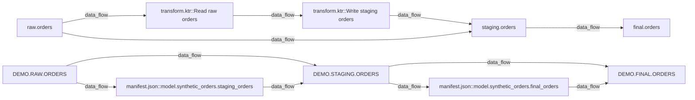
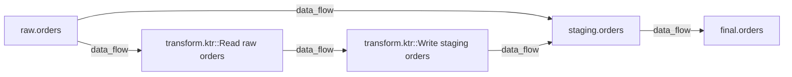
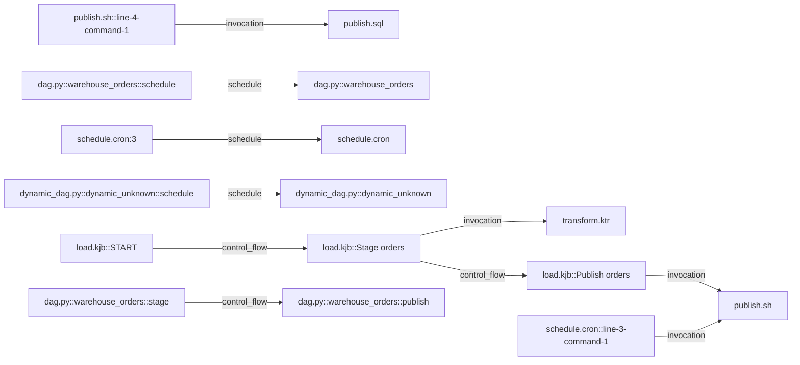

# Pipeline Handbook · pipeline_handbook_portfolio

## Start Here

Inspected: 2026-10-29T12:05:55+00:00. Snapshot age at generation: 0.0 days. Age alone does not establish source freshness. Regenerate after source changes. File hashes describe this scan; the saved page does not recheck the inputs. Source exports may predate this inspection: their generated/collected timestamps describe the supplied export, not an observed live system. Static definitions do not prove deployment or successful execution.

1. Check technology and environment inventory.
2. Choose an output in the asset dictionary and trace upstream data flow.
3. Open the evidence locations to find the responsible code or job.
4. Read control-flow conditions and coverage findings before drawing operational conclusions.

Static definitions do not prove successful execution. Business meaning, ownership and safe recovery procedures require reviewed evidence.

## Technology and environment inventory

| Technology | Family | Environment | Category | Confidence | Versions | Client versions | Export declared at | Support | Analysis | Selected | Reasons / conflicts | Evidence IDs |
| --- | --- | --- | --- | --- | --- | --- | --- | --- | --- | --- | --- | --- |
| docker | deployment | dev | declared | high | ["15.8"] | unknown | unknown | detection-only | detection_only | True | {"conflicts": [], "reasons": ["structural docker_from signature"]} | ["evidence:139da51d822d9939680407c0"] |
| postgresql | database | dev | declared | high | ["15.8"] | unknown | unknown | reference | detection_only | True | {"conflicts": ["Conflicting server/deployment versions in this environment/service: 15.8, 16.4. Resolve deployment vs export age; runtime version is unknown."], "reasons": ["structural docker_from signature"]} | ["evidence:3e2229462c8c857b9060689e"] |
| kafka | messaging | dev | mentioned | low | unknown | unknown | unknown | detection-only | detection_only | False | {"conflicts": [], "reasons": ["documentation mention only"]} | ["evidence:c49c52fe3f96e58d3f2bfed9"] |
| pentaho | etl | dev | mentioned | low | unknown | unknown | unknown | reference | detection_only | False | {"conflicts": [], "reasons": ["documentation mention only"]} | ["evidence:0e02f12ef8adb4efe9232e2d"] |
| postgresql | database | dev | mentioned | low | unknown | unknown | unknown | reference | detection_only | False | {"conflicts": [], "reasons": ["documentation mention only"]} | ["evidence:abad13f2b14fbf651b0a5c64"] |
| shell | language | dev | mentioned | low | unknown | unknown | unknown | reference | detection_only | False | {"conflicts": [], "reasons": ["documentation mention only"]} | ["evidence:59f6e96645ebaabede92ee6c"] |
| tableau | bi | dev | mentioned | low | unknown | unknown | unknown | detection-only | detection_only | False | {"conflicts": [], "reasons": ["documentation mention only"]} | ["evidence:3351633f5425ade3c60ac309"] |
| postgresql | database | dev | recognized | high | unknown | unknown | unknown | reference | analyzed_subset | True | {"conflicts": [], "reasons": ["structural contains_all signature"]} | ["evidence:5945efc8a9772deb66931c8b"] |
| pentaho | etl | dev | recognized | high | unknown | unknown | unknown | reference | analyzed_subset | True | {"conflicts": [], "reasons": ["structural xml_structure signature"]} | ["evidence:a8d5ada5a0e510b59ae11eb3"] |
| postgresql | database | dev | declared | high | ["16.4"] | unknown | 2026-01-15T00:00:00Z | reference | detection_only | True | {"conflicts": ["Conflicting server/deployment versions in this environment/service: 15.8, 16.4. Resolve deployment vs export age; runtime version is unknown."], "reasons": ["structural json_fields signature"]} | ["evidence:e585ed62b791db42a8c63304"] |
| shell | language | dev | recognized | high | unknown | unknown | unknown | reference | analyzed_subset | True | {"conflicts": [], "reasons": ["structural shell signature"]} | ["evidence:58c607abd1d53c12f358ab16"] |
| postgresql | database | dev | recognized | high | unknown | unknown | unknown | reference | analyzed_subset | True | {"conflicts": [], "reasons": ["structural contains_all signature"]} | ["evidence:6c65c3d0dc23c32e9fc9fa0f"] |
| cron | scheduler | dev | recognized | high | unknown | unknown | unknown | reference | analyzed_subset | True | {"conflicts": [], "reasons": ["structural cron signature"]} | ["evidence:99ee9c96287e68afcc40382b"] |
| pentaho | etl | dev | recognized | high | unknown | unknown | unknown | reference | analyzed_subset | True | {"conflicts": [], "reasons": ["structural xml_structure signature"]} | ["evidence:477540fa844b831aba991afc"] |
| postgresql | database | dev | recognized | high | unknown | unknown | unknown | reference | detection_only | True | {"conflicts": [], "reasons": ["structural contains_all signature"]} | ["evidence:b261a4e82614e38257923249"] |
| postgresql | database | prod | recognized | high | unknown | unknown | unknown | reference | analyzed_subset | True | {"conflicts": [], "reasons": ["structural contains_all signature"]} | ["evidence:586e8fc844ab17164481e7fb"] |
| pentaho | etl | prod | recognized | high | unknown | unknown | unknown | reference | analyzed_subset | True | {"conflicts": [], "reasons": ["structural xml_structure signature"]} | ["evidence:921bf9b5bf173401594801b3"] |
| postgresql | database | prod | recognized | high | unknown | unknown | unknown | reference | detection_only | True | {"conflicts": [], "reasons": ["structural contains_all signature"]} | ["evidence:2ea5e9f521e6eb8f4c3815e9"] |
| airflow | orchestrator | dev | mentioned | low | unknown | unknown | unknown | reference | detection_only | False | {"conflicts": [], "reasons": ["documentation mention only"]} | ["evidence:905894d00228ede4f0379366"] |
| dbt | transformation | dev | mentioned | low | unknown | unknown | unknown | reference | detection_only | False | {"conflicts": [], "reasons": ["documentation mention only"]} | ["evidence:d753b743f1d059b8de45eadc"] |
| python | language | dev | mentioned | low | unknown | unknown | unknown | detection-only | detection_only | False | {"conflicts": [], "reasons": ["documentation mention only"]} | ["evidence:40eecd144dec95d5fc175381"] |
| snowflake | warehouse | dev | mentioned | low | unknown | unknown | unknown | detection-only | detection_only | False | {"conflicts": [], "reasons": ["documentation mention only"]} | ["evidence:fd12daffdca7f26ff7633b66"] |
| airflow | orchestrator | dev | recognized | high | unknown | unknown | unknown | reference | analyzed_subset | True | {"conflicts": [], "reasons": ["structural python_import signature"]} | ["evidence:0a3a7b7c0622612c47e2d202"] |
| python | language | dev | recognized | high | unknown | unknown | unknown | detection-only | detection_only | True | {"conflicts": [], "reasons": ["structural python_import signature"]} | ["evidence:941a1ad4843c362d9b3cffb6"] |
| airflow | orchestrator | dev | recognized | high | unknown | unknown | unknown | reference | analyzed_subset | True | {"conflicts": [], "reasons": ["structural python_import signature"]} | ["evidence:1823a4c1a410c3687aa9fad6"] |
| python | language | dev | recognized | high | unknown | unknown | unknown | detection-only | detection_only | True | {"conflicts": [], "reasons": ["structural python_import signature"]} | ["evidence:430202c35ef244ef49dd721b"] |
| dbt | transformation | dev | recognized | high | ["1.8.8"] | unknown | 2026-01-15T00:00:00Z | reference | analyzed_subset | True | {"conflicts": [], "reasons": ["structural json_fields signature", "dbt manifest metadata and dependency containers; version support validated by adapter"]} | ["evidence:5f99413bf458f8715aa24230"] |
| snowflake | warehouse | dev | declared | high | unknown | unknown | 2026-01-15T00:00:00Z | detection-only | detection_only | True | {"conflicts": [], "reasons": ["structural json_fields signature"]} | ["evidence:5af4af09569d15df45c6b815"] |
| airflow | orchestrator | dev | declared | high | ["2.10.3"] | unknown | unknown | reference | detection_only | True | {"conflicts": [], "reasons": ["structural dependency signature"]} | ["evidence:b3bcce12853e44c738490ab7"] |
| dbt | transformation | dev | declared | high | ["1.8.8"] | unknown | unknown | reference | detection_only | True | {"conflicts": [], "reasons": ["structural dependency signature"]} | ["evidence:4d060ea913df58ae45ebc87a"] |
| python | language | dev | mentioned | low | unknown | unknown | unknown | detection-only | detection_only | False | {"conflicts": [], "reasons": ["documentation mention only"]} | ["evidence:bf3cec88ee998903a880198e"] |
| snowflake | warehouse | dev | declared | high | unknown | ["3.12.3"] | unknown | detection-only | detection_only | True | {"conflicts": [], "reasons": ["Snowflake client dependency declaration; warehouse server version remains unknown"]} | ["evidence:5c4fba626533fecc653b8ca3"] |
| dbt | transformation | test | recognized | high | unknown | unknown | 2026-01-15T00:00:00Z | reference | analyzed_subset | True | {"conflicts": [], "reasons": ["dbt manifest metadata and dependency containers; version support validated by adapter"]} | ["evidence:f0302ffa86f013ce711c5452"] |
| python | language | test | recognized | high | unknown | unknown | unknown | detection-only | detection_only | True | {"conflicts": [], "reasons": ["structural python_import signature"]} | ["evidence:98811427968c8bfcd20d67ba"] |


## Pipeline catalogue

<a id="item-98a50e783a2ee7bfd8"></a>
### manifest.json::model.synthetic_orders.staging_orders

Kind: pipeline; environment: dev; namespace: modern_dev; status: declared.

manifest.json::model.synthetic_orders.staging_orders is a declared pipeline extracted from dbt evidence; execution is unverified.

{"compiled_sql_available": true, "materialization": "table", "original_file_path": "models/staging_orders.sql", "parameters": [], "resource_type": "model", "semantics": "declared dbt model; incremental/snapshot runtime behavior is not analyzed", "unique_id": "model.synthetic_orders.staging_orders"}

Evidence: [Eb0d781](#item-800eb0914ef8326e5c)

<a id="item-4428efc86609ef0edf"></a>
### publish.sql

Kind: pipeline; environment: dev; namespace: legacy_dev; status: declared.

publish.sql is a declared pipeline extracted from postgresql evidence; execution is unverified.

{"definition_only": true, "dialect": "postgres", "entrypoint": true, "operation": "SQL definition; no workload executed"}

Evidence: [Eb74a1f](#item-9f4bf018abd25be525)

<a id="item-39972077afa7ca32b1"></a>
### publish.sh

Kind: pipeline; environment: dev; namespace: legacy_dev; status: declared.

publish.sh is a declared pipeline extracted from shell evidence; execution is unverified.

{"definition_only": true, "entrypoint": true, "technology": "shell/cron"}

Evidence: [E78d7f3](#item-636b89164b4bc1e984)

<a id="item-602963c8df17ec0697"></a>
### dag.py::warehouse_orders

Kind: pipeline; environment: dev; namespace: modern_dev; status: declared.

dag.py::warehouse_orders is a declared pipeline extracted from airflow evidence; execution is unverified.

{"dag_id": "warehouse_orders", "definition_only": true, "entrypoint": true, "technology": "airflow"}

Evidence: [E9b2208](#item-46818af733bf8022a1)

<a id="item-caf06ddab5e60cc142"></a>
### publish.sql

Kind: pipeline; environment: prod; namespace: legacy_prod; status: declared.

publish.sql is a declared pipeline extracted from postgresql evidence; execution is unverified.

{"definition_only": true, "dialect": "postgres", "entrypoint": true, "operation": "SQL definition; no workload executed"}

Evidence: [E315d47](#item-164b7ce4c80f3730e2)

<a id="item-9fdfb68905e2d1af2e"></a>
### manifest.json::synthetic_orders

Kind: pipeline; environment: dev; namespace: modern_dev; status: declared.

manifest.json::synthetic_orders is a declared pipeline extracted from dbt evidence; execution is unverified.

{"dbt_version": "1.8.8", "definition_only": true, "entrypoint": true, "manifest_schema": "v12", "metadata_generated_at": "2026-01-15T00:00:00Z", "metadata_time_status": "declared export metadata; not scanner collection time or runtime observation", "semantics": "dbt declared dependencies; no models executed", "warehouse_product": "snowflake", "warehouse_server_version": "unknown"}

Evidence: [E195e79](#item-5010a693a3c0854acb)

<a id="item-499ebd52bbe0b9d12d"></a>
### transform.ktr

Kind: pipeline; environment: dev; namespace: legacy_dev; status: declared.

transform.ktr is a declared pipeline extracted from pentaho evidence; execution is unverified.

{"definition_only": true, "entrypoint": true, "label": "stage_orders", "semantics": "KTR enabled hops carry row streams; they are not execution-order guarantees", "technology": "pentaho"}

Evidence: [E66715e](#item-101fb26247b18a082a)

<a id="item-3350e726e0001acdbc"></a>
### load.kjb

Kind: pipeline; environment: dev; namespace: legacy_dev; status: declared.

load.kjb is a declared pipeline extracted from pentaho evidence; execution is unverified.

{"definition_only": true, "entrypoint": true, "label": "orders_nightly", "semantics": "KJB hops declare conditional control flow; successful execution is not observed"}

Evidence: [E1143c1](#item-972ab424b8083e1ed1)

<a id="item-9f51cd5193f8103b53"></a>
### transform.ktr

Kind: pipeline; environment: prod; namespace: legacy_prod; status: declared.

transform.ktr is a declared pipeline extracted from pentaho evidence; execution is unverified.

{"definition_only": true, "entrypoint": true, "label": "stage_orders", "semantics": "KTR enabled hops carry row streams; they are not execution-order guarantees", "technology": "pentaho"}

Evidence: [E117bb1](#item-5205c0bdbdca138059)

<a id="item-7ee29781dbca965f96"></a>
### schedule.cron

Kind: pipeline; environment: dev; namespace: legacy_dev; status: declared.

schedule.cron is a declared pipeline extracted from cron evidence; execution is unverified.

{"definition_only": true, "entrypoint": true, "technology": "shell/cron"}

Evidence: [E8efb8f](#item-1591b9eaa48749cb5a)

<a id="item-37c63046266e643da4"></a>
### dynamic_dag.py::dynamic_unknown

Kind: pipeline; environment: dev; namespace: modern_dev; status: declared.

dynamic_dag.py::dynamic_unknown is a declared pipeline extracted from airflow evidence; execution is unverified.

{"dag_id": "dynamic_unknown", "definition_only": true, "entrypoint": true, "technology": "airflow"}

Evidence: [Ebd2124](#item-08b1d8ec4c8541a705)

<a id="item-5739590a49f3a608dd"></a>
### manifest.json::model.synthetic_orders.final_orders

Kind: pipeline; environment: dev; namespace: modern_dev; status: declared.

manifest.json::model.synthetic_orders.final_orders is a declared pipeline extracted from dbt evidence; execution is unverified.

{"compiled_sql_available": true, "materialization": "table", "original_file_path": "models/final_orders.sql", "parameters": [], "resource_type": "model", "semantics": "declared dbt model; incremental/snapshot runtime behavior is not analyzed", "unique_id": "model.synthetic_orders.final_orders"}

Evidence: [E9d0562](#item-3079fd9b087233cf89)

<a id="item-952f9758f4cb604488"></a>
### schedule.cron:3

Kind: schedule; environment: dev; namespace: legacy_dev; status: declared.

schedule.cron:3 is a declared schedule extracted from cron evidence; execution is unverified.

{"expression": "0 2 * * *", "runtime_observed": false, "timezone": "unknown"}

Evidence: [Ecdfc52](#item-9a3d40ce9de73f6df9)

<a id="item-b72485911aa1c86a76"></a>
### dynamic_dag.py::dynamic_unknown::schedule

Kind: schedule; environment: dev; namespace: modern_dev; status: declared.

dynamic_dag.py::dynamic_unknown::schedule is a declared schedule extracted from airflow evidence; execution is unverified.

{"expression": null, "runtime_observed": false, "timezone": "unknown"}

Evidence: [Ebe2117](#item-66e382942a404042ab)

<a id="item-d8cd9010d2c2075d6b"></a>
### dag.py::warehouse_orders::schedule

Kind: schedule; environment: dev; namespace: modern_dev; status: declared.

dag.py::warehouse_orders::schedule is a declared schedule extracted from airflow evidence; execution is unverified.

{"expression": "0 3 * * *", "runtime_observed": false, "timezone": "unknown"}

Evidence: [Ee8dfae](#item-153f538bde1d1e1c12)

<a id="item-fe3e0f6b003027b83d"></a>
### transform.ktr::Read raw orders

Kind: task; environment: dev; namespace: legacy_dev; status: declared.

transform.ktr::Read raw orders is a declared task extracted from pentaho evidence; execution is unverified.

{"connection": {"database": "orders_demo", "port": "5432", "server": "localhost", "type": "POSTGRESQL"}, "connection_name": "orders_local", "type": "TableInput"}

Evidence: [E0a56d5](#item-9b206e03d3583a2d5a)

<a id="item-5a9e764d01de0e0d24"></a>
### transform.ktr::Read raw orders

Kind: task; environment: prod; namespace: legacy_prod; status: declared.

transform.ktr::Read raw orders is a declared task extracted from pentaho evidence; execution is unverified.

{"connection": {"database": "orders_demo", "port": "5432", "server": "localhost", "type": "POSTGRESQL"}, "connection_name": "orders_local", "type": "TableInput"}

Evidence: [Ec3c3b1](#item-42760b655273c712eb)

<a id="item-5fbae2e2a1a7f149f3"></a>
### transform.ktr::Write staging orders

Kind: task; environment: dev; namespace: legacy_dev; status: declared.

transform.ktr::Write staging orders is a declared task extracted from pentaho evidence; execution is unverified.

{"connection": {"database": "orders_demo", "port": "5432", "server": "localhost", "type": "POSTGRESQL"}, "connection_name": "orders_local", "type": "TableOutput"}

Evidence: [E96acd2](#item-6987a37ee6d3f9ed42)

<a id="item-eef1d6a25a5a50d459"></a>
### load.kjb::Stage orders

Kind: task; environment: dev; namespace: legacy_dev; status: declared.

load.kjb::Stage orders is a declared task extracted from pentaho evidence; execution is unverified.

{"type": "TRANS"}

Evidence: [Ef2ae55](#item-c4bf395386f6adee37)

<a id="item-f271ad29509207e982"></a>
### schedule.cron::line-3-command-1

Kind: task; environment: dev; namespace: legacy_dev; status: declared.

schedule.cron::line-3-command-1 is a declared task extracted from cron evidence; execution is unverified.

{"arguments": "omitted; source evidence retains location only", "executable": "sh", "working_directory": "source root (reviewed marker)"}

Evidence: [Edef5eb](#item-27904789822a6372aa)

<a id="item-61dcba599753c09045"></a>
### load.kjb::Publish orders

Kind: task; environment: dev; namespace: legacy_dev; status: declared.

load.kjb::Publish orders is a declared task extracted from pentaho evidence; execution is unverified.

{"type": "SHELL"}

Evidence: [E76bd84](#item-8b8625ac4783c51657)

<a id="item-beaec47a28b063b9b3"></a>
### transform.ktr::Write staging orders

Kind: task; environment: prod; namespace: legacy_prod; status: declared.

transform.ktr::Write staging orders is a declared task extracted from pentaho evidence; execution is unverified.

{"connection": {"database": "orders_demo", "port": "5432", "server": "localhost", "type": "POSTGRESQL"}, "connection_name": "orders_local", "type": "TableOutput"}

Evidence: [Eb27289](#item-20dc8aee2ac5084bd0)

<a id="item-b281c243fb648e0813"></a>
### load.kjb::START

Kind: task; environment: dev; namespace: legacy_dev; status: declared.

load.kjb::START is a declared task extracted from pentaho evidence; execution is unverified.

{"type": "SPECIAL"}

Evidence: [Eb1540a](#item-ece0c1663fd08e7c50)

<a id="item-7936d309b513efd2f7"></a>
### publish.sh::line-4-command-1

Kind: task; environment: dev; namespace: legacy_dev; status: declared.

publish.sh::line-4-command-1 is a declared task extracted from shell evidence; execution is unverified.

{"arguments": "omitted; source evidence retains location only", "executable": "psql", "working_directory": "source root (reviewed marker)"}

Evidence: [E5ac240](#item-0d1615eb958740b9b0)

<a id="item-c86ae8a69133491b4a"></a>
### dag.py::warehouse_orders::publish

Kind: task; environment: dev; namespace: modern_dev; status: declared.

dag.py::warehouse_orders::publish is a declared task extracted from airflow evidence; execution is unverified.

{"definition_only": true, "operator": "airflow.operators.bash.BashOperator", "task_id": "publish"}

Evidence: [E0ce76e](#item-60d86e14f2748c6d49)

<a id="item-1a2e77fd9d38cb7c25"></a>
### dag.py::warehouse_orders::stage

Kind: task; environment: dev; namespace: modern_dev; status: declared.

dag.py::warehouse_orders::stage is a declared task extracted from airflow evidence; execution is unverified.

{"definition_only": true, "operator": "airflow.operators.bash.BashOperator", "task_id": "stage"}

Evidence: [E788cf3](#item-ef81ce75bb1fc6c0aa)

## Data-flow diagram

Arrows point upstream to downstream. Supported data dependencies do not establish execution order.

### dev



| Upstream | Downstream | Kind | Conditions | Evidence IDs |
| --- | --- | --- | --- | --- |
| DEMO.STAGING.ORDERS | DEMO.FINAL.ORDERS | data_flow | {"semantics": "manifest depends_on.nodes; declared model dependency", "via": "pipeline:eb032712f11bfc6d9192c05e"} | evidence:e343f22f5a55275384ca7e5d |
| transform.ktr::Read raw orders | transform.ktr::Write staging orders | data_flow | {"semantics": "declared enabled row-stream hop", "via": "pipeline:a28d3a9edc5f443d2ae9b901"} | evidence:e9a2cc0517c71afb7156f668 |
| DEMO.STAGING.ORDERS | manifest.json::model.synthetic_orders.final_orders | data_flow | {"semantics": "declared model input"} | evidence:e343f22f5a55275384ca7e5d |
| transform.ktr::Write staging orders | staging.orders | data_flow | {"semantics": "TableOutput declares database write", "via": "pipeline:a28d3a9edc5f443d2ae9b901"} | evidence:e9a2cc0517c71afb7156f668 |
| DEMO.RAW.ORDERS | DEMO.STAGING.ORDERS | data_flow | {"semantics": "manifest depends_on.nodes; declared model dependency", "via": "pipeline:3a8d0df35ad81cef3372f84b"} | evidence:e343f22f5a55275384ca7e5d |
| raw.orders | staging.orders | data_flow | {"condition": null, "semantics": "direct supported TableInput-to-TableOutput row mapping", "via": "pipeline:a28d3a9edc5f443d2ae9b901"} | evidence:e9a2cc0517c71afb7156f668 |
| DEMO.RAW.ORDERS | manifest.json::model.synthetic_orders.staging_orders | data_flow | {"semantics": "declared model input"} | evidence:e343f22f5a55275384ca7e5d |
| staging.orders | final.orders | data_flow | {"condition": null, "operation": "create_table_as", "via": "pipeline:643199447d14bc5d485bbb0b"} | evidence:d7d08432f6117992c61e3d50 |
| manifest.json::model.synthetic_orders.final_orders | DEMO.FINAL.ORDERS | data_flow | {"semantics": "declared model output"} | evidence:e343f22f5a55275384ca7e5d |
| manifest.json::model.synthetic_orders.staging_orders | DEMO.STAGING.ORDERS | data_flow | {"semantics": "declared model output"} | evidence:e343f22f5a55275384ca7e5d |
| raw.orders | transform.ktr::Read raw orders | data_flow | {"semantics": "TableInput declares database read", "via": "pipeline:a28d3a9edc5f443d2ae9b901"} | evidence:e9a2cc0517c71afb7156f668 |

### prod



| Upstream | Downstream | Kind | Conditions | Evidence IDs |
| --- | --- | --- | --- | --- |
| staging.orders | final.orders | data_flow | {"condition": null, "operation": "create_table_as", "via": "pipeline:931a306fa49cf642049b3773"} | evidence:33c0064a06094acbfc0d9942 |
| transform.ktr::Read raw orders | transform.ktr::Write staging orders | data_flow | {"semantics": "declared enabled row-stream hop", "via": "pipeline:be45a0b1229e89af5d9ed2f6"} | evidence:3982ec4b248bfd8816538682 |
| raw.orders | transform.ktr::Read raw orders | data_flow | {"semantics": "TableInput declares database read", "via": "pipeline:be45a0b1229e89af5d9ed2f6"} | evidence:3982ec4b248bfd8816538682 |
| raw.orders | staging.orders | data_flow | {"condition": null, "semantics": "direct supported TableInput-to-TableOutput row mapping", "via": "pipeline:be45a0b1229e89af5d9ed2f6"} | evidence:3982ec4b248bfd8816538682 |
| transform.ktr::Write staging orders | staging.orders | data_flow | {"semantics": "TableOutput declares database write", "via": "pipeline:be45a0b1229e89af5d9ed2f6"} | evidence:3982ec4b248bfd8816538682 |


## Control-flow diagram

Task dependencies, invocation and schedule are separate from data movement. Conditions appear in the relationship tables.

### dev



| Upstream | Downstream | Kind | Conditions | Evidence IDs |
| --- | --- | --- | --- | --- |
| dag.py::warehouse_orders::schedule | dag.py::warehouse_orders | schedule | {} | evidence:7cf2dafc565af50840b32fc2 |
| load.kjb::Publish orders | publish.sh | invocation | {"declared_reference": "${Internal.Entry.Current.Directory}/publish.sh", "path_basis": "Pentaho Internal.Entry.Current.Directory", "resolution": "exact same-source relative artifact path"} | evidence:7d416de5f3cfe53c588c97be |
| publish.sh::line-4-command-1 | publish.sql | invocation | {"path_basis": "reviewed source-directory marker", "resolution": "exact same-source relative artifact path"} | evidence:4cb5db10373bff76b7ea921c |
| load.kjb::START | load.kjb::Stage orders | control_flow | {"condition": "unconditional", "execution_observed": false, "semantics": "KJB declared transition"} | evidence:6520438700086a75dbc0c793 |
| load.kjb::Stage orders | load.kjb::Publish orders | control_flow | {"condition": "success", "execution_observed": false, "semantics": "KJB declared transition"} | evidence:6520438700086a75dbc0c793 |
| dag.py::warehouse_orders::stage | dag.py::warehouse_orders::publish | control_flow | {"semantics": "declared Airflow dependency; trigger rules govern eligibility, not execution order guarantees"} | evidence:5410cce35bfe13c7a1fdae5d |
| load.kjb::Stage orders | transform.ktr | invocation | {"declared_reference": "${Internal.Entry.Current.Directory}/transform.ktr", "path_basis": "Pentaho Internal.Entry.Current.Directory", "resolution": "exact same-source relative artifact path"} | evidence:7d416de5f3cfe53c588c97be |
| dynamic_dag.py::dynamic_unknown::schedule | dynamic_dag.py::dynamic_unknown | schedule | {} | evidence:2ebc745bd594bbed041de80d |
| schedule.cron:3 | schedule.cron | schedule | {} | evidence:c44fbd6692574a787a066d69 |
| schedule.cron::line-3-command-1 | publish.sh | invocation | {"path_basis": "reviewed source-directory marker", "resolution": "exact same-source relative artifact path"} | evidence:4fa7836735e0d93a7f5e0b3e |


## Asset dictionary and column mappings

<a id="item-e2cb721209080905f1"></a>
### DEMO.STAGING.ORDERS.AMOUNT

Kind: column; environment: dev; namespace: analytics_warehouse; status: declared.

{"dataset": "dataset:7beee4c42da252ace79498fb"}

Evidence: [E357314](#item-3a9ab97db8a23d0209)

<a id="item-8afb812d27dd543038"></a>
### raw.orders.amount

Kind: column; environment: prod; namespace: legacy_orders; status: declared.

{"dataset": "dataset:68189a6ebf9968794925811c"}

Evidence: [E90a548](#item-ff66f6306eec3c7d20)

<a id="item-eb3f0dd4a125e009b5"></a>
### staging.orders.order_id

Kind: column; environment: prod; namespace: legacy_orders; status: declared.

{"dataset": "dataset:8816b3b5b202dc1232c994d5"}

Evidence: [E9ec122](#item-999dd8ebbebfea0a3c), [E78cb57](#item-fcabfb9fcf69074efb)

<a id="item-39d0397c12134e2222"></a>
### DEMO.FINAL.ORDERS.AMOUNT

Kind: column; environment: dev; namespace: analytics_warehouse; status: declared.

{"dataset": "dataset:e7e1bbe84914d9f688b683e7"}

Evidence: [E96d4c4](#item-ea547a767d4644fa55)

<a id="item-7a1d86978dd33ea67f"></a>
### staging.orders.order_id

Kind: column; environment: dev; namespace: legacy_orders; status: declared.

{"dataset": "dataset:3592ee0a0093b91ee68aec2c"}

Evidence: [E284417](#item-843e9eec7964a538da), [Efef0bc](#item-7fb35d7c4d0078e3ec)

<a id="item-7fd6864c7d7abccdeb"></a>
### raw.orders.order_id

Kind: column; environment: prod; namespace: legacy_orders; status: declared.

{"dataset": "dataset:68189a6ebf9968794925811c"}

Evidence: [E0bceae](#item-015134033441b30458)

<a id="item-a0f0b524d3ca6b34ea"></a>
### raw.orders.order_id

Kind: column; environment: dev; namespace: legacy_orders; status: declared.

{"dataset": "dataset:9453b8a6955b4b4ea9386429"}

Evidence: [E03a18b](#item-b1d197ae0d8e4d5d09)

<a id="item-4596053fd101b18249"></a>
### staging.orders.amount

Kind: column; environment: dev; namespace: legacy_orders; status: declared.

{"dataset": "dataset:3592ee0a0093b91ee68aec2c"}

Evidence: [E9d10f3](#item-5c0eeb2c38cb58ee20), [E603e85](#item-a6eb66d8b2f43833cf)

<a id="item-ea1c5816e6ae3654c7"></a>
### DEMO.STAGING.ORDERS.ORDER_ID

Kind: column; environment: dev; namespace: analytics_warehouse; status: declared.

{"dataset": "dataset:7beee4c42da252ace79498fb"}

Evidence: [Efc676b](#item-0de62af1e0a366c70b)

<a id="item-b5085417bfc4358b08"></a>
### final.orders.order_id

Kind: column; environment: dev; namespace: legacy_orders; status: declared.

{"dataset": "dataset:9868158e4bc828b08f48824f"}

Evidence: [Ebbe253](#item-e5edc469588fe9d51a)

<a id="item-1cd4e83492c42253f2"></a>
### DEMO.RAW.ORDERS.AMOUNT

Kind: column; environment: dev; namespace: analytics_warehouse; status: declared.

{"dataset": "dataset:95e73660e79dda70e372c741"}

Evidence: [E2b5711](#item-1b59067bb1ed952f6d)

<a id="item-9bddca6143aa6f10f2"></a>
### final.orders.amount

Kind: column; environment: prod; namespace: legacy_orders; status: declared.

{"dataset": "dataset:b0dd42309b651b0abacfa140"}

Evidence: [E73d148](#item-7f4c02bf936c509cfe)

<a id="item-70e68552d015bc78c0"></a>
### final.orders.amount

Kind: column; environment: dev; namespace: legacy_orders; status: declared.

{"dataset": "dataset:9868158e4bc828b08f48824f"}

Evidence: [Ebc3f71](#item-45a63a94a11d67d386)

<a id="item-9ac1f5e047c482dc59"></a>
### staging.orders.amount

Kind: column; environment: prod; namespace: legacy_orders; status: declared.

{"dataset": "dataset:8816b3b5b202dc1232c994d5"}

Evidence: [Efb26e7](#item-0f541a18722761f25b), [E0e48a2](#item-3ae61690048c2598e9)

<a id="item-a68437f5a54d76c0b9"></a>
### DEMO.FINAL.ORDERS.ORDER_ID

Kind: column; environment: dev; namespace: analytics_warehouse; status: declared.

{"dataset": "dataset:e7e1bbe84914d9f688b683e7"}

Evidence: [E0a1453](#item-dc146151fd0d6c9465)

<a id="item-abebd6c943c899c3eb"></a>
### final.orders.order_id

Kind: column; environment: prod; namespace: legacy_orders; status: declared.

{"dataset": "dataset:b0dd42309b651b0abacfa140"}

Evidence: [E254ed5](#item-ad9b2ca62f5e9c583e)

<a id="item-e124f114c09ef0f15d"></a>
### raw.orders.amount

Kind: column; environment: dev; namespace: legacy_orders; status: declared.

{"dataset": "dataset:9453b8a6955b4b4ea9386429"}

Evidence: [E74de3c](#item-9442c5b3d9c7dc3625)

<a id="item-d817ffb1bea65d0d44"></a>
### DEMO.RAW.ORDERS.ORDER_ID

Kind: column; environment: dev; namespace: analytics_warehouse; status: declared.

{"dataset": "dataset:95e73660e79dda70e372c741"}

Evidence: [Eaf156c](#item-c3d949184eb12c7f06)

<a id="item-e1bf68e9ed9330ed8d"></a>
### staging.orders

Kind: dataset; environment: dev; namespace: legacy_orders; status: declared.

{"columns": ["amount", "order_id"]}

Evidence: [E4782c7](#item-3049c1cfd0ec34b1c5), [E70d64e](#item-a01d06a10e75171ee8)

<a id="item-953b28bcf94dbcd506"></a>
### raw.orders

Kind: dataset; environment: prod; namespace: legacy_orders; status: declared.

{"columns": ["amount", "order_id"]}

Evidence: [Ebad188](#item-f25b79e437a5a01d61)

<a id="item-1c62383ff4ec6716c5"></a>
### DEMO.STAGING.ORDERS

Kind: dataset; environment: dev; namespace: analytics_warehouse; status: declared.

{"columns": ["ORDER_ID", "AMOUNT"]}

Evidence: [E035fd7](#item-5ae4c2f62fcdda8c84)

<a id="item-5cbcbcf3587c31524a"></a>
### staging.orders

Kind: dataset; environment: prod; namespace: legacy_orders; status: declared.

{"columns": ["amount", "order_id"]}

Evidence: [Ea9b41f](#item-ebe74f6f26b649d481), [Eb03f60](#item-1aa86812bb7fb98fd5)

<a id="item-c073d9d6f676e19df8"></a>
### raw.orders

Kind: dataset; environment: dev; namespace: legacy_orders; status: declared.

{"columns": ["amount", "order_id"]}

Evidence: [E8f0e1a](#item-d5cf7174a2b02b89db)

<a id="item-c6e2a8b57bc64604ff"></a>
### DEMO.RAW.ORDERS

Kind: dataset; environment: dev; namespace: analytics_warehouse; status: declared.

{"columns": ["ORDER_ID", "AMOUNT"]}

Evidence: [E564205](#item-32b759985f412c4dd0)

<a id="item-9b0bc07025f4380f81"></a>
### final.orders

Kind: dataset; environment: dev; namespace: legacy_orders; status: declared.

{"columns": ["order_id", "amount"]}

Evidence: [E61aa55](#item-bfe14cc260bf4dab03)

<a id="item-46e9d14e465f15c7da"></a>
### final.orders

Kind: dataset; environment: prod; namespace: legacy_orders; status: declared.

{"columns": ["order_id", "amount"]}

Evidence: [E42268b](#item-5caf80520bcd67d67c)

<a id="item-7233ee05d402349ef8"></a>
### DEMO.FINAL.ORDERS

Kind: dataset; environment: dev; namespace: analytics_warehouse; status: declared.

{"columns": ["ORDER_ID", "AMOUNT"]}

Evidence: [E22c8a1](#item-6b7b4cbd361572fb29)

<a id="item-d50373789ed2bca864"></a>
### untrusted_fixture

Kind: source_system; environment: test; namespace: adversarial; status: declared.

{"kind": "authorized_local_directory", "runtime_observation": false, "scope_id": "adversarial"}

Evidence: [Eb6954b](#item-87526a2a08c2570b26)

<a id="item-f8be108135fdf38c9a"></a>
### legacy_orders

Kind: source_system; environment: dev; namespace: legacy_dev; status: declared.

{"kind": "authorized_local_directory", "runtime_observation": false, "scope_id": "legacy_dev"}

Evidence: [Ec2ba8a](#item-79ca49b15ab188c57c)

<a id="item-76c355deab06579f6a"></a>
### analytics_warehouse

Kind: source_system; environment: dev; namespace: modern_dev; status: declared.

{"kind": "authorized_local_directory", "runtime_observation": false, "scope_id": "modern_dev"}

Evidence: [Ebf2add](#item-38bafb4435fd0054c1)

<a id="item-0d2676ab3fe84c82fa"></a>
### legacy_orders

Kind: source_system; environment: prod; namespace: legacy_prod; status: declared.

{"kind": "authorized_local_directory", "runtime_observation": false, "scope_id": "legacy_prod"}

Evidence: [Ec68d7a](#item-b0ad170c653bc15c39)

| Source column | Target column | Mapping | Evidence IDs |
| --- | --- | --- | --- |
| raw.orders.order_id | staging.orders.order_id | {"condition": null, "semantics": "direct supported TableInput-to-TableOutput row mapping", "via": "pipeline:a28d3a9edc5f443d2ae9b901"} | ["evidence:4147814e6c2d3efffe46b2bb"] |
| staging.orders.order_id | final.orders.order_id | {"condition": null, "operation": "create_table_as", "via": "pipeline:931a306fa49cf642049b3773"} | ["evidence:fa5162da8bd9472059a11159"] |
| raw.orders.amount | staging.orders.amount | {"condition": null, "semantics": "direct supported TableInput-to-TableOutput row mapping", "via": "pipeline:a28d3a9edc5f443d2ae9b901"} | ["evidence:4147814e6c2d3efffe46b2bb"] |
| raw.orders.order_id | staging.orders.order_id | {"condition": null, "semantics": "direct supported TableInput-to-TableOutput row mapping", "via": "pipeline:be45a0b1229e89af5d9ed2f6"} | ["evidence:027f642ee7acbf2c476b0199"] |
| staging.orders.order_id | final.orders.order_id | {"condition": null, "operation": "create_table_as", "via": "pipeline:643199447d14bc5d485bbb0b"} | ["evidence:857ffc11a2d74cb0b1c95f15"] |
| staging.orders.amount | final.orders.amount | {"condition": null, "operation": "create_table_as", "via": "pipeline:643199447d14bc5d485bbb0b"} | ["evidence:857ffc11a2d74cb0b1c95f15"] |
| staging.orders.amount | final.orders.amount | {"condition": null, "operation": "create_table_as", "via": "pipeline:931a306fa49cf642049b3773"} | ["evidence:fa5162da8bd9472059a11159"] |
| raw.orders.amount | staging.orders.amount | {"condition": null, "semantics": "direct supported TableInput-to-TableOutput row mapping", "via": "pipeline:be45a0b1229e89af5d9ed2f6"} | ["evidence:027f642ee7acbf2c476b0199"] |


## Where to check

Open each relative source location in an editor and compare its SHA-256 hash with this snapshot. Dataset names identify declared resources; no business rows were sampled. Logs, validation outputs and actual run success are unknown unless explicitly provided as authorized evidence.

| Source | Environment | Path | Size | SHA-256 |
| --- | --- | --- | --- | --- |
| legacy_dev | dev | Dockerfile | 94 | 68466988f9b2c71d4c0864f099ab641da2a460b2e200f66261c3796ed4d763e5 |
| legacy_dev | dev | README.md | 1425 | 3fab6936856a9fb9baf580b527e665a8436ae10264370e5dcd00c743e4c069d8 |
| legacy_dev | dev | dynamic.sql | 100 | 27f92ccc6adfb3899a0f6c4f2b1af196e9e8a25acb98a76e1ce6adf8588a34d4 |
| legacy_dev | dev | load.kjb | 866 | 4e488797154e685644e008a2b879ca8c3ccb4623c4372f8a1706f5cc0c471d2e |
| legacy_dev | dev | postgres-metadata.json | 287 | 4b576bf0613843c334f6f67dfd674e87d04eeefe8720e7d2fd05e628f6b32bca |
| legacy_dev | dev | publish.sh | 130 | e17cd036075fe2c717e0426ebfa06c13a406613a8ea92db41bc09e3ba111cfa6 |
| legacy_dev | dev | publish.sql | 175 | d80113c92f0f2b62c440c008d2df7a575185a94216e352bf6518e5a38942ed2f |
| legacy_dev | dev | schedule.cron | 123 | eed87b3025afe87d594928ce84ff09aa5a6c2d1eda4c3323caaa6effd52b0b18 |
| legacy_dev | dev | transform.ktr | 1151 | 55959ca630079a6c4caf0d9f9bef4a2dfba4c6fce3618f756177198e51d717b8 |
| legacy_prod | prod | README.md | 185 | c50ddd48a7986f3293eab1f39d2982302c38f71345164abc57be25a593e7f36f |
| legacy_prod | prod | publish.sql | 175 | d80113c92f0f2b62c440c008d2df7a575185a94216e352bf6518e5a38942ed2f |
| legacy_prod | prod | transform.ktr | 1151 | 55959ca630079a6c4caf0d9f9bef4a2dfba4c6fce3618f756177198e51d717b8 |
| modern_dev | dev | README.md | 657 | 2458388259b04c3c2a8fc57b9fa7b0b278c75ab47b503805b46bc76058df82a1 |
| modern_dev | dev | dag.py | 441 | fe5f816b86c8e46364c02a448c1fc325bdd2ecae0feb8780ad2c29f8b06fec65 |
| modern_dev | dev | dynamic_dag.py | 312 | 3c48f1535773dee8f7eee2b3a2e4b0a443489844893f5a93988561a9f2e23ad6 |
| modern_dev | dev | manifest.json | 2732 | f7eb0b3ece365e964577ba4eef4e9786f43e4d4856d35ce04d2ffbc9f43d714a |
| modern_dev | dev | requirements.txt | 95 | b903f65a2c87f2693d81154d32304ece7d1b3c029dc21cb17b1868ec506b320d |
| adversarial | test | PROMPT.md | 196 | 142f9ea22bade245be553119b917a34f5b71acce6c4052aa64e7191d088c2383 |
| adversarial | test | airflow.py | 112 | 9106327776fe26954e88aad7da0b7070249d6e622868d7efea90d2db2b028519 |
| adversarial | test | ambiguous.sql | 106 | df81d7b2738bcb775dd99077714bc31c5f55f1edfedb4cc0e479ddaceefabb9d |
| adversarial | test | dbt-v11.json | 256 | e0c11acf5e11e9fe33186d2b08882eced029a06fe4a6286cf91f83839dbabb38 |
| adversarial | test | hostile.py | 225 | de2fdf2c1e1a9d6cc731c32c0f8be66dc15c0873bbc5fbb2efbe3bde6a73dd76 |
| adversarial | test | secrets.json | 317 | fe56b9af5ee5229e9634497f8fad5c9bcfc88c2c09e1620525255ae1888567d3 |
| adversarial | test | unknown.workflow | 120 | 4e72f0c924e21c3bdfab9f912249d6a615c4dc3cce625cf8b6683b63282fe848 |
| adversarial | test | unsafe.ktr | 169 | 9c523c3ec4dd9458c3b2a39640d676a549a138b45a2946417a55111208ae26d8 |


### Initial read-only troubleshooting

1. Confirm the environment, service and collection time.
2. Locate and inspect the definition at its evidence location.
3. Review unresolved parameters, dynamic references and permission gaps.
4. Request an authorized metadata/run export to answer runtime questions.
5. Obtain owner-reviewed recovery instructions before changing a workflow.

## Impact, snapshot changes and freshness

Semantic snapshot: `f3dc71e7b8ba5084f8f296b6`. Registry fingerprint: `3cae09f933da43ac282f0f7f4e561136e7588684f16a93cabfd0fd852b00fff9`.

Use `impact` to traverse supported relationships and `diff` to compare stored snapshots. A saved handbook cannot poll source files. Run `status --config <config.json>` to check for stale definitions; `document` rescans before generation. Missing graph visibility limits impact results.

## Coverage gaps, conflicts and human questions

| Code | Severity | Explanation / next input | Evidence IDs |
| --- | --- | --- | --- |
| airflow_dynamic_graph | warning | Conditional, loop, function or class-generated DAG content is not evaluated. | ["evidence:ab5bd6af9c7834bfea065daf"] |
| dbt_column_lineage_unsupported | info | Manifest column names are metadata, not source-to-target mappings; column lineage was not inferred. | ["evidence:7e7ecccea044afbf2dfc7733"] |
| dbt_column_lineage_unsupported | info | Manifest column names are metadata, not source-to-target mappings; column lineage was not inferred. | ["evidence:7e7ecccea044afbf2dfc7733"] |
| dbt_column_lineage_unsupported | info | Manifest column names are metadata, not source-to-target mappings; column lineage was not inferred. | ["evidence:7e7ecccea044afbf2dfc7733"] |
| unknown_artifact | warning | No supported structural signature. Provide format/schema metadata, an export, a reviewed detector/adapter, or human clarification. | ["evidence:924bbc9df7fe0567a7b8cb67"] |
| dbt_manifest_schema_unsupported | warning | Only dbt manifest schema v12 is supported. Export a matching manifest or add a tested adapter version. | ["evidence:23cc1ec1e92e4a7fbd9f7c95"] |
| unknown_artifact | warning | No supported structural signature. Provide format/schema metadata, an export, a reviewed detector/adapter, or human clarification. | ["evidence:8aa87438f207ff7dd5ac5145"] |
| unknown_artifact | warning | No supported structural signature. Provide format/schema metadata, an export, a reviewed detector/adapter, or human clarification. | ["evidence:c3e8702c46f2da19ae138f4b"] |
| unknown_artifact | warning | No supported structural signature. Provide format/schema metadata, an export, a reviewed detector/adapter, or human clarification. | ["evidence:d59153f11d460d634cac3d58"] |
| unknown_artifact | warning | No supported structural signature. Provide format/schema metadata, an export, a reviewed detector/adapter, or human clarification. | ["evidence:6c34b6b13e770538b7d05489"] |
| airflow_operator_body_unparsed | info | Operator body is declared but not executed or linked to external tools by command-name guessing. | ["evidence:17af205886979719f97efbb3"] |
| airflow_operator_body_unparsed | info | Operator body is declared but not executed or linked to external tools by command-name guessing. | ["evidence:15b25cffd829b64a065c1032"] |
| dynamic_sql | warning | Runtime-generated SQL or unresolved parameters prevent static lineage. | ["evidence:b383454061986704d88aa56d"] |
| unknown_artifact | warning | No supported structural signature. Provide format/schema metadata, an export, a reviewed detector/adapter, or human clarification. | ["evidence:63fc2f7d30e01930962a837d"] |
| unknown_artifact | warning | No supported structural signature. Provide format/schema metadata, an export, a reviewed detector/adapter, or human clarification. | ["evidence:4903e5a044df9351cba97e31"] |
| unsafe_xml | warning | DOCTYPE/entity XML rejected; supply a sanitized export without external entities. | ["evidence:9a8ac4abbe6eac0444da419c"] |
| version_conflict | warning | Conflicting server/deployment versions in this environment/service: 15.8, 16.4. Resolve deployment vs export age; runtime version is unknown. | ["evidence:3e2229462c8c857b9060689e", "evidence:e585ed62b791db42a8c63304"] |


Questions: Who owns each pipeline? Which reviewed business purpose and SLA apply? Which environment/service does each unresolved connection target? Where are time-bound logs, validation reports and run exports?

## Capability declarations

These declarations are limited to the stated adapters and tested fixtures. Detection alone does not imply parsing, lineage, deployment or execution.

```json
[
  {
    "technology": "airflow",
    "family": "orchestrator",
    "version": "1.0.0",
    "applicable_versions": [
      "Airflow 2.10 fixture subset"
    ],
    "features": {
      "detection": "subset",
      "version_identification": "subset",
      "metadata_extraction": "subset",
      "table_lineage": "unsupported",
      "column_lineage": "unsupported",
      "control_flow": "subset",
      "schedules": "subset",
      "runtime_evidence": "unsupported",
      "documentation": "subset"
    },
    "limitations": [
      "AST literal DAG/tasks and >>/<< dependencies only; no imports or DAG execution; dynamic factories unsupported.",
      "No live connection, runtime inference, or claim about successful execution.",
      "Detection is limited to the listed signatures and synthetic fixtures."
    ],
    "maturity": "reference",
    "tests": [
      "tests/test_acceptance.py",
      "tests/test_core.py"
    ],
    "fixtures": [
      "fixtures/legacy",
      "fixtures/modern",
      "fixtures/adversarial"
    ],
    "official_references": [
      "https://airflow.apache.org/docs/apache-airflow/2.10.4/core-concepts/tasks.html"
    ],
    "adapters": [
      "builtin:airflow"
    ]
  },
  {
    "technology": "bigquery",
    "family": "warehouse",
    "version": "1.0.0",
    "applicable_versions": [
      "*"
    ],
    "features": {
      "detection": "subset",
      "version_identification": "unsupported",
      "metadata_extraction": "unsupported",
      "table_lineage": "unsupported",
      "column_lineage": "unsupported",
      "control_flow": "unsupported",
      "schedules": "unsupported",
      "runtime_evidence": "unsupported",
      "documentation": "subset"
    },
    "limitations": [
      "SDK/manifest declaration only; client version is not warehouse version.",
      "No live connection, runtime inference, or claim about successful execution.",
      "Detection is limited to the listed signatures and synthetic fixtures.",
      "Signature implemented but not measured against labeled positive fixtures in this MVP."
    ],
    "maturity": "detection-only",
    "tests": [],
    "fixtures": [],
    "official_references": [
      "https://cloud.google.com/bigquery/docs"
    ],
    "adapters": []
  },
  {
    "technology": "cron",
    "family": "scheduler",
    "version": "1.0.0",
    "applicable_versions": [
      "*"
    ],
    "features": {
      "detection": "subset",
      "version_identification": "unsupported",
      "metadata_extraction": "subset",
      "table_lineage": "unsupported",
      "column_lineage": "unsupported",
      "control_flow": "unsupported",
      "schedules": "subset",
      "runtime_evidence": "unsupported",
      "documentation": "subset"
    },
    "limitations": [
      "Five-field cron subset, timezone/context not inferred; commands are declarations.",
      "No live connection, runtime inference, or claim about successful execution.",
      "Detection is limited to the listed signatures and synthetic fixtures."
    ],
    "maturity": "reference",
    "tests": [
      "tests/test_acceptance.py",
      "tests/test_core.py"
    ],
    "fixtures": [
      "fixtures/legacy",
      "fixtures/modern",
      "fixtures/adversarial"
    ],
    "official_references": [
      "https://man7.org/linux/man-pages/man5/crontab.5.html"
    ],
    "adapters": [
      "builtin:shell"
    ]
  },
  {
    "technology": "dagster",
    "family": "orchestrator",
    "version": "1.0.0",
    "applicable_versions": [
      "*"
    ],
    "features": {
      "detection": "subset",
      "version_identification": "unsupported",
      "metadata_extraction": "unsupported",
      "table_lineage": "unsupported",
      "column_lineage": "unsupported",
      "control_flow": "unsupported",
      "schedules": "unsupported",
      "runtime_evidence": "unsupported",
      "documentation": "subset"
    },
    "limitations": [
      "No Dagster graph adapter.",
      "No live connection, runtime inference, or claim about successful execution.",
      "Detection is limited to the listed signatures and synthetic fixtures.",
      "Signature implemented but not measured against labeled positive fixtures in this MVP."
    ],
    "maturity": "detection-only",
    "tests": [],
    "fixtures": [],
    "official_references": [
      "https://docs.dagster.io/"
    ],
    "adapters": []
  },
  {
    "technology": "databricks",
    "family": "compute",
    "version": "1.0.0",
    "applicable_versions": [
      "*"
    ],
    "features": {
      "detection": "subset",
      "version_identification": "unsupported",
      "metadata_extraction": "unsupported",
      "table_lineage": "unsupported",
      "column_lineage": "unsupported",
      "control_flow": "unsupported",
      "schedules": "unsupported",
      "runtime_evidence": "unsupported",
      "documentation": "subset"
    },
    "limitations": [
      "SDK import or bundle signature only.",
      "No live connection, runtime inference, or claim about successful execution.",
      "Detection is limited to the listed signatures and synthetic fixtures.",
      "Signature implemented but not measured against labeled positive fixtures in this MVP."
    ],
    "maturity": "detection-only",
    "tests": [],
    "fixtures": [],
    "official_references": [
      "https://docs.databricks.com/dev-tools/bundles/"
    ],
    "adapters": []
  },
  {
    "technology": "dbt",
    "family": "transformation",
    "version": "1.0.0",
    "applicable_versions": [
      "manifest v12 / dbt 1.8 fixtures"
    ],
    "features": {
      "detection": "subset",
      "version_identification": "subset",
      "metadata_extraction": "subset",
      "table_lineage": "subset",
      "column_lineage": "unsupported",
      "control_flow": "unsupported",
      "schedules": "unsupported",
      "runtime_evidence": "unsupported",
      "documentation": "subset"
    },
    "limitations": [
      "Manifest v12 dependency edges and columns metadata; no compiled SQL column analysis or execution; other manifest schemas reported as unsupported.",
      "No live connection, runtime inference, or claim about successful execution.",
      "Detection is limited to the listed signatures and synthetic fixtures.",
      "Unrecognized manifest schema versions remain detected with unsupported extraction reported."
    ],
    "maturity": "reference",
    "tests": [
      "tests/test_acceptance.py",
      "tests/test_core.py"
    ],
    "fixtures": [
      "fixtures/legacy",
      "fixtures/modern",
      "fixtures/adversarial"
    ],
    "official_references": [
      "https://docs.getdbt.com/reference/artifacts/manifest-json"
    ],
    "adapters": [
      "builtin:dbt"
    ]
  },
  {
    "technology": "docker",
    "family": "deployment",
    "version": "1.0.0",
    "applicable_versions": [
      "*"
    ],
    "features": {
      "detection": "subset",
      "version_identification": "subset",
      "metadata_extraction": "unsupported",
      "table_lineage": "unsupported",
      "column_lineage": "unsupported",
      "control_flow": "unsupported",
      "schedules": "unsupported",
      "runtime_evidence": "unsupported",
      "documentation": "subset"
    },
    "limitations": [
      "Only FROM declarations; image versions are not runtime/container observations.",
      "No live connection, runtime inference, or claim about successful execution.",
      "Detection is limited to the listed signatures and synthetic fixtures."
    ],
    "maturity": "detection-only",
    "tests": [
      "tests/test_acceptance.py",
      "tests/test_core.py"
    ],
    "fixtures": [
      "fixtures/legacy",
      "fixtures/modern",
      "fixtures/adversarial"
    ],
    "official_references": [
      "https://docs.docker.com/reference/dockerfile/"
    ],
    "adapters": []
  },
  {
    "technology": "kafka",
    "family": "messaging",
    "version": "1.0.0",
    "applicable_versions": [
      "*"
    ],
    "features": {
      "detection": "subset",
      "version_identification": "unsupported",
      "metadata_extraction": "unsupported",
      "table_lineage": "unsupported",
      "column_lineage": "unsupported",
      "control_flow": "unsupported",
      "schedules": "unsupported",
      "runtime_evidence": "unsupported",
      "documentation": "subset"
    },
    "limitations": [
      "Client import/dependency only. No broker metadata or topic lineage.",
      "No live connection, runtime inference, or claim about successful execution.",
      "Detection is limited to the listed signatures and synthetic fixtures."
    ],
    "maturity": "detection-only",
    "tests": [
      "tests/test_acceptance.py",
      "tests/test_core.py"
    ],
    "fixtures": [
      "fixtures/legacy",
      "fixtures/modern",
      "fixtures/adversarial"
    ],
    "official_references": [
      "https://kafka.apache.org/documentation/"
    ],
    "adapters": []
  },
  {
    "technology": "kubernetes",
    "family": "deployment",
    "version": "1.0.0",
    "applicable_versions": [
      "*"
    ],
    "features": {
      "detection": "subset",
      "version_identification": "unsupported",
      "metadata_extraction": "unsupported",
      "table_lineage": "unsupported",
      "column_lineage": "unsupported",
      "control_flow": "unsupported",
      "schedules": "unsupported",
      "runtime_evidence": "unsupported",
      "documentation": "subset"
    },
    "limitations": [
      "Detection-only. No YAML parser, deployment semantics or running cluster metadata.",
      "No live connection, runtime inference, or claim about successful execution.",
      "Detection is limited to the listed signatures and synthetic fixtures.",
      "Signature implemented but not measured against labeled positive fixtures in this MVP."
    ],
    "maturity": "detection-only",
    "tests": [],
    "fixtures": [],
    "official_references": [
      "https://kubernetes.io/docs/concepts/workloads/controllers/deployment/"
    ],
    "adapters": []
  },
  {
    "technology": "object-storage",
    "family": "storage",
    "version": "1.0.0",
    "applicable_versions": [
      "*"
    ],
    "features": {
      "detection": "subset",
      "version_identification": "unsupported",
      "metadata_extraction": "unsupported",
      "table_lineage": "unsupported",
      "column_lineage": "unsupported",
      "control_flow": "unsupported",
      "schedules": "unsupported",
      "runtime_evidence": "unsupported",
      "documentation": "subset"
    },
    "limitations": [
      "AWS SDK candidate does not establish an S3 connection; further configuration is needed.",
      "No live connection, runtime inference, or claim about successful execution.",
      "Detection is limited to the listed signatures and synthetic fixtures.",
      "Signature implemented but not measured against labeled positive fixtures in this MVP."
    ],
    "maturity": "detection-only",
    "tests": [],
    "fixtures": [],
    "official_references": [
      "https://docs.aws.amazon.com/AmazonS3/latest/userguide/Welcome.html"
    ],
    "adapters": []
  },
  {
    "technology": "pentaho",
    "family": "etl",
    "version": "1.0.0",
    "applicable_versions": [
      "PDI 9.4 fixture subset"
    ],
    "features": {
      "detection": "subset",
      "version_identification": "unsupported",
      "metadata_extraction": "subset",
      "table_lineage": "subset",
      "column_lineage": "subset",
      "control_flow": "subset",
      "schedules": "unsupported",
      "runtime_evidence": "unsupported",
      "documentation": "subset"
    },
    "limitations": [
      "KTR TableInput/TableOutput and enabled stream hops only; job literal TRANS/SHELL references and conditional hops. No proprietary plugins or general step semantics.",
      "No live connection, runtime inference, or claim about successful execution.",
      "Detection is limited to the listed signatures and synthetic fixtures."
    ],
    "maturity": "reference",
    "tests": [
      "tests/test_acceptance.py",
      "tests/test_core.py"
    ],
    "fixtures": [
      "fixtures/legacy",
      "fixtures/modern",
      "fixtures/adversarial"
    ],
    "official_references": [
      "https://docs.pentaho.com/pdia-data-integration"
    ],
    "adapters": [
      "builtin:pentaho"
    ]
  },
  {
    "technology": "postgresql",
    "family": "database",
    "version": "1.0.0",
    "applicable_versions": [
      "PostgreSQL 16 SQL fixture subset",
      "15/16 image declarations"
    ],
    "features": {
      "detection": "subset",
      "version_identification": "subset",
      "metadata_extraction": "subset",
      "table_lineage": "subset",
      "column_lineage": "subset",
      "control_flow": "unsupported",
      "schedules": "unsupported",
      "runtime_evidence": "unsupported",
      "documentation": "subset"
    },
    "limitations": [
      "SQL subset requires explicit postgres dialect; single-source direct projections only for column lineage. XML connection alone is detection, not SQL extraction.",
      "No live connection, runtime inference, or claim about successful execution.",
      "Detection is limited to the listed signatures and synthetic fixtures."
    ],
    "maturity": "reference",
    "tests": [
      "tests/test_acceptance.py",
      "tests/test_core.py"
    ],
    "fixtures": [
      "fixtures/legacy",
      "fixtures/modern",
      "fixtures/adversarial"
    ],
    "official_references": [
      "https://www.postgresql.org/docs/16/sql-createtableas.html"
    ],
    "adapters": [
      "builtin:sql"
    ]
  },
  {
    "technology": "powerbi",
    "family": "bi",
    "version": "1.0.0",
    "applicable_versions": [
      "*"
    ],
    "features": {
      "detection": "subset",
      "version_identification": "unsupported",
      "metadata_extraction": "unsupported",
      "table_lineage": "unsupported",
      "column_lineage": "unsupported",
      "control_flow": "unsupported",
      "schedules": "unsupported",
      "runtime_evidence": "unsupported",
      "documentation": "subset"
    },
    "limitations": [
      "Tabular model structural candidate only; Power BI vs Analysis Services unresolved without more metadata.",
      "No live connection, runtime inference, or claim about successful execution.",
      "Detection is limited to the listed signatures and synthetic fixtures.",
      "Signature implemented but not measured against labeled positive fixtures in this MVP."
    ],
    "maturity": "detection-only",
    "tests": [],
    "fixtures": [],
    "official_references": [
      "https://learn.microsoft.com/power-bi/developer/projects/projects-overview"
    ],
    "adapters": []
  },
  {
    "technology": "python",
    "family": "language",
    "version": "1.0.0",
    "applicable_versions": [
      "*"
    ],
    "features": {
      "detection": "subset",
      "version_identification": "unsupported",
      "metadata_extraction": "unsupported",
      "table_lineage": "unsupported",
      "column_lineage": "unsupported",
      "control_flow": "unsupported",
      "schedules": "unsupported",
      "runtime_evidence": "unsupported",
      "documentation": "subset"
    },
    "limitations": [
      "Only structural Python import signatures; not every Python program has these imports.",
      "No live connection, runtime inference, or claim about successful execution.",
      "Detection is limited to the listed signatures and synthetic fixtures."
    ],
    "maturity": "detection-only",
    "tests": [
      "tests/test_acceptance.py",
      "tests/test_core.py"
    ],
    "fixtures": [
      "fixtures/legacy",
      "fixtures/modern",
      "fixtures/adversarial"
    ],
    "official_references": [
      "https://docs.python.org/3/library/ast.html"
    ],
    "adapters": []
  },
  {
    "technology": "shell",
    "family": "language",
    "version": "1.0.0",
    "applicable_versions": [
      "*"
    ],
    "features": {
      "detection": "subset",
      "version_identification": "unsupported",
      "metadata_extraction": "subset",
      "table_lineage": "unsupported",
      "column_lineage": "unsupported",
      "control_flow": "subset",
      "schedules": "unsupported",
      "runtime_evidence": "unsupported",
      "documentation": "subset"
    },
    "limitations": [
      "Static literal command references only; unknown cwd, expansion, loops and pipelines remain gaps.",
      "No live connection, runtime inference, or claim about successful execution.",
      "Detection is limited to the listed signatures and synthetic fixtures."
    ],
    "maturity": "reference",
    "tests": [
      "tests/test_acceptance.py",
      "tests/test_core.py"
    ],
    "fixtures": [
      "fixtures/legacy",
      "fixtures/modern",
      "fixtures/adversarial"
    ],
    "official_references": [
      "https://pubs.opengroup.org/onlinepubs/9799919799/utilities/V3_chap02.html"
    ],
    "adapters": [
      "builtin:shell"
    ]
  },
  {
    "technology": "snowflake",
    "family": "warehouse",
    "version": "1.0.0",
    "applicable_versions": [
      "*"
    ],
    "features": {
      "detection": "subset",
      "version_identification": "unsupported",
      "metadata_extraction": "unsupported",
      "table_lineage": "unsupported",
      "column_lineage": "unsupported",
      "control_flow": "unsupported",
      "schedules": "unsupported",
      "runtime_evidence": "unsupported",
      "documentation": "subset"
    },
    "limitations": [
      "Snowflake target declaration only. dbt adapter supplies manifest graph; no direct Snowflake SQL analyzer. Client versions are never reported as server versions.",
      "No live connection, runtime inference, or claim about successful execution.",
      "Detection is limited to the listed signatures and synthetic fixtures.",
      "Client versions are recorded separately from server/tool versions; no warehouse server version identification."
    ],
    "maturity": "detection-only",
    "tests": [
      "tests/test_acceptance.py",
      "tests/test_core.py"
    ],
    "fixtures": [
      "fixtures/legacy",
      "fixtures/modern",
      "fixtures/adversarial"
    ],
    "official_references": [
      "https://docs.snowflake.com/en/user-guide/python-connector"
    ],
    "adapters": []
  },
  {
    "technology": "spark",
    "family": "compute",
    "version": "1.0.0",
    "applicable_versions": [
      "*"
    ],
    "features": {
      "detection": "subset",
      "version_identification": "unsupported",
      "metadata_extraction": "unsupported",
      "table_lineage": "unsupported",
      "column_lineage": "unsupported",
      "control_flow": "unsupported",
      "schedules": "unsupported",
      "runtime_evidence": "unsupported",
      "documentation": "subset"
    },
    "limitations": [
      "No compute graph or SQL adapter.",
      "No live connection, runtime inference, or claim about successful execution.",
      "Detection is limited to the listed signatures and synthetic fixtures.",
      "Signature implemented but not measured against labeled positive fixtures in this MVP."
    ],
    "maturity": "detection-only",
    "tests": [],
    "fixtures": [],
    "official_references": [
      "https://spark.apache.org/docs/latest/"
    ],
    "adapters": []
  },
  {
    "technology": "sqlserver",
    "family": "database",
    "version": "1.0.0",
    "applicable_versions": [
      "*"
    ],
    "features": {
      "detection": "subset",
      "version_identification": "unsupported",
      "metadata_extraction": "unsupported",
      "table_lineage": "unsupported",
      "column_lineage": "unsupported",
      "control_flow": "unsupported",
      "schedules": "unsupported",
      "runtime_evidence": "unsupported",
      "documentation": "subset"
    },
    "limitations": [
      "T-SQL structural candidate only; no SQL Server analyzer.",
      "No live connection, runtime inference, or claim about successful execution.",
      "Detection is limited to the listed signatures and synthetic fixtures.",
      "Signature implemented but not measured against labeled positive fixtures in this MVP."
    ],
    "maturity": "detection-only",
    "tests": [],
    "fixtures": [],
    "official_references": [
      "https://learn.microsoft.com/sql/t-sql/statements/create-procedure-transact-sql"
    ],
    "adapters": []
  },
  {
    "technology": "tableau",
    "family": "bi",
    "version": "1.0.0",
    "applicable_versions": [
      "*"
    ],
    "features": {
      "detection": "subset",
      "version_identification": "unsupported",
      "metadata_extraction": "unsupported",
      "table_lineage": "unsupported",
      "column_lineage": "unsupported",
      "control_flow": "unsupported",
      "schedules": "unsupported",
      "runtime_evidence": "unsupported",
      "documentation": "subset"
    },
    "limitations": [
      "Workbook signature only. No Tableau datasource lineage adapter.",
      "No live connection, runtime inference, or claim about successful execution.",
      "Detection is limited to the listed signatures and synthetic fixtures."
    ],
    "maturity": "detection-only",
    "tests": [
      "tests/test_acceptance.py",
      "tests/test_core.py"
    ],
    "fixtures": [
      "fixtures/legacy",
      "fixtures/modern",
      "fixtures/adversarial"
    ],
    "official_references": [
      "https://help.tableau.com/current/api/metadata_api/en-us/"
    ],
    "adapters": []
  }
]
```

## Reviewed annotations

No entries within the documented scan coverage.


## Glossary

- **Declared:** present in a static definition; execution is unproven.
- **Observed:** captured through authorized time-bound evidence.
- **Inferred:** derived through a supported rule.
- **Unknown:** missing evidence or unsupported analysis.
- **Data flow:** supported upstream-to-downstream data dependency.
- **Control flow:** technology-specific task order/conditions.
- **Evidence:** sanitized source location, hash and parser/rule provenance.

## Evidence index

<a id="item-93d4e9ba72c48bd0e7"></a>
### E6b0199 · legacy_prod/transform.ktr:L1

```json
{
  "id": "evidence:027f642ee7acbf2c476b0199",
  "artifact_id": "artifact:9fe3e932b2d0114aea436ef7",
  "location": "legacy_prod/transform.ktr:L1",
  "source_hash": "55959ca630079a6c4caf0d9f9bef4a2dfba4c6fce3618f756177198e51d717b8",
  "adapter": "builtin:pentaho",
  "adapter_version": "1.0.0",
  "rule_id": "builtin.pentaho",
  "rule_version": "1.0.0",
  "reason": "column_lineage relationship",
  "status": "declared",
  "collected_at": "2026-10-29T12:05:55+00:00"
}
```

<a id="item-5c0eeb2c38cb58ee20"></a>
### E9d10f3 · legacy_dev/publish.sql:L1

```json
{
  "id": "evidence:0353ae32bc79e8c5129d10f3",
  "artifact_id": "artifact:59892a897910f3cdd8e4b40f",
  "location": "legacy_dev/publish.sql:L1",
  "source_hash": "d80113c92f0f2b62c440c008d2df7a575185a94216e352bf6518e5a38942ed2f",
  "adapter": "builtin:sql",
  "adapter_version": "1.0.0",
  "rule_id": "builtin.postgresql",
  "rule_version": "1.0.0",
  "reason": "column definition: staging.orders.amount",
  "status": "declared",
  "collected_at": "2026-10-29T12:05:55+00:00"
}
```

<a id="item-c3d949184eb12c7f06"></a>
### Eaf156c · modern_dev/manifest.json:L1

```json
{
  "id": "evidence:070ef7648797e51051af156c",
  "artifact_id": "artifact:38e69d7ff5cb76d56437a26f",
  "location": "modern_dev/manifest.json:L1",
  "source_hash": "f7eb0b3ece365e964577ba4eef4e9786f43e4d4856d35ce04d2ffbc9f43d714a",
  "adapter": "builtin:dbt",
  "adapter_version": "1.0.0",
  "rule_id": "builtin.dbt",
  "rule_version": "1.0.0",
  "reason": "column definition: DEMO.RAW.ORDERS.ORDER_ID",
  "status": "declared",
  "collected_at": "2026-10-29T12:05:55+00:00"
}
```

<a id="item-f0801fd4f955e7e5fc"></a>
### E24bc3a · legacy_dev/schedule.cron:L3

```json
{
  "id": "evidence:0715e800b8c081b31f24bc3a",
  "artifact_id": "artifact:7b5d4be5557d5dd2f5e01ef9",
  "location": "legacy_dev/schedule.cron:L3",
  "source_hash": "eed87b3025afe87d594928ce84ff09aa5a6c2d1eda4c3323caaa6effd52b0b18",
  "adapter": "builtin:shell",
  "adapter_version": "1.0.0",
  "rule_id": "builtin.cron",
  "rule_version": "1.0.0",
  "reason": "contains relationship",
  "status": "declared",
  "collected_at": "2026-10-29T12:05:55+00:00"
}
```

<a id="item-999dd8ebbebfea0a3c"></a>
### E9ec122 · legacy_prod/transform.ktr:L1

```json
{
  "id": "evidence:0982b4c2cf0cd7368c9ec122",
  "artifact_id": "artifact:9fe3e932b2d0114aea436ef7",
  "location": "legacy_prod/transform.ktr:L1",
  "source_hash": "55959ca630079a6c4caf0d9f9bef4a2dfba4c6fce3618f756177198e51d717b8",
  "adapter": "builtin:pentaho",
  "adapter_version": "1.0.0",
  "rule_id": "builtin.pentaho",
  "rule_version": "1.0.0",
  "reason": "column definition: staging.orders.order_id",
  "status": "declared",
  "collected_at": "2026-10-29T12:05:55+00:00"
}
```

<a id="item-0f541a18722761f25b"></a>
### Efb26e7 · legacy_prod/transform.ktr:L1

```json
{
  "id": "evidence:09bf1e79f1ba383ddffb26e7",
  "artifact_id": "artifact:9fe3e932b2d0114aea436ef7",
  "location": "legacy_prod/transform.ktr:L1",
  "source_hash": "55959ca630079a6c4caf0d9f9bef4a2dfba4c6fce3618f756177198e51d717b8",
  "adapter": "builtin:pentaho",
  "adapter_version": "1.0.0",
  "rule_id": "builtin.pentaho",
  "rule_version": "1.0.0",
  "reason": "column definition: staging.orders.amount",
  "status": "declared",
  "collected_at": "2026-10-29T12:05:55+00:00"
}
```

<a id="item-357f7b83b1e7f721ac"></a>
### Ee2d202 · modern_dev/dag.py:L2

```json
{
  "id": "evidence:0a3a7b7c0622612c47e2d202",
  "artifact_id": "artifact:9a568b178dd0c59aff979e28",
  "location": "modern_dev/dag.py:L2",
  "source_hash": "fe5f816b86c8e46364c02a448c1fc325bdd2ecae0feb8780ad2c29f8b06fec65",
  "adapter": "builtin:detector",
  "adapter_version": "1.0.0",
  "rule_id": "builtin.airflow",
  "rule_version": "1.0.0",
  "reason": "structural python_import signature",
  "status": "declared",
  "collected_at": "2026-10-29T12:05:55+00:00"
}
```

<a id="item-32b759985f412c4dd0"></a>
### E564205 · modern_dev/manifest.json:L1

```json
{
  "id": "evidence:0c7ddbc34b2322cb13564205",
  "artifact_id": "artifact:38e69d7ff5cb76d56437a26f",
  "location": "modern_dev/manifest.json:L1",
  "source_hash": "f7eb0b3ece365e964577ba4eef4e9786f43e4d4856d35ce04d2ffbc9f43d714a",
  "adapter": "builtin:dbt",
  "adapter_version": "1.0.0",
  "rule_id": "builtin.dbt",
  "rule_version": "1.0.0",
  "reason": "dataset definition: DEMO.RAW.ORDERS",
  "status": "declared",
  "collected_at": "2026-10-29T12:05:55+00:00"
}
```

<a id="item-01bd3cd92aff6fa81d"></a>
### E232e2d · legacy_dev/README.md:L1

```json
{
  "id": "evidence:0e02f12ef8adb4efe9232e2d",
  "artifact_id": "artifact:38d6298ed7c9b42cca863027",
  "location": "legacy_dev/README.md:L1",
  "source_hash": "3fab6936856a9fb9baf580b527e665a8436ae10264370e5dcd00c743e4c069d8",
  "adapter": "builtin:detector",
  "adapter_version": "1.0.0",
  "rule_id": "builtin.pentaho",
  "rule_version": "1.0.0",
  "reason": "documentation mention only",
  "status": "declared",
  "collected_at": "2026-10-29T12:05:55+00:00"
}
```

<a id="item-79ca49b15ab188c57c"></a>
### Ec2ba8a · legacy_dev/[configured-scope]:L1

```json
{
  "id": "evidence:0fb8d0b767ff1ad525c2ba8a",
  "artifact_id": "source:83b2b846f084827888cd30a6",
  "location": "legacy_dev/[configured-scope]:L1",
  "source_hash": "7fc725df795e81beb25780d88fe572b0bf67dabf086cd9253fa1adba0ee6f737",
  "adapter": "builtin:inventory",
  "adapter_version": "1.0.0",
  "rule_id": "inventory",
  "rule_version": "1.0.0",
  "reason": "source_system definition: legacy_orders",
  "status": "declared",
  "collected_at": "2026-10-29T12:05:55+00:00"
}
```

<a id="item-42760b655273c712eb"></a>
### Ec3c3b1 · legacy_prod/transform.ktr:L1

```json
{
  "id": "evidence:109af7d36e8a8e0757c3c3b1",
  "artifact_id": "artifact:9fe3e932b2d0114aea436ef7",
  "location": "legacy_prod/transform.ktr:L1",
  "source_hash": "55959ca630079a6c4caf0d9f9bef4a2dfba4c6fce3618f756177198e51d717b8",
  "adapter": "builtin:pentaho",
  "adapter_version": "1.0.0",
  "rule_id": "builtin.pentaho",
  "rule_version": "1.0.0",
  "reason": "task definition: transform.ktr::Read raw orders",
  "status": "declared",
  "collected_at": "2026-10-29T12:05:55+00:00"
}
```

<a id="item-1b59067bb1ed952f6d"></a>
### E2b5711 · modern_dev/manifest.json:L1

```json
{
  "id": "evidence:11644456f0f688f5a72b5711",
  "artifact_id": "artifact:38e69d7ff5cb76d56437a26f",
  "location": "modern_dev/manifest.json:L1",
  "source_hash": "f7eb0b3ece365e964577ba4eef4e9786f43e4d4856d35ce04d2ffbc9f43d714a",
  "adapter": "builtin:dbt",
  "adapter_version": "1.0.0",
  "rule_id": "builtin.dbt",
  "rule_version": "1.0.0",
  "reason": "column definition: DEMO.RAW.ORDERS.AMOUNT",
  "status": "declared",
  "collected_at": "2026-10-29T12:05:55+00:00"
}
```

<a id="item-101fb26247b18a082a"></a>
### E66715e · legacy_dev/transform.ktr:L1

```json
{
  "id": "evidence:11da3e4da9d445c24c66715e",
  "artifact_id": "artifact:20ae0a0abb76f7f50ac04db6",
  "location": "legacy_dev/transform.ktr:L1",
  "source_hash": "55959ca630079a6c4caf0d9f9bef4a2dfba4c6fce3618f756177198e51d717b8",
  "adapter": "builtin:pentaho",
  "adapter_version": "1.0.0",
  "rule_id": "builtin.pentaho",
  "rule_version": "1.0.0",
  "reason": "pipeline definition: transform.ktr",
  "status": "declared",
  "collected_at": "2026-10-29T12:05:55+00:00"
}
```

<a id="item-800eb0914ef8326e5c"></a>
### Eb0d781 · modern_dev/manifest.json:L1

```json
{
  "id": "evidence:1249a256bbe6746bc0b0d781",
  "artifact_id": "artifact:38e69d7ff5cb76d56437a26f",
  "location": "modern_dev/manifest.json:L1",
  "source_hash": "f7eb0b3ece365e964577ba4eef4e9786f43e4d4856d35ce04d2ffbc9f43d714a",
  "adapter": "builtin:dbt",
  "adapter_version": "1.0.0",
  "rule_id": "builtin.dbt",
  "rule_version": "1.0.0",
  "reason": "pipeline definition: manifest.json::model.synthetic_orders.staging_orders",
  "status": "declared",
  "collected_at": "2026-10-29T12:05:55+00:00"
}
```

<a id="item-442400c3696cb3660b"></a>
### E0407c0 · legacy_dev/Dockerfile:L1

```json
{
  "id": "evidence:139da51d822d9939680407c0",
  "artifact_id": "artifact:ed5ab0de7efbe10f833a31d6",
  "location": "legacy_dev/Dockerfile:L1",
  "source_hash": "68466988f9b2c71d4c0864f099ab641da2a460b2e200f66261c3796ed4d763e5",
  "adapter": "builtin:detector",
  "adapter_version": "1.0.0",
  "rule_id": "builtin.docker",
  "rule_version": "1.0.0",
  "reason": "structural docker_from signature",
  "status": "declared",
  "collected_at": "2026-10-29T12:05:55+00:00"
}
```

<a id="item-290bea38c06246e4b6"></a>
### E5c1032 · modern_dev/dag.py:L7

```json
{
  "id": "evidence:15b25cffd829b64a065c1032",
  "artifact_id": "artifact:9a568b178dd0c59aff979e28",
  "location": "modern_dev/dag.py:L7",
  "source_hash": "fe5f816b86c8e46364c02a448c1fc325bdd2ecae0feb8780ad2c29f8b06fec65",
  "adapter": "builtin:airflow",
  "adapter_version": "1.0.0",
  "rule_id": "builtin.airflow",
  "rule_version": "1.0.0",
  "reason": "coverage limit",
  "status": "unknown",
  "collected_at": "2026-10-29T12:05:55+00:00"
}
```

<a id="item-d5cf7174a2b02b89db"></a>
### E8f0e1a · legacy_dev/transform.ktr:L1

```json
{
  "id": "evidence:15e1847d66d57edc678f0e1a",
  "artifact_id": "artifact:20ae0a0abb76f7f50ac04db6",
  "location": "legacy_dev/transform.ktr:L1",
  "source_hash": "55959ca630079a6c4caf0d9f9bef4a2dfba4c6fce3618f756177198e51d717b8",
  "adapter": "builtin:pentaho",
  "adapter_version": "1.0.0",
  "rule_id": "builtin.pentaho",
  "rule_version": "1.0.0",
  "reason": "dataset definition: raw.orders",
  "status": "declared",
  "collected_at": "2026-10-29T12:05:55+00:00"
}
```

<a id="item-b97e2eef1be8017a51"></a>
### E7efbb3 · modern_dev/dag.py:L6

```json
{
  "id": "evidence:17af205886979719f97efbb3",
  "artifact_id": "artifact:9a568b178dd0c59aff979e28",
  "location": "modern_dev/dag.py:L6",
  "source_hash": "fe5f816b86c8e46364c02a448c1fc325bdd2ecae0feb8780ad2c29f8b06fec65",
  "adapter": "builtin:airflow",
  "adapter_version": "1.0.0",
  "rule_id": "builtin.airflow",
  "rule_version": "1.0.0",
  "reason": "coverage limit",
  "status": "unknown",
  "collected_at": "2026-10-29T12:05:55+00:00"
}
```

<a id="item-4d6e684b31466ca7c0"></a>
### Ea9fad6 · modern_dev/dynamic_dag.py:L2

```json
{
  "id": "evidence:1823a4c1a410c3687aa9fad6",
  "artifact_id": "artifact:1938fc27c4cb3c109691f078",
  "location": "modern_dev/dynamic_dag.py:L2",
  "source_hash": "3c48f1535773dee8f7eee2b3a2e4b0a443489844893f5a93988561a9f2e23ad6",
  "adapter": "builtin:detector",
  "adapter_version": "1.0.0",
  "rule_id": "builtin.airflow",
  "rule_version": "1.0.0",
  "reason": "structural python_import signature",
  "status": "declared",
  "collected_at": "2026-10-29T12:05:55+00:00"
}
```

<a id="item-491c203d4218d638e3"></a>
### E8b01b3 · legacy_prod/transform.ktr:L1

```json
{
  "id": "evidence:192d230773c71136fc8b01b3",
  "artifact_id": "artifact:9fe3e932b2d0114aea436ef7",
  "location": "legacy_prod/transform.ktr:L1",
  "source_hash": "55959ca630079a6c4caf0d9f9bef4a2dfba4c6fce3618f756177198e51d717b8",
  "adapter": "builtin:pentaho",
  "adapter_version": "1.0.0",
  "rule_id": "builtin.pentaho",
  "rule_version": "1.0.0",
  "reason": "contains relationship",
  "status": "declared",
  "collected_at": "2026-10-29T12:05:55+00:00"
}
```

<a id="item-0d1615eb958740b9b0"></a>
### E5ac240 · legacy_dev/publish.sh:L4

```json
{
  "id": "evidence:1d5d5cd0ebb09eddb15ac240",
  "artifact_id": "artifact:2238155e1e0f5ef4d019bb3f",
  "location": "legacy_dev/publish.sh:L4",
  "source_hash": "e17cd036075fe2c717e0426ebfa06c13a406613a8ea92db41bc09e3ba111cfa6",
  "adapter": "builtin:shell",
  "adapter_version": "1.0.0",
  "rule_id": "builtin.shell",
  "rule_version": "1.0.0",
  "reason": "task definition: publish.sh::line-4-command-1",
  "status": "declared",
  "collected_at": "2026-10-29T12:05:55+00:00"
}
```

<a id="item-45a63a94a11d67d386"></a>
### Ebc3f71 · legacy_dev/publish.sql:L1

```json
{
  "id": "evidence:20df1c6b2e879ae25cbc3f71",
  "artifact_id": "artifact:59892a897910f3cdd8e4b40f",
  "location": "legacy_dev/publish.sql:L1",
  "source_hash": "d80113c92f0f2b62c440c008d2df7a575185a94216e352bf6518e5a38942ed2f",
  "adapter": "builtin:sql",
  "adapter_version": "1.0.0",
  "rule_id": "builtin.postgresql",
  "rule_version": "1.0.0",
  "reason": "column definition: final.orders.amount",
  "status": "declared",
  "collected_at": "2026-10-29T12:05:55+00:00"
}
```

<a id="item-eca7d1e25f364ec935"></a>
### E9f7c95 · adversarial/dbt-v11.json:L1

```json
{
  "id": "evidence:23cc1ec1e92e4a7fbd9f7c95",
  "artifact_id": "artifact:487a792b603e24746259aea8",
  "location": "adversarial/dbt-v11.json:L1",
  "source_hash": "e0c11acf5e11e9fe33186d2b08882eced029a06fe4a6286cf91f83839dbabb38",
  "adapter": "builtin:dbt",
  "adapter_version": "1.0.0",
  "rule_id": "builtin.dbt",
  "rule_version": "1.0.0",
  "reason": "coverage limit",
  "status": "unknown",
  "collected_at": "2026-10-29T12:05:55+00:00"
}
```

<a id="item-dc146151fd0d6c9465"></a>
### E0a1453 · modern_dev/manifest.json:L1

```json
{
  "id": "evidence:2461c8a6d2462a98a20a1453",
  "artifact_id": "artifact:38e69d7ff5cb76d56437a26f",
  "location": "modern_dev/manifest.json:L1",
  "source_hash": "f7eb0b3ece365e964577ba4eef4e9786f43e4d4856d35ce04d2ffbc9f43d714a",
  "adapter": "builtin:dbt",
  "adapter_version": "1.0.0",
  "rule_id": "builtin.dbt",
  "rule_version": "1.0.0",
  "reason": "column definition: DEMO.FINAL.ORDERS.ORDER_ID",
  "status": "declared",
  "collected_at": "2026-10-29T12:05:55+00:00"
}
```

<a id="item-38bafb4435fd0054c1"></a>
### Ebf2add · modern_dev/[configured-scope]:L1

```json
{
  "id": "evidence:29543a12a26ef13b78bf2add",
  "artifact_id": "source:aac87c600ae38b239ca5e103",
  "location": "modern_dev/[configured-scope]:L1",
  "source_hash": "7fc725df795e81beb25780d88fe572b0bf67dabf086cd9253fa1adba0ee6f737",
  "adapter": "builtin:inventory",
  "adapter_version": "1.0.0",
  "rule_id": "inventory",
  "rule_version": "1.0.0",
  "reason": "source_system definition: analytics_warehouse",
  "status": "declared",
  "collected_at": "2026-10-29T12:05:55+00:00"
}
```

<a id="item-5ae4c2f62fcdda8c84"></a>
### E035fd7 · modern_dev/manifest.json:L1

```json
{
  "id": "evidence:2a3df0d1ae871f02e6035fd7",
  "artifact_id": "artifact:38e69d7ff5cb76d56437a26f",
  "location": "modern_dev/manifest.json:L1",
  "source_hash": "f7eb0b3ece365e964577ba4eef4e9786f43e4d4856d35ce04d2ffbc9f43d714a",
  "adapter": "builtin:dbt",
  "adapter_version": "1.0.0",
  "rule_id": "builtin.dbt",
  "rule_version": "1.0.0",
  "reason": "dataset definition: DEMO.STAGING.ORDERS",
  "status": "declared",
  "collected_at": "2026-10-29T12:05:55+00:00"
}
```

<a id="item-b0ad170c653bc15c39"></a>
### Ec68d7a · legacy_prod/[configured-scope]:L1

```json
{
  "id": "evidence:2b17871eb88eb6532fc68d7a",
  "artifact_id": "source:057b234a1e587b8ac2e6cb3d",
  "location": "legacy_prod/[configured-scope]:L1",
  "source_hash": "7fc725df795e81beb25780d88fe572b0bf67dabf086cd9253fa1adba0ee6f737",
  "adapter": "builtin:inventory",
  "adapter_version": "1.0.0",
  "rule_id": "inventory",
  "rule_version": "1.0.0",
  "reason": "source_system definition: legacy_orders",
  "status": "declared",
  "collected_at": "2026-10-29T12:05:55+00:00"
}
```

<a id="item-ad9b2ca62f5e9c583e"></a>
### E254ed5 · legacy_prod/publish.sql:L1

```json
{
  "id": "evidence:2cbfdd8e92fdfce95d254ed5",
  "artifact_id": "artifact:bbcdbd7f3be1b0fdc3fea105",
  "location": "legacy_prod/publish.sql:L1",
  "source_hash": "d80113c92f0f2b62c440c008d2df7a575185a94216e352bf6518e5a38942ed2f",
  "adapter": "builtin:sql",
  "adapter_version": "1.0.0",
  "rule_id": "builtin.postgresql",
  "rule_version": "1.0.0",
  "reason": "column definition: final.orders.order_id",
  "status": "declared",
  "collected_at": "2026-10-29T12:05:55+00:00"
}
```

<a id="item-630050cee4a1807936"></a>
### E3815e9 · legacy_prod/transform.ktr:L5

```json
{
  "id": "evidence:2ea5e9f521e6eb8f4c3815e9",
  "artifact_id": "artifact:9fe3e932b2d0114aea436ef7",
  "location": "legacy_prod/transform.ktr:L5",
  "source_hash": "55959ca630079a6c4caf0d9f9bef4a2dfba4c6fce3618f756177198e51d717b8",
  "adapter": "builtin:detector",
  "adapter_version": "1.0.0",
  "rule_id": "builtin.postgresql",
  "rule_version": "1.0.0",
  "reason": "structural contains_all signature",
  "status": "declared",
  "collected_at": "2026-10-29T12:05:55+00:00"
}
```

<a id="item-ab2533cf0417014ebd"></a>
### E1de80d · modern_dev/dynamic_dag.py:L5

```json
{
  "id": "evidence:2ebc745bd594bbed041de80d",
  "artifact_id": "artifact:1938fc27c4cb3c109691f078",
  "location": "modern_dev/dynamic_dag.py:L5",
  "source_hash": "3c48f1535773dee8f7eee2b3a2e4b0a443489844893f5a93988561a9f2e23ad6",
  "adapter": "builtin:airflow",
  "adapter_version": "1.0.0",
  "rule_id": "builtin.airflow",
  "rule_version": "1.0.0",
  "reason": "schedule relationship",
  "status": "declared",
  "collected_at": "2026-10-29T12:05:55+00:00"
}
```

<a id="item-e114243c42bb883cd1"></a>
### E0ac309 · legacy_dev/README.md:L1

```json
{
  "id": "evidence:3351633f5425ade3c60ac309",
  "artifact_id": "artifact:38d6298ed7c9b42cca863027",
  "location": "legacy_dev/README.md:L1",
  "source_hash": "3fab6936856a9fb9baf580b527e665a8436ae10264370e5dcd00c743e4c069d8",
  "adapter": "builtin:detector",
  "adapter_version": "1.0.0",
  "rule_id": "builtin.tableau",
  "rule_version": "1.0.0",
  "reason": "documentation mention only",
  "status": "declared",
  "collected_at": "2026-10-29T12:05:55+00:00"
}
```

<a id="item-dd7caddbc155b855a0"></a>
### E0d9942 · legacy_prod/publish.sql:L1

```json
{
  "id": "evidence:33c0064a06094acbfc0d9942",
  "artifact_id": "artifact:bbcdbd7f3be1b0fdc3fea105",
  "location": "legacy_prod/publish.sql:L1",
  "source_hash": "d80113c92f0f2b62c440c008d2df7a575185a94216e352bf6518e5a38942ed2f",
  "adapter": "builtin:sql",
  "adapter_version": "1.0.0",
  "rule_id": "builtin.postgresql",
  "rule_version": "1.0.0",
  "reason": "data_flow relationship",
  "status": "declared",
  "collected_at": "2026-10-29T12:05:55+00:00"
}
```

<a id="item-215f7096cce56becd1"></a>
### E538682 · legacy_prod/transform.ktr:L1

```json
{
  "id": "evidence:3982ec4b248bfd8816538682",
  "artifact_id": "artifact:9fe3e932b2d0114aea436ef7",
  "location": "legacy_prod/transform.ktr:L1",
  "source_hash": "55959ca630079a6c4caf0d9f9bef4a2dfba4c6fce3618f756177198e51d717b8",
  "adapter": "builtin:pentaho",
  "adapter_version": "1.0.0",
  "rule_id": "builtin.pentaho",
  "rule_version": "1.0.0",
  "reason": "data_flow relationship",
  "status": "declared",
  "collected_at": "2026-10-29T12:05:55+00:00"
}
```

<a id="item-5514ec3e8b06163f0c"></a>
### E60689e · legacy_dev/Dockerfile:L1

```json
{
  "id": "evidence:3e2229462c8c857b9060689e",
  "artifact_id": "artifact:ed5ab0de7efbe10f833a31d6",
  "location": "legacy_dev/Dockerfile:L1",
  "source_hash": "68466988f9b2c71d4c0864f099ab641da2a460b2e200f66261c3796ed4d763e5",
  "adapter": "builtin:detector",
  "adapter_version": "1.0.0",
  "rule_id": "builtin.postgresql",
  "rule_version": "1.0.0",
  "reason": "structural docker_from signature",
  "status": "declared",
  "collected_at": "2026-10-29T12:05:55+00:00"
}
```

<a id="item-3049c1cfd0ec34b1c5"></a>
### E4782c7 · legacy_dev/transform.ktr:L1

```json
{
  "id": "evidence:3ff0c5c9ead4e25b984782c7",
  "artifact_id": "artifact:20ae0a0abb76f7f50ac04db6",
  "location": "legacy_dev/transform.ktr:L1",
  "source_hash": "55959ca630079a6c4caf0d9f9bef4a2dfba4c6fce3618f756177198e51d717b8",
  "adapter": "builtin:pentaho",
  "adapter_version": "1.0.0",
  "rule_id": "builtin.pentaho",
  "rule_version": "1.0.0",
  "reason": "dataset definition: staging.orders",
  "status": "declared",
  "collected_at": "2026-10-29T12:05:55+00:00"
}
```

<a id="item-543f363798791b696e"></a>
### E175381 · modern_dev/README.md:L1

```json
{
  "id": "evidence:40eecd144dec95d5fc175381",
  "artifact_id": "artifact:341e02d3c6e9afe915f68a4d",
  "location": "modern_dev/README.md:L1",
  "source_hash": "2458388259b04c3c2a8fc57b9fa7b0b278c75ab47b503805b46bc76058df82a1",
  "adapter": "builtin:detector",
  "adapter_version": "1.0.0",
  "rule_id": "builtin.python",
  "rule_version": "1.0.0",
  "reason": "documentation mention only",
  "status": "declared",
  "collected_at": "2026-10-29T12:05:55+00:00"
}
```

<a id="item-81a7222032b4aeda02"></a>
### E46b2bb · legacy_dev/transform.ktr:L1

```json
{
  "id": "evidence:4147814e6c2d3efffe46b2bb",
  "artifact_id": "artifact:20ae0a0abb76f7f50ac04db6",
  "location": "legacy_dev/transform.ktr:L1",
  "source_hash": "55959ca630079a6c4caf0d9f9bef4a2dfba4c6fce3618f756177198e51d717b8",
  "adapter": "builtin:pentaho",
  "adapter_version": "1.0.0",
  "rule_id": "builtin.pentaho",
  "rule_version": "1.0.0",
  "reason": "column_lineage relationship",
  "status": "declared",
  "collected_at": "2026-10-29T12:05:55+00:00"
}
```

<a id="item-afb646677ba610e2fd"></a>
### Edd721b · modern_dev/dynamic_dag.py:L2

```json
{
  "id": "evidence:430202c35ef244ef49dd721b",
  "artifact_id": "artifact:1938fc27c4cb3c109691f078",
  "location": "modern_dev/dynamic_dag.py:L2",
  "source_hash": "3c48f1535773dee8f7eee2b3a2e4b0a443489844893f5a93988561a9f2e23ad6",
  "adapter": "builtin:detector",
  "adapter_version": "1.0.0",
  "rule_id": "builtin.python",
  "rule_version": "1.0.0",
  "reason": "structural python_import signature",
  "status": "declared",
  "collected_at": "2026-10-29T12:05:55+00:00"
}
```

<a id="item-5a27342f0e158b0641"></a>
### E991afc · legacy_dev/transform.ktr:L1

```json
{
  "id": "evidence:477540fa844b831aba991afc",
  "artifact_id": "artifact:20ae0a0abb76f7f50ac04db6",
  "location": "legacy_dev/transform.ktr:L1",
  "source_hash": "55959ca630079a6c4caf0d9f9bef4a2dfba4c6fce3618f756177198e51d717b8",
  "adapter": "builtin:detector",
  "adapter_version": "1.0.0",
  "rule_id": "builtin.pentaho",
  "rule_version": "1.0.0",
  "reason": "structural xml_structure signature",
  "status": "declared",
  "collected_at": "2026-10-29T12:05:55+00:00"
}
```

<a id="item-d1dff1667a5453a507"></a>
### Ea97e31 · adversarial/unsafe.ktr:L1

```json
{
  "id": "evidence:4903e5a044df9351cba97e31",
  "artifact_id": "artifact:d78457191d0eecfe5789874d",
  "location": "adversarial/unsafe.ktr:L1",
  "source_hash": "9c523c3ec4dd9458c3b2a39640d676a549a138b45a2946417a55111208ae26d8",
  "adapter": "builtin:inventory",
  "adapter_version": "1.0.0",
  "rule_id": "inventory",
  "rule_version": "1.0.0",
  "reason": "unknown_artifact",
  "status": "unknown",
  "collected_at": "2026-10-29T12:05:55+00:00"
}
```

<a id="item-a01d06a10e75171ee8"></a>
### E70d64e · legacy_dev/publish.sql:L1

```json
{
  "id": "evidence:4ace6e01b921fd8a1b70d64e",
  "artifact_id": "artifact:59892a897910f3cdd8e4b40f",
  "location": "legacy_dev/publish.sql:L1",
  "source_hash": "d80113c92f0f2b62c440c008d2df7a575185a94216e352bf6518e5a38942ed2f",
  "adapter": "builtin:sql",
  "adapter_version": "1.0.0",
  "rule_id": "builtin.postgresql",
  "rule_version": "1.0.0",
  "reason": "dataset definition: staging.orders",
  "status": "declared",
  "collected_at": "2026-10-29T12:05:55+00:00"
}
```

<a id="item-f73f5368f6040bb2e9"></a>
### Eea921c · legacy_dev/publish.sh:L4

```json
{
  "id": "evidence:4cb5db10373bff76b7ea921c",
  "artifact_id": "artifact:2238155e1e0f5ef4d019bb3f",
  "location": "legacy_dev/publish.sh:L4",
  "source_hash": "e17cd036075fe2c717e0426ebfa06c13a406613a8ea92db41bc09e3ba111cfa6",
  "adapter": "builtin:shell",
  "adapter_version": "1.0.0",
  "rule_id": "builtin.shell",
  "rule_version": "1.0.0",
  "reason": "static artifact reference",
  "status": "declared",
  "collected_at": "2026-10-29T12:05:55+00:00"
}
```

<a id="item-5168ab7fd9c9b896b3"></a>
### Eebc87a · modern_dev/requirements.txt:L2

```json
{
  "id": "evidence:4d060ea913df58ae45ebc87a",
  "artifact_id": "artifact:67f9cee49eb655d102580271",
  "location": "modern_dev/requirements.txt:L2",
  "source_hash": "b903f65a2c87f2693d81154d32304ece7d1b3c029dc21cb17b1868ec506b320d",
  "adapter": "builtin:detector",
  "adapter_version": "1.0.0",
  "rule_id": "builtin.dbt",
  "rule_version": "1.0.0",
  "reason": "structural dependency signature",
  "status": "declared",
  "collected_at": "2026-10-29T12:05:55+00:00"
}
```

<a id="item-07a869c8922f0fcb80"></a>
### E50ca7a · legacy_prod/publish.sql:L1

```json
{
  "id": "evidence:4d6637cdcc0e0f596b50ca7a",
  "artifact_id": "artifact:bbcdbd7f3be1b0fdc3fea105",
  "location": "legacy_prod/publish.sql:L1",
  "source_hash": "d80113c92f0f2b62c440c008d2df7a575185a94216e352bf6518e5a38942ed2f",
  "adapter": "builtin:sql",
  "adapter_version": "1.0.0",
  "rule_id": "builtin.postgresql",
  "rule_version": "1.0.0",
  "reason": "contains relationship",
  "status": "declared",
  "collected_at": "2026-10-29T12:05:55+00:00"
}
```

<a id="item-1f6fb716df8e12d853"></a>
### E5e0b3e · legacy_dev/schedule.cron:L3

```json
{
  "id": "evidence:4fa7836735e0d93a7f5e0b3e",
  "artifact_id": "artifact:7b5d4be5557d5dd2f5e01ef9",
  "location": "legacy_dev/schedule.cron:L3",
  "source_hash": "eed87b3025afe87d594928ce84ff09aa5a6c2d1eda4c3323caaa6effd52b0b18",
  "adapter": "builtin:shell",
  "adapter_version": "1.0.0",
  "rule_id": "builtin.cron",
  "rule_version": "1.0.0",
  "reason": "static artifact reference",
  "status": "declared",
  "collected_at": "2026-10-29T12:05:55+00:00"
}
```

<a id="item-ebe74f6f26b649d481"></a>
### Ea9b41f · legacy_prod/transform.ktr:L1

```json
{
  "id": "evidence:528ace4379c825dbb3a9b41f",
  "artifact_id": "artifact:9fe3e932b2d0114aea436ef7",
  "location": "legacy_prod/transform.ktr:L1",
  "source_hash": "55959ca630079a6c4caf0d9f9bef4a2dfba4c6fce3618f756177198e51d717b8",
  "adapter": "builtin:pentaho",
  "adapter_version": "1.0.0",
  "rule_id": "builtin.pentaho",
  "rule_version": "1.0.0",
  "reason": "dataset definition: staging.orders",
  "status": "declared",
  "collected_at": "2026-10-29T12:05:55+00:00"
}
```

<a id="item-f0f05a3d2af12e8612"></a>
### Efdae5d · modern_dev/dag.py:L8

```json
{
  "id": "evidence:5410cce35bfe13c7a1fdae5d",
  "artifact_id": "artifact:9a568b178dd0c59aff979e28",
  "location": "modern_dev/dag.py:L8",
  "source_hash": "fe5f816b86c8e46364c02a448c1fc325bdd2ecae0feb8780ad2c29f8b06fec65",
  "adapter": "builtin:airflow",
  "adapter_version": "1.0.0",
  "rule_id": "builtin.airflow",
  "rule_version": "1.0.0",
  "reason": "control_flow relationship",
  "status": "declared",
  "collected_at": "2026-10-29T12:05:55+00:00"
}
```

<a id="item-b6d7af7fd677a99a50"></a>
### E81e7fb · legacy_prod/publish.sql:L1

```json
{
  "id": "evidence:586e8fc844ab17164481e7fb",
  "artifact_id": "artifact:bbcdbd7f3be1b0fdc3fea105",
  "location": "legacy_prod/publish.sql:L1",
  "source_hash": "d80113c92f0f2b62c440c008d2df7a575185a94216e352bf6518e5a38942ed2f",
  "adapter": "builtin:detector",
  "adapter_version": "1.0.0",
  "rule_id": "builtin.postgresql",
  "rule_version": "1.0.0",
  "reason": "structural contains_all signature",
  "status": "declared",
  "collected_at": "2026-10-29T12:05:55+00:00"
}
```

<a id="item-89801c4b62e8565646"></a>
### E8249bb · legacy_dev/publish.sh:L4

```json
{
  "id": "evidence:58b6426f355e9aa3098249bb",
  "artifact_id": "artifact:2238155e1e0f5ef4d019bb3f",
  "location": "legacy_dev/publish.sh:L4",
  "source_hash": "e17cd036075fe2c717e0426ebfa06c13a406613a8ea92db41bc09e3ba111cfa6",
  "adapter": "builtin:shell",
  "adapter_version": "1.0.0",
  "rule_id": "builtin.shell",
  "rule_version": "1.0.0",
  "reason": "contains relationship",
  "status": "declared",
  "collected_at": "2026-10-29T12:05:55+00:00"
}
```

<a id="item-cb8dc9cacb53c7980e"></a>
### E58ab16 · legacy_dev/publish.sh:L1

```json
{
  "id": "evidence:58c607abd1d53c12f358ab16",
  "artifact_id": "artifact:2238155e1e0f5ef4d019bb3f",
  "location": "legacy_dev/publish.sh:L1",
  "source_hash": "e17cd036075fe2c717e0426ebfa06c13a406613a8ea92db41bc09e3ba111cfa6",
  "adapter": "builtin:detector",
  "adapter_version": "1.0.0",
  "rule_id": "builtin.shell",
  "rule_version": "1.0.0",
  "reason": "structural shell signature",
  "status": "declared",
  "collected_at": "2026-10-29T12:05:55+00:00"
}
```

<a id="item-5205c0bdbdca138059"></a>
### E117bb1 · legacy_prod/transform.ktr:L1

```json
{
  "id": "evidence:5941a300e2fa49cf5a117bb1",
  "artifact_id": "artifact:9fe3e932b2d0114aea436ef7",
  "location": "legacy_prod/transform.ktr:L1",
  "source_hash": "55959ca630079a6c4caf0d9f9bef4a2dfba4c6fce3618f756177198e51d717b8",
  "adapter": "builtin:pentaho",
  "adapter_version": "1.0.0",
  "rule_id": "builtin.pentaho",
  "rule_version": "1.0.0",
  "reason": "pipeline definition: transform.ktr",
  "status": "declared",
  "collected_at": "2026-10-29T12:05:55+00:00"
}
```

<a id="item-c61c2674fc40cd907c"></a>
### E931c8b · legacy_dev/dynamic.sql:L1

```json
{
  "id": "evidence:5945efc8a9772deb66931c8b",
  "artifact_id": "artifact:a15ba90f743d1408abe73c42",
  "location": "legacy_dev/dynamic.sql:L1",
  "source_hash": "27f92ccc6adfb3899a0f6c4f2b1af196e9e8a25acb98a76e1ce6adf8588a34d4",
  "adapter": "builtin:detector",
  "adapter_version": "1.0.0",
  "rule_id": "builtin.postgresql",
  "rule_version": "1.0.0",
  "reason": "structural contains_all signature",
  "status": "declared",
  "collected_at": "2026-10-29T12:05:55+00:00"
}
```

<a id="item-dd2f81ec1575148847"></a>
### E92ee6c · legacy_dev/README.md:L1

```json
{
  "id": "evidence:59f6e96645ebaabede92ee6c",
  "artifact_id": "artifact:38d6298ed7c9b42cca863027",
  "location": "legacy_dev/README.md:L1",
  "source_hash": "3fab6936856a9fb9baf580b527e665a8436ae10264370e5dcd00c743e4c069d8",
  "adapter": "builtin:detector",
  "adapter_version": "1.0.0",
  "rule_id": "builtin.shell",
  "rule_version": "1.0.0",
  "reason": "documentation mention only",
  "status": "declared",
  "collected_at": "2026-10-29T12:05:55+00:00"
}
```

<a id="item-a83252b2cf54651621"></a>
### Ec6b815 · modern_dev/manifest.json:L1

```json
{
  "id": "evidence:5af4af09569d15df45c6b815",
  "artifact_id": "artifact:38e69d7ff5cb76d56437a26f",
  "location": "modern_dev/manifest.json:L1",
  "source_hash": "f7eb0b3ece365e964577ba4eef4e9786f43e4d4856d35ce04d2ffbc9f43d714a",
  "adapter": "builtin:detector",
  "adapter_version": "1.0.0",
  "rule_id": "builtin.snowflake",
  "rule_version": "1.0.0",
  "reason": "structural json_fields signature",
  "status": "declared",
  "collected_at": "2026-10-29T12:05:55+00:00"
}
```

<a id="item-544969492f2f86c603"></a>
### Ee1952f · modern_dev/manifest.json:L1

```json
{
  "id": "evidence:5b169810e2972a4627e1952f",
  "artifact_id": "artifact:38e69d7ff5cb76d56437a26f",
  "location": "modern_dev/manifest.json:L1",
  "source_hash": "f7eb0b3ece365e964577ba4eef4e9786f43e4d4856d35ce04d2ffbc9f43d714a",
  "adapter": "builtin:dbt",
  "adapter_version": "1.0.0",
  "rule_id": "builtin.dbt",
  "rule_version": "1.0.0",
  "reason": "contains relationship",
  "status": "declared",
  "collected_at": "2026-10-29T12:05:55+00:00"
}
```

<a id="item-7c280037c5145d87ce"></a>
### E3b8ca3 · modern_dev/requirements.txt:L4

```json
{
  "id": "evidence:5c4fba626533fecc653b8ca3",
  "artifact_id": "artifact:67f9cee49eb655d102580271",
  "location": "modern_dev/requirements.txt:L4",
  "source_hash": "b903f65a2c87f2693d81154d32304ece7d1b3c029dc21cb17b1868ec506b320d",
  "adapter": "builtin:detector",
  "adapter_version": "1.0.0",
  "rule_id": "builtin.snowflake",
  "rule_version": "1.0.0",
  "reason": "Snowflake client dependency declaration; warehouse server version remains unknown",
  "status": "declared",
  "collected_at": "2026-10-29T12:05:55+00:00"
}
```

<a id="item-fcabfb9fcf69074efb"></a>
### E78cb57 · legacy_prod/publish.sql:L1

```json
{
  "id": "evidence:5cdb1a821694f2b5a478cb57",
  "artifact_id": "artifact:bbcdbd7f3be1b0fdc3fea105",
  "location": "legacy_prod/publish.sql:L1",
  "source_hash": "d80113c92f0f2b62c440c008d2df7a575185a94216e352bf6518e5a38942ed2f",
  "adapter": "builtin:sql",
  "adapter_version": "1.0.0",
  "rule_id": "builtin.postgresql",
  "rule_version": "1.0.0",
  "reason": "column definition: staging.orders.order_id",
  "status": "declared",
  "collected_at": "2026-10-29T12:05:55+00:00"
}
```

<a id="item-3a9ab97db8a23d0209"></a>
### E357314 · modern_dev/manifest.json:L1

```json
{
  "id": "evidence:5df2d03ff5e27a8a5c357314",
  "artifact_id": "artifact:38e69d7ff5cb76d56437a26f",
  "location": "modern_dev/manifest.json:L1",
  "source_hash": "f7eb0b3ece365e964577ba4eef4e9786f43e4d4856d35ce04d2ffbc9f43d714a",
  "adapter": "builtin:dbt",
  "adapter_version": "1.0.0",
  "rule_id": "builtin.dbt",
  "rule_version": "1.0.0",
  "reason": "column definition: DEMO.STAGING.ORDERS.AMOUNT",
  "status": "declared",
  "collected_at": "2026-10-29T12:05:55+00:00"
}
```

<a id="item-153f538bde1d1e1c12"></a>
### Ee8dfae · modern_dev/dag.py:L5

```json
{
  "id": "evidence:5eedb3c70aa07cd616e8dfae",
  "artifact_id": "artifact:9a568b178dd0c59aff979e28",
  "location": "modern_dev/dag.py:L5",
  "source_hash": "fe5f816b86c8e46364c02a448c1fc325bdd2ecae0feb8780ad2c29f8b06fec65",
  "adapter": "builtin:airflow",
  "adapter_version": "1.0.0",
  "rule_id": "builtin.airflow",
  "rule_version": "1.0.0",
  "reason": "schedule definition: dag.py::warehouse_orders::schedule",
  "status": "declared",
  "collected_at": "2026-10-29T12:05:55+00:00"
}
```

<a id="item-2a9ef65197ea22a5bc"></a>
### Ea24230 · modern_dev/manifest.json:L1

```json
{
  "id": "evidence:5f99413bf458f8715aa24230",
  "artifact_id": "artifact:38e69d7ff5cb76d56437a26f",
  "location": "modern_dev/manifest.json:L1",
  "source_hash": "f7eb0b3ece365e964577ba4eef4e9786f43e4d4856d35ce04d2ffbc9f43d714a",
  "adapter": "builtin:detector",
  "adapter_version": "1.0.0",
  "rule_id": "builtin.dbt",
  "rule_version": "1.0.0",
  "reason": "structural json_fields signature; dbt manifest metadata and dependency containers; version support validated by adapter",
  "status": "declared",
  "collected_at": "2026-10-29T12:05:55+00:00"
}
```

<a id="item-972ab424b8083e1ed1"></a>
### E1143c1 · legacy_dev/load.kjb:L1

```json
{
  "id": "evidence:60f3e05fdaea5fbbad1143c1",
  "artifact_id": "artifact:70ce12b23f23cb306ab75237",
  "location": "legacy_dev/load.kjb:L1",
  "source_hash": "4e488797154e685644e008a2b879ca8c3ccb4623c4372f8a1706f5cc0c471d2e",
  "adapter": "builtin:pentaho",
  "adapter_version": "1.0.0",
  "rule_id": "builtin.pentaho",
  "rule_version": "1.0.0",
  "reason": "pipeline definition: load.kjb",
  "status": "declared",
  "collected_at": "2026-10-29T12:05:55+00:00"
}
```

<a id="item-96a1c92a7a09f1298d"></a>
### E2a837d · adversarial/airflow.py:L1

```json
{
  "id": "evidence:63fc2f7d30e01930962a837d",
  "artifact_id": "artifact:c0defa47c831d397ca0095d7",
  "location": "adversarial/airflow.py:L1",
  "source_hash": "9106327776fe26954e88aad7da0b7070249d6e622868d7efea90d2db2b028519",
  "adapter": "builtin:inventory",
  "adapter_version": "1.0.0",
  "rule_id": "inventory",
  "rule_version": "1.0.0",
  "reason": "unknown_artifact",
  "status": "unknown",
  "collected_at": "2026-10-29T12:05:55+00:00"
}
```

<a id="item-015134033441b30458"></a>
### E0bceae · legacy_prod/transform.ktr:L1

```json
{
  "id": "evidence:64738098dbc70f3a960bceae",
  "artifact_id": "artifact:9fe3e932b2d0114aea436ef7",
  "location": "legacy_prod/transform.ktr:L1",
  "source_hash": "55959ca630079a6c4caf0d9f9bef4a2dfba4c6fce3618f756177198e51d717b8",
  "adapter": "builtin:pentaho",
  "adapter_version": "1.0.0",
  "rule_id": "builtin.pentaho",
  "rule_version": "1.0.0",
  "reason": "column definition: raw.orders.order_id",
  "status": "declared",
  "collected_at": "2026-10-29T12:05:55+00:00"
}
```

<a id="item-ddc963cf97d6a35ff9"></a>
### Ec0c793 · legacy_dev/load.kjb:L1

```json
{
  "id": "evidence:6520438700086a75dbc0c793",
  "artifact_id": "artifact:70ce12b23f23cb306ab75237",
  "location": "legacy_dev/load.kjb:L1",
  "source_hash": "4e488797154e685644e008a2b879ca8c3ccb4623c4372f8a1706f5cc0c471d2e",
  "adapter": "builtin:pentaho",
  "adapter_version": "1.0.0",
  "rule_id": "builtin.pentaho",
  "rule_version": "1.0.0",
  "reason": "control_flow relationship",
  "status": "declared",
  "collected_at": "2026-10-29T12:05:55+00:00"
}
```

<a id="item-019140f19a4e53a73d"></a>
### E46c549 · legacy_dev/transform.ktr:L1

```json
{
  "id": "evidence:66d53abff270bd03c746c549",
  "artifact_id": "artifact:20ae0a0abb76f7f50ac04db6",
  "location": "legacy_dev/transform.ktr:L1",
  "source_hash": "55959ca630079a6c4caf0d9f9bef4a2dfba4c6fce3618f756177198e51d717b8",
  "adapter": "builtin:pentaho",
  "adapter_version": "1.0.0",
  "rule_id": "builtin.pentaho",
  "rule_version": "1.0.0",
  "reason": "contains relationship",
  "status": "declared",
  "collected_at": "2026-10-29T12:05:55+00:00"
}
```

<a id="item-f45cc77fea921d0f07"></a>
### Ed05489 · adversarial/secrets.json:L1

```json
{
  "id": "evidence:6c34b6b13e770538b7d05489",
  "artifact_id": "artifact:956d356457d98057ac27025a",
  "location": "adversarial/secrets.json:L1",
  "source_hash": "fe56b9af5ee5229e9634497f8fad5c9bcfc88c2c09e1620525255ae1888567d3",
  "adapter": "builtin:inventory",
  "adapter_version": "1.0.0",
  "rule_id": "inventory",
  "rule_version": "1.0.0",
  "reason": "unknown_artifact",
  "status": "unknown",
  "collected_at": "2026-10-29T12:05:55+00:00"
}
```

<a id="item-5caf80520bcd67d67c"></a>
### E42268b · legacy_prod/publish.sql:L1

```json
{
  "id": "evidence:6c5be98d16f332f41442268b",
  "artifact_id": "artifact:bbcdbd7f3be1b0fdc3fea105",
  "location": "legacy_prod/publish.sql:L1",
  "source_hash": "d80113c92f0f2b62c440c008d2df7a575185a94216e352bf6518e5a38942ed2f",
  "adapter": "builtin:sql",
  "adapter_version": "1.0.0",
  "rule_id": "builtin.postgresql",
  "rule_version": "1.0.0",
  "reason": "dataset definition: final.orders",
  "status": "declared",
  "collected_at": "2026-10-29T12:05:55+00:00"
}
```

<a id="item-78c2e2cf676d36cb7a"></a>
### Ec9fa0f · legacy_dev/publish.sql:L1

```json
{
  "id": "evidence:6c65c3d0dc23c32e9fc9fa0f",
  "artifact_id": "artifact:59892a897910f3cdd8e4b40f",
  "location": "legacy_dev/publish.sql:L1",
  "source_hash": "d80113c92f0f2b62c440c008d2df7a575185a94216e352bf6518e5a38942ed2f",
  "adapter": "builtin:detector",
  "adapter_version": "1.0.0",
  "rule_id": "builtin.postgresql",
  "rule_version": "1.0.0",
  "reason": "structural contains_all signature",
  "status": "declared",
  "collected_at": "2026-10-29T12:05:55+00:00"
}
```

<a id="item-20dc8aee2ac5084bd0"></a>
### Eb27289 · legacy_prod/transform.ktr:L1

```json
{
  "id": "evidence:7553cecd8ae4977dabb27289",
  "artifact_id": "artifact:9fe3e932b2d0114aea436ef7",
  "location": "legacy_prod/transform.ktr:L1",
  "source_hash": "55959ca630079a6c4caf0d9f9bef4a2dfba4c6fce3618f756177198e51d717b8",
  "adapter": "builtin:pentaho",
  "adapter_version": "1.0.0",
  "rule_id": "builtin.pentaho",
  "rule_version": "1.0.0",
  "reason": "task definition: transform.ktr::Write staging orders",
  "status": "declared",
  "collected_at": "2026-10-29T12:05:55+00:00"
}
```

<a id="item-5549add0871f0f6eb1"></a>
### Eb32fc2 · modern_dev/dag.py:L5

```json
{
  "id": "evidence:7cf2dafc565af50840b32fc2",
  "artifact_id": "artifact:9a568b178dd0c59aff979e28",
  "location": "modern_dev/dag.py:L5",
  "source_hash": "fe5f816b86c8e46364c02a448c1fc325bdd2ecae0feb8780ad2c29f8b06fec65",
  "adapter": "builtin:airflow",
  "adapter_version": "1.0.0",
  "rule_id": "builtin.airflow",
  "rule_version": "1.0.0",
  "reason": "schedule relationship",
  "status": "declared",
  "collected_at": "2026-10-29T12:05:55+00:00"
}
```

<a id="item-b5fee46bc4eb0a35cd"></a>
### E8c97be · legacy_dev/load.kjb:L1

```json
{
  "id": "evidence:7d416de5f3cfe53c588c97be",
  "artifact_id": "artifact:70ce12b23f23cb306ab75237",
  "location": "legacy_dev/load.kjb:L1",
  "source_hash": "4e488797154e685644e008a2b879ca8c3ccb4623c4372f8a1706f5cc0c471d2e",
  "adapter": "builtin:pentaho",
  "adapter_version": "1.0.0",
  "rule_id": "builtin.pentaho",
  "rule_version": "1.0.0",
  "reason": "static artifact reference",
  "status": "declared",
  "collected_at": "2026-10-29T12:05:55+00:00"
}
```

<a id="item-fdce776ad09f21d857"></a>
### Efc7733 · modern_dev/manifest.json:L1

```json
{
  "id": "evidence:7e7ecccea044afbf2dfc7733",
  "artifact_id": "artifact:38e69d7ff5cb76d56437a26f",
  "location": "modern_dev/manifest.json:L1",
  "source_hash": "f7eb0b3ece365e964577ba4eef4e9786f43e4d4856d35ce04d2ffbc9f43d714a",
  "adapter": "builtin:dbt",
  "adapter_version": "1.0.0",
  "rule_id": "builtin.dbt",
  "rule_version": "1.0.0",
  "reason": "coverage limit",
  "status": "unknown",
  "collected_at": "2026-10-29T12:05:55+00:00"
}
```

<a id="item-ef81ce75bb1fc6c0aa"></a>
### E788cf3 · modern_dev/dag.py:L6

```json
{
  "id": "evidence:80c17a5428bdbb9f3e788cf3",
  "artifact_id": "artifact:9a568b178dd0c59aff979e28",
  "location": "modern_dev/dag.py:L6",
  "source_hash": "fe5f816b86c8e46364c02a448c1fc325bdd2ecae0feb8780ad2c29f8b06fec65",
  "adapter": "builtin:airflow",
  "adapter_version": "1.0.0",
  "rule_id": "builtin.airflow",
  "rule_version": "1.0.0",
  "reason": "task definition: dag.py::warehouse_orders::stage",
  "status": "declared",
  "collected_at": "2026-10-29T12:05:55+00:00"
}
```

<a id="item-5f182f0164897687c9"></a>
### Ec95f15 · legacy_dev/publish.sql:L1

```json
{
  "id": "evidence:857ffc11a2d74cb0b1c95f15",
  "artifact_id": "artifact:59892a897910f3cdd8e4b40f",
  "location": "legacy_dev/publish.sql:L1",
  "source_hash": "d80113c92f0f2b62c440c008d2df7a575185a94216e352bf6518e5a38942ed2f",
  "adapter": "builtin:sql",
  "adapter_version": "1.0.0",
  "rule_id": "builtin.postgresql",
  "rule_version": "1.0.0",
  "reason": "column_lineage relationship",
  "status": "declared",
  "collected_at": "2026-10-29T12:05:55+00:00"
}
```

<a id="item-ea547a767d4644fa55"></a>
### E96d4c4 · modern_dev/manifest.json:L1

```json
{
  "id": "evidence:8685e91ee0733be4d296d4c4",
  "artifact_id": "artifact:38e69d7ff5cb76d56437a26f",
  "location": "modern_dev/manifest.json:L1",
  "source_hash": "f7eb0b3ece365e964577ba4eef4e9786f43e4d4856d35ce04d2ffbc9f43d714a",
  "adapter": "builtin:dbt",
  "adapter_version": "1.0.0",
  "rule_id": "builtin.dbt",
  "rule_version": "1.0.0",
  "reason": "column definition: DEMO.FINAL.ORDERS.AMOUNT",
  "status": "declared",
  "collected_at": "2026-10-29T12:05:55+00:00"
}
```

<a id="item-fa2ca5d3be52592e95"></a>
### E1dd145 · modern_dev/dag.py:L6

```json
{
  "id": "evidence:873dbb24873965ae231dd145",
  "artifact_id": "artifact:9a568b178dd0c59aff979e28",
  "location": "modern_dev/dag.py:L6",
  "source_hash": "fe5f816b86c8e46364c02a448c1fc325bdd2ecae0feb8780ad2c29f8b06fec65",
  "adapter": "builtin:airflow",
  "adapter_version": "1.0.0",
  "rule_id": "builtin.airflow",
  "rule_version": "1.0.0",
  "reason": "contains relationship",
  "status": "declared",
  "collected_at": "2026-10-29T12:05:55+00:00"
}
```

<a id="item-1591b9eaa48749cb5a"></a>
### E8efb8f · legacy_dev/schedule.cron:L1

```json
{
  "id": "evidence:89e51250259e1be94c8efb8f",
  "artifact_id": "artifact:7b5d4be5557d5dd2f5e01ef9",
  "location": "legacy_dev/schedule.cron:L1",
  "source_hash": "eed87b3025afe87d594928ce84ff09aa5a6c2d1eda4c3323caaa6effd52b0b18",
  "adapter": "builtin:shell",
  "adapter_version": "1.0.0",
  "rule_id": "builtin.cron",
  "rule_version": "1.0.0",
  "reason": "pipeline definition: schedule.cron",
  "status": "declared",
  "collected_at": "2026-10-29T12:05:55+00:00"
}
```

<a id="item-11452ddf07a2027778"></a>
### Eac5145 · adversarial/ambiguous.sql:L1

```json
{
  "id": "evidence:8aa87438f207ff7dd5ac5145",
  "artifact_id": "artifact:4a656c4ef2b84ea668f6df6c",
  "location": "adversarial/ambiguous.sql:L1",
  "source_hash": "df81d7b2738bcb775dd99077714bc31c5f55f1edfedb4cc0e479ddaceefabb9d",
  "adapter": "builtin:inventory",
  "adapter_version": "1.0.0",
  "rule_id": "inventory",
  "rule_version": "1.0.0",
  "reason": "unknown_artifact",
  "status": "unknown",
  "collected_at": "2026-10-29T12:05:55+00:00"
}
```

<a id="item-c4bf395386f6adee37"></a>
### Ef2ae55 · legacy_dev/load.kjb:L1

```json
{
  "id": "evidence:8f4458749351f6d855f2ae55",
  "artifact_id": "artifact:70ce12b23f23cb306ab75237",
  "location": "legacy_dev/load.kjb:L1",
  "source_hash": "4e488797154e685644e008a2b879ca8c3ccb4623c4372f8a1706f5cc0c471d2e",
  "adapter": "builtin:pentaho",
  "adapter_version": "1.0.0",
  "rule_id": "builtin.pentaho",
  "rule_version": "1.0.0",
  "reason": "task definition: load.kjb::Stage orders",
  "status": "declared",
  "collected_at": "2026-10-29T12:05:55+00:00"
}
```

<a id="item-e34ef4e92ab3d5c4e8"></a>
### E379366 · modern_dev/README.md:L1

```json
{
  "id": "evidence:905894d00228ede4f0379366",
  "artifact_id": "artifact:341e02d3c6e9afe915f68a4d",
  "location": "modern_dev/README.md:L1",
  "source_hash": "2458388259b04c3c2a8fc57b9fa7b0b278c75ab47b503805b46bc76058df82a1",
  "adapter": "builtin:detector",
  "adapter_version": "1.0.0",
  "rule_id": "builtin.airflow",
  "rule_version": "1.0.0",
  "reason": "documentation mention only",
  "status": "declared",
  "collected_at": "2026-10-29T12:05:55+00:00"
}
```

<a id="item-5677c1fad757ab5ee5"></a>
### E4801b3 · legacy_prod/transform.ktr:L1

```json
{
  "id": "evidence:921bf9b5bf173401594801b3",
  "artifact_id": "artifact:9fe3e932b2d0114aea436ef7",
  "location": "legacy_prod/transform.ktr:L1",
  "source_hash": "55959ca630079a6c4caf0d9f9bef4a2dfba4c6fce3618f756177198e51d717b8",
  "adapter": "builtin:detector",
  "adapter_version": "1.0.0",
  "rule_id": "builtin.pentaho",
  "rule_version": "1.0.0",
  "reason": "structural xml_structure signature",
  "status": "declared",
  "collected_at": "2026-10-29T12:05:55+00:00"
}
```

<a id="item-99348a07da32ed8b94"></a>
### Eb8cb67 · adversarial/unknown.workflow:L1

```json
{
  "id": "evidence:924bbc9df7fe0567a7b8cb67",
  "artifact_id": "artifact:3a1351a658863df2f8668e93",
  "location": "adversarial/unknown.workflow:L1",
  "source_hash": "4e72f0c924e21c3bdfab9f912249d6a615c4dc3cce625cf8b6683b63282fe848",
  "adapter": "builtin:inventory",
  "adapter_version": "1.0.0",
  "rule_id": "inventory",
  "rule_version": "1.0.0",
  "reason": "unknown_artifact",
  "status": "unknown",
  "collected_at": "2026-10-29T12:05:55+00:00"
}
```

<a id="item-e5edc469588fe9d51a"></a>
### Ebbe253 · legacy_dev/publish.sql:L1

```json
{
  "id": "evidence:9413c1564edb20a926bbe253",
  "artifact_id": "artifact:59892a897910f3cdd8e4b40f",
  "location": "legacy_dev/publish.sql:L1",
  "source_hash": "d80113c92f0f2b62c440c008d2df7a575185a94216e352bf6518e5a38942ed2f",
  "adapter": "builtin:sql",
  "adapter_version": "1.0.0",
  "rule_id": "builtin.postgresql",
  "rule_version": "1.0.0",
  "reason": "column definition: final.orders.order_id",
  "status": "declared",
  "collected_at": "2026-10-29T12:05:55+00:00"
}
```

<a id="item-2c8fea2ec0d61ab469"></a>
### E3cffb6 · modern_dev/dag.py:L2

```json
{
  "id": "evidence:941a1ad4843c362d9b3cffb6",
  "artifact_id": "artifact:9a568b178dd0c59aff979e28",
  "location": "modern_dev/dag.py:L2",
  "source_hash": "fe5f816b86c8e46364c02a448c1fc325bdd2ecae0feb8780ad2c29f8b06fec65",
  "adapter": "builtin:detector",
  "adapter_version": "1.0.0",
  "rule_id": "builtin.python",
  "rule_version": "1.0.0",
  "reason": "structural python_import signature",
  "status": "declared",
  "collected_at": "2026-10-29T12:05:55+00:00"
}
```

<a id="item-08b1d8ec4c8541a705"></a>
### Ebd2124 · modern_dev/dynamic_dag.py:L5

```json
{
  "id": "evidence:973c2fb4119fe8347abd2124",
  "artifact_id": "artifact:1938fc27c4cb3c109691f078",
  "location": "modern_dev/dynamic_dag.py:L5",
  "source_hash": "3c48f1535773dee8f7eee2b3a2e4b0a443489844893f5a93988561a9f2e23ad6",
  "adapter": "builtin:airflow",
  "adapter_version": "1.0.0",
  "rule_id": "builtin.airflow",
  "rule_version": "1.0.0",
  "reason": "pipeline definition: dynamic_dag.py::dynamic_unknown",
  "status": "declared",
  "collected_at": "2026-10-29T12:05:55+00:00"
}
```

<a id="item-1d1e9acb60f9568972"></a>
### E0d67ba · adversarial/hostile.py:L2

```json
{
  "id": "evidence:98811427968c8bfcd20d67ba",
  "artifact_id": "artifact:9f62ae9fe30855289d9b51c0",
  "location": "adversarial/hostile.py:L2",
  "source_hash": "de2fdf2c1e1a9d6cc731c32c0f8be66dc15c0873bbc5fbb2efbe3bde6a73dd76",
  "adapter": "builtin:detector",
  "adapter_version": "1.0.0",
  "rule_id": "builtin.python",
  "rule_version": "1.0.0",
  "reason": "structural python_import signature",
  "status": "declared",
  "collected_at": "2026-10-29T12:05:55+00:00"
}
```

<a id="item-674daddedf41aa2b26"></a>
### E40382b · legacy_dev/schedule.cron:L3

```json
{
  "id": "evidence:99ee9c96287e68afcc40382b",
  "artifact_id": "artifact:7b5d4be5557d5dd2f5e01ef9",
  "location": "legacy_dev/schedule.cron:L3",
  "source_hash": "eed87b3025afe87d594928ce84ff09aa5a6c2d1eda4c3323caaa6effd52b0b18",
  "adapter": "builtin:detector",
  "adapter_version": "1.0.0",
  "rule_id": "builtin.cron",
  "rule_version": "1.0.0",
  "reason": "structural cron signature",
  "status": "declared",
  "collected_at": "2026-10-29T12:05:55+00:00"
}
```

<a id="item-bb5e4073e4d78ad7c3"></a>
### Eda419c · adversarial/unsafe.ktr:L1

```json
{
  "id": "evidence:9a8ac4abbe6eac0444da419c",
  "artifact_id": "artifact:d78457191d0eecfe5789874d",
  "location": "adversarial/unsafe.ktr:L1",
  "source_hash": "9c523c3ec4dd9458c3b2a39640d676a549a138b45a2946417a55111208ae26d8",
  "adapter": "builtin:inventory",
  "adapter_version": "1.0.0",
  "rule_id": "inventory",
  "rule_version": "1.0.0",
  "reason": "unsafe_xml",
  "status": "unknown",
  "collected_at": "2026-10-29T12:05:55+00:00"
}
```

<a id="item-3079fd9b087233cf89"></a>
### E9d0562 · modern_dev/manifest.json:L1

```json
{
  "id": "evidence:9bb70a4c9f1cfe99769d0562",
  "artifact_id": "artifact:38e69d7ff5cb76d56437a26f",
  "location": "modern_dev/manifest.json:L1",
  "source_hash": "f7eb0b3ece365e964577ba4eef4e9786f43e4d4856d35ce04d2ffbc9f43d714a",
  "adapter": "builtin:dbt",
  "adapter_version": "1.0.0",
  "rule_id": "builtin.dbt",
  "rule_version": "1.0.0",
  "reason": "pipeline definition: manifest.json::model.synthetic_orders.final_orders",
  "status": "declared",
  "collected_at": "2026-10-29T12:05:55+00:00"
}
```

<a id="item-ece0c1663fd08e7c50"></a>
### Eb1540a · legacy_dev/load.kjb:L1

```json
{
  "id": "evidence:a017019412e341d4a2b1540a",
  "artifact_id": "artifact:70ce12b23f23cb306ab75237",
  "location": "legacy_dev/load.kjb:L1",
  "source_hash": "4e488797154e685644e008a2b879ca8c3ccb4623c4372f8a1706f5cc0c471d2e",
  "adapter": "builtin:pentaho",
  "adapter_version": "1.0.0",
  "rule_id": "builtin.pentaho",
  "rule_version": "1.0.0",
  "reason": "task definition: load.kjb::START",
  "status": "declared",
  "collected_at": "2026-10-29T12:05:55+00:00"
}
```

<a id="item-636b89164b4bc1e984"></a>
### E78d7f3 · legacy_dev/publish.sh:L1

```json
{
  "id": "evidence:a68b395ab8dbfbc35078d7f3",
  "artifact_id": "artifact:2238155e1e0f5ef4d019bb3f",
  "location": "legacy_dev/publish.sh:L1",
  "source_hash": "e17cd036075fe2c717e0426ebfa06c13a406613a8ea92db41bc09e3ba111cfa6",
  "adapter": "builtin:shell",
  "adapter_version": "1.0.0",
  "rule_id": "builtin.shell",
  "rule_version": "1.0.0",
  "reason": "pipeline definition: publish.sh",
  "status": "declared",
  "collected_at": "2026-10-29T12:05:55+00:00"
}
```

<a id="item-164b7ce4c80f3730e2"></a>
### E315d47 · legacy_prod/publish.sql:L1

```json
{
  "id": "evidence:a7defa680fcca98413315d47",
  "artifact_id": "artifact:bbcdbd7f3be1b0fdc3fea105",
  "location": "legacy_prod/publish.sql:L1",
  "source_hash": "d80113c92f0f2b62c440c008d2df7a575185a94216e352bf6518e5a38942ed2f",
  "adapter": "builtin:sql",
  "adapter_version": "1.0.0",
  "rule_id": "builtin.postgresql",
  "rule_version": "1.0.0",
  "reason": "pipeline definition: publish.sql",
  "status": "declared",
  "collected_at": "2026-10-29T12:05:55+00:00"
}
```

<a id="item-758f30fede4ed73eb9"></a>
### Ee11eb3 · legacy_dev/load.kjb:L1

```json
{
  "id": "evidence:a8d5ada5a0e510b59ae11eb3",
  "artifact_id": "artifact:70ce12b23f23cb306ab75237",
  "location": "legacy_dev/load.kjb:L1",
  "source_hash": "4e488797154e685644e008a2b879ca8c3ccb4623c4372f8a1706f5cc0c471d2e",
  "adapter": "builtin:detector",
  "adapter_version": "1.0.0",
  "rule_id": "builtin.pentaho",
  "rule_version": "1.0.0",
  "reason": "structural xml_structure signature",
  "status": "declared",
  "collected_at": "2026-10-29T12:05:55+00:00"
}
```

<a id="item-5010a693a3c0854acb"></a>
### E195e79 · modern_dev/manifest.json:L1

```json
{
  "id": "evidence:a8e0cac44a390c15f9195e79",
  "artifact_id": "artifact:38e69d7ff5cb76d56437a26f",
  "location": "modern_dev/manifest.json:L1",
  "source_hash": "f7eb0b3ece365e964577ba4eef4e9786f43e4d4856d35ce04d2ffbc9f43d714a",
  "adapter": "builtin:dbt",
  "adapter_version": "1.0.0",
  "rule_id": "builtin.dbt",
  "rule_version": "1.0.0",
  "reason": "pipeline definition: manifest.json::synthetic_orders",
  "status": "declared",
  "collected_at": "2026-10-29T12:05:55+00:00"
}
```

<a id="item-1aa86812bb7fb98fd5"></a>
### Eb03f60 · legacy_prod/publish.sql:L1

```json
{
  "id": "evidence:a9d8d80856901656a0b03f60",
  "artifact_id": "artifact:bbcdbd7f3be1b0fdc3fea105",
  "location": "legacy_prod/publish.sql:L1",
  "source_hash": "d80113c92f0f2b62c440c008d2df7a575185a94216e352bf6518e5a38942ed2f",
  "adapter": "builtin:sql",
  "adapter_version": "1.0.0",
  "rule_id": "builtin.postgresql",
  "rule_version": "1.0.0",
  "reason": "dataset definition: staging.orders",
  "status": "declared",
  "collected_at": "2026-10-29T12:05:55+00:00"
}
```

<a id="item-3741581114c50cee95"></a>
### E065daf · modern_dev/dynamic_dag.py:L6

```json
{
  "id": "evidence:ab5bd6af9c7834bfea065daf",
  "artifact_id": "artifact:1938fc27c4cb3c109691f078",
  "location": "modern_dev/dynamic_dag.py:L6",
  "source_hash": "3c48f1535773dee8f7eee2b3a2e4b0a443489844893f5a93988561a9f2e23ad6",
  "adapter": "builtin:airflow",
  "adapter_version": "1.0.0",
  "rule_id": "builtin.airflow",
  "rule_version": "1.0.0",
  "reason": "coverage limit",
  "status": "unknown",
  "collected_at": "2026-10-29T12:05:55+00:00"
}
```

<a id="item-60d86e14f2748c6d49"></a>
### E0ce76e · modern_dev/dag.py:L7

```json
{
  "id": "evidence:ab92868619dc9da2db0ce76e",
  "artifact_id": "artifact:9a568b178dd0c59aff979e28",
  "location": "modern_dev/dag.py:L7",
  "source_hash": "fe5f816b86c8e46364c02a448c1fc325bdd2ecae0feb8780ad2c29f8b06fec65",
  "adapter": "builtin:airflow",
  "adapter_version": "1.0.0",
  "rule_id": "builtin.airflow",
  "rule_version": "1.0.0",
  "reason": "task definition: dag.py::warehouse_orders::publish",
  "status": "declared",
  "collected_at": "2026-10-29T12:05:55+00:00"
}
```

<a id="item-e8337f6d7016d11991"></a>
### E0a5c64 · legacy_dev/README.md:L1

```json
{
  "id": "evidence:abad13f2b14fbf651b0a5c64",
  "artifact_id": "artifact:38d6298ed7c9b42cca863027",
  "location": "legacy_dev/README.md:L1",
  "source_hash": "3fab6936856a9fb9baf580b527e665a8436ae10264370e5dcd00c743e4c069d8",
  "adapter": "builtin:detector",
  "adapter_version": "1.0.0",
  "rule_id": "builtin.postgresql",
  "rule_version": "1.0.0",
  "reason": "documentation mention only",
  "status": "declared",
  "collected_at": "2026-10-29T12:05:55+00:00"
}
```

<a id="item-9b206e03d3583a2d5a"></a>
### E0a56d5 · legacy_dev/transform.ktr:L1

```json
{
  "id": "evidence:ae934e6325604229600a56d5",
  "artifact_id": "artifact:20ae0a0abb76f7f50ac04db6",
  "location": "legacy_dev/transform.ktr:L1",
  "source_hash": "55959ca630079a6c4caf0d9f9bef4a2dfba4c6fce3618f756177198e51d717b8",
  "adapter": "builtin:pentaho",
  "adapter_version": "1.0.0",
  "rule_id": "builtin.pentaho",
  "rule_version": "1.0.0",
  "reason": "task definition: transform.ktr::Read raw orders",
  "status": "declared",
  "collected_at": "2026-10-29T12:05:55+00:00"
}
```

<a id="item-6987a37ee6d3f9ed42"></a>
### E96acd2 · legacy_dev/transform.ktr:L1

```json
{
  "id": "evidence:b1c310ab31e010743396acd2",
  "artifact_id": "artifact:20ae0a0abb76f7f50ac04db6",
  "location": "legacy_dev/transform.ktr:L1",
  "source_hash": "55959ca630079a6c4caf0d9f9bef4a2dfba4c6fce3618f756177198e51d717b8",
  "adapter": "builtin:pentaho",
  "adapter_version": "1.0.0",
  "rule_id": "builtin.pentaho",
  "rule_version": "1.0.0",
  "reason": "task definition: transform.ktr::Write staging orders",
  "status": "declared",
  "collected_at": "2026-10-29T12:05:55+00:00"
}
```

<a id="item-1c0ff512765b6f7132"></a>
### E923249 · legacy_dev/transform.ktr:L5

```json
{
  "id": "evidence:b261a4e82614e38257923249",
  "artifact_id": "artifact:20ae0a0abb76f7f50ac04db6",
  "location": "legacy_dev/transform.ktr:L5",
  "source_hash": "55959ca630079a6c4caf0d9f9bef4a2dfba4c6fce3618f756177198e51d717b8",
  "adapter": "builtin:detector",
  "adapter_version": "1.0.0",
  "rule_id": "builtin.postgresql",
  "rule_version": "1.0.0",
  "reason": "structural contains_all signature",
  "status": "declared",
  "collected_at": "2026-10-29T12:05:55+00:00"
}
```

<a id="item-6406e2288be53af889"></a>
### E8aa56d · legacy_dev/dynamic.sql:L1

```json
{
  "id": "evidence:b383454061986704d88aa56d",
  "artifact_id": "artifact:a15ba90f743d1408abe73c42",
  "location": "legacy_dev/dynamic.sql:L1",
  "source_hash": "27f92ccc6adfb3899a0f6c4f2b1af196e9e8a25acb98a76e1ce6adf8588a34d4",
  "adapter": "builtin:sql",
  "adapter_version": "1.0.0",
  "rule_id": "builtin.postgresql",
  "rule_version": "1.0.0",
  "reason": "coverage limit",
  "status": "unknown",
  "collected_at": "2026-10-29T12:05:55+00:00"
}
```

<a id="item-cff23f07da095f903a"></a>
### E490ab7 · modern_dev/requirements.txt:L1

```json
{
  "id": "evidence:b3bcce12853e44c738490ab7",
  "artifact_id": "artifact:67f9cee49eb655d102580271",
  "location": "modern_dev/requirements.txt:L1",
  "source_hash": "b903f65a2c87f2693d81154d32304ece7d1b3c029dc21cb17b1868ec506b320d",
  "adapter": "builtin:detector",
  "adapter_version": "1.0.0",
  "rule_id": "builtin.airflow",
  "rule_version": "1.0.0",
  "reason": "structural dependency signature",
  "status": "declared",
  "collected_at": "2026-10-29T12:05:55+00:00"
}
```

<a id="item-7f4c02bf936c509cfe"></a>
### E73d148 · legacy_prod/publish.sql:L1

```json
{
  "id": "evidence:b557cc3c2cfcb2332573d148",
  "artifact_id": "artifact:bbcdbd7f3be1b0fdc3fea105",
  "location": "legacy_prod/publish.sql:L1",
  "source_hash": "d80113c92f0f2b62c440c008d2df7a575185a94216e352bf6518e5a38942ed2f",
  "adapter": "builtin:sql",
  "adapter_version": "1.0.0",
  "rule_id": "builtin.postgresql",
  "rule_version": "1.0.0",
  "reason": "column definition: final.orders.amount",
  "status": "declared",
  "collected_at": "2026-10-29T12:05:55+00:00"
}
```

<a id="item-a6eb66d8b2f43833cf"></a>
### E603e85 · legacy_dev/transform.ktr:L1

```json
{
  "id": "evidence:b7a1686f08437c0cb0603e85",
  "artifact_id": "artifact:20ae0a0abb76f7f50ac04db6",
  "location": "legacy_dev/transform.ktr:L1",
  "source_hash": "55959ca630079a6c4caf0d9f9bef4a2dfba4c6fce3618f756177198e51d717b8",
  "adapter": "builtin:pentaho",
  "adapter_version": "1.0.0",
  "rule_id": "builtin.pentaho",
  "rule_version": "1.0.0",
  "reason": "column definition: staging.orders.amount",
  "status": "declared",
  "collected_at": "2026-10-29T12:05:55+00:00"
}
```

<a id="item-0de62af1e0a366c70b"></a>
### Efc676b · modern_dev/manifest.json:L1

```json
{
  "id": "evidence:b8b288f0a0a6a84836fc676b",
  "artifact_id": "artifact:38e69d7ff5cb76d56437a26f",
  "location": "modern_dev/manifest.json:L1",
  "source_hash": "f7eb0b3ece365e964577ba4eef4e9786f43e4d4856d35ce04d2ffbc9f43d714a",
  "adapter": "builtin:dbt",
  "adapter_version": "1.0.0",
  "rule_id": "builtin.dbt",
  "rule_version": "1.0.0",
  "reason": "column definition: DEMO.STAGING.ORDERS.ORDER_ID",
  "status": "declared",
  "collected_at": "2026-10-29T12:05:55+00:00"
}
```

<a id="item-8b8625ac4783c51657"></a>
### E76bd84 · legacy_dev/load.kjb:L1

```json
{
  "id": "evidence:bb660d1b8cb3a7c11b76bd84",
  "artifact_id": "artifact:70ce12b23f23cb306ab75237",
  "location": "legacy_dev/load.kjb:L1",
  "source_hash": "4e488797154e685644e008a2b879ca8c3ccb4623c4372f8a1706f5cc0c471d2e",
  "adapter": "builtin:pentaho",
  "adapter_version": "1.0.0",
  "rule_id": "builtin.pentaho",
  "rule_version": "1.0.0",
  "reason": "task definition: load.kjb::Publish orders",
  "status": "declared",
  "collected_at": "2026-10-29T12:05:55+00:00"
}
```

<a id="item-9a3d40ce9de73f6df9"></a>
### Ecdfc52 · legacy_dev/schedule.cron:L3

```json
{
  "id": "evidence:bc399d1ed830236abacdfc52",
  "artifact_id": "artifact:7b5d4be5557d5dd2f5e01ef9",
  "location": "legacy_dev/schedule.cron:L3",
  "source_hash": "eed87b3025afe87d594928ce84ff09aa5a6c2d1eda4c3323caaa6effd52b0b18",
  "adapter": "builtin:shell",
  "adapter_version": "1.0.0",
  "rule_id": "builtin.cron",
  "rule_version": "1.0.0",
  "reason": "schedule definition: schedule.cron:3",
  "status": "declared",
  "collected_at": "2026-10-29T12:05:55+00:00"
}
```

<a id="item-bfe14cc260bf4dab03"></a>
### E61aa55 · legacy_dev/publish.sql:L1

```json
{
  "id": "evidence:be26a66a5eaf19b86a61aa55",
  "artifact_id": "artifact:59892a897910f3cdd8e4b40f",
  "location": "legacy_dev/publish.sql:L1",
  "source_hash": "d80113c92f0f2b62c440c008d2df7a575185a94216e352bf6518e5a38942ed2f",
  "adapter": "builtin:sql",
  "adapter_version": "1.0.0",
  "rule_id": "builtin.postgresql",
  "rule_version": "1.0.0",
  "reason": "dataset definition: final.orders",
  "status": "declared",
  "collected_at": "2026-10-29T12:05:55+00:00"
}
```

<a id="item-843e9eec7964a538da"></a>
### E284417 · legacy_dev/transform.ktr:L1

```json
{
  "id": "evidence:be90f3356bfaa9be8d284417",
  "artifact_id": "artifact:20ae0a0abb76f7f50ac04db6",
  "location": "legacy_dev/transform.ktr:L1",
  "source_hash": "55959ca630079a6c4caf0d9f9bef4a2dfba4c6fce3618f756177198e51d717b8",
  "adapter": "builtin:pentaho",
  "adapter_version": "1.0.0",
  "rule_id": "builtin.pentaho",
  "rule_version": "1.0.0",
  "reason": "column definition: staging.orders.order_id",
  "status": "declared",
  "collected_at": "2026-10-29T12:05:55+00:00"
}
```

<a id="item-272ffe970fce3b964f"></a>
### E80198e · modern_dev/requirements.txt:L1

```json
{
  "id": "evidence:bf3cec88ee998903a880198e",
  "artifact_id": "artifact:67f9cee49eb655d102580271",
  "location": "modern_dev/requirements.txt:L1",
  "source_hash": "b903f65a2c87f2693d81154d32304ece7d1b3c029dc21cb17b1868ec506b320d",
  "adapter": "builtin:detector",
  "adapter_version": "1.0.0",
  "rule_id": "builtin.python",
  "rule_version": "1.0.0",
  "reason": "documentation mention only",
  "status": "declared",
  "collected_at": "2026-10-29T12:05:55+00:00"
}
```

<a id="item-f3202a407945c9fc5a"></a>
### E138f4b · legacy_prod/README.md:L1

```json
{
  "id": "evidence:c3e8702c46f2da19ae138f4b",
  "artifact_id": "artifact:51b27154cc4f5659020a3d3e",
  "location": "legacy_prod/README.md:L1",
  "source_hash": "c50ddd48a7986f3293eab1f39d2982302c38f71345164abc57be25a593e7f36f",
  "adapter": "builtin:inventory",
  "adapter_version": "1.0.0",
  "rule_id": "inventory",
  "rule_version": "1.0.0",
  "reason": "unknown_artifact",
  "status": "unknown",
  "collected_at": "2026-10-29T12:05:55+00:00"
}
```

<a id="item-2ce11d6e1aa8e1cb70"></a>
### E066d69 · legacy_dev/schedule.cron:L3

```json
{
  "id": "evidence:c44fbd6692574a787a066d69",
  "artifact_id": "artifact:7b5d4be5557d5dd2f5e01ef9",
  "location": "legacy_dev/schedule.cron:L3",
  "source_hash": "eed87b3025afe87d594928ce84ff09aa5a6c2d1eda4c3323caaa6effd52b0b18",
  "adapter": "builtin:shell",
  "adapter_version": "1.0.0",
  "rule_id": "builtin.cron",
  "rule_version": "1.0.0",
  "reason": "schedule relationship",
  "status": "declared",
  "collected_at": "2026-10-29T12:05:55+00:00"
}
```

<a id="item-b41bd49ed4f8079188"></a>
### E2bfed9 · legacy_dev/README.md:L1

```json
{
  "id": "evidence:c49c52fe3f96e58d3f2bfed9",
  "artifact_id": "artifact:38d6298ed7c9b42cca863027",
  "location": "legacy_dev/README.md:L1",
  "source_hash": "3fab6936856a9fb9baf580b527e665a8436ae10264370e5dcd00c743e4c069d8",
  "adapter": "builtin:detector",
  "adapter_version": "1.0.0",
  "rule_id": "builtin.kafka",
  "rule_version": "1.0.0",
  "reason": "documentation mention only",
  "status": "declared",
  "collected_at": "2026-10-29T12:05:55+00:00"
}
```

<a id="item-b1d197ae0d8e4d5d09"></a>
### E03a18b · legacy_dev/transform.ktr:L1

```json
{
  "id": "evidence:c4af29d604c779b5bf03a18b",
  "artifact_id": "artifact:20ae0a0abb76f7f50ac04db6",
  "location": "legacy_dev/transform.ktr:L1",
  "source_hash": "55959ca630079a6c4caf0d9f9bef4a2dfba4c6fce3618f756177198e51d717b8",
  "adapter": "builtin:pentaho",
  "adapter_version": "1.0.0",
  "rule_id": "builtin.pentaho",
  "rule_version": "1.0.0",
  "reason": "column definition: raw.orders.order_id",
  "status": "declared",
  "collected_at": "2026-10-29T12:05:55+00:00"
}
```

<a id="item-6b7b4cbd361572fb29"></a>
### E22c8a1 · modern_dev/manifest.json:L1

```json
{
  "id": "evidence:c8dd39e7f400bd062b22c8a1",
  "artifact_id": "artifact:38e69d7ff5cb76d56437a26f",
  "location": "modern_dev/manifest.json:L1",
  "source_hash": "f7eb0b3ece365e964577ba4eef4e9786f43e4d4856d35ce04d2ffbc9f43d714a",
  "adapter": "builtin:dbt",
  "adapter_version": "1.0.0",
  "rule_id": "builtin.dbt",
  "rule_version": "1.0.0",
  "reason": "dataset definition: DEMO.FINAL.ORDERS",
  "status": "declared",
  "collected_at": "2026-10-29T12:05:55+00:00"
}
```

<a id="item-f25b79e437a5a01d61"></a>
### Ebad188 · legacy_prod/transform.ktr:L1

```json
{
  "id": "evidence:cbeca7797010849c02bad188",
  "artifact_id": "artifact:9fe3e932b2d0114aea436ef7",
  "location": "legacy_prod/transform.ktr:L1",
  "source_hash": "55959ca630079a6c4caf0d9f9bef4a2dfba4c6fce3618f756177198e51d717b8",
  "adapter": "builtin:pentaho",
  "adapter_version": "1.0.0",
  "rule_id": "builtin.pentaho",
  "rule_version": "1.0.0",
  "reason": "dataset definition: raw.orders",
  "status": "declared",
  "collected_at": "2026-10-29T12:05:55+00:00"
}
```

<a id="item-3ae61690048c2598e9"></a>
### E0e48a2 · legacy_prod/publish.sql:L1

```json
{
  "id": "evidence:cc389cbfa96ce5f9e80e48a2",
  "artifact_id": "artifact:bbcdbd7f3be1b0fdc3fea105",
  "location": "legacy_prod/publish.sql:L1",
  "source_hash": "d80113c92f0f2b62c440c008d2df7a575185a94216e352bf6518e5a38942ed2f",
  "adapter": "builtin:sql",
  "adapter_version": "1.0.0",
  "rule_id": "builtin.postgresql",
  "rule_version": "1.0.0",
  "reason": "column definition: staging.orders.amount",
  "status": "declared",
  "collected_at": "2026-10-29T12:05:55+00:00"
}
```

<a id="item-87526a2a08c2570b26"></a>
### Eb6954b · adversarial/[configured-scope]:L1

```json
{
  "id": "evidence:cf0e29e834dafd48a6b6954b",
  "artifact_id": "source:83354ccd4aee8b119874b40e",
  "location": "adversarial/[configured-scope]:L1",
  "source_hash": "7fc725df795e81beb25780d88fe572b0bf67dabf086cd9253fa1adba0ee6f737",
  "adapter": "builtin:inventory",
  "adapter_version": "1.0.0",
  "rule_id": "inventory",
  "rule_version": "1.0.0",
  "reason": "source_system definition: untrusted_fixture",
  "status": "declared",
  "collected_at": "2026-10-29T12:05:55+00:00"
}
```

<a id="item-27904789822a6372aa"></a>
### Edef5eb · legacy_dev/schedule.cron:L3

```json
{
  "id": "evidence:d0873ac3e50ae7a117def5eb",
  "artifact_id": "artifact:7b5d4be5557d5dd2f5e01ef9",
  "location": "legacy_dev/schedule.cron:L3",
  "source_hash": "eed87b3025afe87d594928ce84ff09aa5a6c2d1eda4c3323caaa6effd52b0b18",
  "adapter": "builtin:shell",
  "adapter_version": "1.0.0",
  "rule_id": "builtin.cron",
  "rule_version": "1.0.0",
  "reason": "task definition: schedule.cron::line-3-command-1",
  "status": "declared",
  "collected_at": "2026-10-29T12:05:55+00:00"
}
```

<a id="item-66e382942a404042ab"></a>
### Ebe2117 · modern_dev/dynamic_dag.py:L5

```json
{
  "id": "evidence:d1ff5efa51a5aac4dfbe2117",
  "artifact_id": "artifact:1938fc27c4cb3c109691f078",
  "location": "modern_dev/dynamic_dag.py:L5",
  "source_hash": "3c48f1535773dee8f7eee2b3a2e4b0a443489844893f5a93988561a9f2e23ad6",
  "adapter": "builtin:airflow",
  "adapter_version": "1.0.0",
  "rule_id": "builtin.airflow",
  "rule_version": "1.0.0",
  "reason": "schedule definition: dynamic_dag.py::dynamic_unknown::schedule",
  "status": "declared",
  "collected_at": "2026-10-29T12:05:55+00:00"
}
```

<a id="item-86d27934779a44a164"></a>
### Eac3d58 · adversarial/PROMPT.md:L1

```json
{
  "id": "evidence:d59153f11d460d634cac3d58",
  "artifact_id": "artifact:84f2e94700679cb215e0afde",
  "location": "adversarial/PROMPT.md:L1",
  "source_hash": "142f9ea22bade245be553119b917a34f5b71acce6c4052aa64e7191d088c2383",
  "adapter": "builtin:inventory",
  "adapter_version": "1.0.0",
  "rule_id": "inventory",
  "rule_version": "1.0.0",
  "reason": "unknown_artifact",
  "status": "unknown",
  "collected_at": "2026-10-29T12:05:55+00:00"
}
```

<a id="item-7fb35d7c4d0078e3ec"></a>
### Efef0bc · legacy_dev/publish.sql:L1

```json
{
  "id": "evidence:d6f9ed68552fa2b186fef0bc",
  "artifact_id": "artifact:59892a897910f3cdd8e4b40f",
  "location": "legacy_dev/publish.sql:L1",
  "source_hash": "d80113c92f0f2b62c440c008d2df7a575185a94216e352bf6518e5a38942ed2f",
  "adapter": "builtin:sql",
  "adapter_version": "1.0.0",
  "rule_id": "builtin.postgresql",
  "rule_version": "1.0.0",
  "reason": "column definition: staging.orders.order_id",
  "status": "declared",
  "collected_at": "2026-10-29T12:05:55+00:00"
}
```

<a id="item-efa036e1f44d77daba"></a>
### E45eadc · modern_dev/README.md:L1

```json
{
  "id": "evidence:d753b743f1d059b8de45eadc",
  "artifact_id": "artifact:341e02d3c6e9afe915f68a4d",
  "location": "modern_dev/README.md:L1",
  "source_hash": "2458388259b04c3c2a8fc57b9fa7b0b278c75ab47b503805b46bc76058df82a1",
  "adapter": "builtin:detector",
  "adapter_version": "1.0.0",
  "rule_id": "builtin.dbt",
  "rule_version": "1.0.0",
  "reason": "documentation mention only",
  "status": "declared",
  "collected_at": "2026-10-29T12:05:55+00:00"
}
```

<a id="item-b64af3a45ac2fc6594"></a>
### E1e3d50 · legacy_dev/publish.sql:L1

```json
{
  "id": "evidence:d7d08432f6117992c61e3d50",
  "artifact_id": "artifact:59892a897910f3cdd8e4b40f",
  "location": "legacy_dev/publish.sql:L1",
  "source_hash": "d80113c92f0f2b62c440c008d2df7a575185a94216e352bf6518e5a38942ed2f",
  "adapter": "builtin:sql",
  "adapter_version": "1.0.0",
  "rule_id": "builtin.postgresql",
  "rule_version": "1.0.0",
  "reason": "data_flow relationship",
  "status": "declared",
  "collected_at": "2026-10-29T12:05:55+00:00"
}
```

<a id="item-9442c5b3d9c7dc3625"></a>
### E74de3c · legacy_dev/transform.ktr:L1

```json
{
  "id": "evidence:e2b7a60682294e500874de3c",
  "artifact_id": "artifact:20ae0a0abb76f7f50ac04db6",
  "location": "legacy_dev/transform.ktr:L1",
  "source_hash": "55959ca630079a6c4caf0d9f9bef4a2dfba4c6fce3618f756177198e51d717b8",
  "adapter": "builtin:pentaho",
  "adapter_version": "1.0.0",
  "rule_id": "builtin.pentaho",
  "rule_version": "1.0.0",
  "reason": "column definition: raw.orders.amount",
  "status": "declared",
  "collected_at": "2026-10-29T12:05:55+00:00"
}
```

<a id="item-a8d323ea4da3435b86"></a>
### Eca7e5d · modern_dev/manifest.json:L1

```json
{
  "id": "evidence:e343f22f5a55275384ca7e5d",
  "artifact_id": "artifact:38e69d7ff5cb76d56437a26f",
  "location": "modern_dev/manifest.json:L1",
  "source_hash": "f7eb0b3ece365e964577ba4eef4e9786f43e4d4856d35ce04d2ffbc9f43d714a",
  "adapter": "builtin:dbt",
  "adapter_version": "1.0.0",
  "rule_id": "builtin.dbt",
  "rule_version": "1.0.0",
  "reason": "data_flow relationship",
  "status": "declared",
  "collected_at": "2026-10-29T12:05:55+00:00"
}
```

<a id="item-46818af733bf8022a1"></a>
### E9b2208 · modern_dev/dag.py:L5

```json
{
  "id": "evidence:e496d17b3b29fe91d59b2208",
  "artifact_id": "artifact:9a568b178dd0c59aff979e28",
  "location": "modern_dev/dag.py:L5",
  "source_hash": "fe5f816b86c8e46364c02a448c1fc325bdd2ecae0feb8780ad2c29f8b06fec65",
  "adapter": "builtin:airflow",
  "adapter_version": "1.0.0",
  "rule_id": "builtin.airflow",
  "rule_version": "1.0.0",
  "reason": "pipeline definition: dag.py::warehouse_orders",
  "status": "declared",
  "collected_at": "2026-10-29T12:05:55+00:00"
}
```

<a id="item-5565718d870176bf67"></a>
### Ec63304 · legacy_dev/postgres-metadata.json:L1

```json
{
  "id": "evidence:e585ed62b791db42a8c63304",
  "artifact_id": "artifact:411e72b59020aa1c019c0594",
  "location": "legacy_dev/postgres-metadata.json:L1",
  "source_hash": "4b576bf0613843c334f6f67dfd674e87d04eeefe8720e7d2fd05e628f6b32bca",
  "adapter": "builtin:detector",
  "adapter_version": "1.0.0",
  "rule_id": "builtin.postgresql",
  "rule_version": "1.0.0",
  "reason": "structural json_fields signature",
  "status": "declared",
  "collected_at": "2026-10-29T12:05:55+00:00"
}
```

<a id="item-9f4bf018abd25be525"></a>
### Eb74a1f · legacy_dev/publish.sql:L1

```json
{
  "id": "evidence:e5f03133024f4d0db5b74a1f",
  "artifact_id": "artifact:59892a897910f3cdd8e4b40f",
  "location": "legacy_dev/publish.sql:L1",
  "source_hash": "d80113c92f0f2b62c440c008d2df7a575185a94216e352bf6518e5a38942ed2f",
  "adapter": "builtin:sql",
  "adapter_version": "1.0.0",
  "rule_id": "builtin.postgresql",
  "rule_version": "1.0.0",
  "reason": "pipeline definition: publish.sql",
  "status": "declared",
  "collected_at": "2026-10-29T12:05:55+00:00"
}
```

<a id="item-4b5d4150eba261bb09"></a>
### E56f668 · legacy_dev/transform.ktr:L1

```json
{
  "id": "evidence:e9a2cc0517c71afb7156f668",
  "artifact_id": "artifact:20ae0a0abb76f7f50ac04db6",
  "location": "legacy_dev/transform.ktr:L1",
  "source_hash": "55959ca630079a6c4caf0d9f9bef4a2dfba4c6fce3618f756177198e51d717b8",
  "adapter": "builtin:pentaho",
  "adapter_version": "1.0.0",
  "rule_id": "builtin.pentaho",
  "rule_version": "1.0.0",
  "reason": "data_flow relationship",
  "status": "declared",
  "collected_at": "2026-10-29T12:05:55+00:00"
}
```

<a id="item-6d2e570d6aae771034"></a>
### E1c5452 · adversarial/dbt-v11.json:L1

```json
{
  "id": "evidence:f0302ffa86f013ce711c5452",
  "artifact_id": "artifact:487a792b603e24746259aea8",
  "location": "adversarial/dbt-v11.json:L1",
  "source_hash": "e0c11acf5e11e9fe33186d2b08882eced029a06fe4a6286cf91f83839dbabb38",
  "adapter": "builtin:detector",
  "adapter_version": "1.0.0",
  "rule_id": "builtin.dbt",
  "rule_version": "1.0.0",
  "reason": "dbt manifest metadata and dependency containers; version support validated by adapter",
  "status": "declared",
  "collected_at": "2026-10-29T12:05:55+00:00"
}
```

<a id="item-ff66f6306eec3c7d20"></a>
### E90a548 · legacy_prod/transform.ktr:L1

```json
{
  "id": "evidence:f29f3f052b384ab79190a548",
  "artifact_id": "artifact:9fe3e932b2d0114aea436ef7",
  "location": "legacy_prod/transform.ktr:L1",
  "source_hash": "55959ca630079a6c4caf0d9f9bef4a2dfba4c6fce3618f756177198e51d717b8",
  "adapter": "builtin:pentaho",
  "adapter_version": "1.0.0",
  "rule_id": "builtin.pentaho",
  "rule_version": "1.0.0",
  "reason": "column definition: raw.orders.amount",
  "status": "declared",
  "collected_at": "2026-10-29T12:05:55+00:00"
}
```

<a id="item-1a43500d2dfeeb66ac"></a>
### E48edae · modern_dev/dag.py:L7

```json
{
  "id": "evidence:f8588c09d4b2c74a0548edae",
  "artifact_id": "artifact:9a568b178dd0c59aff979e28",
  "location": "modern_dev/dag.py:L7",
  "source_hash": "fe5f816b86c8e46364c02a448c1fc325bdd2ecae0feb8780ad2c29f8b06fec65",
  "adapter": "builtin:airflow",
  "adapter_version": "1.0.0",
  "rule_id": "builtin.airflow",
  "rule_version": "1.0.0",
  "reason": "contains relationship",
  "status": "declared",
  "collected_at": "2026-10-29T12:05:55+00:00"
}
```

<a id="item-715fd332f857748a78"></a>
### Ee85766 · legacy_dev/load.kjb:L1

```json
{
  "id": "evidence:f86be0ad5bdf48cf35e85766",
  "artifact_id": "artifact:70ce12b23f23cb306ab75237",
  "location": "legacy_dev/load.kjb:L1",
  "source_hash": "4e488797154e685644e008a2b879ca8c3ccb4623c4372f8a1706f5cc0c471d2e",
  "adapter": "builtin:pentaho",
  "adapter_version": "1.0.0",
  "rule_id": "builtin.pentaho",
  "rule_version": "1.0.0",
  "reason": "contains relationship",
  "status": "declared",
  "collected_at": "2026-10-29T12:05:55+00:00"
}
```

<a id="item-75b0ee099545add0d2"></a>
### Ea11159 · legacy_prod/publish.sql:L1

```json
{
  "id": "evidence:fa5162da8bd9472059a11159",
  "artifact_id": "artifact:bbcdbd7f3be1b0fdc3fea105",
  "location": "legacy_prod/publish.sql:L1",
  "source_hash": "d80113c92f0f2b62c440c008d2df7a575185a94216e352bf6518e5a38942ed2f",
  "adapter": "builtin:sql",
  "adapter_version": "1.0.0",
  "rule_id": "builtin.postgresql",
  "rule_version": "1.0.0",
  "reason": "column_lineage relationship",
  "status": "declared",
  "collected_at": "2026-10-29T12:05:55+00:00"
}
```

<a id="item-5f3d3d31088ae2a1e0"></a>
### E3063d0 · legacy_dev/publish.sql:L1

```json
{
  "id": "evidence:fb22e7233b6f4922993063d0",
  "artifact_id": "artifact:59892a897910f3cdd8e4b40f",
  "location": "legacy_dev/publish.sql:L1",
  "source_hash": "d80113c92f0f2b62c440c008d2df7a575185a94216e352bf6518e5a38942ed2f",
  "adapter": "builtin:sql",
  "adapter_version": "1.0.0",
  "rule_id": "builtin.postgresql",
  "rule_version": "1.0.0",
  "reason": "contains relationship",
  "status": "declared",
  "collected_at": "2026-10-29T12:05:55+00:00"
}
```

<a id="item-f58925a9b62d4eb8bf"></a>
### E633b66 · modern_dev/README.md:L1

```json
{
  "id": "evidence:fd12daffdca7f26ff7633b66",
  "artifact_id": "artifact:341e02d3c6e9afe915f68a4d",
  "location": "modern_dev/README.md:L1",
  "source_hash": "2458388259b04c3c2a8fc57b9fa7b0b278c75ab47b503805b46bc76058df82a1",
  "adapter": "builtin:detector",
  "adapter_version": "1.0.0",
  "rule_id": "builtin.snowflake",
  "rule_version": "1.0.0",
  "reason": "documentation mention only",
  "status": "declared",
  "collected_at": "2026-10-29T12:05:55+00:00"
}
```

## Effective configuration and metrics

```json
{
  "effective_config": {
    "discovery": {
      "mode": "auto"
    },
    "technologies": {
      "include": [
        "*"
      ],
      "exclude": [],
      "overrides": {}
    },
    "rules": {
      "directories": [
        "reviewed-rules:0"
      ],
      "include": [
        "*"
      ],
      "exclude": []
    },
    "adapters": {
      "trusted": [
        "builtin:*"
      ],
      "include": [
        "*"
      ],
      "exclude": [],
      "plugins": []
    },
    "security": {
      "network_enabled": false,
      "allowed_endpoints": [],
      "redact": true
    },
    "budgets": {
      "max_files": 2000,
      "max_file_bytes": 1000000,
      "max_total_bytes": 20000000,
      "scan_timeout_seconds": 60,
      "adapter_timeout_seconds": 5,
      "adapter_memory_mb": 512,
      "max_nodes_per_adapter": 10000
    },
    "output": {
      "directory": "generated-output",
      "formats": [
        "markdown",
        "html",
        "json"
      ]
    },
    "project": "pipeline_handbook_portfolio",
    "sources": [
      {
        "id": "legacy_dev",
        "kind": "directory",
        "environment": "dev",
        "service": "legacy_orders",
        "path": "scope:legacy_dev",
        "include": [
          "*"
        ],
        "exclude": [],
        "schema_filters": [
          "*"
        ],
        "resource_filters": [
          "*"
        ]
      },
      {
        "id": "legacy_prod",
        "kind": "directory",
        "environment": "prod",
        "service": "legacy_orders",
        "path": "scope:legacy_prod",
        "include": [
          "*"
        ],
        "exclude": [],
        "schema_filters": [
          "*"
        ],
        "resource_filters": [
          "*"
        ]
      },
      {
        "id": "modern_dev",
        "kind": "directory",
        "environment": "dev",
        "service": "analytics_warehouse",
        "path": "scope:modern_dev",
        "include": [
          "*"
        ],
        "exclude": [],
        "schema_filters": [
          "*"
        ],
        "resource_filters": [
          "*"
        ]
      },
      {
        "id": "adversarial",
        "kind": "directory",
        "environment": "test",
        "service": "untrusted_fixture",
        "path": "scope:adversarial",
        "include": [
          "*"
        ],
        "exclude": [],
        "schema_filters": [
          "*"
        ],
        "resource_filters": [
          "*"
        ]
      }
    ]
  },
  "metrics": {
    "files": 25,
    "input_bytes": 11600,
    "adapter_runs": 12,
    "adapter_failures": 0,
    "elapsed_seconds": 0.939653,
    "extraction_cache": "disabled; every input is rehashed and reparsed",
    "resource_isolation": "spawned workers; wall time + platform-supported CPU/address-space limits"
  }
}
```
